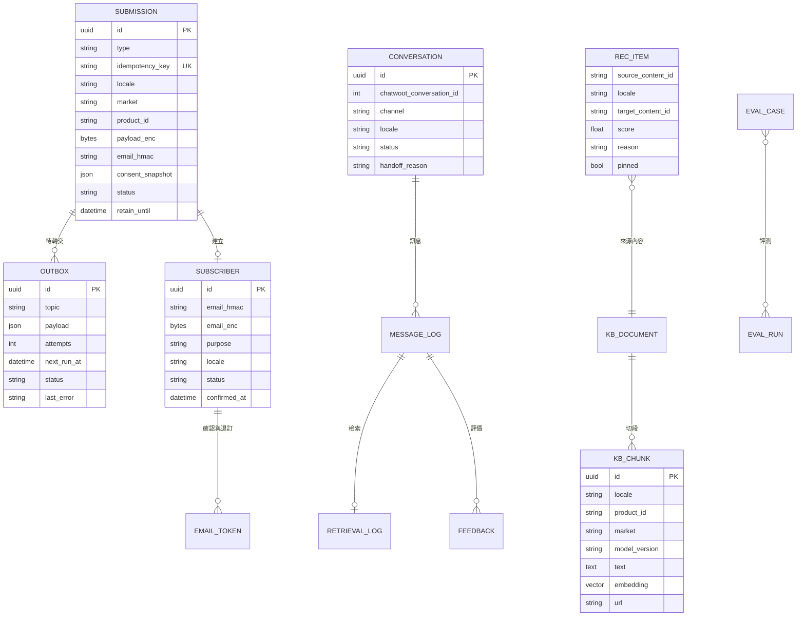
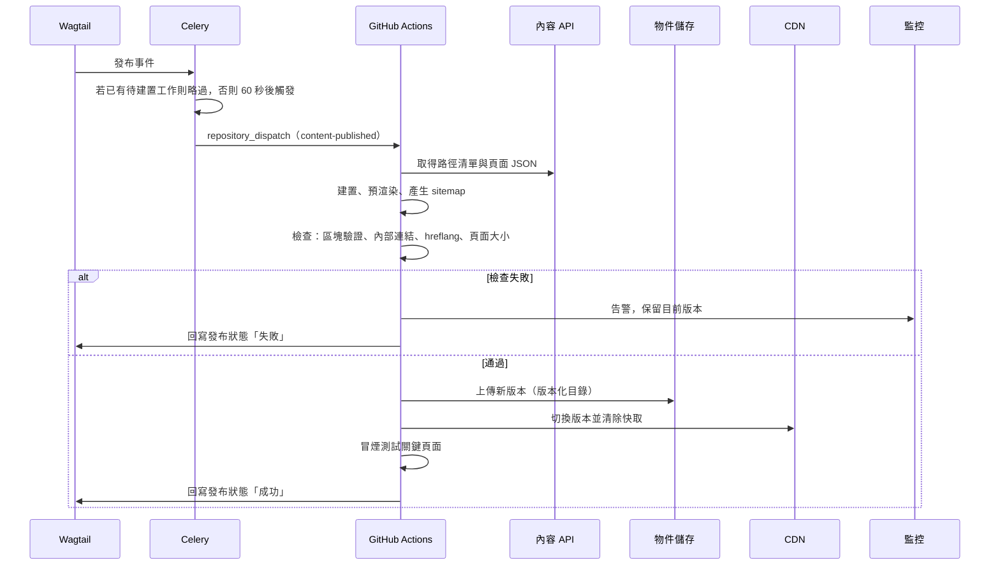
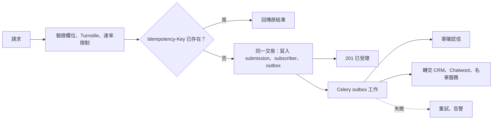
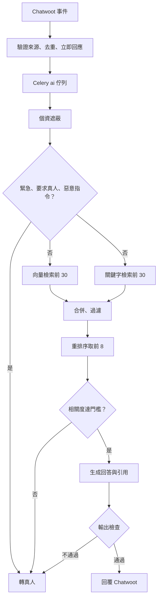
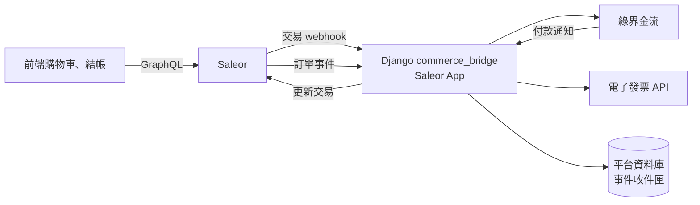
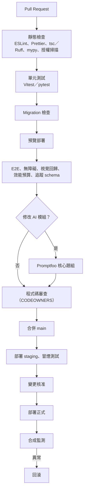
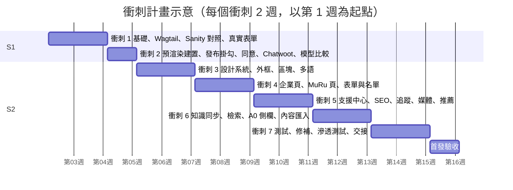

# D-Link Robotics 工程實施指南

版本：v1（2026-11-07）
對應：《數位平台建置計劃書 v6》、《網站功能規格 v1》、《開源智慧客服規劃 v1》
讀者：技術負責人、前後端工程師、AI 工程師、QA、維運
用途：工程師開工依據——程式結構、模組設計、介面、資料、流程、任務分解與工作規範

> 本文取代《系統詳細設計 v1》中與技術棧相關的部分（該文以 Next.js 撰寫）。其設計原則——寄件匣／收件匣、冪等處理、事件契約、狀態機、同意閘道——在本文中沿用。

---

## 1. 技術棧與版本

| 層 | 技術 | 版本策略 |
| --- | --- | --- |
| 前端 | React、React Router v7（framework 模式）、Vite、TypeScript、Tailwind CSS | S1 鎖定當時最新穩定版 |
| 前端多語 | react-i18next（ICU 格式） | 同上 |
| 後端 | Python、Django（LTS）、Django Ninja | Django 使用 LTS 版本 |
| 內容管理 | Wagtail（LTS）、wagtail-localize | 使用 LTS；S1 若改選 Sanity 則以 adapter 取代 |
| 資料庫 | PostgreSQL（託管）＋pgvector、pg_bigm | 確認託管服務支援兩個擴充 |
| 背景工作 | Celery、Valkey | — |
| 客服 | Chatwoot 社群版 | 鎖定版本，季度升級 |
| AI | Infinity（BGE-M3、bge-reranker-v2-m3）、Anthropic Python SDK、Langfuse、Promptfoo | — |
| 電商（S3） | Saleor | 鎖定版本 |
| 基礎設施 | 容器平台、OpenTofu、GitHub Actions | — |
| 執行環境 | Node.js LTS（僅建置與預覽）、Python 3.12 以上 | — |

---

## 2. 程式庫結構

```text
dlink-platform/
├── frontend/                       Vite＋React Router
│   ├── app/
│   │   ├── routes/                 路由（依網址結構）
│   │   │   ├── $lang._index.tsx              企業首頁
│   │   │   ├── $lang.products.$product.tsx   產品頁（依模板渲染）
│   │   │   ├── $lang.support.*.tsx
│   │   │   └── $lang.account.*.tsx           會員（S4，前端應用）
│   │   ├── shells/                 CorporateShell、ProductShell
│   │   ├── sections/               區塊元件（對應 CMS 區塊）
│   │   ├── ui/                     設計系統基礎元件
│   │   ├── themes/                 corporate、muru 主題 token
│   │   ├── i18n/                   介面文字 zh-tw／en／ja
│   │   ├── analytics/              事件 SDK、同意閘道、adapter
│   │   └── lib/content/            內容 API 用戶端與型別
│   ├── react-router.config.ts
│   └── tests/                      Vitest、Playwright
├── backend/                        Django 專案
│   ├── config/                     settings（base、dev、staging、prod）、urls、celery
│   ├── apps/
│   │   ├── cms/                    Wagtail 頁面、區塊、片段、發布掛勾
│   │   ├── content_api/            給前端建置用的內容 API
│   │   ├── forms_intake/           表單受理、寄件匣、轉交
│   │   ├── subscribers/            名單、雙重確認、退訂
│   │   ├── recommend/              推薦
│   │   ├── ai_support/             AI 客服
│   │   ├── flags/                  功能開關
│   │   ├── audit/                  稽核紀錄
│   │   ├── commerce_bridge/        Saleor App 與金流、發票（S3）
│   │   └── entitlement/            訂閱與權益（S4）
│   ├── templates/emails/           三語通知信
│   └── tests/                      pytest
├── eval/                           AI 客服評測題庫與 Promptfoo 設定
├── infra/                          OpenTofu、容器設定、監控設定
├── docs/adr/                       架構決策紀錄
└── .github/workflows/              CI／CD
```

**模組邊界**

- 前端只透過 `lib/content/` 取得內容，不直接呼叫 Wagtail 原生 API。
- 前端元件只呼叫 `analytics.track()`，不直接引用 GA4。
- Django 各 app 之間只透過 service 函式互相呼叫，不跨 app 直接操作 model。
- 外部服務（CRM、寄信、Chatwoot、模型、Saleor）一律經 `adapters/` 包裝，可在測試中替換。

---

## 3. 前端

### 3.1 渲染策略

| 環境 | 設定 | 說明 |
| --- | --- | --- |
| 正式 | `ssr: false`＋`prerender` | 建置時預渲染所有已發布公開頁；其他路由（會員、購物車）以前端應用運作 |
| 預覽 | `ssr: true` | 以伺服器端渲染讀取草稿，只對已登入編輯開放 |
| 本機 | `ssr: true` | 開發方便 |

```ts
// frontend/react-router.config.ts
import type { Config } from "@react-router/dev/config";

const isPreview = process.env.PREVIEW === "1";

export default {
  ssr: isPreview,
  prerender: isPreview
    ? false
    : async () => {
        // 由後端提供所有已發布公開頁的路徑清單（含三語）
        const res = await fetch(`${process.env.CONTENT_API_URL}/api/v1/content/routes`);
        const { paths } = (await res.json()) as { paths: string[] };
        return paths;
      },
} satisfies Config;
```

### 3.2 資料載入

- 公開頁的 `loader` 在建置時呼叫內容 API，取得已經過 schema 驗證的頁面 JSON。
- 會員、購物車等頁面使用 `clientLoader` 於瀏覽器呼叫 Django API。
- 內容 API 的回應型別由後端 Pydantic schema 匯出 OpenAPI，再產生 TypeScript 型別，前後端一致。

### 3.3 區塊渲染

CMS 區塊與前端元件一對一對應：

```ts
// frontend/app/sections/index.tsx
const registry = {
  hero: Hero,
  media_text: MediaText,
  feature_grid: FeatureGrid,
  timeline: Timeline,
  spec_table: SpecTable,
  plan_compare: PlanCompare,
  faq_list: FaqList,
  news_list: NewsList,
  download_list: DownloadList,
  trust_block: TrustBlock,
  cta_band: CtaBand,
  related: RelatedItems, // 推薦 R0
} as const;
// 未知區塊：預覽環境顯示錯誤框；正式建置直接失敗
```

### 3.4 多語

- 語言取自網址 `$lang`（`zh-tw`、`en`、`ja`），對應 `<html lang>` 為 `zh-Hant-TW`、`en`、`ja`。
- 介面文字檔：`app/i18n/{lang}/{namespace}.json`；鍵名格式 `模組.元件.用途`。
- CI 腳本比對已發布語言的鍵集合，缺鍵即失敗。
- 字體依語言載入子集；中日文標題使用 BudouX 斷行。

### 3.5 對話視窗

- Chatwoot 網站小工具在使用者點擊「線上客服」後才載入，不在首屏載入。
- 開啟時帶入語言、目前產品與頁面類型作為對話屬性。

---

## 4. 後端（Django）

### 4.1 App 職責

| App | 職責 | 階段 |
| --- | --- | --- |
| `cms` | Wagtail 頁面類型、StreamField 區塊、片段（產品、市場、宣稱、FAQ、法務、轉址）、發布掛勾 | S2 |
| `content_api` | 路徑清單、頁面 JSON、導覽、sitemap 資料、預覽 | S2 |
| `forms_intake` | 表單受理、驗證、寄件匣、轉交 | S2 |
| `subscribers` | 上市通知名單、雙重確認、退訂、停止寄送清單 | S2 |
| `recommend` | 相關內容計算與查詢 | S2 |
| `ai_support` | 知識同步、檢索、生成、檢查、工具、Chatwoot 整合 | S2（A0）／A1 |
| `flags` | 功能開關讀取與稽核 | S2 |
| `audit` | 後台操作稽核 | S2 |
| `commerce_bridge` | Saleor App（金流、發票）與訂單事件 | S3 |
| `entitlement` | 帳號連結、裝置歸屬、訂閱、權益 | S4 |

### 4.2 API 規範

- 路徑前綴 `/api/v1/`；JSON；時間一律 ISO 8601（UTC）。
- 所有寫入請求需帶 `Idempotency-Key`（前端產生 UUID）。
- 錯誤格式：

```json
{
  "error": {
    "code": "validation_error",
    "message": "欄位格式不正確",
    "fields": { "email": "invalid_format" },
    "request_id": "01J..."
  }
}
```

### 4.3 端點清單

| 方法與路徑 | 用途 | 驗證 | 階段 |
| --- | --- | --- | --- |
| `GET /api/v1/content/routes` | 已發布公開頁路徑（建置用） | 建置權杖 | S2 |
| `GET /api/v1/content/pages?path=&lang=` | 頁面 JSON | 建置權杖 | S2 |
| `GET /api/v1/content/preview?token=` | 草稿頁面 JSON | 預覽權杖＋編輯身分 | S2 |
| `GET /api/v1/content/navigation?brand=&lang=` | 導覽與頁尾 | 建置權杖 | S2 |
| `POST /api/v1/forms/{type}` | 表單受理（waitlist、b2b、distributor、media、support） | 公開＋防濫用 | S2 |
| `POST /api/v1/subscriptions/confirm` | 名單確認 | 一次性權杖 | S2 |
| `POST /api/v1/subscriptions/unsubscribe` | 退訂 | 一次性權杖 | S2 |
| `POST /api/v1/support/chatwoot/webhook` | Chatwoot 機器人事件 | 來源驗證 | A1 |
| `GET /api/v1/support/assist?conversation_id=` | A0 側欄建議 | 員工身分 | S2 |
| `POST /api/v1/support/assist/feedback` | A0 採用結果 | 員工身分 | S2 |
| `POST /api/v1/commerce/saleor/webhooks/*` | Saleor 金流與訂單事件 | Saleor 簽章 | S3 |
| `POST /api/v1/commerce/ecpay/notify` | 綠界付款通知 | 綠界檢查碼 | S3 |
| `GET /api/v1/me/*` | 會員資料、裝置、訂閱 | 會員 session | S4 |
| `GET /api/v1/entitlements/{account_id}` | App 後端查詢權益 | 服務憑證 | S4 |

### 4.4 安全設定

- 正式環境：`DEBUG=False`、HTTPS 強制、HSTS、安全 Cookie、`CSRF_TRUSTED_ORIGINS` 限定官方網域。
- 內容安全政策（CSP）以中介層設定，白名單包含 CDN、Chatwoot、GA（同意後）。
- 後台（Wagtail、Django admin）只允許企業單一登入，網址不對外公開連結，加上 IP 或身分代理限制。
- 祕密資訊由雲端 Secret Manager 注入環境變數，不進程式庫。

---

## 5. 內容模型（Wagtail）

### 5.1 頁面類型與片段

| 類型 | 種類 | 主要欄位 |
| --- | --- | --- |
| `HomePage` | 頁面 | 區塊（StreamField） |
| `ContentPage` | 頁面 | 區塊；用於關於、技術、信任中心等 |
| `ProductPage` | 頁面 | 產品參照、模板、區塊 |
| `ProductSubPage` | 頁面 | 產品參照、區塊（陪伴特色、成長軌跡等） |
| `SupportArticlePage` | 頁面 | 產品、型號、版本、內容類型、正文 |
| `NewsPage` | 頁面 | 分類、關聯產品、發布日、正文 |
| `FormPage` | 頁面 | 表單類型、說明文字 |
| `LegalPage` | 頁面 | 文件類型、適用市場、版本、生效日 |
| `Product` | 片段 | product_id（不可變）、名稱、來源、產品線、模板、生命週期、主題、後繼產品 |
| `ProductMarket` | 片段 | 產品、市場、可售狀態、通路連結、商店參照 |
| `Claim` | 片段 | 產品、型號、數值、單位、證據、限制、核准人、有效期 |
| `FAQ` | 片段 | 購前或售後、產品、問題、答案、完整文章連結 |
| `ManualPage` | 頁面 | 產品、型號、章節順序、適用韌體與 App 版本、語言、更新日期、是否有 PDF；章節網址穩定 |
| `ResourceFile` | 片段 | 類別（手冊、快速上手、規格書、素材、韌體說明、韌體）、產品、適用型號、版本、語言、檔案、大小、校驗碼、發布日、核准狀態 |
| `Redirect` | 內建 | 舊路徑、新路徑、狀態碼 |

### 5.2 多語設定

- 啟用 Wagtail 國際化：內容語言 `zh-hant`、`en`、`ja`；每種語言一棵頁面樹，以翻譯鍵關聯同一內容。
- 使用 wagtail-localize 建立翻譯任務、匯出給翻譯管理系統、追蹤原文變更。
- 片段（產品、宣稱、FAQ）同樣啟用多語；數值欄位不翻譯。

### 5.3 審核與權限

| 群組 | 權限 |
| --- | --- |
| 品牌編輯 | 企業頁、新聞：編輯、送審、核准新聞 |
| 產品行銷 | 指定產品頁、FAQ：編輯、送審 |
| 產品事實核准者 | `Claim`、方案：核准 |
| 語言編輯 | 指定語言樹：編輯、送審 |
| 法務 | 法務頁、標記敏感的內容：核准 |
| 客服編輯 | 售後文章、售後 FAQ、手冊章節：編輯、送審 |
| 檢視者 | 唯讀與預覽 |

Wagtail 工作流設定兩種：一般內容（一道核准）、敏感內容（產品事實核准者＋法務兩道核准）。

### 5.4 發布掛勾

```python
# backend/apps/cms/signals.py
from django.db import transaction
from django.dispatch import receiver
from wagtail.signals import page_published, page_unpublished

from apps.cms.tasks import on_content_changed


@receiver(page_published)
def handle_page_published(sender, instance, revision, **kwargs):
    transaction.on_commit(
        lambda: on_content_changed.delay(page_id=instance.id, action="publish")
    )


@receiver(page_unpublished)
def handle_page_unpublished(sender, instance, **kwargs):
    transaction.on_commit(
        lambda: on_content_changed.delay(page_id=instance.id, action="unpublish")
    )
```

`on_content_changed` 會：(1) 排入合併後的網站重建；(2) 更新 AI 客服知識庫；(3) 重算推薦。片段的發布（草稿狀態片段）以 Wagtail 的通用發布訊號處理，邏輯相同。

---

## 6. 資料模型



**規則**

- 個資欄位以應用層加密（雲端 KMS 管理主金鑰）；Email 以 HMAC 雜湊查詢與去重。
- `SUBMISSION` 與 `OUTBOX` 必須在同一個資料庫交易中寫入。
- 所有含個資的表都有 `retain_until`，每日清理工作依此刪除。
- 向量欄位 1024 維（BGE-M3）；建立 HNSW 索引（cosine）與 pg_bigm GIN 索引：

```python
# backend/apps/ai_support/models.py（節錄）
from django.contrib.postgres.indexes import GinIndex
from django.db import models
from pgvector.django import HnswIndex, VectorField


class KbChunk(models.Model):
    locale = models.CharField(max_length=8)
    product_id = models.CharField(max_length=32, blank=True)
    text = models.TextField()
    embedding = VectorField(dimensions=1024)

    class Meta:
        indexes = [
            HnswIndex(
                name="kb_chunk_embedding_hnsw",
                fields=["embedding"],
                m=16,
                ef_construction=64,
                opclasses=["vector_cosine_ops"],
            ),
            GinIndex(name="kb_chunk_text_bigm", fields=["text"], opclasses=["gin_bigm_ops"]),
        ]
```

---

## 7. 背景工作

### 7.1 佇列

| 佇列 | 工作 | 並行 |
| --- | --- | --- |
| `outbox` | 表單轉交、寄信、名單同步 | 中 |
| `content` | 觸發建置、知識同步、推薦重算 | 低（避免重複建置） |
| `ai` | Chatwoot 事件處理、A0 建議 | 高，依模型速率限制調整 |
| `maintenance` | 資料保留清理、對帳、評測排程 | 低 |

### 7.2 排程

| 工作 | 頻率 |
| --- | --- |
| 寄件匣補處理（逾期未完成者） | 每分鐘 |
| 知識庫與 Wagtail 已發布清單比對 | 每晚 |
| 個資保留期滿清理 | 每日 |
| AI 客服完整評測（staging） | 每晚 |
| 知識缺口彙整寄給編輯 | 每週 |
| 權益對帳（S4） | 每日 |

### 7.3 重試

指數退避：1 分、5 分、30 分、2 小時、12 小時，最多 8 次；超過進入失敗狀態並告警，維運可於後台手動重試。所有工作必須可重複執行而不產生副作用。

---

## 8. 建置與發布流程



```yaml
# .github/workflows/content-build.yml（節錄）
on:
  repository_dispatch:
    types: [content-published]
  push:
    branches: [main]
concurrency:
  group: frontend-build
  cancel-in-progress: false
jobs:
  build:
    runs-on: ubuntu-latest
    steps:
      - uses: actions/checkout@v4
      - uses: actions/setup-node@v4
        with:
          node-version: lts/*
      - run: npm ci
        working-directory: frontend
      - run: npm run build
        working-directory: frontend
        env:
          CONTENT_API_URL: ${{ secrets.CONTENT_API_URL }}
      # 後續：檢查、上傳、切換版本、清除快取、冒煙測試、回寫狀態
```

**回滾**：物件儲存保留最近 20 個版本目錄，CDN 指向切回上一版即完成回滾。

---

## 9. 表單模組

### 9.1 請求與回應

```jsonc
// POST /api/v1/forms/waitlist
// Idempotency-Key: 6f1c...
{
  "email": "user@example.com",
  "product_id": "muru",
  "locale": "ja",
  "market_interest": "JP",
  "consent": { "notice_version": "2026-11-v1", "marketing": true },
  "turnstile_token": "..."
}
```

```jsonc
// 201 Created
{ "status": "accepted", "reference": "W-7K3P9Q" }
```

### 9.2 處理流程



---

## 10. AI 客服模組

### 10.1 結構

```text
backend/apps/ai_support/
├── ingest/          切段、向量化、寫入知識庫
├── retrieval/       混合檢索、重排序、過濾
├── generation/      模型供應介面：claude.py、vllm.py
├── guards/          個資遮蔽、惡意指令偵測、輸出檢查
├── tools/           轉真人、建工單、查訂單（S3）、查保固（S4）
├── chatwoot/        webhook、API 用戶端
├── assist/          A0 側欄建議
└── tracing.py       Langfuse 紀錄
```

### 10.2 處理管線



### 10.3 檢索

```python
# backend/apps/ai_support/retrieval/search.py（節錄）
from pgvector.django import CosineDistance

from apps.ai_support.models import KbChunk


def vector_candidates(query_vec, *, locale, product_id, market, limit=30):
    return (
        KbChunk.objects.filter(locale=locale, product_id__in=[product_id, ""], market__in=[market, ""])
        .annotate(distance=CosineDistance("embedding", query_vec))
        .order_by("distance")[:limit]
    )


def keyword_candidates(terms, *, locale, product_id, market, limit=30):
    qs = KbChunk.objects.filter(locale=locale, product_id__in=[product_id, ""], market__in=[market, ""])
    for term in terms:  # 型號、專有名詞；pg_bigm 索引支援中日文部分比對
        qs = qs.filter(text__contains=term)
    return qs[:limit]
```

合併以排名倒數加權（RRF），再交給 Infinity 的重排序端點取前 8 段。

### 10.4 模型供應介面

```python
# backend/apps/ai_support/generation/base.py
from dataclasses import dataclass
from typing import Protocol


@dataclass(frozen=True)
class Passage:
    chunk_id: str
    title: str
    url: str
    text: str


@dataclass(frozen=True)
class Answer:
    text: str
    cited_chunk_ids: list[str]
    model: str
    input_tokens: int
    output_tokens: int


class GenerationProvider(Protocol):
    def answer(self, *, system: str, passages: list[Passage], history: list[dict], locale: str) -> Answer: ...
```

| 實作 | 方式 |
| --- | --- |
| `ClaudeProvider` | 使用官方 Anthropic Python SDK；檢索段落以 search result 內容區塊傳入並啟用 citations；系統指示加提示快取。實作細節依 Anthropic 官方文件，不以相容層呼叫 |
| `VllmProvider` | 呼叫自架 vLLM；要求結構化輸出（回答＋引用段落 ID），由服務端驗證 ID 與引用文字 |

模型名稱、推理強度、門檻值放在設定與功能開關，不寫死在程式中。

### 10.5 輸出檢查規則

| 規則 | 判斷方式 |
| --- | --- |
| 事實需有引用 | 回答中的數字、價格、日期、規格字串須出現在被引用段落中 |
| 禁止承諾 | 承諾詞表（保證、一定退款、免費更換等，三語） |
| 連結白名單 | 只允許官方網域 |
| 敏感主題 | 醫療、法律、緊急關鍵詞（三語）→ 固定說明＋轉真人 |
| 語言一致 | 語言偵測結果須等於對話語言 |

### 10.6 Chatwoot 整合

- 每個 Inbox 綁定 Agent Bot，webhook 指向 `/api/v1/support/chatwoot/webhook`；以網址中的長隨機權杖加上來源限制驗證（Chatwoot 版本若支援簽章則改用簽章）。
- 只處理 `message_created` 且為訪客訊息的事件；以訊息 ID 去重。
- 回覆、私訊備註、轉真人（將對話狀態改為開啟並指派團隊）透過 Chatwoot API 執行；具體端點以採用版本的 Chatwoot API 文件為準。

### 10.7 評測

- 題庫放在 `eval/cases/{locale}/*.yaml`，每題含問題、必須提到的要點、必須引用的來源、是否須轉真人。
- PR 修改 `ai_support/` 或 `eval/` 時，CI 以 Promptfoo 跑核心題組；每晚 staging 跑完整題庫，結果寫入 Langfuse。
- 未達門檻（《網站功能規格》F-AI 與計劃書第 6.12 節）不可部署至正式環境。

---

## 11. 推薦模組

| 項目 | 設計 |
| --- | --- |
| 計算時機 | 內容發布時，針對變更頁面與同產品頁面重算 |
| 候選 | 同語言已發布內容的向量相似度前 20＋編輯固定項目 |
| 過濾 | 已發布、同語言、該市場可售或可洽詢、非停產 |
| 排序 | 相似度＋編輯權重＋多樣性（同類型不超過 2 個） |
| 輸出 | 寫入 `REC_ITEM`，經內容 API 提供給建置，直接預渲染進頁面 |
| 推薦理由 | 依關聯類型產生固定文案（同產品、同主題、同支援分類） |

---

## 12. 電商整合（S3）



- Saleor 獨立部署與資料庫；`commerce_bridge` 註冊為 Saleor App，提供 manifest 與 webhook 端點。
- 金流以 Saleor Transactions API 的付款 App 機制實作（初始化、處理、退款等同步 webhook，名稱與流程依採用版本的官方文件）。
- 所有外部通知先寫入事件收件匣（來源＋事件 ID 唯一），再以冪等流程處理；處理時向來源查詢最新狀態。
- 沙盒驗證涵蓋：成功、取消、失敗、延遲確認、重複通知、退款、發票作廢與折讓。

---

## 13. 事件追蹤實作

| 項目 | 規範 |
| --- | --- |
| 追蹤計畫 | `frontend/app/analytics/schema/*.json`（JSON Schema），變更需分析負責人審核 |
| 命名 | 事件 `物件_動作`、參數小寫蛇形、≤ 40 字元 |
| 送出方式 | `track()` → 同意閘道 → GA4 adapter（gtag，Consent Mode 預設拒絕） |
| 伺服器端 | 名單確認、案件受理由 Celery 記錄；提交時已同意且有 client_id 者以 Measurement Protocol 送 GA4 |
| 測試 | Playwright 攔截事件，驗證 schema 與禁止欄位；五種同意情境驗證無未授權請求 |

首發事件：`page_view`、`product_view`、`cta_click`、`section_view`、`media_progress`、`faq_open`、`plan_view`、`language_switch`、`form_start`、`form_error`、`waitlist_submit`、`waitlist_confirmed`、`business_lead_submit`、`support_request_submit`、`file_download`、`outbound_store_click`、`recommendation_view`、`recommendation_click`、`chat_open`、`chat_handoff`、`chat_feedback`。

---

## 14. 環境與部署

| 環境 | 網址範例 | 資料 | 外部服務 |
| --- | --- | --- | --- |
| local | localhost | 假資料 | 模擬 |
| preview | `pr-123.preview.{domain}` | CMS 草稿資料庫副本（無個資） | 沙盒 |
| staging | `staging.{domain}` | 匿名化資料 | 沙盒金流、測試 Chatwoot |
| production | `www.{domain}` | 正式 | 正式 |

| 元件 | 部署 |
| --- | --- |
| 前端正式版 | 物件儲存＋CDN（版本化目錄） |
| 前端預覽 | 容器（SSR） |
| Django、Celery、Infinity、Chatwoot、Langfuse | 容器平台（台灣區域），各自可水平擴充 |
| PostgreSQL、Valkey | 雲端託管 |
| 基礎設施 | OpenTofu 模組：網路、DNS、CDN／WAF、資料庫、物件儲存、Secret、監控 |

**CDN 規則**：靜態頁長快取、部署時切換版本並清除；`/api/*` 不快取；圖片與字體依版本檔名長快取。

---

## 15. CI／CD



---

## 16. 開發規範

| 主題 | 規範 |
| --- | --- |
| 分支 | 主幹開發；功能分支壽命 ≤ 3 天；以功能開關隱藏未完成功能 |
| 提交訊息 | `類型(範圍): 說明`，例如 `feat(forms): 上市通知雙重確認` |
| PR | 引用功能編號（如 F-FORM-02）；附測試說明與截圖；至少一位審查 |
| Python | Ruff（格式與檢查）、mypy、pytest；service 層不直接回傳 model |
| TypeScript | ESLint、Prettier、strict 模式、Vitest |
| Migration | 先擴充後收斂；不可在同一次部署中刪除仍被舊版使用的欄位 |
| 日誌 | 結構化 JSON；禁止記錄 Email、姓名、電話、表單內容、權杖 |
| 功能開關 | 命名 `領域.功能`，例如 `commerce.enabled`；正式環境預設關閉 |
| 介面文字 | 不寫死字串；鍵名 `模組.元件.用途` |
| 架構決策 | 重要決策寫成 ADR，放在 `docs/adr/` |
| 相依套件 | Renovate 自動更新；高風險弱點 7 天內修補 |

---

## 17. 測試策略

| 層 | 工具 | 範圍 | 要求 |
| --- | --- | --- | --- |
| 單元 | pytest、Vitest | service、驗證、狀態機、格式化 | 核心模組覆蓋率 ≥ 80% |
| 契約 | OpenAPI 產生型別、schema 測試 | 內容 API、表單 API、事件 schema | 不相容變更即失敗 |
| 整合 | pytest＋測試資料庫 | 寄件匣、Wagtail 發布掛勾、檢索 | — |
| E2E | Playwright | 三語主要旅程、表單成功與失敗、同意五情境、對話視窗 | 每次 PR |
| 無障礙 | axe-core＋人工 | 代表頁、共用元件 | 無嚴重問題 |
| 視覺回歸 | Playwright 截圖 | 外框、區塊、三語換行 | 差異需人工核准 |
| 效能 | Lighthouse CI | 資源預算 | 超出預算即失敗 |
| AI | Promptfoo、Ragas、人工抽審 | 題庫門檻 | 未達門檻不可部署 |
| 負載 | k6 | 表單端點、AI 佇列、發表會尖峰 | 首發前一次 |
| 安全 | OWASP ZAP、第三方滲透測試 | 全站 | 首發前 |

---

## 18. 任務分解

估算單位為人日，為初步估算；S1 結束後以實際速度重估。

### E01 專案基礎（S1）

| ID | 任務 | 角色 | 人日 | 依賴 |
| --- | --- | --- | --- | --- |
| T-0101 | 建立程式庫、目錄結構、程式規範設定 | 技術負責人 | 2 | — |
| T-0102 | OpenTofu：網路、資料庫、物件儲存、Secret | 維運 | 5 | — |
| T-0103 | CI：靜態檢查、測試、預覽部署 | 技術負責人 | 3 | T-0101 |
| T-0104 | Django 骨架、設定分層、健康檢查、日誌 | 後端 | 2 | T-0101 |
| T-0105 | React Router 骨架、預渲染設定、兩套外框空殼 | 前端 | 3 | T-0101 |
| T-0106 | 監控與告警基礎 | 維運 | 3 | T-0102 |

### E02 內容平台（S1–S2）

| ID | 任務 | 角色 | 人日 | 依賴 | 功能 |
| --- | --- | --- | --- | --- | --- |
| T-0201 | Wagtail 安裝、多語、員工單一登入 | 後端 | 3 | T-0104 | F-CMS-06、12 |
| T-0202 | 頁面類型與 StreamField 區塊 | 後端 | 6 | T-0201 | F-CMS-01 |
| T-0203 | 片段：產品、市場、宣稱、FAQ、法務 | 後端 | 5 | T-0201 | F-CMS-02–05 |
| T-0204 | 審核工作流與群組權限 | 後端 | 3 | T-0201 | F-CMS-07 |
| T-0205 | 內容 API 與 Pydantic schema、OpenAPI 型別輸出 | 後端 | 5 | T-0202 | — |
| T-0206 | 草稿預覽（SSR 預覽環境） | 前後端 | 4 | T-0205 | F-CMS-08 |
| T-0207 | 發布掛勾、合併建置、狀態回寫 | 後端＋維運 | 4 | T-0205 | F-CMS-11 |
| T-0208 | 轉址管理與檢查 | 後端 | 2 | T-0201 | F-CMS-10 |
| T-0210 | 手冊頁面類型與資源檔案片段（含版本、校驗碼、核准狀態） | 後端 | 4 | T-0201 | F-SUP-04、09、11 |
| T-0209 | S1 對照組：Sanity 最小驗證 | 後端 | 4 | — | — |

### E03 前端與設計系統（S2）

| ID | 任務 | 角色 | 人日 | 依賴 | 功能 |
| --- | --- | --- | --- | --- | --- |
| T-0301 | 設計 token、主題、基礎元件 | 前端 | 6 | 設計稿 | F-PROD-10 |
| T-0302 | 企業外框、產品外框、手機導覽 | 前端 | 5 | T-0301 | F-SHELL-01–03 |
| T-0303 | 區塊元件（12 種） | 前端 | 10 | T-0301 | F-CMS-01 |
| T-0304 | 企業頁組裝 | 前端 | 4 | T-0303 | F-CORP-01–08 |
| T-0305 | MuRu 七頁組裝 | 前端 | 6 | T-0303 | F-PROD-01–07 |
| T-0306 | 單頁產品、機構方案模板 | 前端 | 3 | T-0303 | F-PROD-08–09 |
| T-0307 | 支援中心頁 | 前端 | 4 | T-0303 | F-SUP-01–06 |
| T-0309 | 線上使用手冊頁（章節導覽、站內搜尋、列印與 PDF）與資源中心頁 | 前端 | 6 | T-0210、T-0303 | F-SUP-04、09、11 |
| T-0308 | 主要按鈕規則與功能開關整合 | 前後端 | 3 | T-0203 | F-SHELL-04 |

### E04 多語（S2）

| ID | 任務 | 角色 | 人日 | 依賴 | 功能 |
| --- | --- | --- | --- | --- | --- |
| T-0401 | react-i18next、語言路由、選擇頁、切換 | 前端 | 3 | T-0105 | F-I18N-01–03 |
| T-0402 | 缺鍵檢查腳本納入 CI | 前端 | 1 | T-0401 | F-I18N-04 |
| T-0403 | 在地格式、字體子集、BudouX | 前端 | 3 | T-0401 | F-I18N-05–06 |
| T-0404 | wagtail-localize 與翻譯狀態 | 後端 | 3 | T-0201 | F-I18N-07 |

### E05 表單與名單（S2）

| ID | 任務 | 角色 | 人日 | 依賴 | 功能 |
| --- | --- | --- | --- | --- | --- |
| T-0501 | 表單 API、驗證、Turnstile、速率限制、冪等 | 後端 | 4 | T-0104 | F-FORM-06–08 |
| T-0502 | 寄件匣與 Celery 轉交、重試、告警 | 後端 | 4 | T-0501 | F-FORM-09 |
| T-0503 | 名單雙重確認與退訂 | 後端 | 4 | T-0502 | F-FORM-01–03 |
| T-0504 | CRM、Chatwoot、名單服務 adapter | 後端 | 4 | T-0502 | F-FORM-04–05 |
| T-0505 | 三語通知信模板 | 後端 | 2 | T-0503 | — |
| T-0506 | 前端表單元件與狀態 | 前端 | 3 | T-0501 | F-FORM-01、04、05 |

### E06 同意、追蹤、SEO（S2）

| ID | 任務 | 角色 | 人日 | 依賴 | 功能 |
| --- | --- | --- | --- | --- | --- |
| T-0601 | 同意管理工具整合與 Consent Mode | 前端 | 3 | T-0105 | F-TRK-01–03 |
| T-0602 | 事件 SDK、schema、GA4 adapter | 前端 | 4 | T-0601 | F-TRK-04–05 |
| T-0603 | 伺服器端轉換事件 | 後端 | 2 | T-0503 | F-TRK-06 |
| T-0604 | Metadata、hreflang、sitemap、robots | 前後端 | 4 | T-0205 | F-SEO-01–04、07 |
| T-0605 | 結構化資料 | 前端 | 3 | T-0604 | F-SEO-05 |

### E07 媒體（S2）

| ID | 任務 | 角色 | 人日 | 依賴 | 功能 |
| --- | --- | --- | --- | --- | --- |
| T-0701 | 圖片尺寸與格式、CDN | 後端＋前端 | 3 | T-0201 | F-MEDIA-01 |
| T-0702 | 影片轉 HLS、播放器、字幕 | 前端＋維運 | 4 | — | F-MEDIA-02–03 |
| T-0703 | 素材授權到期提醒 | 後端 | 2 | T-0201 | F-MEDIA-04 |

### E08 推薦 R0（S2）

| ID | 任務 | 角色 | 人日 | 依賴 | 功能 |
| --- | --- | --- | --- | --- | --- |
| T-0801 | Infinity 部署、向量化工作 | AI 工程師 | 3 | T-0102 | — |
| T-0802 | 相關內容計算、過濾、編輯控制 | AI 工程師 | 4 | T-0801、T-0203 | F-REC-01–02 |
| T-0803 | 推薦區塊與追蹤事件 | 前端 | 2 | T-0802 | F-REC-06 |

### E09 智慧客服 A0（S2）

| ID | 任務 | 角色 | 人日 | 依賴 | 功能 |
| --- | --- | --- | --- | --- | --- |
| T-0901 | Chatwoot 部署、收件匣、團隊、員工登入 | 維運＋後端 | 4 | T-0102 | F-AI-01 |
| T-0902 | 知識同步、切段、索引 | AI 工程師 | 5 | T-0801、T-0207 | F-AI-02 |
| T-0903 | 混合檢索與重排序 | AI 工程師 | 4 | T-0902 | — |
| T-0904 | 模型供應介面、ClaudeProvider、提示快取 | AI 工程師 | 4 | T-0903 | — |
| T-0905 | 個資遮蔽與輸出檢查 | AI 工程師 | 5 | T-0904 | F-AI-06–07 |
| T-0906 | A0 側欄應用與採用紀錄 | AI 工程師＋前端 | 5 | T-0905 | F-AI-03 |
| T-0907 | Langfuse 部署與追蹤 | 維運＋AI 工程師 | 2 | T-0102 | — |
| T-0908 | 評測題庫框架與 Promptfoo CI | AI 工程師＋QA | 4 | T-0904 | — |

### E10 智慧客服 A1（首發後）

| ID | 任務 | 角色 | 人日 | 依賴 | 功能 |
| --- | --- | --- | --- | --- | --- |
| T-1001 | Chatwoot 機器人 webhook 與非同步處理 | AI 工程師 | 3 | T-0905 | F-AI-04 |
| T-1002 | 轉真人、私訊備註、建立工單 | AI 工程師 | 3 | T-1001 | F-AI-05、11 |
| T-1003 | 網站對話視窗、AI 揭露、評價 | 前端 | 3 | T-1001 | F-AI-08–09 |
| T-1004 | 緊急關閉與費用上限 | 後端 | 2 | T-1001 | F-AI-10 |
| T-1005 | 三語完整評測與調校（繁中先行） | AI 工程師＋客服 | 10 | T-0908 | — |
| T-1007 | 手冊 AI 助理：手冊頁內問答，依型號與版本檢索，附章節連結，與 A1 共用檢查與評價 | AI 工程師＋前端 | 5 | T-1003、T-0309 | F-SUP-10 |
| T-1006 | 方案 B 自架模型比較（若 D-Link 要求） | AI 工程師 | 5 | T-0904 | — |

### E11 營運與品質（S2）

| ID | 任務 | 角色 | 人日 | 依賴 | 功能 |
| --- | --- | --- | --- | --- | --- |
| T-1101 | 功能開關與稽核紀錄 | 後端 | 3 | T-0104 | F-OPS-01、05 |
| T-1102 | 備份、還原演練、回滾演練 | 維運 | 3 | T-0102 | F-OPS-03–04 |
| T-1103 | 個資保留清理與權利請求流程 | 後端 | 3 | T-0503 | F-OPS-06 |
| T-1104 | E2E、無障礙、視覺回歸、效能預算 | QA＋前端 | 8 | T-0304 | NFR |
| T-1105 | 負載測試與滲透測試修補 | QA＋全員 | 6 | 全部 | NFR-07 |
| T-1106 | 操作手冊與交接訓練 | 全員 | 4 | 全部 | — |

### E12 電商（S3，決策後細化）

T-1201 Saleor 部署與商品資料；T-1202 commerce_bridge Saleor App；T-1203 綠界付款；T-1204 電子發票；T-1205 前端購物車與結帳；T-1206 訂單通知與退換貨；T-1207 電商事件；T-1208 沙盒全情境驗證；T-1209 A2 訂單查詢與 LINE。

### E13 會員與權益（S4，決策後細化）

T-1301 OIDC 登入與 session；T-1302 帳號連結；T-1303 裝置歸屬與保固登錄；T-1304 權益服務與事件收件匣；T-1305 App Store、Google Play 通知；T-1306 官網定期扣款；T-1307 每日對帳；T-1308 會員中心；T-1309 A3 會員情境工具。

### 18.1 衝刺計畫（S1–S2）



S0（2 週）在衝刺 1 之前進行，產出決策與需求台帳，不排工程衝刺。

---

## 19. 就緒與完成定義

**就緒（可開工）**

- 有功能編號與驗收條件。
- 設計稿或區塊規格已核准（前端任務）。
- 依賴任務已完成或有替代方案。
- 涉及外部系統時，已有沙盒帳號與介面文件。

**完成**

- 程式已合併，CI 全數通過。
- 驗收條件逐項有測試或人工驗證紀錄。
- 三語介面文字齊全；無障礙檢查無嚴重問題。
- 日誌、追蹤事件不含個資。
- 相關文件（ADR、操作手冊、API 文件）已更新。
- 在 staging 由 PM 或 QA 確認。

---

## 20. 操作手冊（摘要）

| 情境 | 偵測 | 處置 |
| --- | --- | --- |
| 內容發布失敗 | 建置告警、Wagtail 發布狀態「失敗」 | 查看建置紀錄；內容錯誤則通知編輯修正後重發；系統錯誤則重跑建置 |
| 網站異常 | 合成監測、錯誤率告警 | CDN 切回上一版本；排查後重新部署 |
| 表單轉交積壓 | outbox 待處理 > 100 或最舊 > 30 分鐘 | 檢查外部服務狀態；恢復後工作自動補處理；必要時手動重試 |
| AI 客服答錯或異常 | 評價下降、檢查攔截暴增、客服回報 | 以功能開關關閉該渠道或語言的 AI；分析 Langfuse 紀錄後修正並重跑評測 |
| AI 費用超標 | 每日費用告警 | 自動關閉 AI 轉真人；檢查是否異常流量 |
| 資料庫故障 | 健康檢查失敗 | 託管服務容錯切換；必要時時間點還原 |
| 個資外洩疑慮 | 安全告警或通報 | 依資安事件程序：隔離、保全證據、通報窗口、評估通知義務 |

---

## 21. 第一週工作清單

| # | 工作 | 負責 |
| --- | --- | --- |
| 1 | 建立程式庫、CI 骨架、分支保護 | 技術負責人 |
| 2 | 申請雲端帳號（台灣區域）、建立 staging 基礎設施 | 維運 |
| 3 | 取得 D-Link 企業單一登入測試設定 | 技術負責人＋D-Link IT |
| 4 | Django＋Wagtail 骨架、三語設定 | 後端 |
| 5 | React Router 骨架、預渲染一頁並量測建置時間 | 前端 |
| 6 | 匯入 MuRu 首頁真實內容（三語）作為 S1 驗證素材 | 後端＋內容 |
| 7 | 盤點 D-Link 既有客服、CRM、寄信工具與介面 | PM＋技術負責人 |
| 8 | 向客服取得近期常見問題，建立評測題庫雛形 | AI 工程師 |
| 9 | 撰寫 ADR-001 技術棧、ADR-002 渲染策略 | 技術負責人 |
