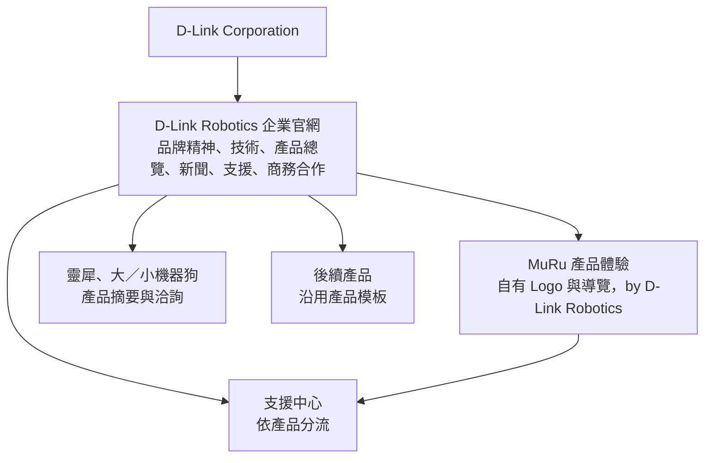
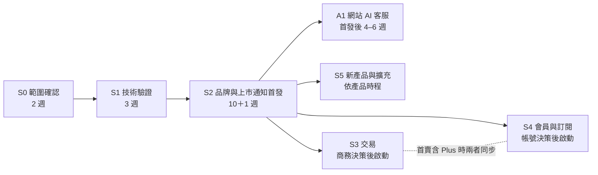
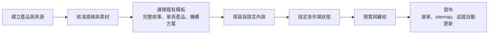
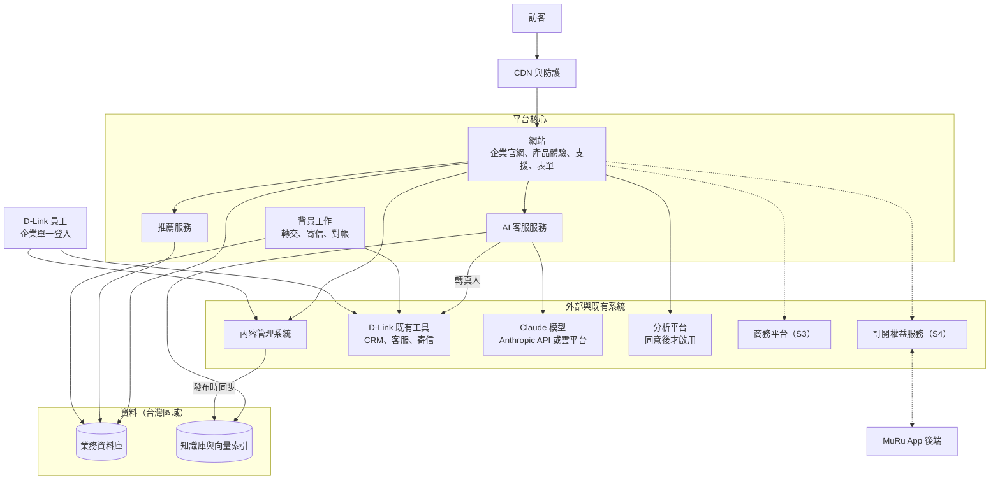
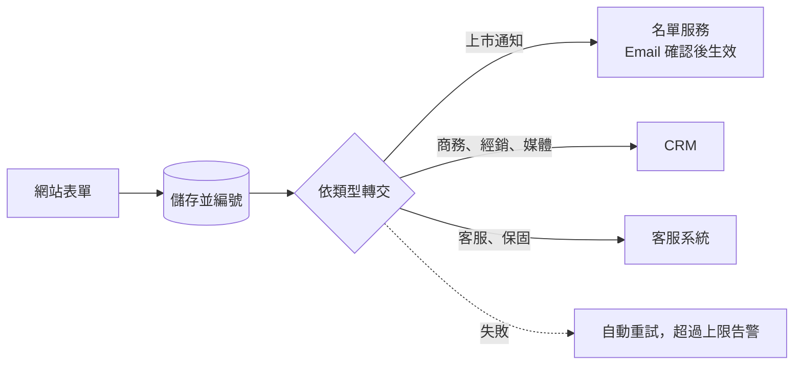
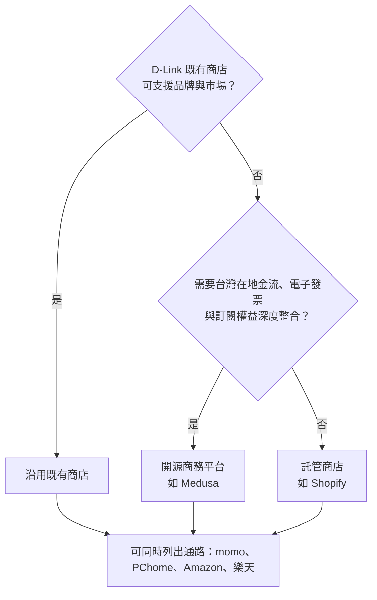
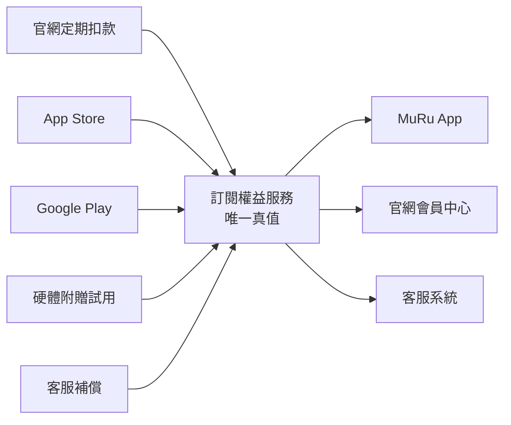
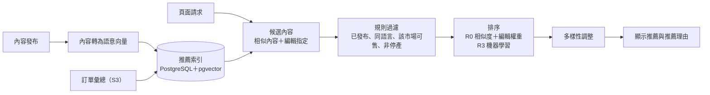
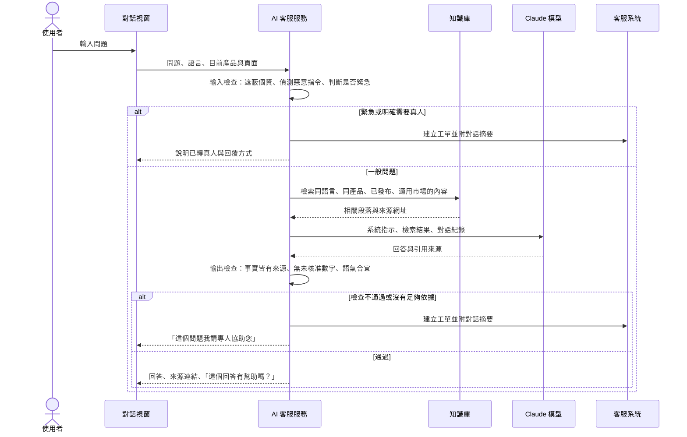
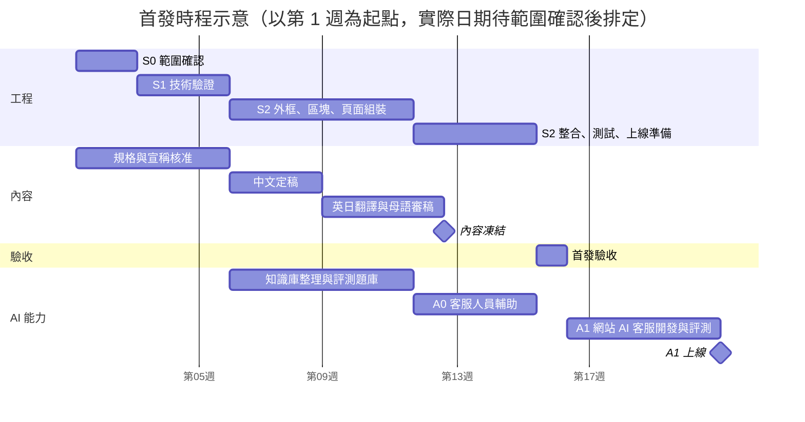

# D-Link Robotics 數位平台建置計劃書

版本：v5（2026-11-07）
本版整合：《網站整體規劃建議 v3》、《v3 評審意見》、《系統詳細設計 v1》
v5 新增：商品與內容推薦（第 6.11 節）、智慧客服（第 6.12 節），並同步更新範圍、架構、時程、費用、風險與決策清單
讀者：D-Link Robotics 決策者，以及品牌、產品、IT、法務、客服窗口

---

## 1. 計劃摘要

### 1.1 我們要建立什麼

一個能**持續上架新產品**的品牌與產品網站平台。MuRu 是第一個上架的產品；之後的靈犀、機器狗與新產品，沿用同一套內容管理、元件與發布流程上線，不必每次重做網站。

### 1.2 我們的做法

1. **先上線品牌，再開賣**：首發完成企業官網、MuRu 完整體驗、上市通知登記與售後服務入口。商店、會員、訂閱依商業決策分階段加入，不讓金流或 App 整合拖住品牌上線。
2. **一個網域，兩種體驗**：企業官網傳達信任與產品組合；MuRu 保有自己的 Logo、導覽與生活敘事，並標示「by D-Link Robotics」。
3. **採用優先於自建**：客服、CRM、寄信、分析採用 D-Link 既有工具或成熟產品；我們只自建平台的核心——內容結構、表單可靠轉交、訂閱權益。
4. **隱私與品牌一致**：MuRu 主打「察言觀色，絕不監視」，網站追蹤同樣只在使用者同意後啟用，營運數字以業務資料為準。
5. **每項能力都可驗證**：每個階段有明確的驗收清單與證據，避免把示意當完成。
6. **AI 用在有把握的地方**：智慧客服只根據 D-Link 已核准的內容回答並附上來源，該由真人處理的問題立即轉接；推薦先從不需個人資料的「相關內容」做起，有資料、有同意、證明有效後才逐步個人化。

### 1.3 首發交付

- 企業官網（繁中／英文；日文提供「關於我們」、信任中心與隱私權政策）
- MuRu 首頁與四個故事頁、FAQ、上市通知（繁中／英文／日文）
- 靈犀、大／小機器狗的產品摘要與洽詢入口（依核准內容）
- 支援中心：照護指南、FAQ、客服與保固協助
- 商務、經銷、媒體洽詢表單，自動轉交到負責窗口
- SEO、AI 搜尋可讀性、Cookie 同意、基本數據追蹤
- 相關內容推薦：每頁自動推薦相關產品、FAQ、支援文章（不使用個人資料）
- 客服知識庫整理與評測題庫；客服人員可在客服系統中使用 AI 摘要與建議回覆（內部使用）
- 監控、備份、回滾機制，以及內容編輯與客服的交接

**首發後 4–6 週**：網站 AI 客服助理公開上線（三語，回答 MuRu 購前與售後問題，可轉真人）。

### 1.4 時程與團隊

首發預估 **約 16 週**（範圍確認 2 週、技術驗證 3 週、建置與整合 10 週、驗收 1 週），內容製作與翻譯同步進行；網站 AI 客服助理於首發後 4–6 週上線。團隊為技術負責人 1 位、全端工程師 2–3 位、AI 工程師 1 位、設計 1 位、QA 1 位、專案經理 1 位。此為初步估算，範圍確認後重估。

### 1.5 需要 D-Link 優先決定的五件事

| 事項 | 我們的建議 | 最晚 |
| --- | --- | --- |
| 正式網域 | 使用 `dlinkrobotics.com`，產品放在子目錄 | 範圍確認期 |
| 首發語言 | 如 1.3 所列 | 範圍確認期 |
| 客服、CRM、寄信工具 | 沿用 D-Link 既有工具；若無，採我們建議的方案 | 技術驗證期 |
| 內容管理系統與資料存放 | 技術驗證期以真實內容比較兩個方案後擇一 | 技術驗證期結束 |
| 追蹤與 Cookie 同意政策 | 由法務在兩個選項中決定（第 6.4 節） | 追蹤設定前 |

完整決策清單見第 12 章。

---

## 2. 背景與目標

### 2.1 現況

D-Link Robotics 已完成兩份網站文件：企業官網架構（2026-09-17）與 MuRu 網站架構（2026-09-15），首頁版面與三語文案已有完整草稿。我們也製作了可點擊的示意站，呈現兩份文件的效果與建議的互動效果。

要成為正式網站，還需要補上：多產品的擴充方式、內容管理與發布流程、表單承接、數據追蹤、搜尋優化、隱私合規，以及之後的商店、會員與訂閱。

### 2.2 目標

1. 讓訪客理解 D-Link Robotics 的品牌精神、與 D-Link 的關係，以及產品的可信度。
2. 用生活情境說明 MuRu 的陪伴價值、適用對象與隱私控制。
3. 把興趣轉成可承接的上市通知名單、商務與經銷洽詢、媒體聯絡。
4. 讓已購買的客戶不必透過行銷頁就能找到照護指南、客服與保固。
5. 第二個產品使用既有模板時，**內容就緒後 2–3 週可上線**。
6. 讓訪客在看完一頁後，總能找到下一個有用的內容；產品增加後，幫訪客找到適合自己的產品。
7. 讓常見問題 24 小時、三語即時得到正確回答，客服人力集中在需要判斷與承諾的案件。

### 2.3 成效指標

| 階段 | 指標 | 資料來源 |
| --- | --- | --- |
| 首發 | 已確認的上市通知名單數 | 業務資料庫 |
| 首發 | 商務、經銷洽詢數與品質 | CRM |
| 首發 | 企業官網導流到 MuRu 的比例、各頁內容使用情況 | GA4（已同意者） |
| 首發 | 表單失敗率、內容發布耗時 | 監控系統 |
| 交易後 | 訂單、淨營收、退款率 | 商務與財務系統 |
| 訂閱後 | Plus 訂閱數、續訂率 | 權益服務 |
| 推薦 | 推薦點擊率、推薦帶來的下一步行動（看產品、加入上市通知、加購） | GA4、業務資料庫 |
| 智慧客服 | 自助解決率、轉真人率、回答正確率（抽樣審閱）、使用者滿意度、每次對話成本 | 客服系統、AI 服務紀錄 |

首發先建立基準值，再設定成長目標。

---

## 3. 整體方案

### 3.1 品牌與網站結構



**網址規則**：

```text
dlinkrobotics.com/zh-tw/                    企業官網
dlinkrobotics.com/zh-tw/products/muru/      MuRu
dlinkrobotics.com/ja/products/muru/         MuRu 日文版
dlinkrobotics.com/zh-tw/support/muru/       MuRu 支援
```

- 每個語言有獨立網址，搜尋引擎可分別收錄。
- 所有產品放在 `/products/` 之下，產品再多也不會與企業頁面衝突。
- 短網址（如 `/muru`）與既有網址一律永久轉址到正式網址。

### 3.2 分期路線



| 階段 | 交付 | 完成條件 |
| --- | --- | --- |
| S0 範圍確認 | 首發清單、語言、品牌外框、宣稱清單、網域與資料責任、工具候選 | 影響首發的決策都有負責人與核准 |
| S1 技術驗證 | 一個企業頁＋一個三語 MuRu 頁、一個真實表單完整流程、CMS 兩案比較、發布與回滾、Cookie 同意 | 技術組合定案 |
| S2 首發 | 第 1.3 節全部內容 | 首發驗收清單全數通過 |
| S3 交易 | 商店、付款、發票、物流、退款 | 各開賣市場完成交易驗收 |
| S4 會員與訂閱 | 登入、保固登錄、會員中心、Plus 訂閱與 App 開通 | 與 App 團隊共同驗收 |
| S5 擴充 | 新產品頁、產品比較、站內搜尋、資料倉儲、行為個人化推薦 | 依需求 |

S5 可以直接接在 S2 之後，不必等商店或會員。

推薦與智慧客服依附在上述階段逐級啟用：

| 階段 | 推薦 | 智慧客服 |
| --- | --- | --- |
| S2 首發 | R0 相關內容推薦 | A0 客服人員 AI 輔助（內部）、知識庫與評測題庫 |
| 首發後 4–6 週 | — | A1 網站 AI 客服助理（三語） |
| S3 交易 | R1 配件與加購推薦 | A2 訂單查詢、LINE 渠道 |
| S4 會員 | R2 依擁有裝置與方案推薦 | A3 裝置、保固、訂閱狀態查詢與工單 |
| S5 擴充 | R3 行為個人化、選購引導 | 依營運數據擴充 |

### 3.3 首發範圍

| 包含 | 不包含（後續階段） |
| --- | --- |
| 企業官網與 MuRu 完整體驗 | 購物車、結帳、付款 |
| 其他產品的核准摘要與洽詢 | 會員登入與會員中心 |
| 免費上市通知（Email 確認） | 付費預購或訂金 |
| 商務、經銷、媒體、客服表單 | 線上訂閱 Plus |
| 支援中心與人工保固協助 | 自動保固登錄 |
| SEO、AI 搜尋可讀性、Cookie 同意、基本追蹤 | 站內搜尋、資料倉儲 |
| 圖片最佳化與影片串流 | App 本身與裝置雲的功能開發 |
| 相關內容推薦（不使用個人資料） | 個人化推薦（S4 起，需同意） |
| 客服知識庫、客服人員 AI 輔助 | 網站 AI 客服公開上線（首發後 4–6 週） |

首發不顯示購物車或購買按鈕，避免承諾尚未提供的服務。

---

## 4. 網站架構與內容

### 4.1 站點地圖

```text
/{語言}/
├── 首頁
├── about/                關於我們：品牌精神、與 D-Link 的關係
├── technology/           技術原則
├── products/             產品總覽
│   ├── muru/             MuRu 首頁
│   │   ├── life-with-muru/     陪伴特色
│   │   ├── growing-together/   成長軌跡
│   │   ├── technology/         智慧設計與規格
│   │   ├── the-app/            App 與 Basic／Plus 方案
│   │   ├── faq/                常見問題
│   │   └── buy/                上市通知（開賣後改為購買）
│   └── {產品}/           其他產品
├── support/              支援中心
│   ├── {產品}/           快速上手、照護指南、FAQ、下載
│   ├── contact/          客服
│   ├── warranty/         保固協助
│   └── repair/           維修與退換貨
├── news/                 新聞
├── business/             商務、經銷、媒體洽詢
├── trust/                信任中心：網站與產品的資料處理說明
└── legal/                隱私權、條款、Cookie、無障礙
```

### 4.2 導覽

| | 企業官網 | MuRu |
| --- | --- | --- |
| 頁首 | D-Link Robotics｜品牌精神｜技術｜產品｜新聞｜支援｜語言｜探索 MuRu | MuRu by D-Link Robotics｜陪伴特色｜成長軌跡｜智慧設計｜App 與方案｜語言｜上市通知 |
| 頁尾 | 公司、產品、支援、法務、母公司連結、社群 | MuRu 品牌、產品支援、法務、回企業官網、社群 |
| 主要按鈕 | 探索 MuRu | 收到上市通知；開賣後改為購買 |

### 4.3 產品狀態與按鈕規則

網站分開記錄三種狀態，主要按鈕由三者共同決定，行銷人員在內容管理系統中切換即可，不需工程師改版：

| 狀態類型 | 選項 | 管理者 |
| --- | --- | --- |
| 內容 | 草稿、待審、已核准、排程、已發布、封存 | 編輯與審核者 |
| 產品生命週期 | 概念、預告、現行、停產 | 產品負責人 |
| 各市場可售性 | 未開放、上市通知、預購、販售、缺貨、暫停、停售 | 產品與商務 |

| 情況 | 頁面顯示 |
| --- | --- |
| 上市通知開放 | 「收到上市通知」，並說明這不是訂單 |
| 販售中 | 「購買」或「哪裡買」，依該市場可用管道 |
| 機構方案 | 「洽詢導入」，表單自動帶入產品 |
| 停產 | 保留支援內容與後繼產品資訊 |

開賣、預購、登入等能力另以「功能開關」控制，開關變更需核准並留下紀錄；內容發布不會意外啟用收款。

### 4.4 新產品如何上架



使用既有模板、內容與翻譯已核准、不需新的交易功能時，目標為 2–3 週上線。需要新互動或新功能時另行評估。

---

## 5. 系統架構



**設計原則**：

| 原則 | 說明 |
| --- | --- |
| 公開頁不受後台故障影響 | 內容管理系統暫時故障時，網站繼續顯示上一個已發布版本 |
| 表單不遺失、不重複 | 先儲存再顯示「已收到」；外部系統故障時自動重試並告警 |
| 個資留在台灣 | 表單、名單、訂單、權益存放於台灣區域；公開內容經全球 CDN 傳遞 |
| 可替換 | 內容管理、商店、分析工具都透過介面層接入，更換時頁面不必重寫 |
| 員工帳號集中管理 | 所有後台工具經 D-Link 企業單一登入，離職即停權 |
| 先單體，後拆分 | 一套網站程式＋一個背景工作程式即可支撐首發；訂閱上線時再增加權益服務 |
| AI 與網站解耦 | AI 客服故障或達到費用上限時，網站與表單照常運作，對話視窗改為顯示 FAQ 搜尋與聯絡表單 |

**技術基線**：Next.js 16 與 TypeScript；託管 PostgreSQL（台灣區域）；網站託管於 Vercel 或集團指定的雲平台。完整設計見《系統詳細設計 v1》。

---

## 6. 各模組方案

### 6.1 多語系

**我們會做**：

- 語言只由網址決定；瀏覽器語言只用來在首頁建議，不自動跳轉。
- 某頁尚未翻譯時，該語言網址顯示「此頁提供以下語言」，不顯示錯誤語言的內容。
- 介面文字（按鈕、表單、錯誤訊息）集中管理，任何已發布語言缺字時系統無法上線。
- 日期、貨幣、姓名、地址依市場格式顯示：日文姓名分姓・名、日本地址從郵便番號開始；台灣價格顯示 NT$。
- 中日文分別載入字體，只下載當前語言所需字元；標題依詞語斷行，避免單字落行。
- 原文更新後，其他語言自動標示「需重新審稿」。

**翻譯流程**：中文定稿 → 翻譯（可用機器翻譯當草稿）→ 母語審稿 → 發布。MuRu／ムル、功能名、方案名等由詞彙表統一。

**工具**：介面文字使用 next-intl（開源）；翻譯管理可用 Tolgee（開源）或 Crowdin（商用）。

### 6.2 內容管理系統

**我們會做**：建立產品、頁面區塊、規格、FAQ、新聞、下載、法務文件等內容類型；設定角色、審核流程、預覽、排程與回滾。

- 規格與功能宣稱只輸入一次，產品頁、規格表、搜尋結果使用同一份資料，數字永遠一致。
- 涉及隱私、資安、健康、認證、價格、雲端保存、訂閱的內容，需產品與法務兩道核准才能發布。
- 未核准或已過期的規格無法被已發布頁面引用。
- 每日自動備份，每月演練還原。

**選型**：技術驗證期以真實 MuRu 內容同時測試兩個方案，依評分擇一：

| | Sanity | Payload |
| --- | --- | --- |
| 模式 | 託管服務（內容存放於供應商） | 開源（MIT 授權），可自架於台灣 |
| 優點 | 編輯體驗佳、免維運 | 資料完全自主、無授權費 |
| 注意 | 費用隨使用席次增加；資料存放位置依方案 | 需自行維運；審核流程需自建 |
| 適合 | D-Link IT 接受 SaaS | 集團要求資料在台或自架 |

評分項目：三語獨立審核與發布、行銷同仁實測的編輯體驗、集團資安與資料駐留、三年總持有成本、預覽與回滾、匯出與更換成本。

### 6.3 表單與客戶名單

**我們會做**：網站負責接收、儲存、可靠轉交；員工在 D-Link 既有的客服系統與 CRM 中處理。



- 上市通知採 Email 雙重確認：使用者點擊確認信後才算有效名單，並可隨時退訂。
- 重複送出不會建立重複資料；同一 Email 重複登記時，不透露是否已登記過。
- 防機器人驗證不需使用者解題；驗證服務故障時仍可提交。
- 表單內容加密儲存，不出現在分析資料或系統日誌中。
- 若 D-Link 尚無客服或 CRM 工具，我們建議商用（Zendesk、HubSpot）或開源（Zammad、Chatwoot、Twenty）方案，並協助導入。

### 6.4 數據追蹤

**我們會做**：

- 建立統一的事件清單（約 25 個事件），涵蓋頁面瀏覽、產品興趣、按鈕點擊、影片觀看、FAQ、表單、上市通知、商務洽詢、通路點擊；交易與訂閱事件在對應階段加入。
- 所有事件自動帶上語言、產品、市場、頁面類型，每個產品都能單獨分析。
- 事件中絕不包含 Email、姓名、電話、序號或表單內容。
- 營運數字（名單數、案件數、訂單、營收、訂閱）以業務資料庫為準；GA4 用於行為分析與趨勢。
- 追蹤規格放在程式中並自動檢查，上線前驗證「未同意時不送出任何追蹤」。

**主要轉換事件**：上市通知送出、Email 確認完成、商務洽詢送出、通路點擊；開賣後加入購買。

**推薦與智慧客服事件**：推薦曝光、推薦點擊（記錄推薦位置與類型）、對話開啟、轉真人、回答評價。對話內容不進入分析平台，只記錄事件與分類。

**Cookie 同意政策（請法務決定）**：

| 選項 | 內容 | 數據影響 |
| --- | --- | --- |
| A：全球事前同意 | 所有地區都先詢問，同意後才啟用分析與廣告追蹤 | 與品牌形象最一致；分析只涵蓋同意者，數據量較少 |
| B：分區政策 | 歐洲地區事前同意；台灣、日本的分析追蹤採「告知＋可拒絕」，廣告追蹤仍需同意 | 分析數據較完整；需法務確認當地法規允許 |

兩個選項都可再加上「不使用 Cookie 的總量統計」作為補充（需法務確認）。無論哪個選項，Cookie 同意工具故障時一律維持「不追蹤」。

**工具**：GA4＋Google 同意模式；同意管理工具可選商用（OneTrust、Cookiebot）或開源（Klaro、CookieConsent）。資料倉儲在有跨產品分析需求時再啟用。

### 6.5 電商（S3）

**我們會做**：商店只負責實體商品——主機、配件、組合；數位訂閱交由第 6.6 節的權益服務。



**在地化要求**：

| 項目 | 台灣 | 日本 |
| --- | --- | --- |
| 價格顯示 | 含 5% 營業稅 | 含 10% 消費稅的總額 |
| 付款 | 信用卡、LINE Pay、Apple Pay、ATM、超商代碼 | 信用卡、超商付款、PayPay、銀行轉帳 |
| 金流服務 | 綠界、藍新、TapPay | KOMOJU、GMO Payment Gateway |
| 發票 | 電子發票（載具、統編、捐贈） | 收據；企業客戶的適格請求書 |
| 物流 | 宅配、超商取貨 | ヤマト運輸、佐川急便 |
| 必要頁面 | 運送、退換貨、7 日解除權說明 | 特定商取引法に基づく表記、返品特約 |

**安全**：使用金流的託管付款頁，網站不接觸卡號；金額一律由伺服器計算；付款結果以金流的伺服器通知為準，不以使用者返回頁面判斷。

開賣前，每個市場需完成能力清單：商家主體、出貨地、商品、價格、稅、付款、發票、退款、客服與法務文件。

### 6.6 訂閱與權益（S4）

**我們會做**：建立獨立的「訂閱權益服務」，統一回答「這位使用者可以用哪些功能、到什麼時候」。



- 不論使用者在官網、iPhone 或 Android 購買 Plus，App 都只向這個服務查詢，換商店也不影響。
- 付款通知可能重送或順序錯亂，系統一律向來源查詢最新狀態再更新，避免已退款的訂閱被誤開通。
- 每日自動對帳，連續兩日不一致即通知人工處理。
- 會員中心清楚標示「在哪裡管理這個訂閱」，避免使用者在官網取消卻無法影響 App Store 訂閱。
- 開通時效（例如 60 秒內）需與 App 團隊共同測試後才對外承諾。

### 6.7 會員與保固（S4）

- **帳號**：優先沿用 App 既有的帳號系統，一個帳號通用官網、App 與客服；網站不保存密碼。若 App 尚無合適的帳號系統，可選開源的 Keycloak 或商用服務。
- **帳號連結**：相同 Email 不自動合併，需使用者同時證明兩邊帳號的控制權。
- **裝置歸屬**：以 App 配對為主要證據；購買硬體不等於擁有任何同型裝置的控制權。
- **保固登錄**：掃描包裝 QR Code 開啟登錄頁；已配對的裝置直接選取，送禮等情況可上傳購買證明由客服審核。
- **首發期間**：保固與維修由客服人工承接，不必等會員中心完成。

### 6.8 通知與 LINE

- 交易與確認信使用寄信服務，寄件網域完成防偽設定，退信與檢舉自動停止寄送。
- 所有信件三語各一份，與網站同一套詞彙表審稿。
- **LINE 官方帳號（選配）**：台灣與日本使用者習慣以 LINE 接收通知。使用者綁定並同意後，可用 LINE 接收上市通知、出貨通知與客服回覆。訊息依官方帳號方案計費，啟用前先估算訊息量。

### 6.9 SEO 與 AI 搜尋

- 每頁自動產生標題、描述、多語對應標記、社群分享資訊與結構化資料；新增產品時自動加入 sitemap。
- 規格、方案、限制以清楚的表格與條列呈現，標示更新日期與適用版本，讓搜尋引擎與 AI 助理能正確引用。
- 一般搜尋與 AI 搜尋的爬蟲允許讀取公開頁面；是否允許內容用於 AI 模型訓練，由品牌與法務另行決定。
- 每季以固定問題詢問主要 AI 助理，記錄產品是否被正確提及。我們交付的是「可讀取、可核實、可觀測」，不保證 AI 推薦或排名。
- Google 已於 2026 年 5 月停止顯示 FAQ 摺疊搜尋結果；FAQ 仍是回答使用者問題的重要內容，但不以搜尋版面效果為目標。

### 6.10 圖片與影片

- 圖片自動轉為最新格式與多種尺寸，首屏圖片控制在 200 KB 以內。
- 影片轉為串流格式，首段在 3 MB 以內；提供封面圖與三語字幕；使用者設定減少動態效果時不自動播放。（示意站的單支影片約 29 MB，正式版需處理。）
- 素材記錄來源、授權範圍與到期日，到期前 30 天提醒，到期自動下架。
- 優先使用核准的實際產品照片與影片；概念圖不冒充正式產品或真實客戶案例。

### 6.11 商品與內容推薦

**定位**：產品數量還少時，推薦的價值在於「把訪客帶到下一個有用的內容」，而不是複雜的演算法。我們依資料量與同意狀態分級啟用，每一級證明有效後才進入下一級。

| 等級 | 推薦什麼 | 依據 | 需要個人資料嗎 | 階段 |
| --- | --- | --- | --- | --- |
| R0 相關內容 | 相關產品、情境頁、FAQ、支援文章、新聞 | 目前頁面內容的語意相似度＋編輯規則 | 不需要，只看目前頁面 | S2 首發 |
| R1 商品推薦 | 配件、組合、結帳加購 | 商品搭配規則；有訂單後加入「常一起購買」 | 不需要，使用彙總統計 | S3 |
| R2 會員推薦 | 適用配件、照護文章、方案升級 | 會員擁有的裝置與方案 | 需要，會員登入並同意個人化 | S4 |
| R3 行為個人化 | 首頁與產品頁的內容排序 | 瀏覽與互動行為的機器學習排序 | 需要，同意個人化 | S5，資料量達門檻後 |
| 選購引導 | 「為誰選購？」幾個問題，導向合適的產品與情境 | 使用者當次的回答，不保存 | 不需要 | 公開產品達 3 款以上時 |



**所有等級共同規則**：

- 只推薦已發布、與頁面同語言、在使用者所選市場可購買或可洽詢的產品；停產、未核准的內容不推薦。
- 編輯可以置頂、排除或固定推薦組合，例如 MuRu 首頁固定推薦照護指南。
- 每個推薦區塊顯示推薦理由，例如「與您正在看的陪伴特色相關」。
- 不使用裝置與 App 資料（聲紋、影像、居家活動、寵物紀錄），不推論健康、兒童等敏感特徵。
- 個人化推薦（R2、R3）需要同意：Cookie 同意新增「個人化」類別，會員中心可隨時關閉；關閉後退回 R0。
- R0 在內容發布時預先計算，不拖慢頁面，也不需要即時呼叫外部服務。

**成效驗證**：衡量推薦點擊率、推薦帶來的下一步行動與覆蓋率。R2、R3 上線一律以 A/B 測試對照非個人化版本，確認有提升才全面開啟。

**R3 的啟用條件**：每月有足夠的已同意行為資料，且 R0–R2 已有穩定基準。產品少、流量小時，機器學習推薦通常不會勝過編輯規則，因此在 S5 前依實際數據評估，不預先投入。

**工具**：

| 元件 | 建議 | 替代方案 |
| --- | --- | --- |
| 語意向量 | 商用嵌入服務（如 Voyage AI） | 開源多語模型 BGE-M3、multilingual-e5（MIT） |
| 向量儲存 | 既有 PostgreSQL 加 pgvector 擴充（開源） | Qdrant（開源，Apache-2.0） |
| 行為個人化（R3） | 依 S5 評估 | 開源 Gorse（Apache-2.0）；商用 Algolia Recommend、Amazon Personalize |
| 商品推薦（R1） | 規則＋訂單統計 | 若採 Shopify，可先用其內建商品推薦 |

### 6.12 智慧客服

**定位**：AI 客服處理大量重複的購前與售後問題，並把需要判斷、承諾或處理例外的問題快速交給真人。它只根據 D-Link 已核准的內容回答，每個回答都附上來源連結。

#### 分階段上線

| 階段 | 能力 | 時程 |
| --- | --- | --- |
| A0 客服人員輔助 | 在客服系統中為人員產生工單摘要與建議回覆（附來源），由人員確認後送出；同時整理知識庫、建立評測題庫 | S2 期間，內部使用 |
| A1 網站 AI 客服 | 網站對話視窗，三語回答 MuRu 購前與售後問題；無法回答或需要處理時轉真人 | 首發後 4–6 週 |
| A2 訂單與 LINE | 驗證身分後查詢訂單與出貨狀態；LINE 官方帳號使用同一套助理 | S3 交易上線後 |
| A3 帳號情境 | 會員登入後查詢裝置、保固、訂閱狀態，協助建立維修工單 | S4 會員上線後 |

先做 A0 的原因：客服人員會檢查每一則 AI 建議，風險最低；同時累積真實問題與正確答案，成為 A1 的評測題庫。

#### 能做與不能做

| AI 客服會做 | AI 客服不做（轉真人或婉拒） |
| --- | --- |
| 回答產品功能、規格、方案、相容性、照護與操作問題 | 承諾退款、補償、例外處理或交期 |
| 引用並連結官方 FAQ、照護指南、支援文章、政策頁 | 回答未核准的規格、價格、上市日期 |
| 協助填寫客服或商務表單、建立工單 | 判斷醫療、法律或安全緊急狀況（顯示緊急聯絡方式並轉真人） |
| 查詢訂單與出貨（A2，需先驗證身分） | 索取或接收卡號、密碼、完整證件號碼 |
| 判斷何時該轉真人，並附上對話摘要 | 存取裝置影像、聲音或居家活動資料 |

#### 運作方式



#### 知識庫

- 來源只限內容管理系統中**已發布**的 FAQ、照護指南、售後文章、規格與宣稱、方案說明與政策頁；不使用網路搜尋、草稿或內部文件。
- 內容發布或下架時自動同步；每個段落標記語言、產品、適用型號與版本、市場與更新日期，檢索時依使用者情境過濾。
- 日文問題只用日文內容回答；某語言缺少答案時轉真人，並把問題記入內容待辦，不以其他語言內容臨時翻譯回答。
- 客服人員回答過、但知識庫沒有的問題，每週彙整給內容編輯補寫，讓知識庫持續完整。

#### 品質門檻

- **評測題庫**：每種語言至少 200 題，涵蓋購前、售後、範圍外問題、應轉真人的情境，以及誘導承諾、惡意指令等攻擊題；由客服與產品共同審核。
- **A1 上線門檻（建議值）**：有來源支持的正確回答 ≥ 95%；安全、價格、隱私、健康類問題無根據陳述為 0；應轉真人的題目正確轉接 ≥ 98%；攻擊題全數攔截。
- **持續把關**：更換模型、修改指示或大量更新知識庫時重跑題庫，未達門檻不上線；上線後每週抽樣人工審閱對話，錯誤回答回饋到知識庫或指示。
- **營運指標**：自助解決率、轉真人率與原因、首次回應時間、使用者滿意度、錯誤回報數、每次對話成本。

#### 透明、隱私與合規

- 對話一開始標示「您正在與 AI 助理對話」，任何時候都可以要求真人。
- 對話紀錄遮蔽個資後保存（建議 90 天），用於品質改善；使用者可要求刪除。
- 與模型供應商確認資料處理條款：不用於模型訓練、保存期限、處理地區。
- 依各市場的 AI 相關規範與指引辦理，例如若服務歐盟使用者，需符合歐盟 AI 法對聊天機器人的揭露要求；由法務確認。
- 服務條款註明：AI 回答僅供參考，交易條件、保固與退款以正式文件及客服確認為準。

#### 模型與部署

- **建議模型**：Anthropic 的 Claude。繁中、日文、英文表現佳，原生支援「依檢索結果回答並標示引用來源」與工具呼叫（查訂單、建立工單），也支援提示快取以降低成本與延遲。
- **模型選擇**：預設以 Claude Opus 5.5 搭配較低的推理強度回答；S1 以評測題庫同時比較 Claude Sonnet 5.5 與 Claude Haiku 5.5 的品質與每次對話成本，依實測定案，不憑印象決定。
- **供應管道**：Anthropic API、Amazon Bedrock、Google Cloud Vertex AI 三選一，依 D-Link 的採購與資料處理地區要求決定。Anthropic API 目前可指定在美國或全球處理；若要求在亞洲區域處理，需於 S1 確認各雲平台的可用區域。
- **費用控制**：固定的系統指示與政策使用提示快取；設定每日費用上限與速率限制，達上限時自動改為「FAQ 搜尋＋聯絡表單」，不影響網站運作。
- **與既有客服系統的關係**：若 D-Link 的客服系統（如 Zendesk、Intercom）已有內建 AI 客服，S1 用同一份評測題庫與自建方案比較，選擇正確率、可控性與成本較佳者。

#### 工具與方案

| 元件 | 建議 | 開源替代 | 商用替代 |
| --- | --- | --- | --- |
| 對話視窗與轉真人 | 客服系統的對話視窗＋自建 AI 客服服務 | Chatwoot（核心 MIT） | Zendesk、Intercom |
| 檢索 | PostgreSQL＋pgvector，關鍵字與語意混合檢索 | Qdrant（Apache-2.0） | — |
| 語意向量 | 與推薦共用 | BGE-M3、multilingual-e5（MIT） | Voyage AI |
| 對話流程 | 直接使用 Anthropic SDK 的輕量流程 | LangGraph、LlamaIndex（MIT）、Haystack（Apache-2.0） | — |
| 評測與監測 | 評測題庫＋對話追蹤 | Promptfoo（MIT）、Ragas（Apache-2.0）、Langfuse（核心 MIT） | — |
| 整套 SaaS（替代自建） | — | — | Zendesk AI agents、Intercom Fin |

若集團要求模型完全在 D-Link 環境內運行，可評估開源權重模型自架，但多語品質、GPU 成本與維運責任需另行評估。

---

## 7. 品質、資安與維運

### 7.1 服務水準建議值

以下為我們建議的起始值，與 D-Link IT 討論後定案：

| 項目 | 建議目標 |
| --- | --- |
| 公開頁可用性 | 每月 99.9% |
| 表單受理 | 每月 99.9%；95% 的提交在 1.5 秒內回應 |
| 表單轉交 | 99% 在 5 分鐘內送達 CRM 或客服系統 |
| 內容發布生效 | 95% 在 5 分鐘內 |
| 公開站故障復原 | 1 小時內回到上一個正常版本 |
| 資料庫復原 | 4 小時內復原，資料損失不超過 15 分鐘 |
| 發表會尖峰 | 依預估流量做負載測試後確認 |
| AI 客服（A1 起） | 每月 99.5%；首字回應 95% 在 3 秒內；故障時自動改為 FAQ 搜尋＋聯絡表單 |
| 知識庫同步 | 內容發布後 95% 在 15 分鐘內可被 AI 客服引用 |

### 7.2 效能與無障礙

- 真實使用者的載入速度、互動回應、版面穩定度達到 Google 建議的「良好」標準。
- 以 WCAG 2.2 AA 為目標：鍵盤操作、螢幕閱讀器、放大縮放、字幕、表單錯誤提示均經人工檢查與自動掃描。
- 企業頁 JavaScript 控制在 150 KB 以內，產品故事頁 250 KB 以內；同意前不載入第三方追蹤腳本。

### 7.3 資安

- 以 OWASP 應用安全驗證標準第 2 級為目標。
- 防機器人、速率限制、安全標頭；所有外部通知驗證簽章並防止重放。
- 金鑰集中於雲端金鑰管理服務；套件自動更新與弱點掃描。
- 首發、交易上線、訂閱上線前，各進行一次第三方滲透測試。
- 員工後台全部經企業單一登入並強制多因素驗證；每季權限複核。
- AI 客服：防範惡意指令（使用者輸入與知識內容都視為資料，不視為指令）；AI 只能呼叫唯讀查詢與建立工單，不能修改訂單、退款或發放權益；查詢個人訂單前必須先驗證身分；AI 相關功能納入滲透測試範圍。

### 7.4 個資與保留

| 資料 | 建議保留期限（由法務核定） |
| --- | --- |
| 未確認的上市通知登記 | 30 天 |
| 有效名單 | 至退訂為止 |
| 商務、媒體洽詢 | 最後往來後 24 個月 |
| 客服、保固案件 | 結案後 3 年 |
| 訂單與發票 | 依稅務與會計法規 |
| 系統日誌 | 90 天（個資已遮罩） |
| AI 客服對話紀錄 | 90 天（個資已遮罩）；轉真人的對話隨客服案件保存 |
| 個人化推薦資料（S4 起） | 至使用者關閉個人化或刪除帳號 |

當事人提出查詢或刪除請求時，有固定的受理入口、身分驗證與跨系統處理流程，並留下處理紀錄。

### 7.5 維運

- 監控公開頁、表單、轉交積壓、內容發布、付款通知與訂閱對帳，異常時通知值班窗口。
- 程式與內容可分別回滾；每次部署 5 分鐘內可回到上一版。
- 每個改動都有預覽網址，D-Link 可在上線前檢視。
- 發表會前 48 小時凍結變更，只允許緊急修正。

### 7.6 首發驗收

| 項目 | 驗收內容 |
| --- | --- |
| 需求與內容 | 每項需求都有對應頁面、負責人、核准版本，或明確的延期紀錄 |
| 品牌與導覽 | 兩種外框、手機導覽、主要按鈕正確，沒有無效入口 |
| 多語 | 直接開啟任何網址都是正確語言；切換語言保留內容；通知信三語正確 |
| 表單 | 成功、錯誤、逾時、重送、轉交失敗都可重現並正確處理 |
| 同意 | 首訪、拒絕、部分同意、撤回、同意工具故障五種情境，未同意的追蹤都沒有送出 |
| 搜尋 | 頁面原始內容可讀取；多語標記、sitemap、狀態碼一致 |
| 無障礙與效能 | 人工與自動檢查紀錄；上線後的真實效能量測計畫 |
| 預覽與個資 | 草稿不外洩；正式與測試資料隔離 |
| 發布與復原 | 發布、失敗處理、回滾、備份還原演練紀錄 |
| 營運交接 | 網域、服務帳號、費用、監控、窗口與操作手冊 |
| 相關內容推薦 | 只推薦已發布、同語言、該市場可售的內容；未同意個人化時不使用個人資料 |
| AI 客服（A1） | 三語評測題庫達第 6.12 節門檻；轉真人、費用上限、故障降級、個資遮蔽、惡意指令攔截皆可重現 |

驗收結果統一記為「通過」「失敗」「依賴未就緒」「不適用」，並附測試環境、版本、日期與證據。

---

## 8. 時程與團隊

### 8.1 時程



內容製作與工程並行。實務上規格核准與日文審稿通常是最慢的環節，我們會在週報中分開追蹤兩條進度，並在 S0 訂定內容凍結日。

### 8.2 團隊

| 角色 | 人數 | 投入 |
| --- | --- | --- |
| 技術負責人 | 1 | 全程 |
| 全端工程師 | 2–3 | 全程 |
| AI 工程師 | 1 | S1 起，負責推薦、知識庫、AI 客服與評測 |
| 設計師 | 1 | S0–S2 前段集中 |
| QA | 1 | S1 起，末段加重 |
| 專案經理 | 1 | 全程 |
| 維運、資料分析、資安審查 | 兼任 | 依階段 |

**D-Link 需要提供**：品牌、產品、法務、客服、IT 各一位窗口；中英日編輯依約定期限審稿；產品照片、影片與規格證據；客服團隊協助整理常見問題、審核評測題庫，並在 A0、A1 期間每週審閱 AI 回答。

### 8.3 估算前提

- 首發約 16 週是初步估算，不是報價承諾。S0 確認頁面清單、素材、語言責任與工具後重估。
- 不含：產品重新拍攝、企業官網完整日文（第 1.3 節所列三頁除外）、商店、會員、App 開發。
- S3、S4 在商務方案與 App 帳號決策後另行估算。
- A1 的 4–6 週以知識庫已整理完成、評測題庫已審核為前提；R3 行為個人化不在首年估算內。
- 若只有一位工程師、素材需重新製作、三語反覆改稿或需更換集團平台，時程需調整。

---

## 9. 費用結構

正式報價在 S0 後提供。以下為費用組成，供預算規劃：

| 類別 | 內容 |
| --- | --- |
| 一次性建置 | 需求與資訊架構、兩套品牌外框、設計系統、內容管理設定、頁面與三語整合、表單與轉交、Cookie 同意、SEO、媒體處理、測試、滲透測試、交接 |
| 內容製作 | 產品攝影、影片、文案、翻譯與母語審稿、授權、法務文件 |
| 每月營運 | 網站託管、內容管理系統、資料庫、CDN 與影片串流、寄信、Cookie 同意工具、監控、備份、維護與支援 |
| 交易（S3） | 商店方案、金流手續費、電子發票、物流整合、客服流程 |
| 會員與訂閱（S4） | 帳號系統、權益服務、App 整合、對帳 |
| 推薦（一次性與每月） | R0 建置；語意向量服務用量；R1–R3 依階段另估 |
| 智慧客服（一次性） | 知識庫整理、評測題庫、AI 客服服務、對話視窗與轉真人整合、A0 輔助功能 |
| 智慧客服（每月） | 模型用量（依對話量計；例如 Claude Opus 5.5 每百萬輸入 token 4 美元、輸出 20 美元，雲平台另有定價，以官方價格為準）、向量檢索、對話監測工具、客服系統 AI 附加功能（若採用）、每週人工審閱工時 |
| 後續擴充 | 新產品、新語言、新市場、站內搜尋、資料倉儲 |

**商用與開源的取捨**：商用服務按月付費、免維運；開源方案無授權費，但需要維運人力與主機費用。我們會在 S1 以相同能力清單比較三年總持有成本，供 D-Link 選擇。

---

## 10. 主要選項一覽

| 領域 | 建議方案 | 替代方案 | 備註 |
| --- | --- | --- | --- |
| 網站 | Next.js（開源，MIT） | — | 可沿用示意站元件 |
| 內容管理 | Sanity（商用） | Payload（開源，MIT） | S1 比較後擇一 |
| 多語 | next-intl（開源，MIT） | — | 翻譯管理可選 Tolgee 或 Crowdin |
| 客服、CRM、寄信 | D-Link 既有工具 | Zendesk、HubSpot；開源 Zammad、Chatwoot、Twenty、Listmonk | |
| 分析 | GA4 | 開源 Matomo、Umami、Plausible | |
| Cookie 同意 | OneTrust 或 Cookiebot | 開源 Klaro、CookieConsent | |
| 商店（S3） | 依第 6.5 節決策 | Shopify；開源 Medusa、Saleor | |
| 訂閱權益（S4） | 自建輕量服務 | RevenueCat（App 收據）、開源 Kill Bill | |
| 帳號（S4） | App 既有帳號系統 | 開源 Keycloak；商用 Auth0 | |
| 監控 | 託管服務或集團既有平台 | 開源 Grafana 系列 | |
| 推薦 | 規則＋語意相似度，PostgreSQL＋pgvector | 開源 Gorse；商用 Algolia Recommend、Amazon Personalize | R3 於 S5 評估 |
| AI 客服模型 | Claude（Anthropic API、Bedrock 或 Vertex AI） | 開源權重模型自架 | S1 以評測題庫定案 |
| AI 客服整套 | 自建 AI 客服服務＋既有客服系統 | 商用 Zendesk AI agents、Intercom Fin | 同一題庫比較 |

**開源授權提醒**：部分開源方案採用 AGPL 授權，或已改為限制商業使用的授權（如 Directus 對大型組織需購買授權）。採用前依 D-Link 開源政策審查。完整清單與授權見《系統詳細設計 v1》第 17 章。

---

## 11. 風險與對策

| 風險 | 影響 | 對策 |
| --- | --- | --- |
| 規格與功能宣稱遲遲無法核准 | 首發延後 | S0 列出宣稱清單與負責人；無證據的數字先不公開，保留故事內容 |
| 翻譯與母語審稿延誤 | 日文版延後 | 內容軌道獨立排程；設定內容凍結日 |
| 集團資安或資料駐留要求 | 工具需更換 | S1 同時測試 SaaS 與開源方案 |
| 既有客服或 CRM 不支援自動接收 | 表單需人工處理 | S1 以真實表單驗證；必要時導入建議工具 |
| 台灣金流與商店、訂閱相容性 | 交易延後 | 訂閱與商店解耦；S3 前完成市場能力清單 |
| App 帳號與權益介面未就緒 | 訂閱延後 | 首發不依賴 App；S4 與 App 團隊共同定義介面與驗收 |
| 同意率低導致分析數據不足 | 行銷判斷受限 | 營運數字以業務資料為準；法務評估分區政策 |
| 發表會流量尖峰 | 網站變慢或中斷 | CDN 快取、負載測試、發表會前凍結變更 |
| AI 客服答錯或捏造 | 誤導消費者、品牌與法律風險 | 只用已核准內容並附來源、輸出檢查、評測門檻、沒把握即轉真人、每週人工審閱 |
| 惡意指令誘導 AI 越權 | 洩漏資料或做出承諾 | AI 只有唯讀與建立工單權限、身分驗證、攻擊題測試 |
| AI 用量費用失控 | 預算超支 | 提示快取、每日費用上限、速率限制、達上限自動降級 |
| 知識庫不完整，尤其日文 | 轉真人率高 | A0 期間累積真實問題；客服回答過的問題每週補進知識庫 |
| 個人化推薦讓使用者不安 | 品牌信任受損 | 需同意、顯示推薦理由、可隨時關閉、不使用裝置與敏感資料 |

---

## 12. 需要 D-Link 決定的事項

| # | 事項 | 我們的建議 | 負責 | 最晚 |
| --- | --- | --- | --- | --- |
| 1 | 正式網域、DNS、既有網址 | `dlinkrobotics.com`；盤點既有網址並建立轉址 | IT＋品牌 | S0 |
| 2 | 首發語言 | MuRu 三語；企業中英，日文提供關於我們、信任中心、隱私權政策 | 專案經理＋編輯 | S0 |
| 3 | 品牌背書、Logo、產品來源標示 | MuRu by D-Link Robotics；靈犀、機器狗的來源依實際標示 | 品牌＋產品 | 設計定稿前 |
| 4 | 上市通知形式 | 免費上市通知，不收訂金 | 產品＋商務 | 表單設計前 |
| 5 | 客服、CRM、寄信工具與承接窗口 | 沿用既有；指定各表單的負責窗口 | 營運＋IT | S1 |
| 6 | 個資保留期限 | 依第 7.4 節建議值 | 法務 | 開放表單前 |
| 7 | 內容管理系統、託管、資料存放 | S1 比較後擇一 | IT＋採購 | S1 結束 |
| 8 | Cookie 同意政策、AI 訓練爬蟲 | 第 6.4 節選項 A 或 B；訓練用途另行決定 | 法務＋品牌 | 追蹤設定前 |
| 9 | 其他產品首發呈現 | 核准摘要＋洽詢入口 | 產品＋品牌 | 內容凍結前 |
| 10 | 規格、成長積分、雲端保存、認證 | 只發布有證據的內容 | 產品＋法務 | 內容公開前 |
| 11 | 服務水準與維運 | 第 7.1 節建議值 | 專案經理＋IT | 正式排程前 |
| 12 | LINE 官方帳號 | 列為選配 | 行銷 | S2 期間 |
| 13 | 商務方案與開賣市場 | 依第 6.5 節決策 | 商務＋財務 | S3 前 |
| 14 | 帳號系統與裝置歸屬 | 沿用 App 帳號系統 | App 團隊＋IT | S4 前 |
| 15 | Plus 訂閱的付款管道與綁定對象 | 官網與 App 可並存，由權益服務統一管理 | App 團隊＋商務 | S4 前 |
| 16 | AI 客服的範圍、渠道與上線時間 | 依第 6.12 節分 A0–A3；A1 先上網站，LINE 隨 A2 | 客服＋產品 | S1 |
| 17 | AI 模型供應管道與資料處理地區 | S1 比較 Anthropic API、Bedrock、Vertex AI 的條款與區域 | IT＋法務＋採購 | S1 結束 |
| 18 | AI 客服評測門檻與上線核准人 | 第 6.12 節建議值；客服主管核准上線 | 客服＋產品＋法務 | A1 上線前 |
| 19 | 個人化推薦的同意方式 | Cookie 同意新增「個人化」類別，會員可隨時關閉 | 法務＋行銷 | S4 前 |
| 20 | AI 對話紀錄保留與用途 | 遮蔽個資、保存 90 天、僅用於品質改善 | 法務 | A0 啟用前 |

---

## 13. 下一步

| 時間 | 工作 |
| --- | --- |
| 第 1 週 | 啟動會議；確認第 12 章 #1、#2；建立需求與發布台帳 |
| 第 1–2 週 | 盤點 D-Link 既有工具（客服、CRM、寄信、商店、帳號）；列出宣稱清單與負責人；確認素材 |
| 第 1–2 週 | 客服提供近期常見問題與既有回覆範本，作為知識庫與評測題庫的起點 |
| 第 2 週末 | S0 結案：首發清單、語言、工具候選、正式報價與排程 |
| 第 3 週起 | S1 技術驗證：內容管理系統兩案比較、真實表單完整流程、發布與回滾演練；以小型題庫比較 AI 模型與供應管道 |

---

## 附錄 A：文件對照

| 文件 | 用途 |
| --- | --- |
| 本計劃書 v5 | 給決策者：方案、範圍、時程、決策；含推薦與智慧客服 |
| 網站整體規劃建議 v3 | 規劃基準：詳細範圍、內容治理、驗收細節 |
| 網站規劃 v3 評審意見 | 本版對 v3 的修訂依據 |
| 系統詳細設計 v1 | 給工程與 IT：架構、資料、介面、時序、選型與授權 |

## 附錄 B：原始需求對應

| D-Link 原始內容 | 本計劃落點 |
| --- | --- |
| 企業品牌精神、自然光居家與溫暖陪伴 | 第 3.1、4.2 節；設計延續原視覺方向 |
| 企業導覽：品牌精神、技術、產品、新聞、支援 | 第 4.1、4.2 節 |
| D-Link 背書與技術 DNA | 第 3.1 節；規格與宣稱依第 6.2 節核准 |
| MuRu、靈犀、大／小機器狗與教育、長照情境 | 第 1.3、4.4 節 |
| MuRu 自有 Logo、導覽與回企業官網 | 第 4.2 節 |
| MuRu 三語內容 | 第 6.1 節 |
| 成長軌跡、五項陪伴特色、智慧設計 | 第 4.1 節；數字依核准發布 |
| App、Basic／Plus 方案 | 第 4.1 節說明；訂閱見第 6.6 節 |
| FAQ、照護指南、保固、商務與媒體聯絡 | 第 4.1、6.3、6.7 節 |
| 母公司連結、LINE／X／YouTube、法務與無障礙 | 第 4.2、6.8、7.2 節 |

企業日文、內容管理、數據追蹤、會員、商店與訂閱整合，以及商品與內容推薦、智慧客服，為本計劃提出的新增能力，依階段與決策清單確認。推薦與智慧客服的技術細節將補入《系統詳細設計》下一版。
