# D-Link Robotics 數位平台系統詳細設計

版本：v1 草案（2026-11-07）
對應規劃：《D-Link Robotics 網站整體規劃建議 v3》（以下稱「規劃書」），評審意見見《網站規劃 v3 評審意見》
讀者：技術負責人、前後端工程師、QA、資料分析、客戶 IT 與資安窗口
狀態：設計基準草案；標示「S1 驗證」的項目須在垂直驗證階段實測後定案

---

## 0. 文件說明

### 0.1 與規劃書的分工

規劃書定義**做什麼、分幾期、誰核准**；本文定義**怎麼做**：架構、模組、資料、介面、時序、非功能指標與選型。兩者衝突時以規劃書的範圍與決策為準；本文對規劃書的修訂建議以 **CP-xx** 標示，彙整於第 16 章。

### 0.2 階段標記

沿用規劃書：**S1** 垂直驗證、**S2** 品牌與候補首發、**S3** 交易、**S4** 會員與訂閱、**S5** 新產品與營運擴充。每個模組標示啟用階段，未啟用的模組只保留介面，不提前實作。

### 0.3 設計假設

| 編號 | 假設 | 若不成立 |
| --- | --- | --- |
| A01 | D-Link 員工使用企業身分系統（如 Microsoft Entra ID），可提供 SAML／OIDC 單一登入 | 員工系統改用各工具內建帳號＋強制 MFA |
| A02 | 首發目標市場為台灣、日本；英文頁面服務其他地區訪客，不代表開賣 | 調整市場矩陣與合規範圍 |
| A03 | App 團隊已有或將有可對外的帳號系統（OIDC 相容）與後端 API | S4 需另建消費者身分服務（§12.1） |
| A04 | 首發流量以品牌活動與新聞為主：平時每日數千造訪，發表會當天尖峰可達平時 50 倍 | 調整容量測試目標（§15.5） |
| A05 | 個資類資料（表單、名單、訂單、權益）需存放於台灣或日本區域 | 依 D08 調整資料庫區域 |

---

## 1. 架構驅動因素與決策

### 1.1 品質屬性

| 品質屬性 | 情境 | 目標 |
| --- | --- | --- |
| 可擴充性 | 新增一個使用既有模板的產品 | 不改程式即可上線；工程投入 ≤ 3 人日 |
| 可用性 | CMS 或外部服務故障 | 公開頁持續提供上一個已發布版本；表單持續受理 |
| 效能 | 行動網路瀏覽 MuRu 首頁 | 真實使用者 p75：LCP ≤ 2.5 秒、INP ≤ 200 毫秒、CLS ≤ 0.1 |
| 安全與隱私 | 任一第三方腳本或日誌 | 不含 Email、姓名、序號等個資；未同意前不載入非必要腳本 |
| 可靠性 | 付款或訂閱通知重送、亂序 | 不重複入帳、不錯誤開通或撤銷權益 |
| 在地化 | 新增一種語言 | 不改程式；只新增語言設定、翻譯與審稿 |
| 可替換性 | 更換 CMS、商店、分析工具 | 只改對應 adapter，頁面元件不受影響 |
| 可維運性 | 發布、回滾、故障排除 | 任何部署 5 分鐘內可回滾；所有外部呼叫可追蹤 |

### 1.2 架構決策摘要

| 編號 | 決策 | 主要理由 | 放棄的方案 |
| --- | --- | --- | --- |
| ADR-01 | 模組化單體：一個 Next.js 網站應用＋一個背景工作程式；S4 再加權益 API | 團隊規模小、領域少；以模組邊界與 adapter 保留拆分能力 | 一開始就微服務 |
| ADR-02 | 公開頁快取優先，CMS 發布後以快取標籤失效 | CMS 故障不影響線上；效能穩定 | 每次請求即時讀 CMS |
| ADR-03 | 內容採文件級多語（每語言一份文件＋穩定 content ID） | 各語言可獨立審核、發布、排程 | 欄位級多語（全語言同步發布） |
| ADR-04 | 實體商品走商務平台；數位訂閱與權益走獨立的帳務與權益服務 | 商店可替換；App 只對接一處；可彙整 App Store、Google Play | 訂閱放在商店平台 |
| ADR-05 | 所有外部整合經「收件匣／寄件匣」（inbox／outbox）＋冪等處理 | 外部服務失敗或重送時不遺失、不重複 | 同步直接呼叫外部 API |
| ADR-06 | 量測採事件契約＋同意閘道＋供應商 adapter；營運真值來自業務資料庫 | 與供應商解耦；同意率不影響營運數字 | 元件直接呼叫 GA4 |
| ADR-07 | 消費者身分外部化（OIDC），網站不保存密碼 | 降低資安責任；與 App 共用帳號 | 網站自建會員帳密 |
| ADR-08 | 商務、預購、登入、各市場開賣以具名功能開關控制 | 上線與開賣解耦；可按市場啟用；有稽核 | 改程式或改 CMS 欄位直接生效 |
| ADR-09 | 員工系統採企業單一登入＋自動開通／停權 | 離職即停權；集中稽核 | 各系統獨立帳號 |
| ADR-10 | 採用優先於自建：CRM、客服、寄信、分析採既有或成熟產品；只自建差異化核心 | 降低維護與資安責任 | 自建員工後台 |
| ADR-11 | 個資資料庫置於台灣區域（GCP asia-east1 或 AWS ap-east-2），公開內容經全球 CDN | 資料駐留與延遲兼顧 | 全部放美國區域 |
| ADR-12 | 基礎設施以程式碼管理（OpenTofu），環境一致 | 可重建、可審查、防設定漂移 | 手動設定 |

---

## 2. 系統全景

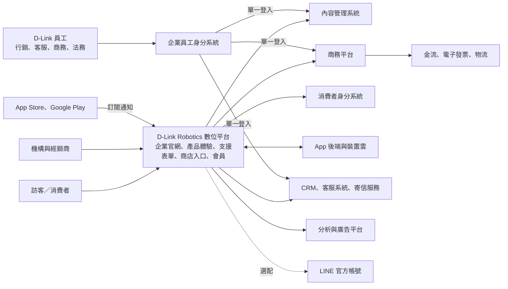

---

## 3. 邏輯架構

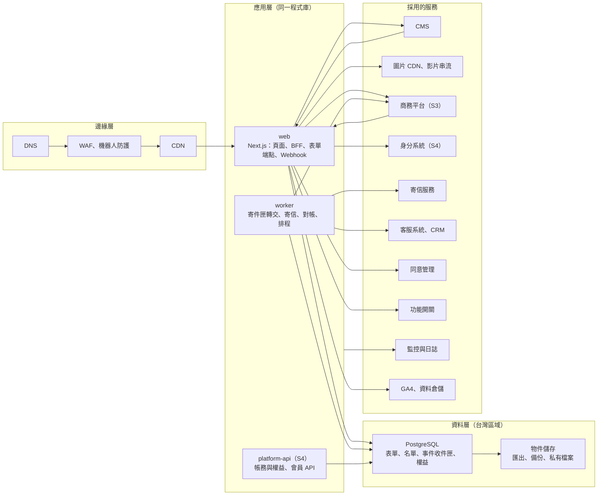

| 容器 | 技術 | 職責 | 階段 |
| --- | --- | --- | --- |
| web | Next.js 16（App Router、Cache Components）、TypeScript | 公開頁渲染、預覽、表單受理、CMS／商務 Webhook 接收、會員 BFF | S1 |
| worker | Node.js、pg-boss | 寄件匣轉交、寄確認信、重試、對帳、資料保留清理 | S1 |
| platform-api | Node.js（同程式庫） | 帳務與權益、帳號連結、供 App 後端查詢 | S4 |
| PostgreSQL | 託管服務（Cloud SQL、RDS 等） | 交易型資料；不存公開內容 | S1 |
| 物件儲存 | GCS、S3 等 | 備份、CMS 匯出、私有附件 | S1 |

公開內容不進 PostgreSQL；個資不進 CMS。

---

## 4. 部署架構

### 4.1 參考方案 A：託管優先

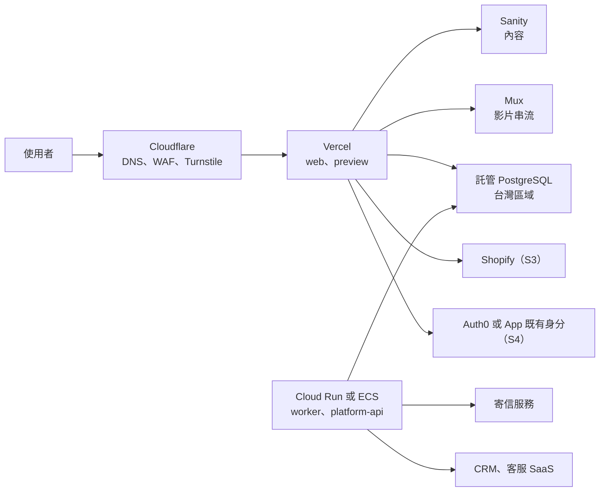

### 4.2 參考方案 B：開源自建

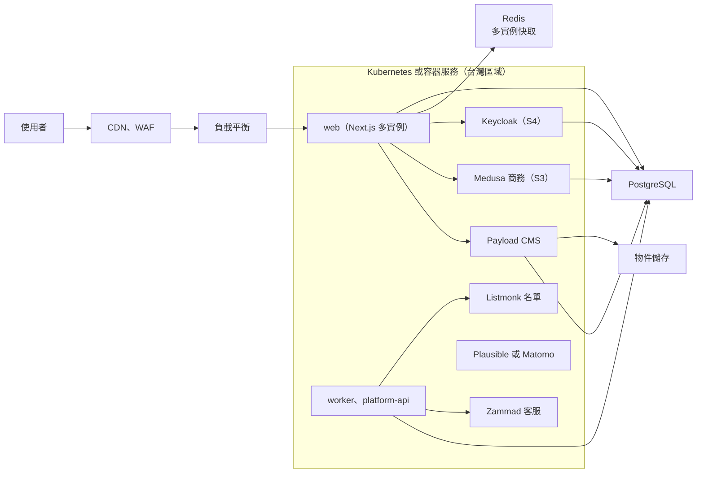

自建時 Next.js 多實例需設定共享快取（自訂 cache handler，以 Redis 為後端），並確認快取失效能同步到所有實例（S1 驗證）。

### 4.3 建議：混合方案

| 元件 | 建議 | 理由 |
| --- | --- | --- |
| 網站託管 | Vercel（或集團指定雲平台） | Next.js 預覽、回滾、圖片最佳化最省工 |
| CMS | S1 比較 Sanity 與 Payload 後擇一 | 見 §7.1 |
| 資料庫 | 託管 PostgreSQL，台灣區域 | 個資駐留；免維運 |
| worker／platform-api | 容器服務（Cloud Run、ECS） | 長時間工作與排程不適合放在無伺服器函式 |
| 客服、CRM、寄信 | 優先沿用 D-Link 既有工具 | 員工已熟悉；資安已審查 |
| 商務 | D10 決策（§10.2） | 依市場與金流條件 |
| 監控 | 託管服務或集團既有平台 | 自建監控的維運成本高 |

### 4.4 環境

| 環境 | 用途 | 資料 | 外部服務 |
| --- | --- | --- | --- |
| local | 開發 | 假資料 | 模擬或沙盒 |
| preview | 每個 Pull Request 一個網址，受存取保護 | CMS 草稿資料集 | 沙盒 |
| staging | 整合與驗收，設定與正式相同 | 匿名化測試資料 | 沙盒金流、測試 App |
| production | 正式 | 正式 | 正式 |

各環境的 CMS 資料集、金鑰、GA4 資源、功能開關彼此隔離；正式個資不複製到其他環境。

---

## 5. Web 應用

### 5.1 程式結構（CP-07）

```text
apps/
  web/                      Next.js 公開網站與 BFF
    src/app/
      [locale]/
        (corporate)/        企業外框：about、technology、news、business、trust、legal
        products/[product]/ 產品外框：依產品模板渲染
        support/            支援中心
        account/            會員（S4）
      api/
        forms/[type]/       表單受理
        draft/              CMS 預覽入口
        webhooks/cms/       內容發布通知
        webhooks/commerce/  商務事件（S3）
        revalidate/         內部快取失效端點
      sitemap.ts、robots.ts
    src/proxy.ts            轉址對照、網址正規化（不做語言自動轉址）
  worker/                   背景工作
  platform-api/             帳務與權益 API（S4）
packages/
  ui/                       設計系統元件
  themes/                   corporate、muru 等主題 token
  content/                  內容契約（zod）、CMS adapter
  i18n/                     語言設定、訊息檔、格式化
  analytics/                事件契約、追蹤 SDK、供應商 adapter
  consent/                  同意管理包裝、用途對照
  forms/                    表單契約、驗證規則
  commerce/                 商務 adapter（S3）
  identity/                 OIDC 用戶端、session（S4）
  db/                       資料表、migration（Drizzle ORM）
  flags/                    功能開關（OpenFeature）
  config/                   ESLint、TypeScript 共用設定
```

**模組邊界規則**（以 ESLint 規則在 CI 強制）：

- `ui` 不依賴任何資料來源；頁面元件只依賴 `content` 的契約型別，不直接呼叫 CMS 查詢語法。
- 只有 `analytics` 可以引用 GA4／Pixel；元件呼叫 `track()`。
- `apps/*` 之間不互相引用，只透過 `packages/*` 共用契約。

### 5.2 路由與渲染

| 路由群組 | 渲染 | 快取標籤 | 失效來源 |
| --- | --- | --- | --- |
| 企業頁、產品故事頁、新聞、公開支援 | 預產生＋`'use cache'` | `page:{contentId}`、`product:{productId}`、`nav:{brand}:{locale}` | CMS 發布 |
| 產品總覽、新聞列表 | 預產生 | `list:{type}:{locale}` | CMS 發布 |
| sitemap、robots | 預產生 | `sitemap` | CMS 發布、轉址變更 |
| 商品價格與可售狀態（S3） | 依市場快取，短時效 | `market:{marketId}:{productId}` | 商務 Webhook |
| 表單端點、Webhook | 動態，不快取 | — | — |
| 會員頁（S4） | 動態，個人化，不進共享快取 | — | — |
| 預覽 | 動態，draft mode | — | — |

一般內容以 `revalidateTag(tag, 'max')` 失效（先回舊版、背景更新）。需要立即生效的情況（撤稿、法律更正、錯誤價格）使用即時過期的快取設定或部署層級清除——具體行為 **S1 驗證**。

### 5.3 頁面請求時序

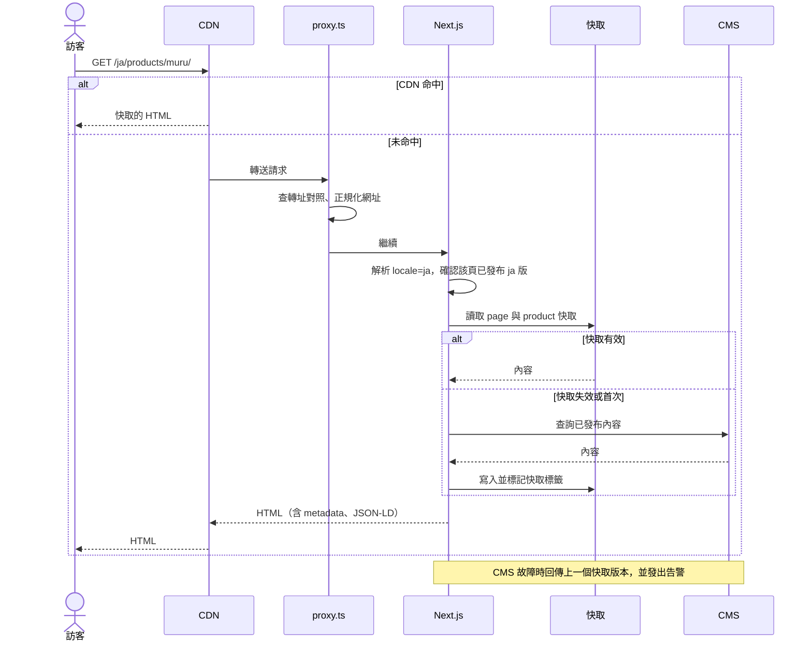

### 5.4 品牌外框與主題

- 兩種外框：`CorporateShell`、`ProductShell`。外框決定頁首、頁尾、導覽與主 CTA 的位置。
- 主題以 CSS 變數提供：`--color-*`、`--font-*`、`--radius-*`、`--motion-*`。主題檔放在 `packages/themes/{themeId}`，由 CMS 的產品資料指定 `themeId`。
- 新主題需通過對比度自動檢查（文字對背景 ≥ 4.5:1，大字 ≥ 3:1）才可發布。
- 字體依語言載入（§6.6），主題只指定字族角色（標題、內文），不直接寫死檔案。

### 5.5 功能開關（CP-09）

以 OpenFeature 標準介面讀取開關，後端可用 Unleash、Flagsmith（開源）或託管服務。開關值依「環境＋市場＋產品」評估。

| 開關 | 型別 | 範例規則 | 啟用者 |
| --- | --- | --- | --- |
| `commerce.enabled` | 布林 | production、市場 TW、產品 muru 為 true | 商務負責人 |
| `commerce.preorder` | 布林 | 依市場 | 商務＋法務 |
| `account.login` | 布林 | S4 前全部 false | IT |
| `waitlist.open` | 布林 | 依產品 | 產品行銷 |
| `channel.line_notify` | 布林 | 選配 | 行銷 |
| `ui.experiment.{id}` | 變體 | A／B 測試 | 行銷＋分析 |

規則：開關變更需在工具內核准並留下稽核紀錄；正式環境預設值一律為「關」；開關只控制「是否顯示／是否可用」，價格與權益仍以後端驗證為準；過期開關每季清理。

---

## 6. 多語系

### 6.1 範圍分層

| 層 | 內容 | 機制 |
| --- | --- | --- |
| 網址 | `/zh-tw/`、`/en/`、`/ja/` | 路由參數 `[locale]` |
| 介面字串 | 按鈕、表單標籤、錯誤訊息、導覽 | 訊息檔（ICU 格式）＋翻譯管理系統 |
| 內容 | 頁面、產品、FAQ、新聞、法務 | CMS 文件級多語 |
| 格式 | 日期、數字、貨幣、電話、地址 | `Intl` API、libphonenumber-js |
| 排版 | 字體、斷行、行高 | 依語言載入字體、BudouX 斷詞 |
| SEO | hreflang、sitemap、metadata | 由發布清單自動產生 |
| 通知 | Email、LINE 訊息 | 依登記時語言選模板 |
| 法務 | 各市場、各語言文件版本 | CMS `LegalDocument` |

### 6.2 語言解析

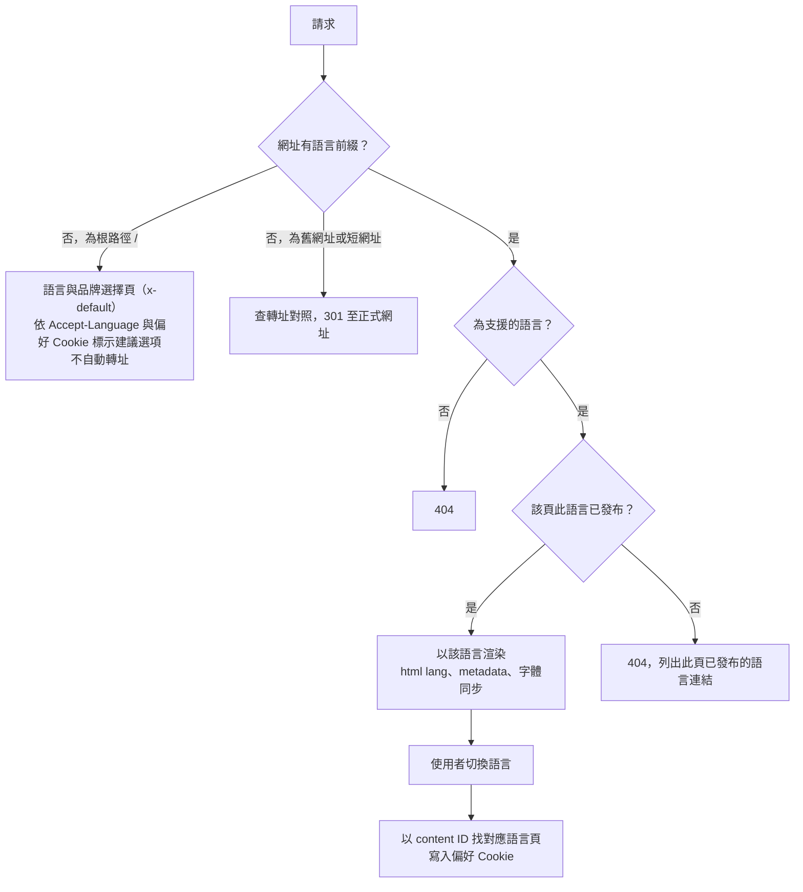

語言只由網址決定。偏好 Cookie 只用於選擇頁的建議與語言切換器的預設，不改變已開啟頁面的語言，也不列入 CDN 快取鍵。

### 6.3 介面字串

- 函式庫：next-intl（MIT），支援 App Router 與伺服器元件；訊息採 ICU MessageFormat，支援複數、選擇與變數。
- 檔案：`packages/i18n/messages/{locale}/{namespace}.json`，namespace 依模組（`common`、`forms`、`nav`、`commerce`…）。
- 鍵名：`模組.元件.用途`，例如 `forms.waitlist.submit`。禁止以中文原文當鍵。
- CI 檢查：已發布語言的鍵集合必須一致；缺鍵即建置失敗。未發布語言允許缺鍵。
- 開發模式提供偽語言 `en-XA`（文字加長 40% 並加上符號），找出寫死字串與版面溢出。

### 6.4 內容翻譯模型

每份可翻譯文件包含 `contentId`（跨語言相同）、`locale`、`translationStatus`（`source`／`in_translation`／`in_review`／`approved`）、`sourceRevision`（翻譯所依據的原文版本）。原文更新後，其他語言的 `sourceRevision` 落後，CMS 標示「原文已更新，需重新審稿」。

共用資料（產品規格數值、圖片、價格參照）不翻譯，以參照方式共用；只有說明文字翻譯。

### 6.5 翻譯工作流

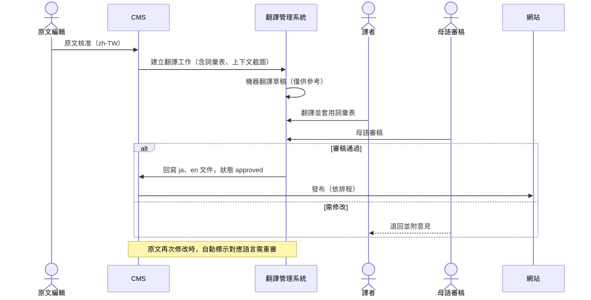

詞彙表（MuRu／ムル、功能名、成長階段名、方案名）在 TMS 中維護，並同步給 CMS 編輯參考。機器翻譯只作草稿，發布前必須有母語審稿（規劃書 §6.1）。

### 6.6 格式與排版

| 項目 | zh-TW | ja | en |
| --- | --- | --- | --- |
| 日期 | 2026年11月7日 | 2026年11月7日 | Nov 7, 2026 |
| 時區 | Asia/Taipei | Asia/Tokyo | 依市場；未指定時用 UTC 標示 |
| 貨幣 | NT$ 12,900（整數） | ¥129,000（整數、税込） | 依市場幣別 |
| 姓名欄位 | 姓名單欄 | 姓・名分欄，可選フリガナ | First／Last name |
| 地址 | 郵遞區號、縣市、鄉鎮區、地址 | 郵便番号、都道府県、市区町村、番地、建物名 | 依國家 |
| 字體 | Noto Sans TC 子集 | Noto Sans JP 子集 | 品牌英文字體 |

- 字體：自架並依 `unicode-range` 切片，只載入當前語言的字體；`font-display: swap`；首屏只預載標題字重。
- 日文與中文標題使用 BudouX（Apache-2.0）在詞語邊界斷行，避免單字落行。
- 版面預留文字長度變化：英文通常比中文長 30–60%，按鈕與導覽不得固定寬度。
- 資料一律以 UTC 儲存，顯示時轉為市場時區。

### 6.7 hreflang 與 sitemap 產生規則

1. 對每個 `contentId` 取已發布語言集合 P。
2. 每個語言版本輸出 P 中所有語言的 `<link rel="alternate" hreflang>`（含自己）。對照：`zh-tw → zh-TW`、`en → en`、`ja → ja`。
3. `x-default`：首頁群組指向 `/`；其他群組若英文已發布則指向英文版，否則省略。
4. sitemap 索引 `/sitemap.xml` 指向 `/sitemaps/{locale}-{type}.xml`，每筆附 `xhtml:link` 替代語言與 `lastmod`。
5. hreflang、sitemap、導覽、語言切換器都由同一份「發布清單」產生，確保一致。

### 6.8 方案

| 用途 | 開源 | 商用 | 建議 |
| --- | --- | --- | --- |
| 介面字串框架 | next-intl（MIT） | — | next-intl |
| 翻譯管理系統 | Tolgee（核心 Apache-2.0，可自架）、Weblate（GPL-3.0） | Crowdin、Phrase、Lokalise | 介面字串量小，首發可用 Tolgee 或 Crowdin；長文翻譯在 CMS 內進行 |
| 斷行 | BudouX（Apache-2.0） | — | 採用 |
| 電話格式 | libphonenumber-js（MIT） | — | 採用 |
| 機器翻譯草稿 | — | DeepL、Google Translate | 僅草稿 |

---

## 7. CMS 與內容平台

### 7.1 選型（CP-06）

| 準則 | Sanity | Payload | Strapi 5 | Contentful | Directus |
| --- | --- | --- | --- | --- | --- |
| 授權／模式 | SaaS；編輯介面開源（MIT），內容儲存為託管服務 | MIT，可自架；以 Next.js 應用形式運行 | 社群版 MIT；SSO、稽核、審核流程等為付費企業功能 | SaaS | BSL 1.1；年財務規模超過 500 萬美元的組織正式使用需商業授權 |
| 資料駐留 | 依方案與區域 | 完全自主（台灣區域） | 自主 | 依方案 | 自主 |
| 文件級多語 | 官方外掛支援 | 內建欄位級；文件級需自行建模（S1 驗證） | 內建 i18n | 內建欄位級 | 內建 |
| 審核工作流 | 可自訂 | 版本、草稿、排程內建；工作流需自建 | 企業版 | 內建 | 內建 |
| 員工 SSO | 企業方案 | 自行整合 | 企業版 | 企業方案 | 內建 |
| 主要風險 | 查詢語言與資料模型綁定供應商；費用隨席次 | 自架維運；需自建審核流程 | 關鍵功能需付費 | 費用高 | D-Link 集團規模必須購買商業授權 |

**建議**：S1 以真實 MuRu 內容（三語、一個產品、五個區塊、一則新聞）同時驗證 **Sanity** 與 **Payload**，依下列權重評分後擇一：

| 評分項目 | 權重 |
| --- | --- |
| 三語獨立審核與發布 | 20% |
| 編輯體驗（行銷同仁實測） | 20% |
| 集團資安與資料駐留合規 | 20% |
| 三年總持有成本 | 15% |
| 預覽、排程、回滾 | 15% |
| 匯出與供應商退出成本 | 10% |

若 D-Link IT 要求資料在台灣或自架，直接選 Payload；否則 Sanity 的編輯體驗與免維運通常勝出。

### 7.2 內容模型

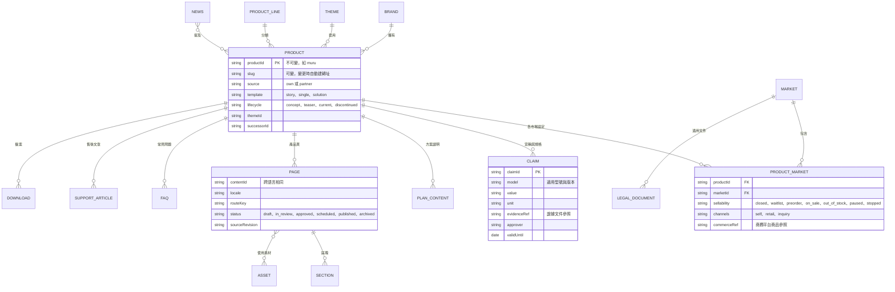

**欄位規範重點**：

- `productId` 建立後不可修改；`slug` 修改時 CMS 自動新增一筆 `Redirect`。
- 金額不存在 CMS；`PRODUCT_MARKET.commerceRef` 指向商務平台，價格由商務平台提供（規劃書 §7.1）。
- `CLAIM` 為規格與功能宣稱的唯一來源；頁面中的規格表、比較表、JSON-LD 都引用 `CLAIM`，不另外輸入數字。
- 未核准（無 `approver`）或已過期（`validUntil`）的 `CLAIM` 不可被已發布頁面引用（CMS 驗證規則阻擋）。

### 7.3 區塊契約

區塊以「判別聯集」型別定義，CMS schema 與前端型別由同一份 zod 定義產生，保證一致：

```ts
// packages/content/src/sections.ts
import { z } from 'zod'

const Cta = z.object({ ctaId: z.string(), label: z.string(), intent: z.enum(['waitlist', 'buy', 'inquiry', 'link']) })

export const Section = z.discriminatedUnion('type', [
  z.object({ type: z.literal('hero'), schemaVersion: z.literal(1), heading: z.string().max(60), body: z.string().max(200), media: z.string(), cta: Cta }),
  z.object({ type: z.literal('mediaText'), schemaVersion: z.literal(1), heading: z.string(), body: z.string(), media: z.string(), align: z.enum(['left', 'right']) }),
  z.object({ type: z.literal('featureGrid'), schemaVersion: z.literal(1), items: z.array(z.object({ title: z.string(), body: z.string(), link: z.string().optional() })).min(2).max(6) }),
  z.object({ type: z.literal('timeline'), schemaVersion: z.literal(1), stages: z.array(z.object({ title: z.string(), body: z.string(), claimRefs: z.array(z.string()) })) }),
  z.object({ type: z.literal('specTable'), schemaVersion: z.literal(1), claimRefs: z.array(z.string()).min(1) }),
  z.object({ type: z.literal('planCompare'), schemaVersion: z.literal(1), planRefs: z.array(z.string()).min(1) }),
  z.object({ type: z.literal('faqList'), schemaVersion: z.literal(1), faqRefs: z.array(z.string()).min(1) }),
  z.object({ type: z.literal('ctaBand'), schemaVersion: z.literal(1), heading: z.string(), cta: Cta }),
])
export type Section = z.infer<typeof Section>
```

- 區塊不開放任意 HTML 或腳本。富文字使用結構化格式（Portable Text 或 Lexical JSON），渲染時白名單過濾。
- `schemaVersion` 升級時提供 migration 腳本，舊資料轉換後才可移除舊版本支援。
- 前端遇到未知或驗證失敗的區塊：預覽環境顯示錯誤框；正式環境不渲染該區塊並發出告警。

### 7.4 角色與工作流

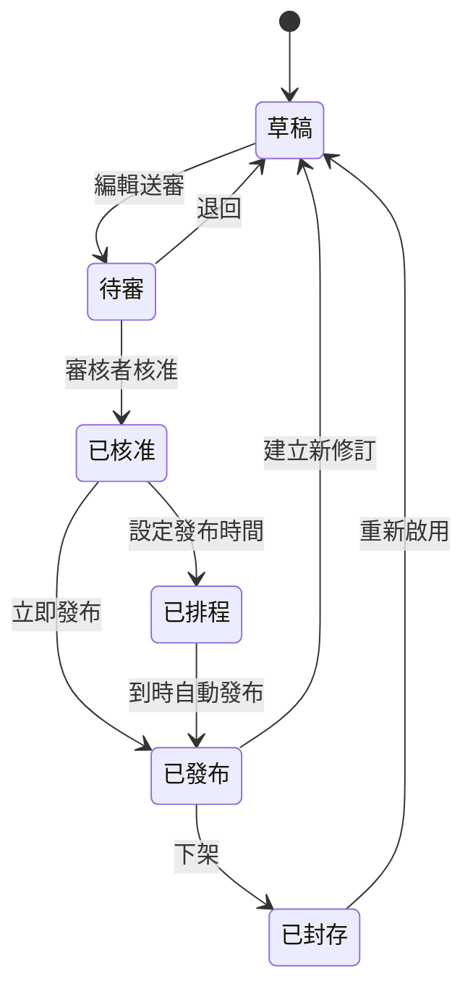

| 角色 | 範圍 | 可執行 |
| --- | --- | --- |
| 管理員（IT） | 全部 | schema 設定、角色指派；不編輯內容 |
| 品牌編輯 | 企業頁、新聞 | 編輯、送審、核准新聞 |
| 產品行銷 | 指定產品 | 編輯產品頁、FAQ、方案說明、送審 |
| 產品事實核准者 | 指定產品 | 核准 `CLAIM`、`PLAN_CONTENT` |
| 語言編輯 | 指定語言 | 翻譯、母語審稿 |
| 法務 | 法務文件、標記需法務的內容 | 核准 |
| 客服編輯 | 售後文章、售後 FAQ、使用手冊章節 | 編輯、送審 |
| 檢視者 | 全部 | 唯讀與預覽 |

涉及隱私、資安、健康、認證、價格、雲端保存、訂閱的內容，CMS 依標籤強制要求「產品事實核准者＋法務」兩道核准（規劃書 §7.3）。

### 7.5 發布管線（CP-08）

**閘道設計**：CMS 端是主要閘道（schema 驗證、宣稱引用檢查、必要核准）；網站端在發布後再次驗證，失敗時告警並提供一鍵還原到上一修訂。

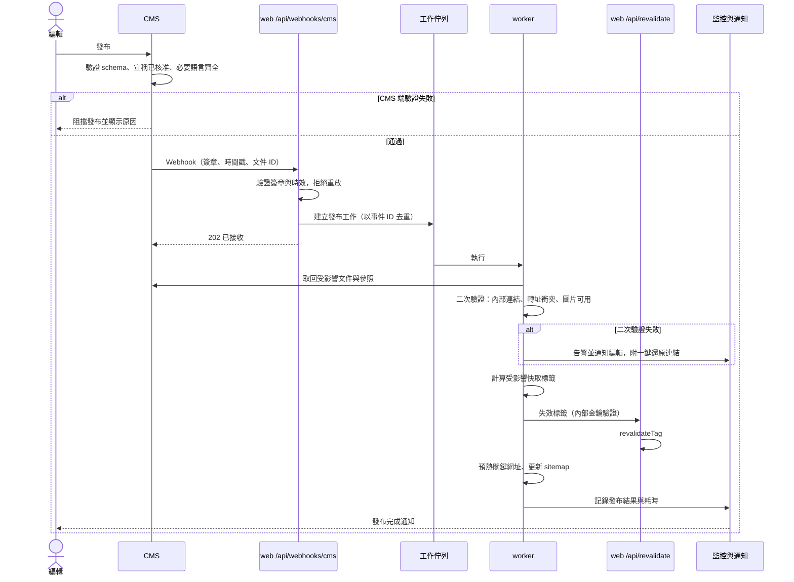

發布結果（成功、失敗、處理中）回寫到 CMS 的發布紀錄文件，讓編輯在 CMS 內看到狀態（規劃書 §7.4）。

### 7.6 預覽

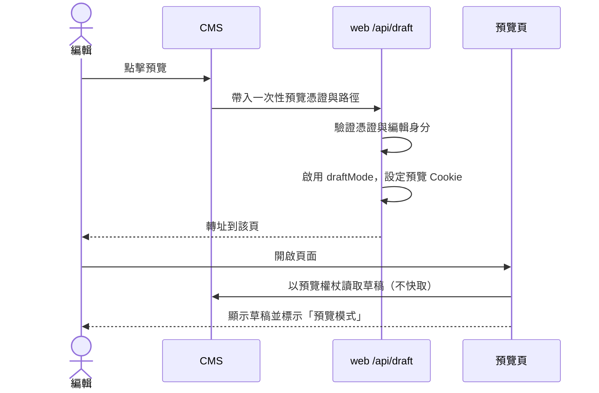

預覽環境另以部署平台的存取保護或企業 SSO 限制，未授權者看不到草稿與未公開素材。預覽頁設定 `noindex`，但不以此作為存取保護。

### 7.7 媒體管線（CP-11）

| 類型 | 處理 | 規範 |
| --- | --- | --- |
| 圖片 | CMS 素材 → 圖片 CDN 自動輸出 AVIF／WebP、多尺寸 | 依區塊定義比例；必填替代文字與焦點；首屏圖 ≤ 200 KB |
| 影片 | 上傳母檔 → 轉 HLS 多碼率 → CDN | 首屏影片首段 ≤ 3 MB；提供海報圖；`prefers-reduced-motion` 或省流量模式時不自動播放 |
| 字幕 | 每語言一份 WebVTT | 敘事影片必備 |
| 下載檔（資源中心） | 版本化檔名，存於物件儲存或 CMS；類別：使用手冊 PDF、快速上手、規格書、媒體素材、韌體說明；升級包檔案待決（見計劃書決策 #24） | 標示版本、適用型號、語言、檔案大小、發布日；韌體檔另附校驗碼；舊版說明保留 |
| 授權 | 素材欄位：來源、授權範圍、到期日 | 到期前 30 天通知；到期自動下架 |

方案：託管用 Mux（影片）＋CMS 內建圖片服務或 Vercel 圖片最佳化；自建用 imgproxy（MIT）＋ FFmpeg 轉檔＋物件儲存＋CDN。

### 7.8 備份與匯出

- CMS 每日完整匯出到物件儲存（開啟版本控制，保留 35 天），每月一次還原演練。
- 自架 CMS 的資料庫採時間點還原（PITR）。
- 供應商退出計畫：匯出格式、轉換腳本、預估工時，於 S1 選型時一併驗證。

---

## 8. 表單、名單與案件（CP-01）

### 8.1 架構

網站只自建**受理、持久化、可靠轉交**三件事；員工處理案件一律在客服系統與 CRM 中進行。

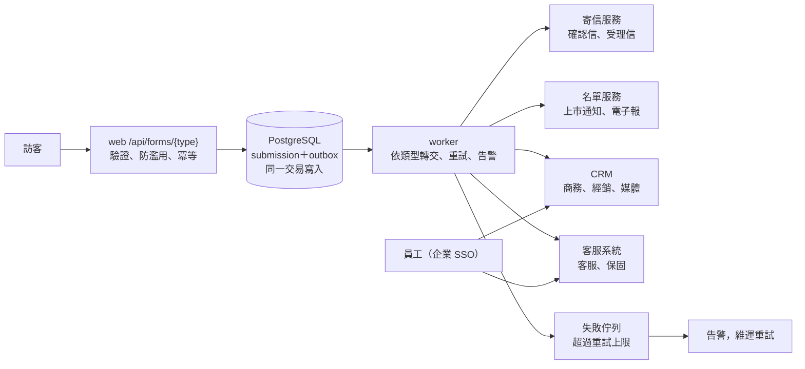

### 8.2 資料表

```text
submission
  id                uuid PK
  type              text      waitlist | b2b | distributor | media | support
  idempotency_key   text      UNIQUE，前端產生的提交 ID
  locale, market    text
  product_id        text      可為空
  payload_enc       bytea     以 KMS 包裝金鑰加密的表單內容
  email_hmac        text      以 HMAC 雜湊的 Email，用於去重與查詢
  consent_snapshot  jsonb     告知文字版本、勾選項目、時間
  analytics_ctx     jsonb     僅在使用者已同意分析時保存 GA client_id
  status            text      accepted | forwarded | failed
  created_at        timestamptz
  retain_until      timestamptz 依類型的保留期限

outbox
  id, submission_id, topic, payload, attempts, next_run_at, status, last_error

subscriber
  id, email_enc, email_hmac, purpose（launch_notice:muru | newsletter）, locale,
  status（pending | active | unsubscribed | suppressed | erased）, confirmed_at,
  consent_version, source_submission_id
  UNIQUE (email_hmac, purpose)

email_token
  id, subscriber_id, kind（confirm | unsubscribe）, token_hash, expires_at, used_at

audit_log
  id, actor, action, target_type, target_id, at, detail（不含個資內容）
```

- 個資欄位以應用層信封加密（雲端 KMS 管理主金鑰），資料庫管理員也無法直接讀取明文。
- Email 去重與查詢用 HMAC 雜湊，不用明文索引。
- 若沿用的 CRM／客服系統本身可提供可稽核的持久受理與查詢，`payload_enc` 可在轉交成功後依保留政策提早清除，唯一保存方為該系統（規劃書 §9.2）。

### 8.3 提交時序

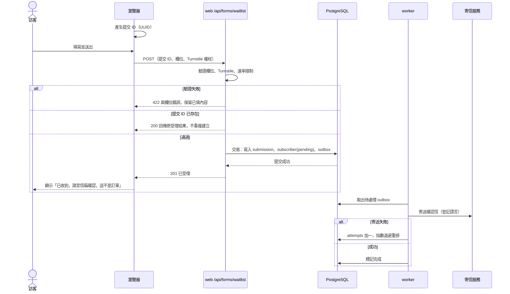

前端逾時顯示「送出狀態未確定，請稍後重試」，重試使用同一提交 ID，不會產生重複資料。

### 8.4 雙重確認與名單狀態

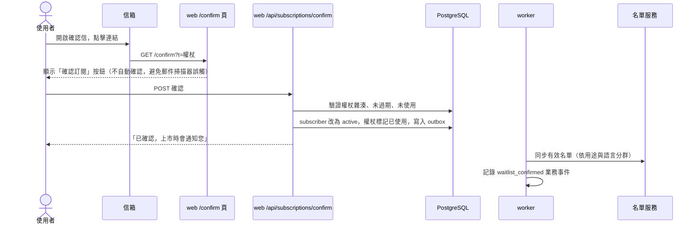

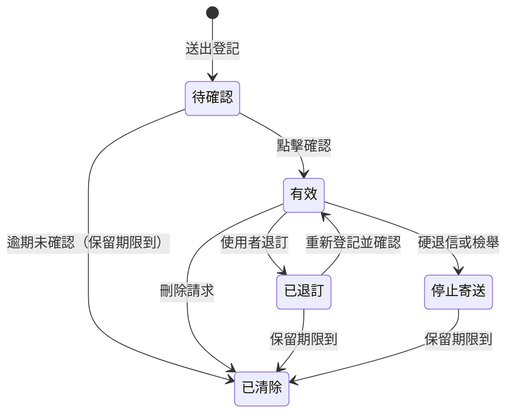

重複登記時對外顯示相同訊息，不透露該 Email 是否已存在（規劃書 §9.4）。退訂名單保留 Email 雜湊作為停止寄送依據。

### 8.5 轉交路由

| 表單類型 | 轉交目的地 | 建立物件 | 失敗時 |
| --- | --- | --- | --- |
| waitlist | 名單服務 | 依產品與語言分群的聯絡人 | 重試；名單仍在本地，不遺失 |
| b2b、distributor | CRM | 潛在客戶，附產品與需求類型 | 重試；超過上限通知商務窗口 |
| media | CRM 或公關信箱 | 媒體聯絡 | 同上 |
| support | 客服系統 | 工單，附產品、分類、語言 | 重試；超過上限通知客服主管 |
| newsletter（選配） | 名單服務 | 電子報聯絡人 | 同 waitlist |

重試策略：指數退避（1 分、5 分、30 分、2 小時、12 小時），最多 8 次後進入失敗佇列並告警。

### 8.6 防濫用

- Cloudflare Turnstile（不需使用者解題）＋隱藏誘捕欄位＋每 IP 與每 Email 雜湊的速率限制。
- 單一 IP 每分鐘最多 5 次提交；同一 Email 同一用途 24 小時內最多 3 次確認信。
- 驗證服務故障時降級為僅速率限制，不阻擋真人提交。
- 附件上傳不在首發範圍（規劃書 §9.2）。

### 8.7 方案

| 用途 | 開源 | 商用 | 建議 |
| --- | --- | --- | --- |
| 工作佇列 | pg-boss（MIT，用 PostgreSQL，免 Redis）、Graphile Worker（MIT）、BullMQ（MIT，需 Redis） | 雲端佇列服務 | pg-boss |
| 交易信 | — | Amazon SES、Postmark、SendGrid | SES 或 Postmark |
| 名單與群發 | Listmonk（AGPL-3.0）、Mautic（GPL-3.0） | Brevo、Mailchimp、HubSpot | 沿用 D-Link 既有工具優先 |
| CRM | Twenty（AGPL-3.0）、SuiteCRM（AGPL-3.0） | Salesforce、HubSpot、Dynamics | 沿用既有 |
| 客服 | Zammad（AGPL-3.0）、Chatwoot（核心 MIT） | Zendesk、Freshdesk | 沿用既有；需 LINE 客服時 Chatwoot、Zendesk 都有整合 |
| 信件模板 | React Email（MIT）、MJML（MIT） | — | React Email |

---

## 9. 埋點與數據

### 9.1 架構

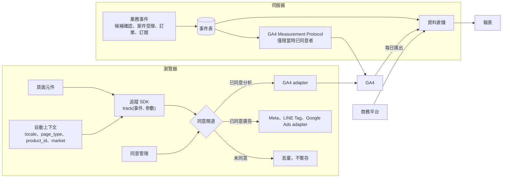

**原則**：

- 營運真值（候補數、案件數、訂單、營收、訂閱）由業務資料庫計算，不由 GA4 計算（規劃書 §12.3）。
- GA4 用於行為分析與趨勢，且只涵蓋已同意的訪客。
- 元件只呼叫 `track()`；供應商 SDK 只在 adapter 中載入。

### 9.2 同意管理（CP-03）

**同意類別與對照**：

| CMP 類別 | Google Consent Mode 訊號 | 控制的工具 |
| --- | --- | --- |
| 必要 | — | 安全、表單、語言偏好、同意紀錄本身 |
| 分析 | `analytics_storage` | GA4、熱圖（若採用） |
| 廣告 | `ad_storage`、`ad_user_data`、`ad_personalization` | Google Ads、Meta Pixel、LINE Tag |
| 嵌入內容 | — | YouTube 等嵌入（未同意時顯示點擊載入的預覽圖） |

**分區政策選項**（由法務在 D13 決定）：

| 選項 | 歐洲經濟區、英國、瑞士 | 台灣、日本 | 其他 | 量測影響 |
| --- | --- | --- | --- | --- |
| A：全球事前同意（規劃書基線） | 事前同意 | 事前同意 | 事前同意 | GA4 只見同意者，數據量可能大幅減少 |
| B：分區政策 | 事前同意 | 分析採「告知＋可拒絕」，廣告採事前同意 | 同台日 | 分析資料較完整；需法務確認當地法規允許 |
| 補充：無 Cookie 彙總統計 | 視法務評估 | 視法務評估 | 視法務評估 | 不識別個人的總量統計，補足 A 的盲區 |

無論哪個選項：CMP 載入失敗時非必要用途維持關閉；撤回同意後立即停止並刪除對應 Cookie；不補送撤回前未允許的事件。

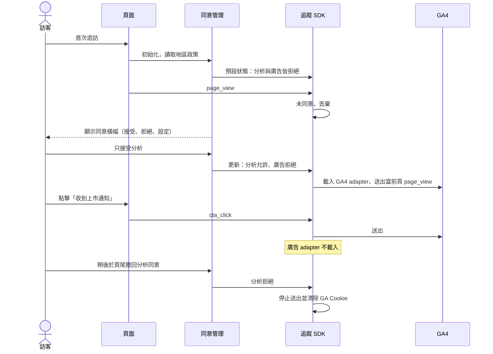

### 9.3 事件命名與契約

- 事件名：`物件_動作`，小寫蛇形，≤ 40 字元（GA4 限制）。例：`waitlist_submit`、`faq_open`。
- 參數名：小寫蛇形，≤ 40 字元；參數值 ≤ 100 字元。
- 識別用參數使用穩定代號，不用顯示文字：`cta_id: "muru_hero_waitlist"`，不是 `"收到上市通知"`。
- 禁止參數：Email、姓名、電話、地址、序號、表單內容、自由輸入文字、帶權杖的網址。SDK 對網址參數做白名單過濾（只保留 `utm_*`）。
- 事件契約存放在 `packages/analytics/schema/*.json`（JSON Schema），由 CI 產生 TypeScript 型別。

```json
{
  "$id": "waitlist_submit/1",
  "type": "object",
  "required": ["product_id", "form_locale"],
  "properties": {
    "product_id": { "type": "string", "enum": ["muru"] },
    "form_locale": { "type": "string", "enum": ["zh-tw", "en", "ja"] },
    "market_interest": { "type": "string", "enum": ["TW", "JP", "OTHER", "UNSPECIFIED"] }
  },
  "additionalProperties": false
}
```

```ts
// packages/analytics/src/track.ts（型別由 schema 產生）
export function track<E extends EventName>(event: E, params: EventParams[E]): void
// 用法
track('waitlist_submit', { product_id: 'muru', form_locale: 'ja', market_interest: 'JP' })
```

### 9.4 共用參數

由 SDK 依路由與頁面契約自動附加，元件不需傳入：

| 參數 | 範例 | 說明 |
| --- | --- | --- |
| `schema_version` | `1` | 事件契約版本 |
| `locale` | `ja` | 由網址決定 |
| `site_section` | `corporate`、`product`、`support`、`account` | 外框類型 |
| `page_type` | `home`、`story`、`faq`、`news_article` | 頁面模板 |
| `content_id` | `muru-life` | 跨語言相同 |
| `product_id` | `muru` | 企業頁無產品時省略 |
| `market` | `TW`、`JP`、`UNSPECIFIED` | 由使用者選擇或商務設定，不由語言推論 |
| `lifecycle`、`sellability` | `teaser`、`waitlist` | 對應規劃書 §6.3 狀態 |

### 9.5 事件字典

| 事件 | 觸發 | 主要參數 | 來源 | 同意 | 階段 | 關鍵事件 |
| --- | --- | --- | --- | --- | --- | --- |
| `page_view` | 路由變更完成 | 共用參數 | 瀏覽器 | 分析 | S2 | |
| `product_view` | 進入產品頁（S3 起同時對應 GA4 `view_item`） | `product_id` | 瀏覽器 | 分析 | S2 | |
| `cta_click` | 點擊主要 CTA | `cta_id`、`cta_location`、`destination_type` | 瀏覽器 | 分析 | S2 | |
| `section_view` | 故事區塊可見 ≥ 50% 且 ≥ 1 秒 | `section_type`、`section_index` | 瀏覽器 | 分析 | S2 | |
| `media_progress` | 影片播放 25／50／75／100% | `media_id`、`percent` | 瀏覽器 | 分析 | S2 | |
| `faq_open` | 展開 FAQ | `faq_id` | 瀏覽器 | 分析 | S2 | |
| `plan_view` | 方案比較區塊可見 | `product_id` | 瀏覽器 | 分析 | S2 | |
| `language_switch` | 切換語言 | `from_locale`、`to_locale` | 瀏覽器 | 分析 | S2 | |
| `form_start` | 表單第一次輸入 | `form_type` | 瀏覽器 | 分析 | S2 | |
| `form_error` | 送出後出現欄位錯誤 | `form_type`、`field`、`error_code` | 瀏覽器 | 分析 | S2 | |
| `waitlist_submit` | 伺服器回應 201 | `product_id`、`form_locale`、`market_interest` | 瀏覽器 | 分析 | S2 | ✅ |
| `waitlist_confirmed` | 使用者完成 Email 確認 | `product_id`、`form_locale` | 伺服器 | 依提交時同意狀態 | S2 | ✅ |
| `business_lead_submit` | 商務或經銷表單受理 | `lead_type` | 瀏覽器 | 分析 | S2 | ✅ |
| `media_inquiry_submit` | 媒體表單受理 | — | 瀏覽器 | 分析 | S2 | |
| `support_request_submit` | 客服表單受理 | `support_category`、`product_id` | 瀏覽器 | 分析 | S2 | |
| `file_download` | 下載檔案 | `file_id`、`file_type`（manual、quickstart、spec、firmware_note、firmware） | 瀏覽器 | 分析 | S2 | |
| `manual_search` | 手冊站內搜尋 | `query_hash`、`result_count`（不記原文） | 瀏覽器 | 分析 | S2 | 無結果率用來找手冊缺口 |
| `manual_helpful` | 手冊章節評價 | `chapter_id`、`helpful` | 瀏覽器 | 分析 | S2 | |
| `manual_assistant_ask` | 手冊 AI 助理提問 | `chapter_id`、`topic`、`resolved`（不記原文） | 瀏覽器 | 分析 | A1 | |
| `outbound_store_click` | 點擊通路連結 | `channel`、`product_id`、`market` | 瀏覽器 | 分析 | S2 | ✅ |
| `app_store_click` | 點擊 App 下載 | `platform` | 瀏覽器 | 分析 | S2 | |
| `newsletter_subscribe` | 電子報確認完成 | — | 伺服器 | 依提交時同意狀態 | 選配 | ✅ |
| `view_item`、`add_to_cart`、`begin_checkout`、`add_shipping_info`、`add_payment_info` | GA4 電商標準事件 | `items`、`currency`、`value` | 瀏覽器 | 分析 | S3 | |
| `purchase` | 商務平台確認付款 | `transaction_id`、`items`、`value`、`currency` | 伺服器 | 依結帳時同意狀態 | S3 | ✅ |
| `refund` | 商務平台確認退款 | `transaction_id`、`value` | 伺服器 | 同上 | S3 | |
| `sign_up`、`login` | 帳號建立、登入 | `method` | 瀏覽器 | 分析 | S4 | |
| `subscription_start`、`subscription_renew`、`subscription_cancel` | 權益服務確認 | `plan_id`、`source`、`period` | 伺服器 | 依可取得的同意狀態 | S4 | ✅（start） |
| `warranty_register_submit` | 保固登錄受理 | `product_id`、`purchase_channel` | 伺服器 | 分析 | S4 | |

伺服器端事件只有在使用者當時已同意分析、且保存了 GA client_id 時才送往 GA4；否則只進資料倉儲作為營運統計。

### 9.6 伺服器端轉換時序

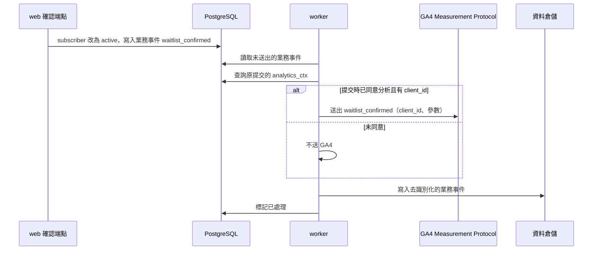

### 9.7 GA4 設定

| 項目 | 設定 |
| --- | --- |
| 資源 | 正式與 staging 各一個資源，避免測試資料污染 |
| 資料保留 | 14 個月（標準版上限） |
| 自訂維度（事件範圍） | `locale`、`site_section`、`page_type`、`content_id`、`product_id`、`market`、`cta_id`、`form_type`、`lead_type`、`section_type`、`faq_id` 等（標準版上限 50 個，預留一半給後續） |
| 使用者範圍維度 | 首發不設，避免帶入可識別資料 |
| 關鍵事件 | `waitlist_submit`、`waitlist_confirmed`、`business_lead_submit`、`outbound_store_click`；S3 起 `purchase` |
| 內部流量 | 以公司出口 IP 或 `traffic_type=internal` 參數排除 |
| 不需要的參照網址 | 金流、商店網域、確認信網域 |
| 跨網域 | 啟用商店後設定主網域與商店網域 |
| BigQuery 匯出 | 每日匯出（標準版每日上限 100 萬事件） |
| Google Signals | 關閉（需另經隱私核准） |

### 9.8 UTM 規範

| 參數 | 規則 | 範例 |
| --- | --- | --- |
| `utm_source` | 平台名小寫 | `facebook`、`line`、`newsletter` |
| `utm_medium` | 固定清單：`cpc`、`social`、`email`、`referral`、`display`、`pr` | `social` |
| `utm_campaign` | `{年}{月}_{產品}_{目的}` | `202612_muru_launch` |
| `utm_content` | 素材代號 | `video_a` |

以共用試算表或連結產生器管理，避免同一活動多種寫法。

### 9.9 資料倉儲與報表（S5，依需求啟用）

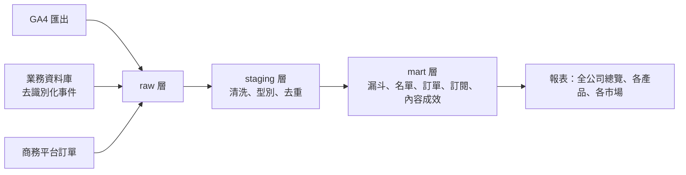

工具：BigQuery＋dbt Core（Apache-2.0）＋ Looker Studio；開源替代為 ClickHouse（Apache-2.0）＋ dbt Core ＋ Apache Superset（Apache-2.0）或 Metabase（AGPL-3.0）。資料倉儲中的個人層級資料以假名化 ID 表示，仍按個資管理（規劃書 §13.2）。

### 9.10 品質保證

1. 追蹤計畫（本節事件字典）與 JSON Schema 放在程式庫，變更需經分析負責人審核。
2. E2E 測試攔截 SDK 輸出，斷言事件名稱、參數符合 schema，且不含禁止欄位。
3. 每次發布前，在 staging 以 GA4 DebugView 抽查關鍵事件。
4. 同意測試：初訪、全拒、部分接受、撤回、CMP 載入失敗五種情境，以網路請求紀錄證明未同意的 SDK 沒有發出請求（規劃書 AC-05）。
5. 每週自動檢查：關鍵事件量與業務資料庫的比例，異常偏離時告警。

### 9.11 方案

| 用途 | 開源 | 商用 | 建議 |
| --- | --- | --- | --- |
| 行為分析 | Matomo（GPL-3.0）、PostHog（核心 MIT）、Plausible CE（AGPL-3.0）、Umami（MIT） | GA4、Amplitude、Mixpanel | GA4（廣告整合）；如需無 Cookie 彙總統計，自架 Umami 或 Plausible |
| 事件管線 | Jitsu（MIT） | Segment | 首發不需要；RudderStack 伺服器為 ELv2、Snowplow 核心為 SLULA，都不是 OSI 開源授權，正式使用需評估商業授權 |
| 同意管理 | Klaro（BSD-3-Clause）、CookieConsent（MIT） | OneTrust、Cookiebot、Usercentrics | 需 Google 認證 CMP 時選商用；否則開源可行 |
| 資料倉儲 | ClickHouse（Apache-2.0） | BigQuery、Snowflake | BigQuery（GA4 原生匯出） |
| 轉換 | dbt Core（Apache-2.0） | dbt Cloud | dbt Core |
| 報表 | Apache Superset（Apache-2.0）、Metabase（AGPL-3.0） | Looker Studio、Power BI | 依集團既有工具 |

---

## 10. 電商（實體商品，S3）

### 10.1 範圍

商務平台只負責**實體商品**：主機、配件、組合。數位訂閱（如 MuRu Plus）不放在商務平台（CP-02，見第 11 章）。若硬體組合內含訂閱試用，商務平台只記錄「含試用權益」的商品屬性，付款確認後由權益服務發放。

### 10.2 選型

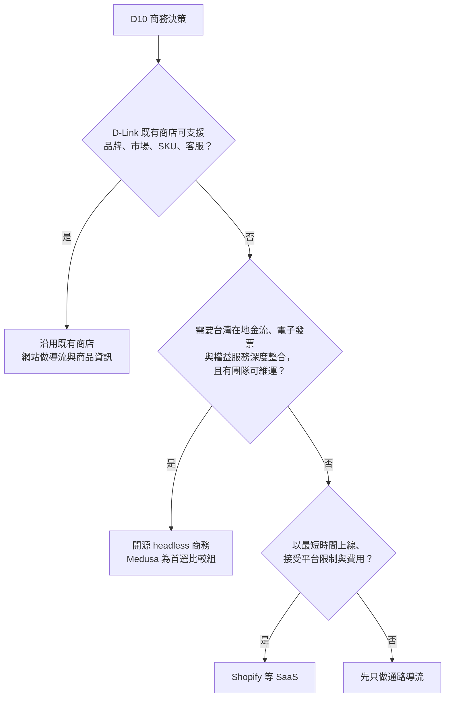

| 方案 | 授權／模式 | 優點 | 限制與注意 |
| --- | --- | --- | --- |
| Shopify／Shopify Plus | SaaS | 上線快；結帳穩定；生態豐富 | 台灣金流與電子發票需透過第三方 App；Shopify Payments 在台灣的可用性需依官方清單確認；外部身分整合限 Plus；訂閱受金流限制 |
| Medusa v2 | MIT，Node.js／TypeScript | 與 Next.js 同技術棧；模組化；資料自主；可自訂金流與發票模組 | 綠界、藍新等金流與電子發票需自行開發 provider；自行維運 |
| Saleor | BSD-3-Clause，Python／GraphQL | 多通路、多幣別成熟；有託管版 | 技術棧與網站不同；金流以 App 擴充 |
| Vendure | GPL-3.0／商業授權，Node.js | B2B 能力強；外掛例外條款允許外掛採其他授權 | 修改核心需遵守 GPL；商業支援需付費 |
| Sylius | MIT，PHP | 成熟、可客製 | PHP 技術棧 |

**建議**：先完成 D10 的市場能力矩陣（規劃書 §10.2）。若首發市場為台灣且需電子發票、在地金流與權益整合，Medusa 的總體控制力較佳；若日本先行或希望最少維運，Shopify 較合適。兩者都以網站的 `commerce` adapter 對接，頁面不直接依賴平台 API。

### 10.3 商務領域模型

```mermaid
erDiagram
  CMS_PRODUCT ||--o{ COMMERCE_PRODUCT : "commerceRef"
  COMMERCE_PRODUCT ||--o{ VARIANT : "規格"
  VARIANT ||--o{ PRICE : "價格"
  PRICE_LIST ||--o{ PRICE : "包含"
  MARKET ||--|| PRICE_LIST : "使用"
  VARIANT ||--o{ INVENTORY_LEVEL : "庫存"
  LOCATION ||--o{ INVENTORY_LEVEL : "倉庫"
  ORDER ||--o{ ORDER_LINE : "明細"
  VARIANT ||--o{ ORDER_LINE : "購買"
  ORDER ||--o{ PAYMENT : "付款"
  ORDER ||--o{ INVOICE : "發票"
  ORDER ||--o{ SHIPMENT : "出貨"
  ORDER ||--o{ RETURN_REQUEST : "退貨"
  PAYMENT ||--o{ REFUND : "退款"
  VARIANT {
    string sku PK
    string productId "對應 CMS productId"
    string kind "device、accessory、bundle"
    bool grantsTrial "是否附訂閱試用"
  }
  PRICE_LIST {
    string marketId
    string currency
    bool taxInclusive
  }
  ORDER {
    string orderId PK
    string marketId
    string status
    string buyerAccountId "可為空（訪客結帳）"
  }
```

### 10.4 市場在地化

| 項目 | 台灣 | 日本 |
| --- | --- | --- |
| 價格顯示 | 含 5% 營業稅 | 含 10% 消費稅的總額表示 |
| 付款方式 | 信用卡（3D 驗證）、LINE Pay、Apple Pay、ATM 虛擬帳號、超商代碼 | 信用卡、超商付款（コンビニ決済）、PayPay、銀行轉帳 |
| 金流服務 | 綠界 ECPay、藍新 NewebPay、TapPay | KOMOJU、GMO Payment Gateway、Stripe（日本法人） |
| 發票 | 電子發票：手機條碼載具、自然人憑證、統一編號、捐贈碼；透過綠界或 ezPay 發票 API | 收據；B2B 客戶可能需要適格請求書（インボイス制度） |
| 物流 | 宅配、超商取貨（透過綠界物流等） | ヤマト運輸、佐川急便 |
| 退貨 | 通訊交易 7 日解除權與合理例外 | 需明示返品特約，未明示時適用法定退貨 |
| 必要頁面 | 運送、退換貨、隱私、條款 | 特定商取引法に基づく表記、返品特約、隱私、條款 |
| 認證標示 | NCC | 技適マーク |

Stripe 目前一般不支援以台灣公司開立商家帳戶（以 Stripe 官方支援國家清單為準），台灣市場不應以 Stripe 為前提。

### 10.5 結帳時序

```mermaid
sequenceDiagram
  actor U as 消費者
  participant W as 網站
  participant C as 商務平台
  participant PG as 金流（託管付款頁）
  participant INV as 電子發票服務
  participant WMS as 倉儲物流
  participant ENT as 權益服務
  U->>W: 選擇市場 TW，加入購物車
  W->>C: 建立購物車（市場、幣別）
  C-->>W: 依市場價目表計價
  U->>W: 前往結帳
  W->>C: 確認庫存、地址、運送方式，重新計價
  C->>PG: 建立付款（金額由伺服器決定）
  PG-->>U: 託管付款頁（網站不接觸卡號）
  U->>PG: 完成付款
  PG-->>U: 導回網站「付款處理中」頁
  PG->>C: 伺服器通知（簽章）
  C->>C: 驗證簽章與金額，冪等處理
  C->>C: 訂單改為已付款
  C->>INV: 開立電子發票
  C->>WMS: 建立出貨單
  C-->>W: 訂單事件
  W-->>U: 頁面輪詢後顯示「訂單已成立」
  opt 商品含訂閱試用
    C->>ENT: 發放試用權益事件
  end
```

返回頁只顯示狀態，不作為付款成功的依據（規劃書 §10.3）。

### 10.6 付款通知冪等處理

```mermaid
sequenceDiagram
  participant PG as 金流
  participant H as 通知端點
  participant IN as 事件收件匣
  participant P as 處理程序
  participant O as 訂單
  PG->>H: 付款通知（可能重送、亂序）
  H->>H: 驗證簽章（如綠界 CheckMacValue）
  H->>IN: INSERT（來源, 事件ID）UNIQUE
  alt 重複事件
    IN-->>H: 已存在
    H-->>PG: 回應成功，不重複處理
  else 新事件
    IN-->>H: 寫入成功
    H-->>PG: 回應成功
    P->>IN: 取出待處理事件
    P->>PG: 向金流查詢交易最新狀態
    P->>O: 依最新狀態更新訂單（狀態機只允許合法轉移）
    P->>IN: 標記已處理
  end
```

### 10.7 訂單狀態機

```mermaid
stateDiagram-v2
  state "待付款" as pending
  state "付款失敗" as failed
  state "已付款" as paid
  state "備貨中" as fulfilling
  state "已出貨" as shipped
  state "已送達" as delivered
  state "已完成" as completed
  state "已取消" as canceled
  state "退貨處理中" as returning
  state "已退款" as refunded
  [*] --> pending
  pending --> paid: 付款確認
  pending --> failed: 付款失敗
  failed --> pending: 重新付款
  pending --> canceled: 逾時或取消
  paid --> fulfilling: 建立出貨單
  paid --> refunded: 出貨前取消並退款
  fulfilling --> shipped: 物流取件
  shipped --> delivered: 簽收
  delivered --> completed: 退貨期滿
  delivered --> returning: 申請退貨
  returning --> refunded: 驗收後退款
  returning --> delivered: 退貨駁回
```

付費預購（若 D04 決定啟用）另加「已付訂金」「待付尾款」狀態，並須先完成規劃書 §10.4 的條款。

### 10.8 系統整合

| 對象 | 方式 | 說明 |
| --- | --- | --- |
| ERP（D-Link 既有） | 事件或批次 API | 商品主檔、庫存、訂單、退款回寫會計；方式待 IT 確認 |
| 倉儲／3PL | API 或檔案交換 | 出貨單、出貨狀態、退貨收件 |
| 電子發票 | 金流或發票服務 API | 開立、作廢、折讓 |
| 客服系統 | 訂單查詢外掛或 API | 客服在工單中查看訂單 |

整合邏輯放在 worker，跨系統長流程（退款→作廢發票→回寫 ERP）可用 Temporal（MIT）等工作流引擎管理重試與補償；量小時以 pg-boss 工作串接即可。

### 10.9 付款安全

- 只用託管付款頁或金流提供的嵌入欄位，網站伺服器不接觸卡號，PCI DSS 範圍維持在最小（SAQ A 等級）。
- 金額、運費、折扣一律伺服器計算；前端送來的價格只作顯示核對。
- 金流通知驗簽、限制來源、記錄原文，供對帳與爭議處理。

---

## 11. 訂閱、帳務與權益（S4，CP-02）

### 11.1 原則

**權益服務是「誰能用什麼功能、到什麼時候」的唯一真值。** App 後端只問權益服務；官網會員中心也只讀權益服務。訂閱來源可以有很多個，權益只有一份。

### 11.2 架構

```mermaid
flowchart LR
  subgraph SOURCES["訂閱來源"]
    WEBB["官網定期扣款<br/>（金流定期定額）"]
    APPLE["App Store<br/>Server Notifications V2"]
    GOOGLE["Google Play<br/>即時開發人員通知"]
    COMH["商務平台<br/>硬體附贈試用"]
    CS["客服補償<br/>人工發放"]
  end
  subgraph ENTSVC["帳務與權益服務 platform-api"]
    INBOX[("事件收件匣<br/>來源＋事件ID 唯一")]
    PROC["處理程序<br/>驗證、查詢來源最新狀態、冪等"]
    SUB[("訂閱")]
    ENT[("權益投影")]
    REC["每日對帳"]
  end
  WEBB --> INBOX
  APPLE --> INBOX
  GOOGLE --> INBOX
  COMH --> INBOX
  CS --> INBOX
  INBOX --> PROC
  PROC --> SUB
  SUB --> ENT
  REC --> SUB
  ENT --> APPAPI["App 後端<br/>查詢權益"]
  ENT --> MEMBER["官網會員中心"]
  ENT --> DESK["客服系統<br/>查詢權益"]
```

### 11.3 資料模型

```mermaid
erDiagram
  ACCOUNT ||--o{ ACCOUNT_LINK : "連結"
  ACCOUNT ||--o{ SUBSCRIPTION : "擁有"
  ACCOUNT ||--o{ ENTITLEMENT : "可用權益"
  SUBSCRIPTION ||--o{ ENTITLEMENT : "產生"
  SUBSCRIPTION ||--o{ SUBSCRIPTION_EVENT : "歷程"
  ACCOUNT ||--o{ DEVICE_OWNERSHIP : "擁有或共享"
  DEVICE ||--o{ DEVICE_OWNERSHIP : "歸屬"
  DEVICE ||--o{ WARRANTY : "保固"
  ACCOUNT {
    string accountId PK "與身分系統的 sub 對應"
    string status
  }
  ACCOUNT_LINK {
    string provider "app、shop、line"
    string externalId
    datetime verifiedAt
  }
  SUBSCRIPTION {
    string source "web、apple、google、bundle、manual"
    string externalId "原始交易識別"
    string planId
    string status
    datetime currentPeriodEnd
    bool autoRenew
    datetime graceUntil
  }
  ENTITLEMENT {
    string featureKey "如 muru.plus"
    datetime validFrom
    datetime validTo
    string status
  }
  DEVICE {
    string serialHash "序號雜湊，不存明文於追蹤與日誌"
    string model
  }
  DEVICE_OWNERSHIP {
    string role "owner、shared"
    string verifiedBy "app_pairing、proof_review"
  }
```

### 11.4 訂閱狀態機

```mermaid
stateDiagram-v2
  state "試用中" as trial
  state "有效" as active
  state "寬限期" as grace
  state "暫停扣款" as hold
  state "已取消續訂" as canceled
  state "已到期" as expired
  state "已撤銷" as revoked
  [*] --> trial: 硬體附贈或試用開始
  [*] --> active: 首次付款成功
  trial --> active: 轉為付費
  trial --> expired: 試用結束未付費
  active --> active: 續訂成功
  active --> grace: 續訂扣款失敗
  grace --> active: 補扣成功
  grace --> hold: 寬限期結束仍失敗
  hold --> active: 更新付款方式成功
  hold --> expired: 逾期
  active --> canceled: 使用者關閉自動續訂
  canceled --> active: 重新開啟續訂
  canceled --> expired: 本期結束
  active --> revoked: 退款或拒付
  grace --> revoked: 退款
```

權益規則：`trial`、`active`、`grace`、`canceled`（本期內）可使用；`hold`、`expired`、`revoked` 不可使用。寬限期長短依各來源規則設定。

### 11.5 官網訂閱時序

```mermaid
sequenceDiagram
  actor U as 使用者（已登入）
  participant W as 官網會員中心
  participant E as 權益服務
  participant PG as 金流（定期定額）
  participant A as App 後端
  U->>W: 選擇 Plus 年繳
  W->>E: 建立訂閱意圖（帳號、方案、市場）
  E->>E: 檢查是否已有其他來源的有效訂閱
  alt 已有 App Store 訂閱
    E-->>W: 拒絕並說明需在 App Store 管理
  else 可建立
    E->>PG: 建立定期扣款授權
    PG-->>U: 託管付款頁
    U->>PG: 完成授權與首期付款
    PG->>E: 付款通知（簽章）
    E->>E: 收件匣去重、查詢最新狀態、訂閱 active、權益 muru.plus 生效
    E-->>W: 狀態「已啟用」
    A->>E: 查詢權益（App 啟動或推播觸發）
    E-->>A: muru.plus 有效至 2027-11-07
  end
```

### 11.6 App 商店通知時序

```mermaid
sequenceDiagram
  participant AS as App Store／Google Play
  participant H as 權益服務通知端點
  participant IN as 事件收件匣
  participant P as 處理程序
  participant API as 商店伺服器 API
  participant ENT as 權益投影
  AS->>H: 訂閱通知（續訂、退款、到期等）
  H->>H: 驗證簽章（Apple JWS）或 Pub/Sub 推送驗證（Google）
  H->>IN: 寫入（來源, 通知ID）唯一
  H-->>AS: 回應成功
  P->>IN: 取出事件
  P->>API: 查詢該訂閱的最新狀態
  API-->>P: 最新狀態
  P->>P: 依最新狀態更新訂閱，忽略較舊事件
  P->>ENT: 重算權益
  P->>IN: 標記已處理
```

收到通知後一律向來源查詢最新狀態，避免亂序事件把已退款的訂閱改回有效（規劃書 §11.3）。

### 11.7 對帳

每日排程：

1. 取出所有 `active`、`grace`、`canceled` 狀態的訂閱。
2. 依來源呼叫官方 API（App Store Server API、Google Play Developer API、金流查詢 API）取得最新狀態。
3. 狀態不一致時修正並記錄差異；同一筆連續兩日不一致則告警給人工處理。
4. 產出對帳報告：各來源有效訂閱數、差異數、修正數。

### 11.8 權益 API

| 方法與路徑 | 呼叫者 | 驗證 | 說明 |
| --- | --- | --- | --- |
| `GET /v1/accounts/{accountId}/entitlements` | App 後端 | OAuth client credentials 或 mTLS | 取得有效權益 |
| `POST /v1/apple/transactions` | App 後端 | 同上 | 轉交 StoreKit 簽署交易，伺服器驗證後入收件匣 |
| `POST /v1/google/purchases` | App 後端 | 同上 | 轉交購買權杖 |
| `POST /v1/webhooks/apple` | Apple | JWS 驗簽 | App Store Server Notifications V2 |
| `POST /v1/webhooks/google` | Google Pub/Sub | 推送驗證 | 即時開發人員通知 |
| `POST /v1/webhooks/payments` | 金流 | 簽章 | 官網定期扣款通知 |
| `POST /v1/grants` | 客服系統 | 員工 SSO＋角色 | 人工發放補償，需填原因，留稽核 |
| `GET /v1/me/subscriptions` | 官網 BFF | 使用者 session | 會員中心顯示，含「在哪裡管理」 |

所有寫入 API 需帶 `Idempotency-Key`。

### 11.9 方案

| 方案 | 授權／模式 | 適合 |
| --- | --- | --- |
| 自建輕量權益服務（建議） | — | 領域小但關鍵；需整合台灣金流定期定額與 App 帳號 |
| RevenueCat | SaaS | 只想簡化 App Store、Google Play 收據處理時，作為來源之一接入自建權益服務 |
| Kill Bill | Apache-2.0，Java | 需要完整帳務（發票、按用量計費、複雜方案） |
| Lago | AGPL-3.0 | 按用量計費為主時 |

---

## 12. 身分、會員與裝置（S4）

### 12.1 消費者身分

| 方案 | 授權／模式 | 說明 |
| --- | --- | --- |
| 沿用 App 既有身分系統（首選） | — | 帳號天然與 App 一致；需支援 OIDC |
| 沿用 D-Link 既有消費者帳號（如 mydlink） | — | 需確認是否提供對外 OIDC 與使用授權 |
| Keycloak | Apache-2.0，CNCF 專案 | 功能完整、可自架；維運需要專人 |
| Ory Kratos／Hydra | Apache-2.0 | API 優先、彈性高；需自建登入介面 |
| Zitadel | v3 起 AGPL-3.0（另有商業授權） | 多租戶完整；使用 API 不改原始碼一般不觸發開源義務，仍需法務確認 |
| Logto | MPL-2.0 | 輕量、介面友善 |
| Auth0、Entra External ID、Amazon Cognito | SaaS | 免維運；依月活躍用戶計費 |

### 12.2 登入時序（BFF 模式）

```mermaid
sequenceDiagram
  actor U as 使用者
  participant B as 瀏覽器
  participant W as 官網 BFF
  participant IDP as 身分系統
  participant S as Session 儲存
  U->>B: 點擊登入
  B->>W: GET /auth/login
  W->>W: 產生 state、nonce、PKCE verifier
  W-->>B: 轉址至 IDP 授權端點（帶 code_challenge）
  B->>IDP: 登入（含 MFA 或 passkey）
  IDP-->>B: 轉址回 /auth/callback?code
  B->>W: callback
  W->>IDP: 以 code＋verifier 換取權杖
  IDP-->>W: ID token、access token、refresh token
  W->>W: 驗證 ID token（簽章、nonce、受眾）
  W->>S: 權杖存在伺服器端
  W-->>B: 設定 __Host-session Cookie（HttpOnly、Secure、SameSite=Lax）
  Note over B,W: 瀏覽器只持有 session Cookie，不持有權杖
```

### 12.3 帳號連結

不同系統的帳號（如商店顧客帳號與 App 帳號）只在使用者**同時證明兩邊控制權**後才連結：已登入 A 帳號的狀態下完成 B 帳號登入，或以寄到 B 帳號 Email 的一次性連結確認。相同 Email 不自動合併（規劃書 §11.1）。

### 12.4 裝置歸屬與保固

```mermaid
sequenceDiagram
  actor U as 使用者
  participant APP as MuRu App
  participant AB as App 後端
  participant E as 權益服務
  participant W as 官網保固頁
  participant DESK as 客服系統
  U->>APP: 首次配對 MuRu
  APP->>AB: 配對證明（裝置簽章）
  AB->>E: 建立裝置歸屬 owner（verifiedBy app_pairing）
  U->>W: 掃描包裝 QR，開啟保固登錄
  W->>W: 要求登入
  W->>E: 查詢此帳號名下裝置
  alt 已透過 App 配對
    E-->>W: 裝置清單
    U->>W: 選擇裝置，填購買日期與通路
  else 尚未配對（如送禮）
    U->>W: 輸入序號並上傳購買證明
    W->>DESK: 建立人工審核工單
  end
  W->>E: 建立保固紀錄（狀態：待審或有效）
  E-->>W: 保固到期日
```

裝置歸屬以 App 配對為主要證據；購買硬體不等於擁有任何同型裝置的控制權（規劃書 §11.2）。

### 12.5 員工身分與權限

- CMS、客服系統、CRM、商務後台、監控、功能開關、雲端主控台全部經企業 SSO 登入，並強制 MFA。
- 支援 SCIM 的工具自動開通與停權；不支援者納入每月帳號盤點。
- 每季權限複核；保留兩組緊急帳號（break-glass），密碼分持，使用即告警。

| 角色 | CMS | 客服系統 | CRM | 商務後台 | 權益補償 | 監控 |
| --- | --- | --- | --- | --- | --- | --- |
| 品牌／產品行銷 | 編輯 | — | 名單唯讀 | 商品資訊 | — | — |
| 語言編輯 | 指定語言 | — | — | — | — | — |
| 客服 | 售後文章 | 處理 | — | 訂單查詢 | 申請 | — |
| 客服主管 | 售後文章 | 管理 | — | 訂單查詢、退款 | 核准 | — |
| 商務 | — | — | 處理 | 訂單、價格 | — | — |
| 法務 | 核准 | 稽核唯讀 | 稽核唯讀 | — | — | — |
| 維運 | — | — | — | — | — | 管理 |
| IT 管理員 | 設定 | 設定 | 設定 | 設定 | — | 設定 |

---

## 13. 通知（Email、LINE）

| 類型 | 管道 | 服務 | 說明 |
| --- | --- | --- | --- |
| 交易信（確認、受理、訂單） | Email | SES、Postmark 等 | 寄件網域設定 SPF、DKIM、DMARC；退信與檢舉回寫名單狀態 |
| 行銷群發（上市通知、電子報） | Email | 名單服務 | 只寄給已確認且未退訂者 |
| 選配：LINE 通知（CP-05） | LINE 官方帳號 | LINE Messaging API | 使用者以 LINE Login 綁定並同意後才推送；適合上市通知、出貨通知、客服 |

- 模板以 React Email 撰寫，每種信件三語各一份，與網站同一套詞彙表審稿。
- 信件中不放完整個資或案件內容，只放必要摘要與連結（規劃書 §9.3）。
- LINE 推播依官方帳號方案計費，需在啟用前估算訊息量。

---

## 14. SEO 與 GEO 技術實作

政策沿用規劃書第 14 章，本節只列實作機制。

| 項目 | 實作 |
| --- | --- |
| metadata | `buildMetadata(page)` 由 CMS 欄位與預設規則產生 title、description、canonical、Open Graph |
| 結構化資料 | `buildJsonLd(page)` 由同一份內容產生；`Product`、`Offer` 引用 `CLAIM` 與商務價格，與畫面一致 |
| sitemap | 由發布清單產生（§6.7），CMS 發布後更新 |
| 轉址 | CMS `Redirect` → 編譯為邊緣對照表，`proxy.ts` 查表；禁止轉址鏈超過一層；每日檢查 404 日誌 |
| 狀態碼 | 未發布語言 404；永久移除且無替代 410 |
| robots | 依下表產生；變更需品牌與法務核准（D13） |
| 監測 | Search Console、Bing Webmaster Tools；每季 GEO 固定問題觀測 |

| 爬蟲 | 用途 | 建議 |
| --- | --- | --- |
| Googlebot、Bingbot | 搜尋索引 | 允許 |
| OAI-SearchBot、PerplexityBot、Claude-SearchBot | AI 搜尋 | 允許公開頁 |
| ChatGPT-User、Perplexity-User、Claude-User | 使用者觸發讀取 | 允許公開頁 |
| GPTBot、ClaudeBot、Google-Extended、Applebot-Extended、CCBot | 模型訓練 | 依 D13 決定 |

各爬蟲名稱與用途以各家官方文件為準，設定前再次核對。WAF 的機器人防護規則需加入已驗證爬蟲的放行設定，避免誤擋。

---

## 15. 橫切面：安全、可觀測性與交付

### 15.1 安全基線

目標：OWASP ASVS（現行版本）Level 2。

| 威脅 | 情境 | 控制措施 |
| --- | --- | --- |
| 表單濫用 | 機器人大量登記、寄信轟炸 | Turnstile、速率限制、確認信頻率上限 |
| Webhook 偽造 | 偽造付款成功或內容發布 | 驗簽、時間戳、重放防護、來源查詢最新狀態 |
| 價格竄改 | 前端修改金額 | 伺服器計價 |
| XSS | CMS 富文字或外部連結 | 結構化富文字、白名單渲染、CSP |
| 預覽外洩 | 未公開產品被看見 | 預覽環境存取保護、預覽憑證、素材權限 |
| 個資進入分析或日誌 | Email 出現在網址或事件 | SDK 欄位白名單、日誌遮罩、網址參數白名單 |
| 帳號接管（S4） | 撞庫 | 身分系統的 MFA／passkey、異常登入偵測 |
| 越權存取（S4） | 改網址看他人訂單 | 每個請求伺服器端授權，資源以帳號為範圍查詢 |
| 供應鏈 | 惡意套件 | 鎖定版本、Renovate 更新、Trivy 或 OSV-Scanner 掃描、SBOM |
| 阻斷服務 | 發表會流量或攻擊 | CDN 快取、WAF、速率限制 |

其他：CSP 與安全標頭（HSTS、X-Content-Type-Options、Referrer-Policy、Permissions-Policy）；金鑰放在雲端 Secret Manager，不進程式庫；正式上線前、S3 與 S4 上線前各做一次第三方滲透測試。

### 15.2 資料分類與保留建議值

保留期限為提供法務討論的建議值，正式值由 D07 核定。

| 資料 | 分類 | 建議保留 |
| --- | --- | --- |
| 未確認的候補登記 | 個資 | 30 天後刪除 |
| 有效候補與電子報名單 | 個資 | 至退訂；退訂後僅保留 Email 雜湊作為停止寄送依據 |
| 商務、媒體案件 | 個資 | 最後往來後 24 個月 |
| 客服、保固案件 | 個資 | 結案後 3 年 |
| 訂單與發票 | 交易 | 依稅務與會計法規（財務核定） |
| 應用程式日誌 | 內部 | 90 天，個資已遮罩 |
| 稽核日誌 | 內部 | 1 年以上 |
| GA4 事件 | 假名化 | 14 個月 |

### 15.3 個資權利請求

```mermaid
sequenceDiagram
  actor U as 當事人
  participant W as 官網隱私請求表單
  participant DESK as 客服系統（隱私佇列）
  actor PO as 隱私請求負責人
  participant WK as worker
  participant SYS as 各系統（資料庫、名單、CRM、客服、GA4、商務）
  U->>W: 提出查詢、更正或刪除請求
  W->>DESK: 建立隱私工單
  PO->>U: 身分驗證（寄送驗證連結）
  U->>PO: 完成驗證
  PO->>WK: 啟動處理工作（請求類型、Email 雜湊）
  WK->>SYS: 逐一查詢或刪除（GA4 使用使用者刪除 API）
  SYS-->>WK: 結果與法定保留例外
  WK->>DESK: 回寫處理證據
  PO->>U: 法定期限內回覆結果
```

### 15.4 可觀測性

- 網站與 worker 以 OpenTelemetry 輸出追蹤、指標與日誌；日誌為結構化 JSON，寫出前遮罩個資。
- 每個外部呼叫帶追蹤 ID，可從表單受理一路追到 CRM 建檔。
- 真實使用者效能以 web-vitals 收集（依同意狀態），或使用託管平台的效能洞察。
- 合成監測：每 5 分鐘檢查首頁、MuRu 首頁、表單端點、sitemap。

| 告警 | 條件 | 通知 |
| --- | --- | --- |
| 公開頁可用性 | 5 分鐘內錯誤率 > 2% | 值班 |
| 表單受理 | 5 分鐘內失敗率 > 5% | 值班＋產品行銷 |
| 轉交積壓 | outbox 待處理 > 100 筆或最舊 > 30 分鐘 | 值班 |
| 發布失敗 | 任一發布工作失敗 | 編輯＋維運 |
| 權益差異（S4） | 對帳差異連續 2 日 | 值班＋App 團隊 |
| Webhook 積壓（S3） | 未處理 > 50 筆 | 值班＋商務 |
| 費用 | 任一服務月費預估超過預算 120% | PM |

### 15.5 服務水準建議值（CP-04）

提供 D14 討論的起始值：

| 指標 | 建議目標 |
| --- | --- |
| 公開頁可用性（邊緣成功率） | 每月 99.9% |
| 表單受理端點可用性 | 每月 99.9%；p95 回應 < 1.5 秒 |
| 表單轉交時效 | 99% 於 5 分鐘內送達目的系統 |
| 內容發布生效 | p95 < 5 分鐘 |
| 付款通知處理（S3） | 99% 於 1 分鐘內 |
| 權益生效（S4） | 99% 於 60 秒內 |
| 公開站復原（RTO） | 1 小時（回滾至上一部署） |
| 資料庫 RTO／RPO | 4 小時／15 分鐘（時間點還原） |
| 容量 | 發表會尖峰：邊緣每秒 2,000 請求；表單每分鐘 300 筆（依 A04，以負載測試驗證） |

### 15.6 CI／CD

```mermaid
flowchart TB
  PR["Pull Request"] --> CHK["靜態檢查<br/>lint、型別、模組邊界、授權掃描"]
  CHK --> UT["單元與契約測試"]
  UT --> BUILD["建置"]
  BUILD --> PREV["預覽部署"]
  PREV --> E2E["E2E、無障礙、視覺回歸<br/>效能預算、追蹤 schema"]
  E2E --> REV["程式碼審查<br/>CODEOWNERS 核准"]
  REV --> MAIN["合併 main"]
  MAIN --> STG["部署 staging<br/>DB migration、冒煙測試"]
  STG --> APPROVE["變更核准"]
  APPROVE --> PROD["部署 production"]
  PROD --> SYN["上線後合成監測"]
  SYN -- "異常" --> RB["自動或一鍵回滾"]
```

- 主幹開發；每個 PR 有預覽網址供 PM 與客戶檢視。
- 資料庫 migration 採「先擴充、後收斂」，確保新舊版本程式可同時運作，回滾不需還原資料庫。
- 正式部署需一位非作者核准；凍結期（如發表會前 48 小時）只允許緊急修正。

### 15.7 測試策略

| 層 | 工具 | 範圍 |
| --- | --- | --- |
| 單元 | Vitest（MIT） | 內容轉換、格式化、狀態機、權限判斷 |
| 契約 | Pact（MIT）或 schema 測試 | 網站與權益 API、App 後端；事件 schema |
| E2E | Playwright（Apache-2.0） | 三語主要旅程、表單成功與失敗、同意五情境 |
| 無障礙 | axe-core（MPL-2.0）＋人工 | 代表頁與共用互動（規劃書 AC-07） |
| 視覺回歸 | Playwright 截圖比對 | 外框、區塊、三語換行 |
| 效能 | Lighthouse CI、真實使用者資料 | 預算見 §15.9 |
| 負載 | k6（AGPL-3.0） | 表單端點、發表會尖峰 |
| 安全 | OWASP ZAP（Apache-2.0）、第三方滲透測試 | 上線前 |

### 15.8 基礎設施即程式碼

- OpenTofu（MPL-2.0）管理 DNS、CDN／WAF 規則、資料庫、物件儲存、Secret、監控告警；狀態檔存於遠端並上鎖。
- 每週自動偵測設定漂移；所有變更經 PR 審查。

### 15.9 效能預算

| 頁面類型 | 首次載入 JavaScript（gzip） | 首屏圖片 | 字體 | 同意前第三方腳本 |
| --- | --- | --- | --- | --- |
| 企業頁、新聞 | ≤ 150 KB | ≤ 200 KB | ≤ 2 檔（當前語言） | 僅同意管理工具 |
| 產品故事頁 | ≤ 250 KB（含動畫） | ≤ 200 KB，影片首段 ≤ 3 MB | ≤ 3 檔 | 同上 |
| 支援、表單 | ≤ 120 KB | ≤ 100 KB | ≤ 2 檔 | 同上 |

---

## 16. 對規劃書的變更提案

| 編號 | 提案 | 本文章節 |
| --- | --- | --- |
| CP-01 | 員工操作改用客服系統與 CRM，網站只自建受理、持久化、轉交 | §8 |
| CP-02 | 數位訂閱與權益獨立於商店，由權益服務統一管理 | §10.1、§11 |
| CP-03 | 分區同意政策選項＋業務資料庫為營運真值＋可選無 Cookie 統計 | §9.1、§9.2 |
| CP-04 | 提出 SLO、RTO／RPO、容量預設值 | §15.5 |
| CP-05 | LINE 官方帳號列為選配通知與客服管道 | §13 |
| CP-06 | CMS 與商務加入開源路線比較 | §7.1、§10.2 |
| CP-07 | 從 S1 起採 monorepo 分 apps／packages | §5.1 |
| CP-08 | 發布閘道以 CMS 驗證為主、網站端監測與還原 | §7.5 |
| CP-09 | 能力啟用以具名功能開關＋核准紀錄控制 | §5.5 |
| CP-10 | 首發提供日文「關於／会社概要」、信任中心、隱私權政策 | §6.1 |
| CP-11 | 首發納入圖片 CDN、影片串流與字幕 | §7.7 |

---

## 17. 開源方案總表

授權資訊查核日期 2026-11-07；採用前以各專案現行 LICENSE 檔案為準，並經 D-Link 開源政策審查。

| 領域 | 方案 | 授權 | 備註 |
| --- | --- | --- | --- |
| 網站框架 | Next.js | MIT | 本案基線 |
| CMS | Payload | MIT | 以 Next.js 應用運行，可自架 |
| CMS | Strapi | MIT（社群版） | SSO、稽核等企業功能需付費 |
| CMS | Directus | BSL 1.1 | 大型組織正式使用需商業授權 |
| 多語 | next-intl | MIT | |
| 多語 | Tolgee | Apache-2.0（核心） | 部分企業功能另授權 |
| 多語 | Weblate | GPL-3.0 | |
| 多語 | BudouX | Apache-2.0 | 日文與中文斷行 |
| 商務 | Medusa | MIT | |
| 商務 | Saleor | BSD-3-Clause | |
| 商務 | Vendure | GPL-3.0／商業授權 | 外掛例外條款 |
| 商務 | Sylius | MIT | PHP |
| 帳務 | Kill Bill | Apache-2.0 | |
| 帳務 | Lago | AGPL-3.0 | |
| 身分 | Keycloak | Apache-2.0 | |
| 身分 | Ory Kratos／Hydra | Apache-2.0 | |
| 身分 | Zitadel | AGPL-3.0（v3 起） | 另有商業授權 |
| 身分 | Logto | MPL-2.0 | |
| 佇列與工作流 | pg-boss、Graphile Worker、BullMQ | MIT | |
| 佇列與工作流 | Temporal | MIT | |
| 資料庫存取 | Drizzle ORM | Apache-2.0 | |
| 郵件 | React Email、MJML | MIT | 模板 |
| 郵件 | Listmonk | AGPL-3.0 | 名單與群發 |
| 郵件 | Mautic | GPL-3.0 | 行銷自動化 |
| CRM | Twenty、SuiteCRM | AGPL-3.0 | |
| 客服 | Zammad | AGPL-3.0 | |
| 客服 | Chatwoot | MIT（核心） | 有 LINE 整合 |
| 分析 | Matomo | GPL-3.0 | |
| 分析 | PostHog | MIT（核心） | |
| 分析 | Plausible CE | AGPL-3.0 | 無 Cookie |
| 分析 | Umami | MIT | 無 Cookie |
| 分析 | Jitsu | MIT | 事件管線 |
| 分析（非 OSI 授權） | RudderStack 伺服器 | ELv2 | 不適合當作開源方案 |
| 分析（非 OSI 授權） | Snowplow 核心管線 | SLULA | 正式使用需商業授權 |
| 同意管理 | Klaro | BSD-3-Clause | |
| 同意管理 | CookieConsent | MIT | |
| 資料 | ClickHouse | Apache-2.0 | |
| 資料 | dbt Core、dlt | Apache-2.0 | |
| 資料 | Apache Superset | Apache-2.0 | |
| 資料 | Metabase | AGPL-3.0 | |
| 搜尋（S5） | Meilisearch | MIT（社群版） | |
| 搜尋（S5） | Typesense | GPL-3.0 | |
| 搜尋（S5） | OpenSearch | Apache-2.0 | |
| 功能開關 | OpenFeature、Unleash | Apache-2.0 | |
| 功能開關 | Flagsmith | BSD-3-Clause | |
| 可觀測性 | OpenTelemetry、Prometheus | Apache-2.0 | |
| 可觀測性 | Grafana、Loki、Tempo | AGPL-3.0 | |
| 可觀測性 | GlitchTip、Uptime Kuma | MIT | 錯誤追蹤、可用性監測 |
| 可觀測性（非 OSI 授權） | Sentry 自架版 | FSL | |
| 安全 | Trivy、OSV-Scanner、OWASP ZAP | Apache-2.0 | |
| 安全 | Renovate | AGPL-3.0 | 開發工具 |
| 安全 | OpenBao | MPL-2.0 | Vault 分支 |
| 基礎設施 | OpenTofu | MPL-2.0 | |
| 媒體 | imgproxy | MIT | 圖片轉檔 |
| 媒體 | FFmpeg | LGPL／GPL | 影片轉檔，依編譯選項 |
| 物件儲存 | SeaweedFS | Apache-2.0 | 自建時可考慮；MinIO 社群版已進入維護並封存，不建議新案採用 |
| 測試 | Playwright | Apache-2.0 | |
| 測試 | Vitest、Pact | MIT | |
| 測試 | axe-core | MPL-2.0 | |
| 測試 | k6 | AGPL-3.0 | |

**授權注意**：AGPL 元件以獨立服務形式、未修改原始碼使用，通常不要求公開本案程式碼；若修改後以網路服務提供，需公開修改部分。建議 D-Link 建立開源授權允許清單，CI 自動產生 SBOM 並掃描授權。

---

## 18. 實作分期與工作分解

| 階段 | 本文模組 | 主要交付 | 估算（初步） |
| --- | --- | --- | --- |
| S0 | 全部（設計） | 決策表、選型短名單、資料分類與保留、環境與帳號規劃 | 1–2 週 |
| S1 垂直驗證 | §5、§6、§7、§8、§9.2、§15.6 | monorepo 骨架、CI／CD、三環境；CMS 兩案比較；一個企業頁＋一個三語 MuRu 頁；waitlist 全流程（含雙重確認）；同意管理；發布與回滾演練 | 2–3 週 |
| S2 首發 | §5–§9、§13、§14、§15 | 兩套外框與區塊庫、全部首發頁、表單轉交至既有工具、事件字典、SEO、媒體管線、監控、滲透測試、交接 | 8–11 週 |
| S3 交易 | §10 | 商務平台、金流、發票、物流、訂單整合、電商事件 | D10 後另估 |
| S4 會員與訂閱 | §11、§12 | 身分整合、會員中心、權益服務、App 整合、對帳 | D11、D12 後另估 |
| S5 擴充 | §9.9 等 | 新產品、資料倉儲、搜尋 | 依需求 |

**估算前提**：技術負責人 1 位、全端工程師 2–3 位、設計 1 位（前段集中）、QA 1 位、PM 1 位；維運、資料分析、資安審查兼任投入。S2 較規劃書的 6–9 週略長，原因是納入媒體管線、滲透測試與更完整的測試自動化；若採 CP-01，可抵銷部分自建後台的工作量。內容製作另立軌道並行（評審意見 M3）。

```mermaid
gantt
  title 首發時程示意（以第 1 週為起點，實際日期待 S0 確認）
  dateFormat YYYY-MM-DD
  axisFormat 第%W週
  section 工程
  S0 範圍與事實確認       :s0, 2027-01-04, 2w
  S1 垂直驗證             :s1, after s0, 3w
  S2 外框、區塊、頁面組裝  :s2a, after s1, 6w
  S2 整合、測試、上線準備  :s2b, after s2a, 4w
  section 內容
  宣稱與規格核准          :c1, 2027-01-04, 5w
  中文定稿                :c2, after c1, 3w
  英日翻譯與母語審稿       :c3, after c2, 4w
  內容凍結                :milestone, after c3, 0d
  section 驗收
  首發驗收 AC-01 至 AC-11  :acc, after s2b, 1w
```

---

## 19. 參考來源

技術行為與授權以下列官方資料為準，查核日期 2026-11-07：

- Next.js 16：`proxy.ts`、`cacheTag`、`revalidateTag(tag, 'max')`、draft mode（Next.js 官方文件 v16）
- [Vendure 授權變更公告](https://vendure.io/blog/license-change-announcement)
- [Zitadel 改採 AGPL 3.0](https://zitadel.com/blog/apache-to-agpl)
- [Directus 授權說明](https://directus.io/blog/why-we-are-relicensing-directus)
- [Snowplow Limited Use License FAQ](https://docs.snowplow.io/docs/licensing/limited-use-license-faq/)
- [RudderStack 授權說明](https://www.rudderstack.com/blog/rudderstacks-licensing-explained)
- [Lago 採用 AGPLv3 的說明](https://www.getlago.com/blog/open-source-licensing-and-why-lago-chose-agplv3)
- [Medusa GitHub](https://github.com/medusajs/medusa)
- [AWS 亞太（台北）區域開放公告](https://aws.amazon.com/jp/blogs/news/now-open-aws-asia-pacific-taipei-region)
- [Shopify Payments 支援國家](https://help.shopify.com/en/manual/payments/shopify-payments/supported-countries)
- Google FAQ rich results 停止顯示（2026-05-07）：[Search Engine Land 報導](https://searchengineland.com/google-to-no-longer-support-faq-rich-results-476957)
- MinIO 社群版維護狀態：[It's FOSS 報導](https://itsfoss.com/news/minio-moves-away-from-open-source/)（以 MinIO 官方儲存庫狀態為準）
