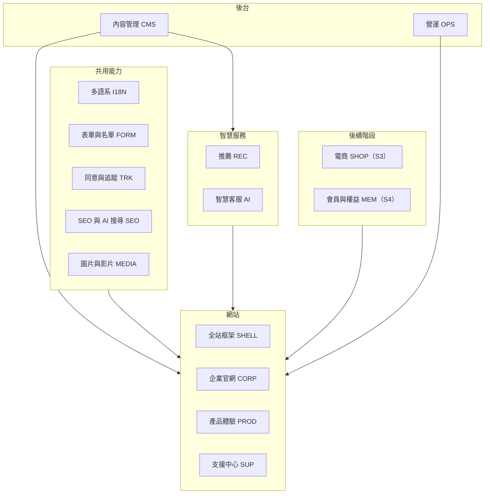
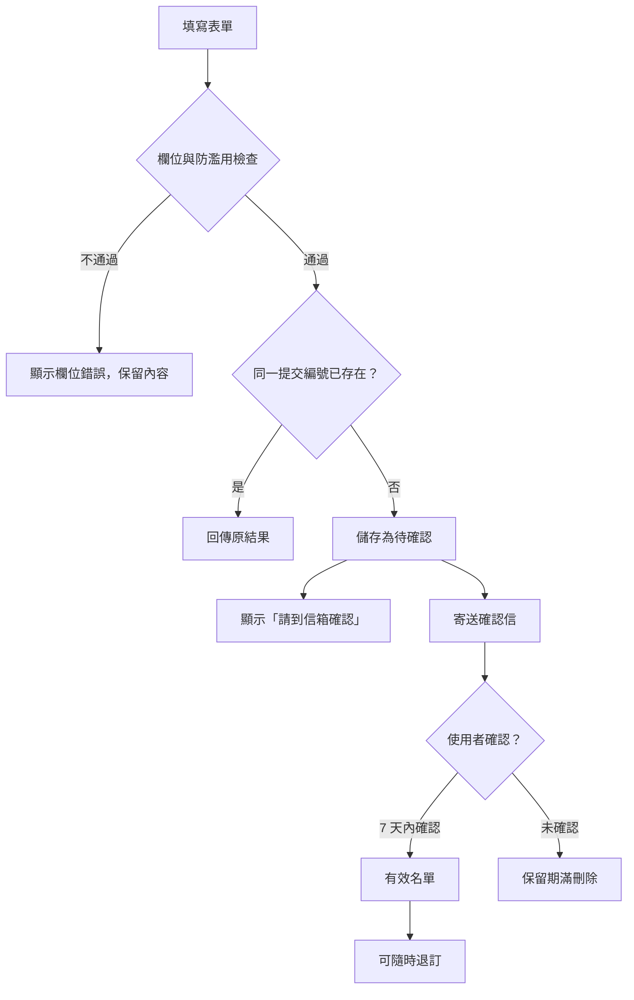
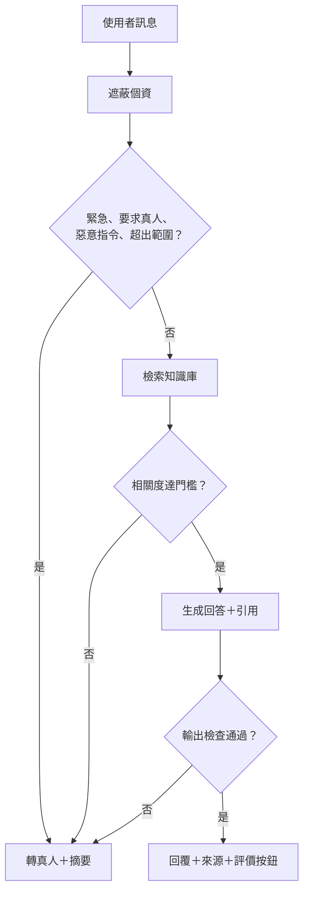
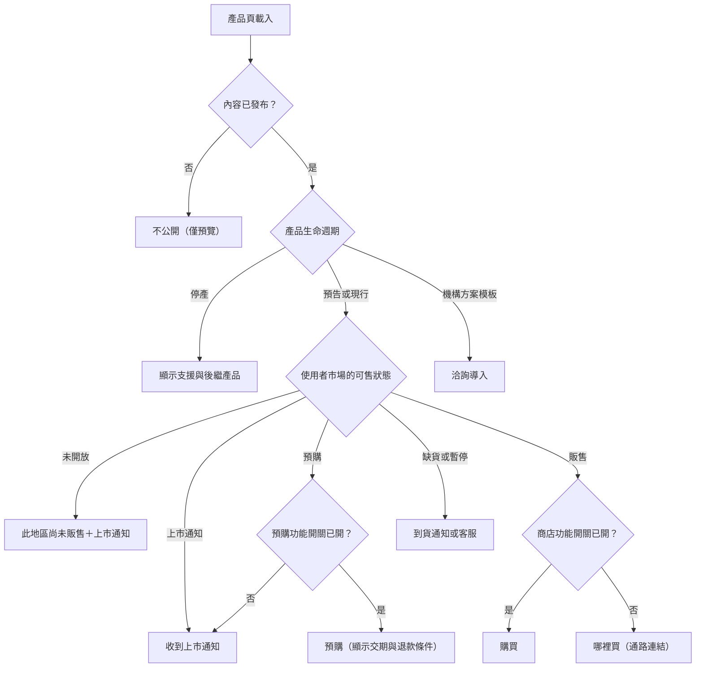
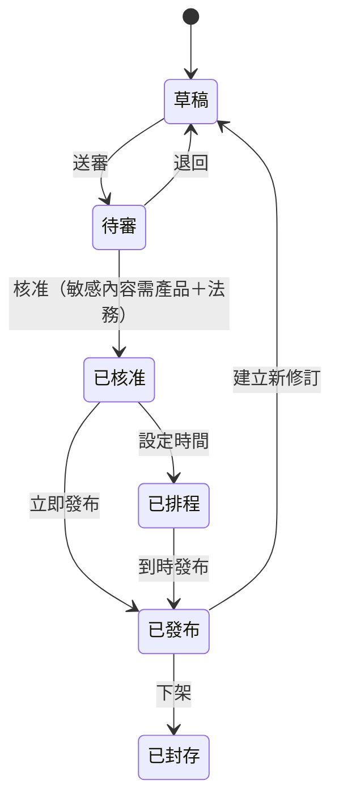

# D-Link Robotics 網站功能規格

版本：v1（2026-11-07）
對應：《數位平台建置計劃書 v6》
讀者：專案經理、設計、前後端工程師、QA、內容編輯
用途：定義「要做哪些功能、做到什麼程度算完成」；工程實作方式見《工程實施指南 v1》

---

## 0. 閱讀方式

- **功能編號**：`F-模組-序號`，例如 `F-FORM-01`。工單、測試案例、驗收紀錄都引用此編號。
- **階段**：S2 首發、A1 首發後 4–6 週、S3 交易、S4 會員與訂閱、S5 擴充。
- **優先**：P0 該階段必備；P1 該階段應有，可在核准下延後；P2 可選。
- **驗收條件**：每項功能的最低完成標準；QA 依此撰寫測試案例。

### 0.1 模組總覽

| 模組 | 功能數 | 首發（S2）P0 |
| --- | --- | --- |
| SHELL 全站框架 | 9 | 8 |
| CORP 企業官網 | 9 | 8 |
| PROD 產品體驗 | 12 | 10 |
| SUP 支援中心 | 11 | 7 |
| I18N 多語系 | 7 | 7 |
| FORM 表單與名單 | 10 | 9 |
| TRK 同意與追蹤 | 7 | 6 |
| SEO 與 AI 搜尋 | 8 | 7 |
| MEDIA 圖片與影片 | 5 | 4 |
| REC 推薦 | 6 | 3 |
| AI 智慧客服 | 14 | 3（A0） |
| CMS 內容管理 | 12 | 12 |
| OPS 營運 | 7 | 6 |
| SHOP 電商 | 12 | — |
| MEM 會員與權益 | 10 | — |

---

## 1. 頁面清單

| 路由 | 頁面 | 外框 | 模板 | 語言（首發） | 階段 |
| --- | --- | --- | --- | --- | --- |
| `/` | 語言與品牌選擇 | 精簡 | 選擇頁 | 三語 | S2 |
| `/{lang}/` | 企業首頁 | 企業 | 企業首頁 | 中、英 | S2 |
| `/{lang}/about/` | 關於我們（品牌精神） | 企業 | 內容頁 | 中、英、日 | S2 |
| `/{lang}/technology/` | 技術原則 | 企業 | 內容頁 | 中、英 | S2 |
| `/{lang}/products/` | 產品總覽 | 企業 | 列表 | 中、英 | S2 |
| `/{lang}/products/muru/` | MuRu 首頁 | MuRu | 完整故事 | 三語 | S2 |
| `/{lang}/products/muru/life-with-muru/` | 陪伴特色 | MuRu | 故事頁 | 三語 | S2 |
| `/{lang}/products/muru/growing-together/` | 成長軌跡 | MuRu | 故事頁 | 三語 | S2 |
| `/{lang}/products/muru/technology/` | 智慧設計與規格 | MuRu | 規格頁 | 三語 | S2 |
| `/{lang}/products/muru/the-app/` | App 與方案 | MuRu | 方案頁 | 三語 | S2 |
| `/{lang}/products/muru/faq/` | 購前 FAQ | MuRu | FAQ | 三語 | S2 |
| `/{lang}/products/muru/buy/` | 上市通知（S3 起購買） | MuRu | 轉換頁 | 三語 | S2 |
| `/{lang}/products/{product}/` | 其他產品 | 企業 | 單頁產品或機構方案 | 中、英 | S2（依核准） |
| `/{lang}/support/` | 支援中心首頁 | 企業 | 支援首頁 | 三語 | S2 |
| `/{lang}/support/{product}/...` | 產品支援（快速上手、使用手冊、照護指南、FAQ、資源中心、文章） | 依產品 | 支援頁 | 三語（MuRu） | S2 |
| `/{lang}/support/contact/` | 聯絡客服 | 企業 | 表單頁 | 三語 | S2 |
| `/{lang}/support/warranty/` | 保固協助 | 企業 | 表單頁 | 三語 | S2 |
| `/{lang}/support/repair/` | 維修與退換貨 | 企業 | 內容頁 | 三語 | S2 |
| `/{lang}/news/`、`/{lang}/news/{slug}/` | 新聞列表與內頁 | 企業 | 列表、文章 | 中、英 | S2 |
| `/{lang}/business/` | 商務、經銷、媒體洽詢 | 企業 | 表單頁 | 中、英 | S2 |
| `/{lang}/trust/` | 信任中心 | 企業 | 內容頁 | 三語 | S2 |
| `/{lang}/legal/*` | 隱私、條款、Cookie、無障礙 | 企業 | 法務頁 | 三語 | S2 |
| `/{lang}/subscriptions/confirm/`、`/unsubscribe/` | 名單確認、退訂 | 精簡 | 狀態頁 | 三語 | S2 |
| `/{lang}/cart/`、`/{lang}/checkout/` | 購物車、結帳 | 企業 | 前端應用 | 依市場 | S3 |
| `/{lang}/account/*` | 會員中心 | 企業 | 前端應用 | 三語 | S4 |
| `/{lang}/legal/commercial-disclosure/` | 特定商取引法表記 | 企業 | 法務頁 | 日 | S3（日本開賣） |

---

## 2. 全站框架（SHELL）

| ID | 功能 | 說明與驗收條件 | 階段 | 優先 |
| --- | --- | --- | --- | --- |
| F-SHELL-01 | 企業外框 | 頁首：Logo、品牌精神、技術、產品、新聞、支援、語言、「探索 MuRu」；頁尾：公司、產品、支援、法務、母公司連結、社群。桌機與手機版皆可鍵盤操作 | S2 | P0 |
| F-SHELL-02 | 產品外框 | 頁首：產品 Logo＋「by D-Link Robotics」、產品子頁導覽、語言、主要按鈕；頁尾含回企業官網。主題色由產品設定決定 | S2 | P0 |
| F-SHELL-03 | 手機導覽 | 漢堡選單開合、焦點鎖定、Esc 關閉；選單與 Cookie 橫幅、對話視窗不互相遮蔽 | S2 | P0 |
| F-SHELL-04 | 主要按鈕依狀態變化 | 依第 13 章規則顯示「收到上市通知／購買／哪裡買／洽詢導入」；無可用動作時不顯示 | S2 | P0 |
| F-SHELL-05 | 404 與語言缺頁 | 不存在的網址回 404；該語言無此頁時顯示其他語言連結 | S2 | P0 |
| F-SHELL-06 | 麵包屑 | 內頁顯示階層，並輸出結構化資料 | S2 | P0 |
| F-SHELL-07 | 減少動態效果 | 系統設定減少動態時停用自動播放與捲動動畫 | S2 | P0 |
| F-SHELL-08 | 社群連結 | 只顯示已確認可用的帳號（LINE、X、YouTube） | S2 | P0 |
| F-SHELL-09 | 站內搜尋 | 跨產品搜尋頁面、FAQ、文章 | S5 | P2 |

---

## 3. 企業官網（CORP）

| ID | 功能 | 說明與驗收條件 | 階段 | 優先 |
| --- | --- | --- | --- | --- |
| F-CORP-01 | 企業首頁 | 依序：主視覺、品牌精神、技術 DNA、MuRu 主打、產品與應用組合、新聞（有幾篇顯示幾篇）、支援與合作；各區塊內容可在 CMS 編輯 | S2 | P0 |
| F-CORP-02 | 關於我們 | 使命、與 D-Link 的關係、設計理念、核准里程碑；日文版首發提供 | S2 | P0 |
| F-CORP-03 | 技術原則 | 三項主題，每項標示適用產品與限制，連到產品規格 | S2 | P0 |
| F-CORP-04 | 產品總覽 | 依產品線分類，產品卡顯示名稱、一句話定位、狀態標籤；只顯示已公開產品；內容不足時不顯示空篩選 | S2 | P0 |
| F-CORP-05 | 新聞列表與內頁 | 分類、日期、關聯產品；支援排程發布與撤稿；撤稿網址回 410 | S2 | P0 |
| F-CORP-06 | 商務合作頁 | B2B、經銷、媒體三種需求說明與表單入口（F-FORM-04） | S2 | P0 |
| F-CORP-07 | 信任中心 | 網站資料處理、各產品本機與雲端邊界、保存與刪除、聯絡方式；網站與裝置隱私分區說明 | S2 | P0 |
| F-CORP-08 | 法務頁 | 隱私權、服務條款、Cookie（含重新設定入口）、無障礙聲明與回報；三語；顯示版本與生效日 | S2 | P0 |
| F-CORP-09 | 應用場域頁 | 教育、長照等情境與核准案例 | S5 | P1 |

---

## 4. 產品體驗（PROD）

| ID | 功能 | 說明與驗收條件 | 階段 | 優先 |
| --- | --- | --- | --- | --- |
| F-PROD-01 | MuRu 首頁 | 主視覺、產品理念、成長軌跡摘要、五項陪伴情境、智慧設計摘要、App 與方案、FAQ 摘要、上市通知；每個區塊可連到詳細頁 | S2 | P0 |
| F-PROD-02 | 陪伴特色頁 | 五個情境，每段含情境、核准功能、使用條件、下一步連結；健康相關不以醫療效能呈現 | S2 | P0 |
| F-PROD-03 | 成長軌跡頁 | 可鍵盤瀏覽的時間軸；積分與天數在產品核准前不顯示 | S2 | P0 |
| F-PROD-04 | 智慧設計與規格頁 | 「使用者價值 → 原理 → 規格 → 限制與認證」；規格表資料來自核准宣稱（F-CMS-04） | S2 | P0 |
| F-PROD-05 | App 與方案頁 | App 相容性與配對概念；Basic／Plus 功能比較表，每列標示網路需求、資料儲存、地區、費用；價格未核准時顯示「方案詳情公布時通知我」 | S2 | P0 |
| F-PROD-06 | 購前 FAQ | 手風琴展開；每題可連到售後完整文章；輸出 FAQ 結構化資料 | S2 | P0 |
| F-PROD-07 | 上市通知頁 | 嵌入 F-FORM-01；說明「不是訂單、不保留庫存」 | S2 | P0 |
| F-PROD-08 | 單頁產品模板 | 價值、核心特色、規格、相容與限制、支援、主要按鈕；供其他產品使用 | S2 | P0 |
| F-PROD-09 | 機構方案模板 | 需求、能力、導入流程、核准案例、洽詢按鈕（表單預帶產品） | S2 | P0 |
| F-PROD-10 | 產品主題 | 每個產品可設定色彩、字體、圖像風格；需通過對比度檢查才可發布 | S2 | P0 |
| F-PROD-11 | 產品比較 | 依可比較的規格欄位自動產生 | S5 | P2 |
| F-PROD-12 | 選購引導 | 「為誰選購？」問答導向產品；不保存答案 | S5 | P2 |

---

## 5. 支援中心（SUP）

| ID | 功能 | 說明與驗收條件 | 階段 | 優先 |
| --- | --- | --- | --- | --- |
| F-SUP-01 | 支援首頁 | 依產品分流；顯示熱門文章與聯絡入口；無需登入 | S2 | P0 |
| F-SUP-02 | 快速上手、照護指南 | 每篇標示適用型號、版本、語言、更新日期 | S2 | P0 |
| F-SUP-03 | 售後 FAQ 索引 | 摘要連到完整文章，不重複全文 | S2 | P0 |
| F-SUP-04 | 資源中心 | 依產品集中提供：使用手冊 PDF、快速上手、App 下載入口（App Store、Google Play）、規格書、媒體素材；只列出已核准檔案，顯示版本、適用型號、大小、語言、發布日；無檔案的分類不顯示 | S2 | P0 |
| F-SUP-05 | 聯絡客服 | F-FORM-05＋對話視窗入口；說明回覆管道 | S2 | P0 |
| F-SUP-06 | 保固與維修協助 | 說明可處理地區、所需證明、回覆方式；由客服人工承接 | S2 | P0 |
| F-SUP-07 | 保固線上登錄 | 掃描包裝 QR 開啟；登入後選擇已配對裝置或上傳證明 | S4 | P0 |
| F-SUP-08 | 其他產品支援 | 連到既有官方支援或人工窗口 | S2 | P1 |
| F-SUP-09 | 線上使用手冊 | 依產品與型號分章節；每章標示適用韌體與 App 版本、語言、更新日期；站內搜尋；三語；可列印與下載 PDF；章節網址穩定，可被客服與 AI 引用；內容在 CMS 維護，與 FAQ、照護指南同一個內容庫 | S2 | P0 |
| F-SUP-10 | 手冊 AI 助理 | 在手冊頁內直接提問；只依已發布、同語言、同型號的手冊與 FAQ 回答，附到章節的連結；依據不足或超出範圍轉客服並附摘要；與 F-AI-04～F-AI-09 共用同一套檢查、遮蔽與評價機制 | A1 | P1 |
| F-SUP-11 | 韌體更新說明與升級包 | 公告每個版本的更新內容、適用型號、更新方式與注意事項；升級包的提供方式（網站放檔案，或僅提供 App 內更新的說明與入口）**待與 App 團隊確認**；若提供檔案，需顯示版本、校驗碼、發布日，並保留舊版本說明 | S2（說明）／待決（檔案） | P1 |

---

## 6. 多語系（I18N）

| ID | 功能 | 說明與驗收條件 | 階段 | 優先 |
| --- | --- | --- | --- | --- |
| F-I18N-01 | 語言網址 | `/zh-tw/`、`/en/`、`/ja/`；直接開啟任何網址都顯示正確語言 | S2 | P0 |
| F-I18N-02 | 語言選擇頁 | `/` 顯示語言與品牌選擇，依瀏覽器語言標示建議，不自動跳轉 | S2 | P0 |
| F-I18N-03 | 語言切換 | 切到同一內容的另一語言版本；無該版本時列出可用語言 | S2 | P0 |
| F-I18N-04 | 介面文字完整性 | 已發布語言缺少任何介面文字時建置失敗 | S2 | P0 |
| F-I18N-05 | 在地格式 | 日期、貨幣、姓名、地址、電話依語言與市場格式 | S2 | P0 |
| F-I18N-06 | 字體與斷行 | 依語言載入字體子集；中日文標題依詞語斷行 | S2 | P0 |
| F-I18N-07 | 翻譯狀態 | 原文更新後，其他語言在 CMS 標示「需重新審稿」 | S2 | P0 |

---

## 7. 表單與名單（FORM）

| ID | 功能 | 說明與驗收條件 | 階段 | 優先 |
| --- | --- | --- | --- | --- |
| F-FORM-01 | 上市通知登記 | 欄位：Email、產品、語言、必要告知（必填）；姓名、關注地區（選填）。成功訊息說明需確認 Email 且不是訂單 | S2 | P0 |
| F-FORM-02 | Email 雙重確認 | 確認連結開啟確認頁，按下按鈕才生效；連結有期限且只能使用一次 | S2 | P0 |
| F-FORM-03 | 退訂 | 每封通知信附退訂連結；退訂立即生效；退訂後不再寄送 | S2 | P0 |
| F-FORM-04 | 商務、經銷、媒體洽詢 | 依需求類型分流到不同窗口；顯示已受理與回覆管道 | S2 | P0 |
| F-FORM-05 | 客服與保固表單 | 建立 Chatwoot 對話；回覆案件編號；不在表單收卡號或完整證件號碼 | S2 | P0 |
| F-FORM-06 | 防重複提交 | 同一提交編號重送只建立一筆；重複登記不透露是否已存在 | S2 | P0 |
| F-FORM-07 | 防濫用 | 免解題機器人驗證、誘捕欄位、速率限制；驗證服務故障時仍可提交 | S2 | P0 |
| F-FORM-08 | 錯誤處理 | 欄位錯誤顯示於欄位旁並保留已填內容；逾時顯示可重試，不顯示假成功 | S2 | P0 |
| F-FORM-09 | 可靠轉交 | 先儲存再回應成功；轉交失敗自動重試，超過上限告警 | S2 | P0 |
| F-FORM-10 | 電子報 | 與上市通知分開的訂閱用途 | S2 | P2 |

### 7.1 上市通知流程

---

## 8. 同意與追蹤（TRK）

| ID | 功能 | 說明與驗收條件 | 階段 | 優先 |
| --- | --- | --- | --- | --- |
| F-TRK-01 | Cookie 同意橫幅 | 接受、拒絕、設定三個選項；選項不預勾；拒絕不影響瀏覽與表單 | S2 | P0 |
| F-TRK-02 | 重新設定入口 | 頁尾與 Cookie 政策頁可隨時修改或撤回 | S2 | P0 |
| F-TRK-03 | 依同意載入 | 未同意前不載入分析與廣告腳本；同意工具故障時維持不追蹤 | S2 | P0 |
| F-TRK-04 | 事件追蹤 | 依《工程實施指南》事件字典送出；事件自動帶語言、產品、市場、頁面類型 | S2 | P0 |
| F-TRK-05 | 禁送個資 | 事件與網址參數不含 Email、姓名、電話、序號、表單內容 | S2 | P0 |
| F-TRK-06 | 伺服器端轉換 | 名單確認、案件受理由後端記錄；已同意者可同步至 GA4 | S2 | P0 |
| F-TRK-07 | 個人化同意類別 | 新增「個人化」類別供推薦使用 | S4 | P0 |

---

## 9. SEO 與 AI 搜尋（SEO）

| ID | 功能 | 說明與驗收條件 | 階段 | 優先 |
| --- | --- | --- | --- | --- |
| F-SEO-01 | 預渲染 | 公開頁原始 HTML 含完整正文、標題與連結 | S2 | P0 |
| F-SEO-02 | Metadata | 每頁 title、description、canonical、Open Graph；CMS 可覆寫 | S2 | P0 |
| F-SEO-03 | 多語標記 | hreflang 只列已發布語言，含自身與 x-default 規則 | S2 | P0 |
| F-SEO-04 | Sitemap | 依語言分檔，由建置時的發布清單產生 | S2 | P0 |
| F-SEO-05 | 結構化資料 | Organization、Product、BreadcrumbList、NewsArticle、VideoObject；內容與畫面一致 | S2 | P0 |
| F-SEO-06 | 轉址管理 | CMS 可設定永久轉址；產品改網址自動建立轉址；避免多層轉址 | S2 | P0 |
| F-SEO-07 | 爬蟲政策 | robots.txt 依搜尋、AI 搜尋、訓練用途分別設定 | S2 | P0 |
| F-SEO-08 | AI 引用觀測 | 每季固定問題記錄各 AI 助理提及情況 | S2 | P1 |

---

## 10. 圖片與影片（MEDIA）

| ID | 功能 | 說明與驗收條件 | 階段 | 優先 |
| --- | --- | --- | --- | --- |
| F-MEDIA-01 | 響應式圖片 | 自動輸出多尺寸與 AVIF／WebP；首屏圖 ≤ 200 KB；必填替代文字 | S2 | P0 |
| F-MEDIA-02 | 影片串流 | HLS 串流；首段 ≤ 3 MB；封面圖；手動播放控制 | S2 | P0 |
| F-MEDIA-03 | 字幕 | 敘事影片三語字幕 | S2 | P0 |
| F-MEDIA-04 | 素材授權 | 記錄來源、範圍、到期日；到期前 30 天提醒，到期自動下架 | S2 | P0 |
| F-MEDIA-05 | 素材庫 | 媒體用下載包 | S5 | P2 |

---

## 11. 推薦（REC）

| ID | 功能 | 說明與驗收條件 | 階段 | 優先 |
| --- | --- | --- | --- | --- |
| F-REC-01 | 相關內容推薦 | 產品頁、文章頁、支援頁顯示 3–4 個相關項目；只推薦已發布、同語言、該市場可售內容 | S2 | P0 |
| F-REC-02 | 編輯控制與推薦理由 | 編輯可置頂、排除、固定；每區塊顯示推薦理由 | S2 | P0 |
| F-REC-03 | 配件與加購推薦 | 商品頁與購物車顯示適用配件 | S3 | P1 |
| F-REC-04 | 會員推薦 | 依擁有裝置與方案推薦；需同意個人化，可關閉 | S4 | P1 |
| F-REC-05 | 行為個人化 | 機器學習排序；A/B 測試證明有效才開啟 | S5 | P2 |
| F-REC-06 | 推薦成效追蹤 | 曝光、點擊、後續行動 | S2 | P0 |

---

## 12. 智慧客服（AI）

| ID | 功能 | 說明與驗收條件 | 階段 | 優先 |
| --- | --- | --- | --- | --- |
| F-AI-01 | 客服平台 | Chatwoot 收件匣接收網站對話、Email、客服表單；客服團隊與權限設定完成 | S2 | P0 |
| F-AI-02 | 知識庫同步 | Wagtail 發布或下架後 15 分鐘內同步；每晚比對修正 | S2 | P0 |
| F-AI-03 | 客服人員輔助（A0） | Chatwoot 側欄顯示摘要、建議回覆與來源；客服採用、修改、捨棄皆記錄 | S2 | P0 |
| F-AI-04 | 網站 AI 回答（A1） | 依已發布、同語言、同產品內容回答，每個回答附來源連結 | A1 | P0 |
| F-AI-05 | 轉真人 | 使用者要求、緊急情境、超出範圍、依據不足、檢查不通過時轉真人並附摘要 | A1 | P0 |
| F-AI-06 | 輸出檢查 | 無來源的數字、承諾用語、非官方連結、語言不一致一律攔截 | A1 | P0 |
| F-AI-07 | 個資遮蔽 | 送模型與寫入紀錄前遮蔽身分證、手機、Email、卡號等 | A1 | P0 |
| F-AI-08 | AI 揭露 | 對話開頭標示 AI 身分；任何時候可輸入「真人」 | A1 | P0 |
| F-AI-09 | 回答評價 | 每則回答可評「有幫助／沒幫助」 | A1 | P0 |
| F-AI-10 | 緊急關閉 | 依渠道、語言一鍵關閉 AI；費用或錯誤率超標自動關閉 | A1 | P0 |
| F-AI-11 | 建立工單 | 經使用者同意後建立客服工單 | A1 | P0 |
| F-AI-12 | 訂單查詢 | 訂單編號＋Email 驗證碼驗證後查詢狀態與物流單號 | S3 | P0 |
| F-AI-13 | LINE 渠道 | LINE 官方帳號對話進入同一收件匣並由 AI 先回應 | S3 | P1 |
| F-AI-14 | 會員情境 | 查詢裝置、保固、訂閱狀態，建立維修工單 | S4 | P1 |

### 12.1 對話處理規則

---

## 13. 主要按鈕規則

---

## 14. 內容管理（CMS）

| ID | 功能 | 說明與驗收條件 | 階段 | 優先 |
| --- | --- | --- | --- | --- |
| F-CMS-01 | 頁面與區塊 | 以既定區塊組頁（主視覺、圖文、特色、時間軸、規格表、方案比較、FAQ、新聞、下載、信任、按鈕帶）；不開放任意 HTML | S2 | P0 |
| F-CMS-02 | 產品資料 | 產品 ID、名稱、來源、產品線、模板、生命週期、主題、後繼產品 | S2 | P0 |
| F-CMS-03 | 市場設定 | 每產品每市場的可售狀態、通路連結、商店參照 | S2 | P0 |
| F-CMS-04 | 宣稱與規格 | 型號、數值、單位、證據、限制、核准人、有效期；未核准或過期不可被引用 | S2 | P0 |
| F-CMS-05 | FAQ 與文章 | 購前、售後分類；適用產品、型號、版本 | S2 | P0 |
| F-CMS-06 | 多語版本 | 每語言一份頁面，可分別審核與發布；顯示翻譯狀態 | S2 | P0 |
| F-CMS-07 | 審核流程 | 草稿 → 待審 → 核准 → 排程或發布；敏感標籤需產品＋法務兩道核准 | S2 | P0 |
| F-CMS-08 | 預覽 | 草稿以正式版面預覽，只限登入的編輯 | S2 | P0 |
| F-CMS-09 | 排程與撤回 | 排程發布、撤稿；保留版本歷史可還原 | S2 | P0 |
| F-CMS-10 | 轉址 | 設定與檢查轉址，避免衝突與多層轉址 | S2 | P0 |
| F-CMS-11 | 發布狀態回報 | 編輯可看到建置處理中、成功、失敗及重試 | S2 | P0 |
| F-CMS-12 | 角色權限 | 品牌編輯、產品行銷、語言編輯、法務、客服編輯、檢視者；員工單一登入 | S2 | P0 |

### 14.1 審核流程

---

## 15. 營運（OPS）

| ID | 功能 | 說明與驗收條件 | 階段 | 優先 |
| --- | --- | --- | --- | --- |
| F-OPS-01 | 功能開關 | 商店、預購、登入、AI 客服等依環境、市場、產品設定；變更需核准並留紀錄 | S2 | P0 |
| F-OPS-02 | 監控與告警 | 公開頁、表單、轉交積壓、建置、AI 錯誤率與費用 | S2 | P0 |
| F-OPS-03 | 備份與還原 | 每日備份；每月還原演練 | S2 | P0 |
| F-OPS-04 | 回滾 | 程式與內容分別回滾；5 分鐘內回到上一版 | S2 | P0 |
| F-OPS-05 | 稽核紀錄 | 後台登入、權限變更、匯出、刪除、開關變更 | S2 | P0 |
| F-OPS-06 | 個資權利請求 | 受理、身分驗證、跨系統刪除與回覆 | S2 | P0 |
| F-OPS-07 | 費用監控 | 主機與 AI 用量超過預算 120% 告警 | S2 | P1 |

---

## 16. 電商（SHOP，S3）

| ID | 功能 | 說明與驗收條件 | 優先 |
| --- | --- | --- | --- |
| F-SHOP-01 | 市場與幣別 | 使用者選擇購買地區；切換市場重新驗證購物車 | P0 |
| F-SHOP-02 | 商品頁購買區 | 價格（台灣含營業稅、日本含消費稅總額）、庫存、出貨時間 | P0 |
| F-SHOP-03 | 購物車 | 加減數量、移除、配件建議（F-REC-03） | P0 |
| F-SHOP-04 | 結帳 | 地址、運送方式、發票資訊（台灣：載具、統編、捐贈） | P0 |
| F-SHOP-05 | 付款 | 託管付款頁；台灣：信用卡、LINE Pay、Apple Pay、ATM、超商代碼 | P0 |
| F-SHOP-06 | 付款結果 | 以金流伺服器通知為準；返回頁顯示處理中並輪詢 | P0 |
| F-SHOP-07 | 電子發票 | 付款成功自動開立；退款時作廢或折讓 | P0 |
| F-SHOP-08 | 訂單通知 | 訂單成立、出貨、退款信件三語 | P0 |
| F-SHOP-09 | 退換貨 | 申請入口、狀態追蹤；台灣 7 日解除權說明 | P0 |
| F-SHOP-10 | 日本必要頁面 | 特定商取引法表記、返品特約 | P0 |
| F-SHOP-11 | 通路連結 | 「哪裡買」列出核准通路 | P1 |
| F-SHOP-12 | 電商事件 | 依 GA4 電商事件規格，購買由伺服器端確認 | P0 |

---

## 17. 會員與權益（MEM，S4）

| ID | 功能 | 說明與驗收條件 | 優先 |
| --- | --- | --- | --- |
| F-MEM-01 | 登入 | 以 App 帳號系統登入（OIDC）；網站不保存密碼 | P0 |
| F-MEM-02 | 帳號連結 | 需同時驗證兩邊控制權；相同 Email 不自動合併 | P0 |
| F-MEM-03 | 我的產品 | 顯示已配對裝置與保固到期日 | P0 |
| F-MEM-04 | 保固登錄 | 見 F-SUP-07；送禮等情況由客服審核 | P0 |
| F-MEM-05 | 訂單紀錄 | 官網訂單與狀態 | P1 |
| F-MEM-06 | 訂閱管理 | 顯示方案、到期日、在哪裡管理；官網訂閱可取消 | P0 |
| F-MEM-07 | 官網購買 Plus | 定期扣款；付款確認後權益開通 | P0 |
| F-MEM-08 | 權益同步 | 官網、App Store、Google Play、硬體附贈、客服補償統一管理 | P0 |
| F-MEM-09 | 個人化設定 | 開關個人化推薦 | P1 |
| F-MEM-10 | 帳號刪除 | 申請刪除與資料匯出 | P0 |

---

## 18. 非功能需求

| ID | 項目 | 要求 |
| --- | --- | --- |
| NFR-01 | 可用性 | 公開頁每月 99.9%；表單受理 99.9%；AI 客服 99.5% |
| NFR-02 | 效能 | 真實使用者 p75：LCP ≤ 2.5 秒、INP ≤ 200 毫秒、CLS ≤ 0.1 |
| NFR-03 | 資源預算 | 企業頁 JS ≤ 150 KB、故事頁 ≤ 250 KB；同意前無第三方追蹤腳本 |
| NFR-04 | 發布時效 | 內容發布 95% 在 10 分鐘內生效；知識庫 95% 在 15 分鐘內 |
| NFR-05 | 回應時間 | 表單 95% 在 1.5 秒內；AI 回覆 95% 在 8 秒內 |
| NFR-06 | 無障礙 | WCAG 2.2 AA |
| NFR-07 | 安全 | OWASP ASVS 第 2 級；首發與各階段上線前滲透測試 |
| NFR-08 | 隱私 | 個資存放台灣區域；追蹤與 AI 紀錄不含未遮蔽個資 |
| NFR-09 | 復原 | 公開站 RTO 1 小時；資料庫 RTO 4 小時、RPO 15 分鐘 |
| NFR-10 | 瀏覽器 | Chrome、Safari、Edge、Firefox 最新兩版；iOS Safari、Android Chrome |

---

## 19. 首發驗收對應

| 驗收項目 | 對應功能 |
| --- | --- |
| 品牌與導覽 | F-SHELL-01–08、F-CORP-01–08、F-PROD-01–10 |
| 多語 | F-I18N-01–07 |
| 表單 | F-FORM-01–09 |
| 同意 | F-TRK-01–06 |
| 搜尋 | F-SEO-01–07 |
| 無障礙與效能 | NFR-02、NFR-03、NFR-06、F-SHELL-07 |
| 預覽與個資 | F-CMS-08、NFR-08 |
| 發布與復原 | F-CMS-09、F-CMS-11、F-OPS-03、F-OPS-04 |
| 推薦 | F-REC-01、F-REC-02、F-REC-06 |
| 客服平台與 A0 | F-AI-01–03 |
| AI 客服（A1） | F-AI-04–11 |
