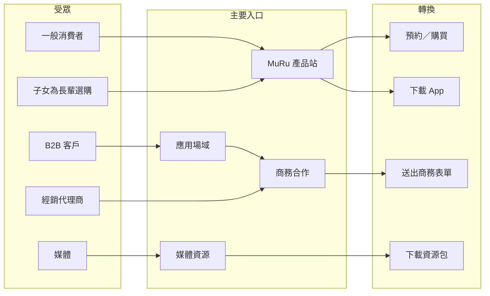
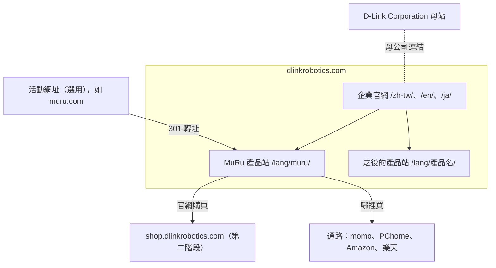
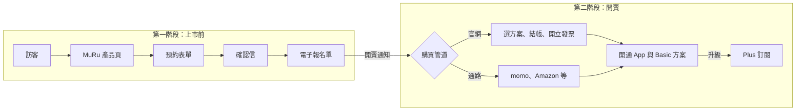
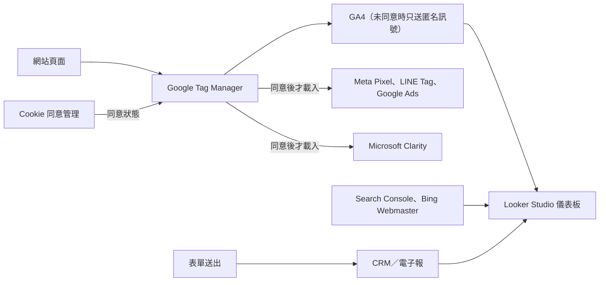
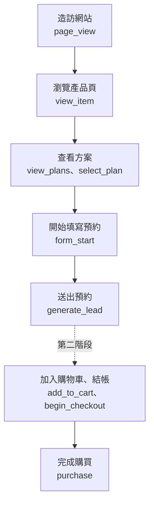
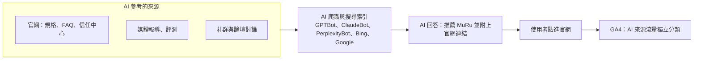
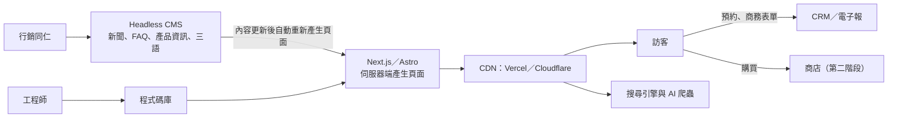
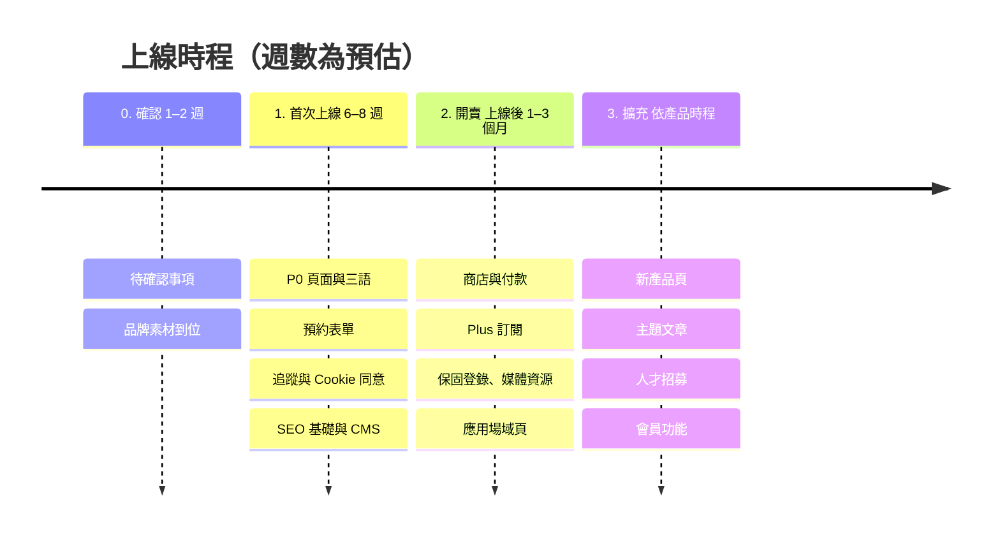

# D-Link Robotics 網站整體規劃建議

版本：v1 草案（2026-11-07）
依據：《D-Link Robotics 企業官網架構 v0（2026-09-17）》、《MuRu 網站架構 v1（2026-09-15）》、本次製作的可點擊示意站

---

## 0. 一頁摘要

兩份現行文件已經把**首頁的版面與三語文案**寫得很完整。要上線成為正式網站，還缺「網站整體骨架」與「看不見的基礎建設」。我們的建議：

1. **一個網域、兩層結構**：企業官網為主站，MuRu 及之後的產品站放在同網域的子目錄下（`dlinkrobotics.com/muru/`），集中 SEO 權重，也方便統一追蹤。
2. **補齊標準頁面**：產品總覽、應用場域（居家／教育／長照）、支援中心、商務合作、媒體資源、隱私與信任中心、法務頁。
3. **電商分兩階段**：上市前先做「預約／候補名單」收集名單；開賣後接上商店與付款，並列出經銷通路。
4. **一定要做數據追蹤**：上線第一天就要能回答「誰來了、從哪裡來、在哪一步流失」。並以符合「隱私優先」品牌形象的方式實作（先取得同意，再載入行銷追蹤）。
5. **SEO 與 GEO 一起做**：每個語言都要有獨立網址；頁面內容要能被搜尋引擎與 AI 助理（ChatGPT、Perplexity、Google AI 摘要）直接讀取並引用。
6. **技術改為伺服器端產生頁面＋內容管理系統（CMS）**：目前示意站是純前端渲染，搜尋引擎與 AI 不易讀取；新聞、FAQ 也需要行銷同仁能自行更新。

---

## 1. 現行文件盤點

| 項目 | 現行文件 | 我們的補充 |
| --- | --- | --- |
| 首頁版面與文案 | ✅ 企業站、MuRu 皆完整 | 沿用 |
| 三語文案（繁中／EN／日） | ✅ MuRu 完整；企業站只有中英 | 企業站補日文，三語網址分開 |
| 內頁 | MuRu 四個內頁有文字說明 | 補產品總覽、應用場域、支援中心等 |
| 其他產品（靈犀、大／小機器狗） | 只在批註提到 | 規劃產品總覽與共用產品頁模板 |
| 購買流程 | 只有「Store / 預約 MuRu」按鈕 | 預約 → 商店 → 通路的完整流程（第 5 章） |
| 方案訂閱（Basic / Plus） | 方案內容完整 | 補付款方式、續訂、取消的規劃 |
| 支援服務 | FAQ、照護指南、保固登錄（僅提及） | 完整支援中心架構 |
| 數據追蹤 | ❌ 未提及 | 第 6 章 |
| SEO／GEO | ❌ 未提及 | 第 7、8 章 |
| 法務與合規 | 只列隱私權、條款連結 | Cookie 同意、各國電商必要頁面（第 10 章） |
| 技術與營運 | ❌ 未提及 | 第 9 章 |

---

## 2. 網站目標與受眾

| 受眾 | 他們想知道 | 網站要達成的目標（轉換） |
| --- | --- | --- |
| 一般消費者（家庭、獨居者、寵物飼主） | MuRu 能做什麼、安不安全、多少錢、哪裡買 | 預約／購買、下載 App、訂閱電子報 |
| 子女為長輩選購 | 能否遠端關心、操作是否簡單 | 預約／購買、聯絡諮詢 |
| B2B 客戶（教育、長照機構、企業） | 應用案例、規格、導入方式 | 送出商務合作表單 |
| 經銷代理商 | 合作條件、產品線 | 送出經銷洽詢 |
| 媒體 | 新聞稿、高解析圖片、聯絡窗口 | 下載媒體資源、聯絡公關 |
| 求職者（第二階段） | 公司願景、職缺 | 應徵 |

各受眾從哪裡進站、最後在哪裡轉換：



---

## 3. 網域與網站架構

### 3.1 網域策略

**建議：單一網域＋子目錄。**

```
dlinkrobotics.com/            ← 企業官網
dlinkrobotics.com/muru/       ← MuRu 產品站
dlinkrobotics.com/lingxi/     ← 之後的產品站，依此類推
```

- 優點：搜尋權重集中，新產品上線就能沾到主站的權重；追蹤、Cookie 同意、登入都只需處理一個網域。
- 若行銷上需要 `muru.com` 這類獨立網址，建議只當作**轉址用的活動網址**，實際內容仍在主網域。
- 商店若使用外部平台（例如 Shopify），建議掛在 `shop.dlinkrobotics.com`，並設定跨網域追蹤。



### 3.2 多語系網址

每個語言要有自己的網址，搜尋引擎才會分別收錄：

```
dlinkrobotics.com/zh-tw/muru/
dlinkrobotics.com/en/muru/
dlinkrobotics.com/ja/muru/
```

- 頁面之間以 `hreflang` 標註彼此是同一頁的不同語言版本。
- 首次造訪依瀏覽器語言**建議**切換，但不強制轉址（強制轉址會讓搜尋引擎爬不到其他語言）。
- 目前示意站的語言切換只改畫面、不改網址，正式版需要調整。

### 3.3 全站地圖

標示：**P0** 首次上線必備、**P1** 上線後三個月內、**P2** 視業務需要。

```
/{lang}/
├── 首頁                                   P0
├── about/            關於我們              P0  品牌精神、與 D-Link 的關係、里程碑
├── technology/       核心技術              P0  無縫連網、Edge AI 隱私、情感 AI
├── products/         產品總覽              P0  依類別：陪伴機器人／機器狗／…
├── solutions/        應用場域              P1
│   ├── home/         居家陪伴
│   ├── education/    教育                      （批註：以教育情境照呈現）
│   └── eldercare/    長照與醫療                （批註：以長照情境照呈現）
├── news/             新聞中心              P0  分類：公司消息／產品發布／產業觀點
│   └── {slug}/       新聞內頁              P0
├── support/          支援中心              P0
│   ├── faq/          常見問題（全產品）     P0
│   ├── downloads/    說明書、App 下載       P0
│   ├── warranty/     保固登錄              P1
│   ├── repair/       維修與退換貨          P1
│   └── contact/      聯絡客服              P0
├── business/         商務合作              P0  B2B 專案、經銷代理（表單分流）
├── press/            媒體資源              P1  新聞稿、Logo、高解析圖、公關窗口
├── trust/            隱私與信任中心        P0  資料如何處理、Edge AI 說明、安全承諾
├── careers/          人才招募              P2
├── legal/
│   ├── privacy/      隱私權政策            P0
│   ├── terms/        服務條款              P0
│   ├── cookies/      Cookie 政策           P0
│   ├── accessibility/ 無障礙聲明           P1
│   └── tokushoho/    特定商取引法表記（僅日文，日本開賣時必備）
│
├── muru/             MuRu 產品站
│   ├── 首頁                                P0
│   ├── life-with-muru/   陪伴特色          P0
│   ├── growing-together/ 成長軌跡          P0
│   ├── technology/       智慧設計＋完整規格 P0
│   ├── the-app/          App 與方案         P0
│   ├── faq/              MuRu 常見問題      P0  獨立成頁，對 SEO／GEO 很重要
│   ├── care-guide/       照護指南          P1
│   └── buy/              預約／購買         P0
│
└── {下一個產品}/      沿用產品站模板        P1–P2
```

### 3.4 導覽

**企業站頁首**：Logo｜產品（展開依類別分的產品清單）｜應用場域｜技術｜新聞｜支援｜語言切換｜**預約 MuRu**（主要按鈕）

**MuRu 站頁首**：維持現行文件的四個選單＋語言切換＋「預約 MuRu」，並在左上 Logo 旁加「by D-Link Robotics」回到企業站。

**全站頁尾**（兩站共用，只維護一份）：

| 產品 | 公司 | 支援 | 法務 |
| --- | --- | --- | --- |
| 各產品連結 | 關於我們、新聞、媒體資源、人才招募 | FAQ、下載、保固、聯絡客服 | 隱私權、條款、Cookie 設定、無障礙 |

底部：© 2026 D-Link Robotics｜母公司 D-Link Corporation 連結｜社群圖示（LINE、YouTube、X，並建議評估 Instagram）｜電子報訂閱欄位。

---

## 4. 重點頁面內容規劃

現行文件已定義的區塊不重複列出，這裡只寫新增頁面與需要補強的地方。

| 頁面 | 目的 | 主要區塊 | 主要行動按鈕 |
| --- | --- | --- | --- |
| 產品總覽 | 產品變多後的入口 | 類別篩選、產品卡（圖、一句話定位、狀態：販售中／即將推出）、產品比較 | 看產品、預約 |
| 產品頁模板（之後的產品共用） | 新產品可快速上線 | 首屏影片、核心特色、捲動展示（可參考 Go2 示意效果）、規格表、配件、FAQ、購買 | 預約／購買 |
| 應用場域 | 給 B2B 與機構看的情境 | 痛點、解法、導入案例、適用產品 | 商務合作表單 |
| 隱私與信任中心 | 回應「家裡有攝影機」的疑慮，也是品牌差異化 | 哪些資料留在本機、哪些上雲端、保存多久、怎麼刪除、資安認證、隱私指示燈說明 | 閱讀隱私權政策 |
| MuRu 規格 | 消費者購買前一定會查 | 現行文件的四大系統規格＋電池續航、充電時間、重量、包裝內容、保固年限、認證標章 | 預約 |
| MuRu FAQ | 回答購買前的疑慮 | 現行四題＋價格、出貨時間、退換貨、App 支援的手機系統、訂閱取消、網路需求、多人家庭使用 | 聯絡客服 |
| 預約／購買 | 轉換頁 | 方案選擇（主機＋Basic／Plus）、價格、出貨時間、付款方式、保固與退貨說明 | 送出預約／結帳 |
| 支援中心 | 買了之後的所有事 | 依產品分類的 FAQ、說明書下載、App 下載、保固登錄、聯絡表單 | 聯絡客服 |
| 媒體資源 | 降低媒體報導門檻 | 最新新聞稿、Logo 與產品圖打包下載、公司簡介、公關聯絡窗口 | 下載資源包 |

---

## 5. 電商與轉換規劃

**結論：需要。建議分兩階段，先收名單，再開賣。**

### 第一階段：預約／候補名單（上市前，P0）

- 「預約 MuRu」表單：姓名、Email、地區、有興趣的方案、是否同意接收行銷資訊。
- 送出後寄確認信，納入電子報名單，開賣時優先通知。
- 可選：小額訂金預購。需先確認退款規則與發票開立方式。

### 第二階段：正式販售（P1）

| 方案 | 適合情況 | 說明 |
| --- | --- | --- |
| A. 自營商店（建議：Shopify 等 SaaS 平台） | 要掌握客戶資料、做會員與訂閱 | 多幣別、多語系、訂閱方案都有現成功能；台灣需串接電子發票（如綠界），日本可用 Shopify Payments 或 KOMOJU |
| B. 使用 D-Link 既有電商 | D-Link 已有可沿用的商店 | 上線最快，但品牌體驗與資料可能分散 |
| C. 只導流到通路 | 初期不自營 | 台灣 momo、PChome；日本 Amazon、樂天。網站做「哪裡買」頁面即可 |

通常是 **A＋C 並行**：官網直購拿到第一手客戶資料，通路負責觸及。

兩個階段如何銜接：第一階段收到的名單，就是第二階段開賣時的第一批買家。



**電商需同步準備的內容**：運送與配送範圍、退換貨政策（台灣網購依法有 7 天鑑賞期）、保固條款、發票說明、付款方式（台灣：信用卡、LINE Pay、Apple Pay；日本：信用卡、コンビニ払い）。

### Plus 訂閱的付款

需要先決定在哪裡付款：
- **App 內付款**：使用者最方便，但 Apple／Google 會抽成 15–30%。
- **網站付款**：沒有平台抽成，但 App 內能否引導到網站付款，受各平台規範限制。

這是商業決策，建議會上確認。

---

## 6. 數據追蹤與分析

**結論：需要。** 沒有追蹤，就無法得知廣告是否有效、預約流程在哪裡流失、哪種語言的市場反應最好。

### 6.1 工具建議

| 用途 | 建議工具 | 說明 |
| --- | --- | --- |
| 網站流量與轉換 | Google Analytics 4 | 免費、業界標準 |
| 追蹤碼管理 | Google Tag Manager | 行銷人員可自行增減追蹤，不需改程式 |
| Cookie 同意管理 | CMP 工具（如 Cookiebot、OneTrust） | 搭配 Google Consent Mode v2，未同意前不載入行銷追蹤 |
| 搜尋表現 | Google Search Console、Bing Webmaster Tools | Bing 也影響 ChatGPT 搜尋的結果 |
| 廣告成效 | Meta Pixel、LINE Tag、Google Ads | 只在使用者同意後載入；LINE 在台日都很重要 |
| 行為熱圖（選用） | Microsoft Clarity | 須遮蔽表單欄位，且只在同意後啟用 |
| 報表 | Looker Studio | 每週自動更新的儀表板 |

資料如何流動：所有追蹤碼都經過 Tag Manager，並由 Cookie 同意狀態決定能否載入。



**品牌一致性提醒**：MuRu 主打「察言觀色，絕不監視」，網站追蹤也要言行一致——預設最少追蹤、使用者同意後才啟用行銷追蹤、表單內容不錄影。若品牌希望更進一步，可評估 Plausible 這類免 Cookie 的分析工具作為替代方案。

### 6.2 事件追蹤清單（埋點）

| 事件 | 觸發時機 | 記錄參數 | 是否為轉換 |
| --- | --- | --- | --- |
| `page_view` | 每次頁面瀏覽（自動） | 語言、站點（企業／MuRu） | |
| `view_item` | 進入產品頁 | 產品名稱 | |
| `cta_click` | 點擊任何主要按鈕 | 按鈕名稱、所在區塊、頁面 | |
| `video_progress` | 首屏影片播放 25／50／75／100% | 影片名稱 | |
| `scroll_depth` | 故事型頁面捲動 50／90% | 頁面 | |
| `view_plans` | 看到方案比較區塊 | | |
| `select_plan` | 點選 Basic／Plus | 方案名稱 | |
| `faq_expand` | 展開 FAQ 題目 | 題目 | |
| `language_switch` | 切換語言 | 原語言、新語言 | |
| `form_start` | 開始填寫表單 | 表單類型 | |
| `generate_lead` | 送出表單成功 | 表單類型（預約／商務／經銷／媒體／客服） | ✅ |
| `sign_up` | 訂閱電子報 | 來源位置 | ✅ |
| `app_store_click` | 點擊 App 下載 | iOS／Android | ✅ |
| `file_download` | 下載說明書、媒體資源 | 檔名 | |
| `outbound_click` | 點到通路或 D-Link 母站 | 目的地 | ✅（通路） |
| `add_to_cart` / `begin_checkout` / `purchase` | 第二階段電商 | 商品、金額、幣別 | ✅（purchase） |

這些事件串起來就是轉換漏斗，每一步之間的流失率就是優化的重點：



### 6.3 關鍵指標（KPI）

- **第一階段**：預約名單數、預約轉換率（造訪 → 送出）、各流量來源的名單成本、各語言市場的名單比例。
- **第二階段**：營收、轉換率、平均訂單金額、Plus 訂閱比例、購物車放棄率。
- **品牌與內容**：自然搜尋流量、AI 助理帶來的流量（第 8 章）、新聞頁閱讀量、B2B 表單數。

---

## 7. SEO（搜尋引擎優化）

### 7.1 技術面（上線前必備）

- **頁面在伺服器端產生**（SSR／SSG），搜尋引擎不用執行 JavaScript 就能讀到內容（見第 9 章）。
- 每頁有唯一的 `<title>`、meta description、`canonical` 網址。
- 三語各自獨立網址，並設定 `hreflang`（`zh-TW`、`en`、`ja`、`x-default`）。
- `sitemap.xml`（含各語言）與 `robots.txt`，上線後提交到 Google 與 Bing。
- 結構化資料（Schema.org）：

| 類型 | 用在哪裡 |
| --- | --- |
| `Organization` | 全站，並標註母公司 D-Link 與各社群帳號 |
| `Product` + `Offer` | 產品頁（價格、庫存、幣別） |
| `FAQPage` | FAQ 頁 |
| `NewsArticle` | 新聞內頁 |
| `BreadcrumbList` | 所有內頁 |
| `VideoObject` | 有產品影片的頁面 |

- 社群分享預覽：每頁設定 Open Graph 與 X Card 圖片與標題（LINE 分享也會讀取 Open Graph）。
- 圖片要有替代文字、適當壓縮（WebP／AVIF）；影片要壓縮並延後載入。目前示意用的單支影片約 29MB，正式版需要壓縮。
- 網站速度達到 Google Core Web Vitals「良好」標準：LCP < 2.5 秒、INP < 200 毫秒、CLS < 0.1。
- 舊網址若有變動，設定 301 轉址；自訂 404 頁面。

### 7.2 內容面

- **關鍵字規劃**：依三個語言分別研究。例如中文「陪伴機器人」、「寵物監控」、「長輩陪伴」，日文「コミュニケーションロボット」、「見守りロボット」、「ペットカメラ」。
- **主題式內容**：新聞中心之外，增加「產業觀點／使用指南」類文章，例如〈如何挑選陪伴機器人〉、〈Edge AI 如何保護家中隱私〉，吸引尚未認識品牌的搜尋者。
- **日文不是翻譯，是在地化**：日本搜尋習慣與用詞不同，日文頁面建議由日籍編輯審稿。

---

## 8. GEO（生成式引擎優化）

GEO 的目標，是讓使用者問 ChatGPT、Perplexity、Gemini 或 Google AI 摘要「有什麼推薦的陪伴機器人？」時，答案會提到 MuRu，並正確引用官網。



| 做法 | 說明 |
| --- | --- |
| 內容能被 AI 爬蟲讀取 | 伺服器端產生頁面；`robots.txt` 明確決定是否允許 GPTBot、ClaudeBot、PerplexityBot、Google-Extended 等爬蟲（建議允許公開頁面） |
| 清楚、可直接引用的事實 | 規格、價格、續航、支援地區用表格或條列寫清楚，數字前後一致。AI 偏好引用明確的事實句 |
| 問答式內容 | FAQ 用自然語言提問（「MuRu 會錄影嗎？」），第一句就直接回答 |
| 品牌實體一致 | 公司名、產品名、母公司關係在官網、新聞稿、社群、維基類資料中寫法一致；`Organization` 結構化資料加上 `sameAs` 連到各官方帳號 |
| 第三方提及 | AI 會參考媒體報導、評測、論壇討論。媒體資源頁與公關稿是 GEO 的一部分 |
| `llms.txt`（選用） | 業界新興提案，在網站根目錄提供給 AI 閱讀的網站摘要。成本低，可以做，但目前並非各家 AI 都支援 |
| 追蹤成效 | 在 GA4 中將來自 chatgpt.com、perplexity.ai 等的流量獨立分類；每季用固定問題詢問各家 AI，記錄品牌是否被提及、描述是否正確 |

---

## 9. 技術架構建議

| 項目 | 建議 | 原因 |
| --- | --- | --- |
| 前端框架 | Next.js 或 Astro（支援 SSR／SSG） | 目前示意站是純前端渲染（Vite SPA），對 SEO／GEO 不利；可沿用現有 React 元件 |
| 內容管理系統 | Headless CMS（如 Sanity、Strapi、Contentful） | 新聞、FAQ、產品資訊、三語翻譯由行銷同仁自行更新，不必找工程師 |
| 主機與 CDN | Vercel 或 Cloudflare | 台灣、日本都有節點，速度快；支援預覽環境 |
| 表單 | 寄送至 CRM 或行銷工具（如 HubSpot），並加防機器人驗證 | 預約與 B2B 名單要能追蹤後續 |
| 電子報 | 與 CRM 同一套 | 預約名單直接成為開賣通知對象 |
| 無障礙 | WCAG 2.2 AA | 頁尾已列無障礙聲明，網站本身需達標；長輩使用者也受益 |
| 動態效果 | 尊重「減少動態效果」系統設定 | Go2 式捲動動畫在低階手機上需降級 |
| 資安 | 全站 HTTPS、安全標頭、定期更新套件 | 與「軍規級資安」品牌主張一致 |



---

## 10. 法務與合規

| 項目 | 適用市場 | 網站上要有什麼 |
| --- | --- | --- |
| 個人資料保護 | 台灣（個資法）、日本（個人情報保護法）；若有歐洲用戶則含 GDPR | 隱私權政策、表單上的蒐集告知、資料刪除申請管道 |
| Cookie 同意 | 全市場（歐洲為法定義務） | Cookie 橫幅、Cookie 政策、隨時可修改設定的入口 |
| 網路購物 | 台灣 | 7 天鑑賞期與退貨說明、電子發票 |
| 網路購物 | 日本 | 「特定商取引法に基づく表記」頁面 |
| 無線電認證 | 台灣 NCC、日本技適 | 規格頁標示認證資訊（產品具 Wi-Fi／藍牙／4G／5G） |
| 訂閱服務 | 各市場 | 清楚標示價格、續訂週期、取消方式 |

法務頁的正式文字需由法務單位提供，網站負責架構與呈現。

---

## 11. 上線時程建議

| 階段 | 內容 | 預估 |
| --- | --- | --- |
| 0. 確認 | 第 12 章待確認事項、品牌素材（Logo、產品照、影片） | 1–2 週 |
| 1. 首次上線 | 第 3.3 節所有 P0 頁面、三語、預約表單、追蹤與 Cookie 同意、SEO 基礎、CMS | 6–8 週 |
| 2. 開賣 | 商店與付款、訂閱、保固登錄、媒體資源、應用場域頁 | 上線後 1–3 個月 |
| 3. 擴充 | 新產品頁、主題文章、人才招募、會員功能 | 依產品時程 |



時程需依素材到位時間與範圍確認後調整。

---

## 12. 待確認事項

1. **目標市場與上線順序**：台灣、日本、英語市場是否同時上線？
2. **網域**：確認使用 `dlinkrobotics.com`，以及 MuRu 是否需要獨立活動網址。
3. **販售方式**：自營商店、D-Link 既有商店，還是只走通路？預計開賣日期與售價？
4. **預約是否收訂金**？
5. **Plus 訂閱的付款管道**：App 內或網站？
6. **其他產品**（靈犀、大／小機器狗）：首次上線要露出到什麼程度？
7. **B2B 方向**：教育、長照是否為正式業務？有沒有可公開的案例？
8. **內容維護人員**：誰負責更新新聞、FAQ 與三語翻譯？
9. **追蹤與廣告**：是否會投放廣告？有沒有既有的 GA4／GTM 帳號，或沿用 D-Link 集團帳號？
10. **CRM／電子報**：D-Link 是否已有指定工具？
