# D-Link Robotics 網站與系統架構規劃建議

版本：v2 草案（2026-11-07）
依據：《D-Link Robotics 企業官網架構 v0（2026-09-17）》、《MuRu 網站架構 v1（2026-09-15）》、本次製作的可點擊示意站

**v2 修訂重點**：MuRu 是第一個產品，之後還會陸續推出其他產品。v1 是「為 MuRu 做一個網站」，v2 改為「建一個能持續上架新產品的平台，MuRu 是第一個上架的產品」。新增第 2 章（多產品前提）、第 4 章（系統架構）、第 6 章（內容模型）、第 9 章（客服與會員），網址規則與其他章節也一併調整。

---

## 0. 一頁摘要

1. **平台思維**：產品是「資料」，不是「一個個獨立網站」。新增產品＝在內容管理系統（CMS）新增一筆產品資料、套用版型與主題色，不需要重寫程式。平台成效的指標之一：**第二個產品上線只需 2–3 週**。
2. **三種產品頁等級**：旗艦品牌型（如 MuRu，有自己的故事頁與視覺風格）、標準型（一頁式產品頁）、方案型（B2B 詢價，不在線上販售）。
3. **一個網域、統一網址規則**：所有產品都在 `dlinkrobotics.com/{語言}/products/{產品}/` 之下。品牌權重集中，追蹤與 Cookie 同意只需處理一次。
4. **共用的商務與會員底層**：商店、訂閱、會員帳號、保固、客服由所有產品共用。會員帳號需與 App 帳號打通，才能做到「官網買 Plus，App 立即開通」。
5. **一定要做數據追蹤**：所有事件都帶上「產品」維度，每個產品各有儀表板，也能看全公司總覽。
6. **SEO 與 GEO 內建在平台裡**：每新增一個產品，sitemap、結構化資料、多語系標註自動產生，不靠人工補。
7. **技術**：伺服器端產生頁面（Next.js）＋ Headless CMS ＋ 共用設計系統（每個產品一套主題色）。目前示意站的 React 元件可以沿用。

---

## 1. 現行文件盤點

| 項目 | 現行文件 | 本文件的補充 |
| --- | --- | --- |
| 首頁版面與文案 | ✅ 企業站、MuRu 皆完整 | 沿用，轉為 CMS 內容 |
| 三語文案（繁中／EN／日） | ✅ MuRu 完整；企業站只有中英 | 企業站補日文，三語網址分開 |
| 多產品規劃 | 只在批註提到靈犀、大／小機器狗 | 產品等級、生命週期、內容模型、上架流程（第 2、6、13 章） |
| 系統架構 | ❌ 未提及 | 第 4 章 |
| 購買與訂閱 | 只有「預約 MuRu」按鈕與方案內容 | 預約 → 商店 → 訂閱開通的完整流程（第 8 章） |
| 客服、保固、會員 | FAQ、照護指南、保固登錄（僅提及） | 第 9 章 |
| 數據追蹤 | ❌ 未提及 | 第 10 章 |
| SEO／GEO | ❌ 未提及 | 第 11、12 章 |
| 法務與合規 | 只列隱私權、條款連結 | 第 14 章 |

---

## 2. 規劃前提：多產品的品牌與產品架構

### 2.1 品牌架構

D-Link Robotics 是企業品牌，每個產品可以有自己的個性，但都由 D-Link Robotics 背書。網站上表現為：**共用骨架（頁首、頁尾、法務、帳號、購物車），各產品有自己的主題色與故事**。

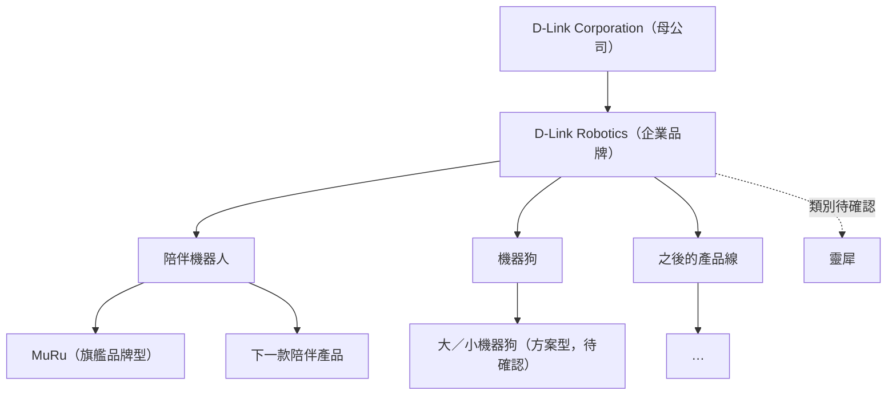

### 2.2 三種產品頁等級

| 等級 | 適用 | 網站上有什麼 | 購買方式 | 例子 |
| --- | --- | --- | --- | --- |
| 旗艦品牌型 | 主力消費性產品、有自己的子品牌 | 多個故事頁、專屬主題色與字體、App 與方案頁、專屬 FAQ | 線上預約／購買＋訂閱 | MuRu |
| 標準型 | 一般產品、配件型產品 | 一頁式產品頁（首屏、特色、規格、FAQ、購買） | 線上購買或導通路 | 之後的較小型產品 |
| 方案型 | B2B、機構採購、合作代理產品 | 產品頁＋應用案例＋規格下載 | 商務詢價表單 | 機器狗（教育、長照情境） |

產品可以升級：先以標準型上市，市場反應好再升級成旗艦品牌型，網址不變。

**待確認**：機器狗、靈犀是自有產品，還是合作代理產品？這會影響頁面等級、規格來源與購買方式。

### 2.3 產品生命週期

每個產品在 CMS 裡都有一個「狀態」，網站依狀態自動切換呈現方式，不需要工程師改版。

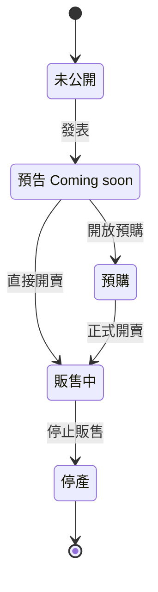

| 狀態 | 頁面是否公開 | 是否給搜尋引擎收錄 | 主要按鈕 | 其他 |
| --- | --- | --- | --- | --- |
| 未公開 | 否（僅內部預覽） | 否 | — | 可給合作夥伴密碼預覽 |
| 預告 | 是 | 是 | 加入候補名單 | 顯示「即將推出」 |
| 預購 | 是 | 是 | 預購／預約 | 顯示預計出貨時間 |
| 販售中 | 是 | 是 | 購買、哪裡買 | 正常狀態 |
| 停產 | 是（保留支援內容） | 是 | 看後繼產品 | 保留說明書、FAQ、保固；**不刪頁面**，保住搜尋排名 |

### 2.4 市場矩陣

不是每個產品都在每個市場販售。CMS 中每個產品分別設定在台灣、日本、英語市場的狀態與價格。網站依使用者所選語言／地區顯示：可購買、預購中，或「此地區尚未販售，加入候補名單」。

---

## 3. 網站目標與受眾

| 受眾 | 他們想知道 | 網站要達成的目標（轉換） |
| --- | --- | --- |
| 一般消費者（家庭、獨居者、寵物飼主） | 產品能做什麼、安不安全、多少錢、哪裡買 | 預約／購買、下載 App、訂閱電子報 |
| 子女為長輩選購 | 能否遠端關心、操作是否簡單 | 預約／購買、聯絡諮詢 |
| 既有用戶 | 怎麼用、保固、升級方案、新產品 | 保固登錄、升級訂閱、加購配件、購買第二款產品 |
| B2B 客戶（教育、長照機構、企業） | 應用案例、規格、導入方式 | 送出商務合作表單 |
| 經銷代理商 | 合作條件、產品線 | 送出經銷洽詢 |
| 媒體 | 新聞稿、高解析圖片、聯絡窗口 | 下載媒體資源、聯絡公關 |

多產品之後，「既有用戶買第二款產品」會變成重要的成長來源，這也是需要統一會員帳號的原因（第 9 章）。

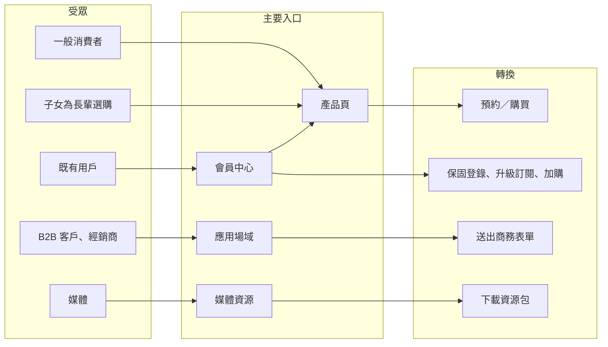

---

## 4. 系統架構

### 4.1 架構總覽

整個系統分五層。上層只依賴下層，新增產品只需在「內容」與「商務」兩層新增資料。

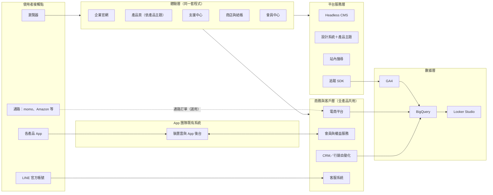

### 4.2 各元件職責

| 層 | 元件 | 負責什麼 | 建議工具（可替換） |
| --- | --- | --- | --- |
| 體驗層 | 網站前端 | 企業站、所有產品頁、支援中心、會員中心都在同一套程式中，以「產品主題」切換外觀 | Next.js |
| 平台服務層 | CMS | 產品資料、頁面內容、新聞、FAQ、說明書、三語翻譯、發布流程 | Sanity、Contentful、Strapi |
| | 設計系統 | 共用元件（頁首、頁尾、按鈕、規格表、方案卡、FAQ），每個產品一組主題色 | 由現有 React 元件整理而成 |
| | 站內搜尋 | 跨產品搜尋產品、FAQ、說明書、新聞 | Algolia 或 CMS 內建搜尋 |
| | 追蹤 SDK | 統一的事件格式，自動帶入產品、語言、市場 | 自建小型模組＋GTM |
| 商務與客戶層 | 電商平台 | 商品與 SKU、庫存、訂單、付款、台灣電子發票、日本付款方式 | Shopify（Markets、訂閱 App） |
| | 會員與權益服務 | 一個帳號通用官網、商店、App、客服；記錄誰擁有哪些產品、哪些訂閱、保固到期日 | 優先沿用 App 既有帳號系統；若無，用 Auth0、AWS Cognito 等 |
| | CRM | 預約名單、電子報、依產品興趣分群、商務線索 | HubSpot 等 |
| | 客服系統 | 工單、LINE 客服、Email 客服；FAQ 內容從 CMS 取用 | Zendesk、Freshdesk |
| 數據層 | GA4＋BigQuery | 網站行為；與訂單、CRM 資料合併分析 | Google 方案 |

### 4.3 與產品既有系統（App、裝置雲）的界線

網站不碰裝置控制，只透過「會員與權益服務」交換三件事：

1. **帳號**：同一個帳號登入官網、商店與 App。
2. **訂閱權益**：在官網購買 Plus，App 立即開通；在 App 內購買，官網會員中心也看得到。
3. **裝置序號**：保固登錄時綁定序號，客服可查詢使用者擁有的裝置。

官網購買 Plus 到 App 開通的流程：

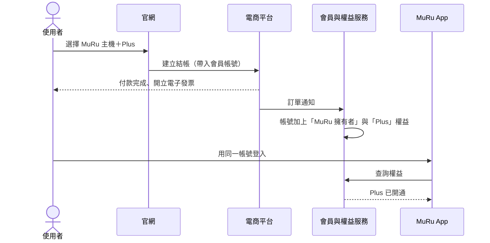

保固登錄流程：

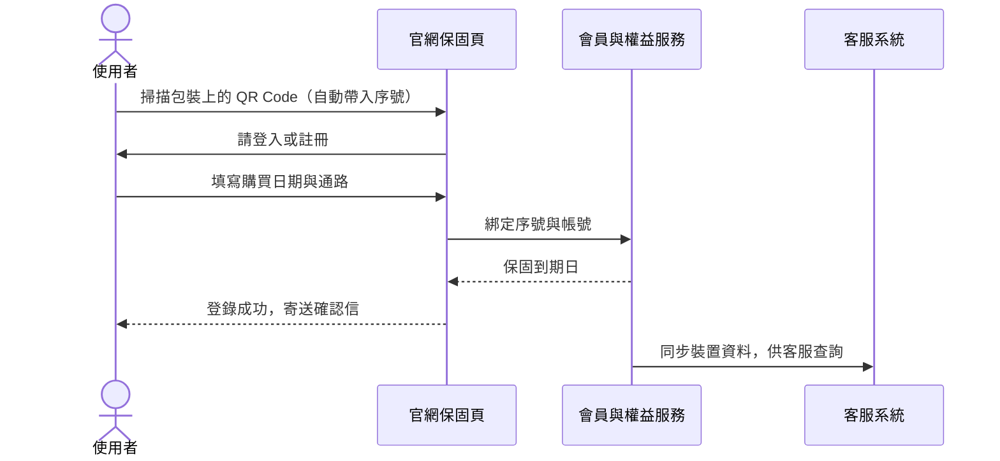

**待確認**：App 目前的帳號系統由誰維護？是否沿用 D-Link 既有的會員系統（例如 mydlink 帳號）？這個決定會影響第 9 章的做法，建議優先確認。

---

## 5. 網站資訊架構

### 5.1 網域與網址規則

**建議：單一網域，所有產品放在 `/products/` 之下。**

```
dlinkrobotics.com/{lang}/                      企業官網
dlinkrobotics.com/{lang}/products/             產品總覽
dlinkrobotics.com/{lang}/products/muru/        MuRu
dlinkrobotics.com/{lang}/products/muru/technology/
dlinkrobotics.com/{lang}/products/{下一個產品}/
```

- `{lang}` 為 `zh-tw`、`en`、`ja`，每個語言獨立網址，並以 `hreflang` 互相標註。
- 統一放在 `/products/` 下，避免產品名稱與企業頁面（如 `/support`、`/news`）衝突，產品再多也不會亂。
- 行銷用短網址（如 `dlinkrobotics.com/muru`、`muru.com`）一律 301 轉址到正式網址。
- 商店若使用 Shopify，掛在 `shop.dlinkrobotics.com`，並設定跨網域追蹤。
- 首次造訪依瀏覽器語言**建議**切換，不強制轉址。

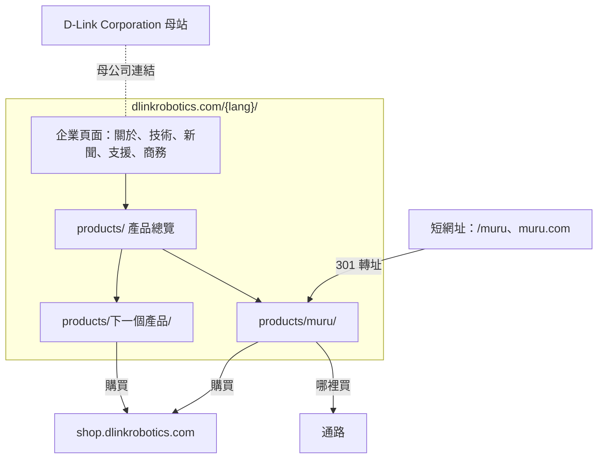

### 5.2 全站地圖

標示：**P0** 首次上線必備、**P1** 上線後三個月內、**P2** 視業務需要。

```
/{lang}/
├── 首頁                                    P0
├── about/              關於我們             P0  品牌精神、與 D-Link 的關係、里程碑
├── technology/         核心技術             P0  無縫連網、Edge AI 隱私、情感 AI（跨產品共用）
├── products/           產品總覽             P0  依產品線分類，顯示各產品狀態
│   ├── muru/           MuRu（旗艦品牌型）    P0
│   │   ├── life-with-muru/    陪伴特色
│   │   ├── growing-together/  成長軌跡
│   │   ├── technology/        智慧設計＋完整規格
│   │   ├── the-app/           App 與方案
│   │   ├── faq/               MuRu 常見問題
│   │   └── buy/               預約／購買
│   ├── {標準型產品}/    一頁式產品頁          P1
│   ├── {方案型產品}/    產品頁＋案例＋詢價     P1
│   └── compare/        產品比較             P2  產品達三款以上時
├── solutions/          應用場域             P1  居家陪伴、教育、長照與醫療
├── news/               新聞中心             P0  可依產品篩選
│   └── {slug}/         新聞內頁             P0
├── support/            支援中心             P0  先選產品，再看該產品的支援內容
│   ├── {產品}/         FAQ、說明書、App 下載、韌體說明
│   ├── warranty/       保固登錄             P1
│   ├── repair/         維修與退換貨          P1
│   └── contact/        聯絡客服             P0
├── account/            會員中心             P1  我的產品、訂閱、保固、訂單
├── business/           商務合作             P0  B2B 專案、經銷代理（表單分流）
├── press/              媒體資源             P1  依產品分類的新聞稿與素材
├── trust/              隱私與信任中心        P0  全產品共用的資料處理原則
├── careers/            人才招募             P2
└── legal/              隱私權、條款、Cookie、無障礙、特定商取引法表記（日文）  P0–P1
```

### 5.3 導覽

**頁首**（全站共用，進入產品頁時套用該產品主題色）：
Logo｜產品（展開依產品線分類的清單，含狀態標示）｜應用場域｜技術｜新聞｜支援｜搜尋｜語言｜會員｜購物車｜主要按鈕（預設「預約 MuRu」，可在 CMS 更換成當期主打產品）

**產品頁內的次導覽**（旗艦品牌型才有）：在頁首下方顯示該產品的子頁，例如 MuRu 的「陪伴特色／成長軌跡／智慧設計／App 與方案／FAQ／購買」。現行 MuRu 文件中的選單即放在這裡。

**頁尾**（全站共用，只維護一份）：

| 產品 | 公司 | 支援 | 法務 |
| --- | --- | --- | --- |
| 依產品線自動列出 | 關於我們、新聞、媒體資源、人才招募 | 支援中心、保固、聯絡客服、會員中心 | 隱私權、條款、Cookie 設定、無障礙 |

底部：© D-Link Robotics｜母公司 D-Link Corporation 連結｜社群圖示｜電子報訂閱。

---

## 6. 內容模型

「產品是資料」的具體做法：CMS 裡定義好以下內容類型，網站依資料自動組出頁面。

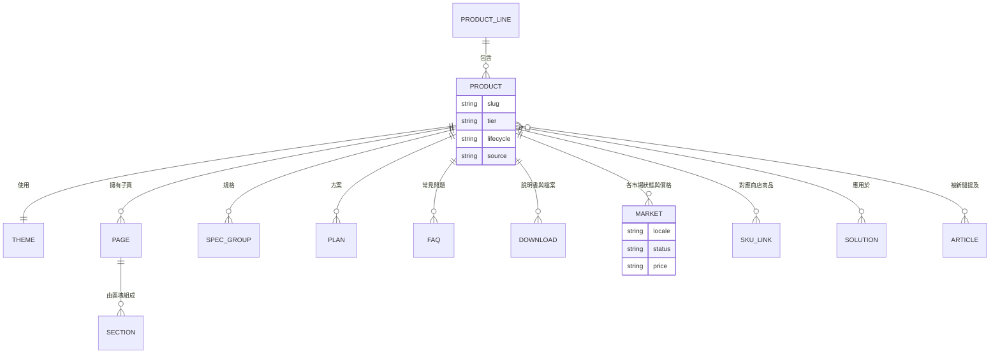

| 內容類型 | 說明 |
| --- | --- |
| 產品線 | 陪伴機器人、機器狗…，用於產品總覽分類與頁首選單 |
| 產品 | 名稱、網址代稱、等級（旗艦／標準／方案）、生命週期狀態、來源（自有／合作代理）、主視覺 |
| 主題 | 該產品的主色、輔色、字體、圖示風格；未設定時使用 D-Link Robotics 預設主題 |
| 頁面與區塊 | 旗艦品牌型產品的子頁，由可重複使用的區塊組成（首屏、圖文交錯、卡片、時間軸、規格表、方案卡、FAQ、行動呼籲） |
| 規格 | 分組的規格表（尺寸、感測器、連線、電池、認證），同時用於產品頁、比較頁與結構化資料 |
| 方案 | 隨機附贈與訂閱方案（如 MuRu Basic／Plus），含各市場價格 |
| FAQ | 可指定屬於某產品或全站；同一份內容用於產品頁、支援中心、客服系統 |
| 下載 | 說明書、快速上手指南、法規文件，依產品與語言分類 |
| 市場 | 每個產品在每個市場的狀態、價格、購買方式、通路連結 |
| 應用場域、新聞、案例 | 可關聯多個產品，產品頁自動列出相關內容 |

**好處**：規格只填一次，產品頁、比較頁、搜尋結果、AI 引用看到的數字一定一致；FAQ 只寫一次，網站和客服回答一致。

---

## 7. 重點頁面內容規劃

現行文件已定義的 MuRu 區塊不重複列出。

| 頁面 | 目的 | 主要區塊 | 主要按鈕 |
| --- | --- | --- | --- |
| 首頁 | 企業門面＋當期主打產品 | 品牌主張、主打產品（CMS 可更換）、產品線一覽、技術 DNA、新聞、信任背書 | 主打產品的預約／購買 |
| 產品總覽 | 產品變多後的入口 | 產品線分類、產品卡（狀態標示：販售中／預購／即將推出）、各地區是否販售 | 看產品 |
| 標準型產品頁模板 | 新產品快速上線 | 首屏、核心特色、捲動展示（可參考 Go2 示意效果）、規格表、配件、FAQ、購買 | 購買／哪裡買 |
| 方案型產品頁模板 | B2B 產品 | 應用情境、案例、規格、導入流程、規格書下載 | 商務詢價 |
| 產品比較 | 三款以上時協助選擇 | 依規格資料自動產生的比較表 | 看產品 |
| 應用場域 | 給機構看的情境 | 痛點、解法、案例、適用產品 | 商務合作表單 |
| 隱私與信任中心 | 回應「家中有攝影機」的疑慮，也是品牌差異化 | 本機與雲端各處理哪些資料、保存多久、如何刪除、資安認證、各產品的隱私設計 | 閱讀隱私權政策 |
| 支援中心 | 買了之後的所有事 | 先選產品 → 該產品的 FAQ、說明書、App、保固、聯絡客服 | 聯絡客服 |
| 會員中心 | 既有用戶的家 | 我的產品與保固、訂閱方案、訂單、推薦的配件與新產品 | 升級方案、加購 |

---

## 8. 電商與訂閱

**結論：需要，且要以多產品為前提來設計。**

### 8.1 分階段

| 階段 | 內容 |
| --- | --- |
| 第一階段：上市前 | 每個「預告」狀態的產品都有候補名單表單，名單依產品分群寫入 CRM |
| 第二階段：開賣 | 共用商店：主機、配件（如 MuRu 可替換的耳朵模組）、組合優惠、訂閱方案 |
| 第三階段：多產品 | 跨產品組合、既有用戶專屬優惠、會員中心加購 |

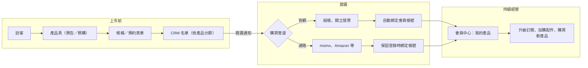

### 8.2 商品結構

| 類型 | 例子 | 說明 |
| --- | --- | --- |
| 主機 | MuRu 主機 | 可有顏色等變化 |
| 配件 | 耳朵模組、充電座 | 可單買，也可依產品推薦 |
| 組合 | 主機＋配件 | 上市促銷常用 |
| 訂閱 | MuRu Plus（月繳／年繳） | 依產品各自定義，透過會員與權益服務開通 |
| 服務 | 延長保固 | 第二階段後評估 |

### 8.3 平台選擇

| 方案 | 適合情況 | 說明 |
| --- | --- | --- |
| A. 自營商店（建議：Shopify 等 SaaS 平台） | 要掌握客戶資料、做會員與訂閱 | 多幣別、多語系、訂閱都有現成功能；台灣需串接電子發票（如綠界），日本可用 Shopify Payments 或 KOMOJU |
| B. 使用 D-Link 既有電商 | D-Link 已有可沿用的商店 | 上線最快，但品牌體驗與會員資料可能分散 |
| C. 只導流到通路 | 初期不自營 | 台灣 momo、PChome；日本 Amazon、樂天 |

建議 **A＋C 並行**。通路購買的用戶，透過保固登錄把帳號綁回來，才不會「賣出去就失聯」。

**電商需同步準備的內容**：運送範圍、退換貨政策（台灣網購依法有 7 天鑑賞期）、保固條款、發票說明、付款方式（台灣：信用卡、LINE Pay、Apple Pay；日本：信用卡、コンビニ払い）。

### 8.4 訂閱的付款管道

- **App 內付款**：使用者最方便，但 Apple／Google 會抽成 15–30%。
- **網站付款**：沒有平台抽成，但 App 內能否引導到網站付款，受各平台規範限制。

兩種都可以共存，前提是「會員與權益服務」是唯一的權益來源（第 4.3 節）。這是商業決策，建議會上確認。

---

## 9. 客戶服務與會員

| 項目 | 做法 |
| --- | --- |
| 統一帳號 | 一個帳號通用官網、商店、所有 App、客服；第二款產品上市時，用戶不需重新註冊 |
| 會員中心 | 我的產品（含序號與保固到期日）、訂閱方案、訂單紀錄、推薦內容 |
| 保固登錄 | 包裝與機身印 QR Code，掃描即帶入序號（第 4.3 節流程） |
| 客服管道 | 網站表單、Email、LINE 官方帳號，集中到同一個客服系統 |
| 知識庫 | FAQ 與說明書以 CMS 為唯一來源，網站與客服系統共用 |
| 客服可查資訊 | 用戶擁有的產品、保固狀態、訂閱狀態、訂單，不必反覆詢問 |

---

## 10. 數據追蹤與分析

**結論：需要。** 多產品之後還要能回答「哪個產品帶來最多新客？」、「買了 MuRu 的人會不會買第二款？」

### 10.1 工具與資料流

| 用途 | 建議工具 | 說明 |
| --- | --- | --- |
| 網站流量與轉換 | Google Analytics 4 | 業界標準 |
| 追蹤碼管理 | Google Tag Manager | 行銷人員可自行增減追蹤 |
| Cookie 同意管理 | CMP 工具（如 Cookiebot、OneTrust） | 搭配 Google Consent Mode v2，未同意前不載入行銷追蹤 |
| 搜尋表現 | Google Search Console、Bing Webmaster Tools | Bing 也影響 ChatGPT 搜尋 |
| 廣告成效 | Meta Pixel、LINE Tag、Google Ads | 只在同意後載入 |
| 行為熱圖（選用） | Microsoft Clarity | 遮蔽表單欄位、同意後才啟用 |
| 資料整合 | BigQuery | GA4 匯出＋訂單＋CRM，做跨產品、跨通路分析 |
| 報表 | Looker Studio | 全公司總覽＋每個產品一份儀表板 |

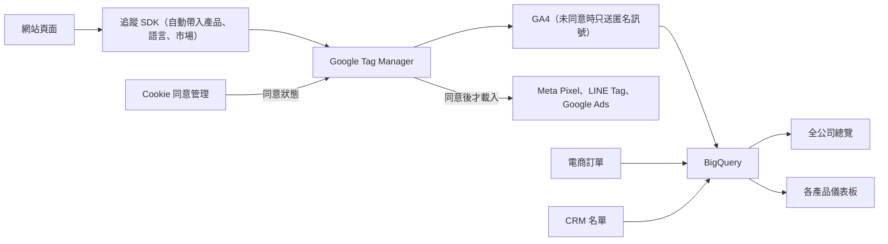

**品牌一致性提醒**：產品主打「察言觀色，絕不監視」，網站追蹤也要言行一致——預設最少追蹤、同意後才啟用行銷追蹤、表單內容不錄影。合併訂單與 CRM 資料時，僅使用去識別化的會員編號。

### 10.2 共用參數

每個事件都自動帶上以下參數，新產品上線不需重新設定追蹤：

| 參數 | 例子 |
| --- | --- |
| `product_id` | `muru` |
| `product_line` | `companion` |
| `lifecycle` | `preorder` |
| `site_section` | `corporate`／`product`／`support`／`account` |
| `language`、`market` | `ja`、`JP` |

### 10.3 事件清單（埋點）

| 事件 | 觸發時機 | 額外參數 | 是否為轉換 |
| --- | --- | --- | --- |
| `page_view` | 每次頁面瀏覽（自動） | | |
| `view_item` | 進入產品頁 | | |
| `cta_click` | 點擊主要按鈕 | 按鈕名稱、所在區塊 | |
| `video_progress` | 影片播放 25／50／75／100% | 影片名稱 | |
| `scroll_depth` | 故事型頁面捲動 50／90% | | |
| `view_plans` / `select_plan` | 看到方案區塊／點選方案 | 方案名稱 | |
| `compare_products` | 使用產品比較 | 比較的產品 | |
| `faq_expand` | 展開 FAQ | 題目 | |
| `search` | 站內搜尋 | 關鍵字 | |
| `language_switch` | 切換語言 | 原語言、新語言 | |
| `form_start` | 開始填寫表單 | 表單類型 | |
| `generate_lead` | 送出表單成功 | 表單類型（候補／預約／商務／經銷／媒體／客服） | ✅ |
| `sign_up` | 註冊會員或訂閱電子報 | 來源 | ✅ |
| `warranty_register` | 完成保固登錄 | 購買通路 | ✅ |
| `app_store_click` | 點擊 App 下載 | iOS／Android | ✅ |
| `file_download` | 下載說明書、媒體資源 | 檔名 | |
| `outbound_click` | 點到通路或母站 | 目的地 | ✅（通路） |
| `add_to_cart` / `begin_checkout` / `purchase` | 電商 | 商品、金額、幣別 | ✅（purchase） |
| `subscription_start` / `subscription_upgrade` | 訂閱 | 方案、週期 | ✅ |

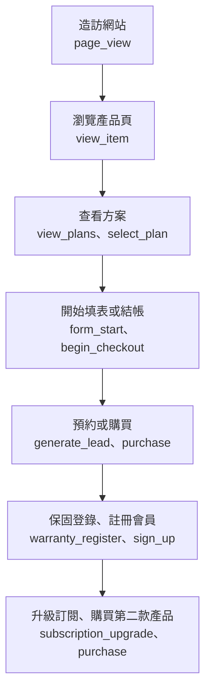

### 10.4 關鍵指標

- **各產品**：候補／預約名單數、轉換率、營收、訂閱比例、各市場表現。
- **全公司**：跨產品回購率、會員數、保固登錄率（通路銷售的帳號回收率）、自然搜尋與 AI 來源流量。
- **平台本身**：新產品從建立到上線所需天數（目標 2–3 週）。

---

## 11. SEO（搜尋引擎優化）

### 11.1 技術面（由平台自動處理）

新增產品時，以下項目自動產生，不靠人工：

- 每頁唯一的 `<title>`、meta description、`canonical`（CMS 欄位，未填時有預設規則）。
- 三語 `hreflang`（`zh-TW`、`en`、`ja`、`x-default`），某語言尚未翻譯的頁面不輸出該語言標註。
- `sitemap.xml`（依語言與產品分檔）與 `robots.txt`；「未公開」狀態的產品不出現在 sitemap，且設為不收錄。
- 結構化資料（Schema.org）：

| 類型 | 用在哪裡 | 資料來源 |
| --- | --- | --- |
| `Organization` | 全站，標註母公司與社群帳號 | 全站設定 |
| `Product` + `Offer` | 產品頁（價格、庫存、幣別） | 產品＋市場資料 |
| `FAQPage` | FAQ 頁 | FAQ 資料 |
| `NewsArticle` | 新聞內頁 | 新聞資料 |
| `BreadcrumbList` | 所有內頁 | 網址結構 |
| `VideoObject` | 有影片的頁面 | 區塊資料 |

- 社群分享預覽：Open Graph 與 X Card（LINE 分享也會讀取 Open Graph），每個產品使用自己的分享圖。
- 圖片自動轉 WebP／AVIF；影片壓縮並延後載入（目前示意用的單支影片約 29MB，正式版需壓縮）。
- Core Web Vitals「良好」：LCP < 2.5 秒、INP < 200 毫秒、CLS < 0.1。
- 產品停產時頁面保留；若真要下架，301 轉址到後繼產品或產品線頁面。

### 11.2 內容面

- **關鍵字規劃**：依三個語言、依產品分別研究。例如中文「陪伴機器人」、「寵物監控」、「長輩陪伴」，日文「コミュニケーションロボット」、「見守りロボット」、「ペットカメラ」。
- **產品線頁面**：「陪伴機器人」這類類別頁本身也要能排名，不只靠產品頁。
- **主題式內容**：如〈如何挑選陪伴機器人〉、〈Edge AI 如何保護家中隱私〉，吸引尚未認識品牌的搜尋者，並導向多個產品。
- **日文不是翻譯，是在地化**：建議由日籍編輯審稿。

---

## 12. GEO（生成式引擎優化）

目標：使用者問 ChatGPT、Perplexity、Gemini 或 Google AI 摘要「有什麼推薦的陪伴機器人？」時，答案會提到 D-Link Robotics 的產品，並正確引用官網。

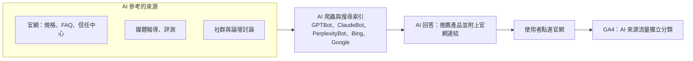

| 做法 | 說明 |
| --- | --- |
| 內容能被 AI 爬蟲讀取 | 伺服器端產生頁面；`robots.txt` 明確決定是否允許 GPTBot、ClaudeBot、PerplexityBot、Google-Extended 等（建議允許公開頁面） |
| 清楚、可直接引用的事實 | 規格、價格、續航、支援地區用表格呈現；因規格來自同一份資料，各頁數字必然一致 |
| 問答式內容 | FAQ 用自然語言提問（「MuRu 會錄影嗎？」），第一句直接回答 |
| 品牌實體一致 | 公司名、產品名、母公司關係在官網、新聞稿、社群中寫法一致；`Organization` 與 `Product` 結構化資料清楚標示「產品由 D-Link Robotics 推出」 |
| 第三方提及 | 媒體報導、評測、論壇討論都會被 AI 參考，媒體資源頁與公關稿是 GEO 的一部分 |
| `llms.txt`（選用） | 業界新興提案，提供給 AI 閱讀的網站摘要，可由產品資料自動產生；目前並非各家 AI 都支援 |
| 追蹤成效 | GA4 中將 chatgpt.com、perplexity.ai 等來源獨立分類；每季用固定問題詢問各家 AI，記錄各產品是否被提及、描述是否正確 |

---

## 13. 技術實作與營運

### 13.1 技術選型

| 項目 | 建議 | 原因 |
| --- | --- | --- |
| 前端框架 | Next.js（伺服器端產生頁面） | 目前示意站是純前端渲染（Vite SPA），對 SEO／GEO 不利；可沿用現有 React 元件 |
| 程式結構 | 單一程式庫（monorepo）：網站、設計系統、主題、追蹤模組、內容型別各自成包 | 所有產品共用同一套元件，修一次全站生效 |
| 設計系統 | 共用元件＋每個產品一組主題（顏色、字體、圓角、插圖風格） | 品牌一致，又保留各產品個性 |
| CMS | Headless CMS，支援多語系、草稿預覽、排程發布、角色權限 | 行銷與各地區編輯可自行作業 |
| 主機與 CDN | Vercel 或 Cloudflare | 台日都有節點；每次修改都有預覽網址 |
| 環境 | 開發／預覽／正式三套 | 「未公開」產品只在預覽環境可見 |
| 無障礙 | WCAG 2.2 AA | 長輩使用者也受益 |
| 動態效果 | 尊重「減少動態效果」設定；捲動動畫在低階手機上降級 | |
| 資安 | 全站 HTTPS、安全標頭、表單防機器人、定期更新套件 | 與「軍規級資安」品牌主張一致 |

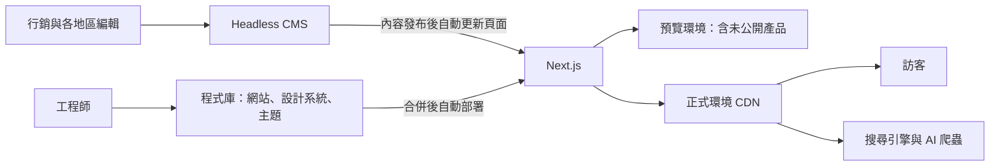

### 13.2 新產品上架流程

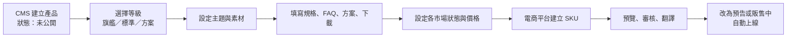

切換狀態後自動完成：頁首選單、產品總覽、頁尾、sitemap、結構化資料、追蹤參數、站內搜尋。

只有旗艦品牌型產品需要設計師參與（新主題、故事頁的視覺），標準型與方案型產品由行銷同仁即可完成。

### 13.3 內容發布流程與分工

| 角色 | 負責 |
| --- | --- |
| 品牌負責人 | 企業頁面、品牌一致性審核 |
| 產品行銷（每個產品一位） | 該產品的頁面、規格、FAQ、方案 |
| 各地區編輯（台、日、英） | 翻譯與在地化審稿 |
| 法務 | 法務頁、涉及隱私與功能宣稱的內容 |
| 客服 | FAQ 更新建議、知識庫維護 |
| 工程 | 平台、元件、整合、效能 |

流程：草稿 → 產品行銷審核 → 翻譯 → （必要時）法務審核 → 發布。

---

## 14. 法務與合規

| 項目 | 適用市場 | 網站上要有什麼 |
| --- | --- | --- |
| 個人資料保護 | 台灣（個資法）、日本（個人情報保護法）；若有歐洲用戶則含 GDPR | 隱私權政策、表單蒐集告知、資料刪除申請管道；會員帳號跨產品共用需在條款中說明 |
| Cookie 同意 | 全市場（歐洲為法定義務） | Cookie 橫幅、Cookie 政策、隨時可修改設定的入口 |
| 網路購物 | 台灣 | 7 天鑑賞期與退貨說明、電子發票 |
| 網路購物 | 日本 | 「特定商取引法に基づく表記」頁面 |
| 無線電認證 | 台灣 NCC、日本技適 | 各產品規格頁標示認證資訊（產品具 Wi-Fi／藍牙／4G／5G） |
| 訂閱服務 | 各市場 | 清楚標示價格、續訂週期、取消方式 |

法務頁的正式文字需由法務單位提供，網站負責架構與呈現。

---

## 15. 上線時程建議

| 階段 | 內容 | 預估 |
| --- | --- | --- |
| 0. 確認 | 第 16 章待確認事項、帳號系統方向、品牌素材 | 2–3 週 |
| 1. 平台＋MuRu 上線 | 平台骨架（設計系統、CMS 內容模型、追蹤、SEO 自動化）、企業站與 MuRu 的 P0 頁面、三語、預約表單 | 8–10 週 |
| 2. 商務與會員 | 商店與付款、訂閱開通、會員中心、保固登錄、客服系統整合 | 上線後 2–3 個月 |
| 3. 第二個產品 | 以模板上架，驗證「2–3 週上線」；產品總覽、應用場域、媒體資源補齊 | 依產品時程 |
| 4. 持續擴充 | 產品比較、跨產品優惠、主題文章、人才招募 | 持續 |

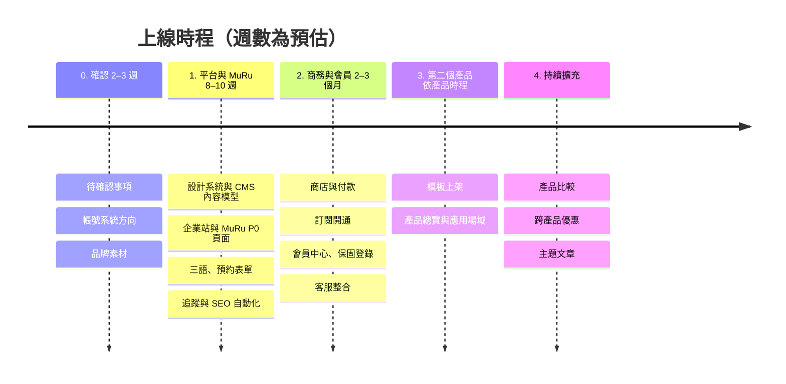

第一階段比 v1 多約 2 週，用來建平台骨架。代價換來的是之後每個產品都能快速上線。時程需依範圍與素材到位時間確認後調整。

---

## 16. 待確認事項

**影響架構，建議優先確認**

1. **產品藍圖**：未來 1–2 年預計推出哪些產品？哪些是自有、哪些是合作代理（如機器狗、靈犀）？
2. **帳號系統**：App 目前的帳號由誰維護？是否沿用 D-Link 既有會員系統（如 mydlink）？
3. **訂閱付款管道**：App 內、網站，或兩者並存？
4. **販售方式**：自營商店、D-Link 既有商店，還是只走通路？

**影響上線範圍**

5. **目標市場與上線順序**：台灣、日本、英語市場是否同時上線？各產品分別在哪些市場販售？
6. **網域**：確認使用 `dlinkrobotics.com`。
7. **MuRu 開賣時程與價格**；預約是否收訂金。
8. **B2B 方向**：教育、長照是否為正式業務？有沒有可公開的案例？

**營運面**

9. **內容維護人員**：各產品、各語言由誰負責更新？
10. **追蹤、CRM、客服工具**：是否有既有帳號，或沿用 D-Link 集團的工具？
