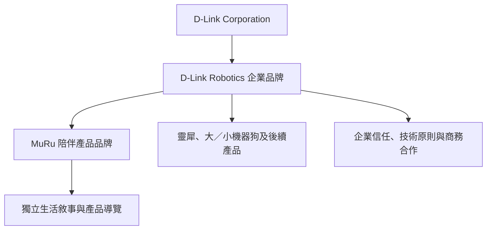
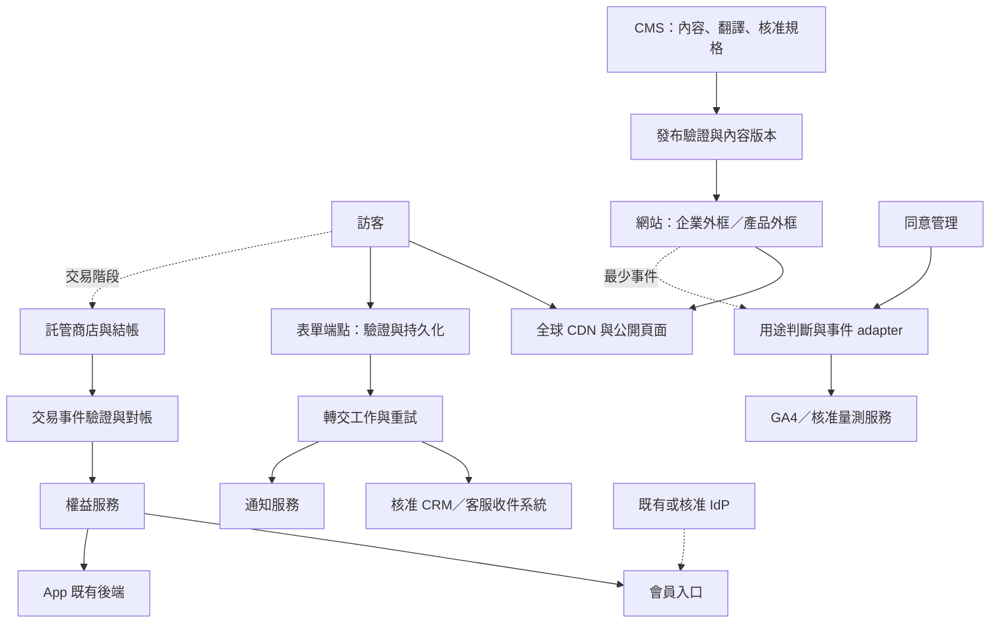
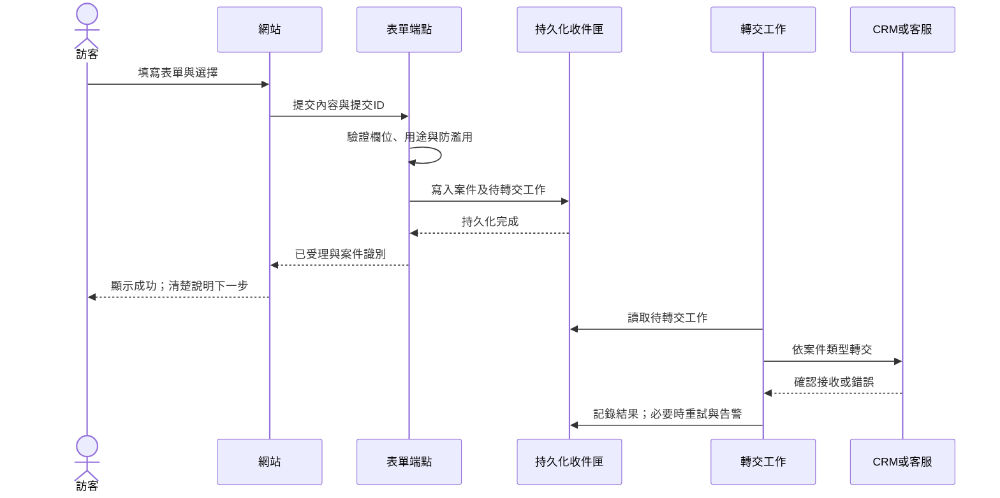

# D-Link Robotics 網站整體規劃建議

版本：v3 整合規劃版  
日期：2026-11-07  
適用：客戶提案討論、範圍確認、分期估價、設計與工程交付

本案建議建立一個可持續擴充的品牌與產品網站：D-Link Robotics 負責企業信任與產品組合，MuRu 保有自己的生活敘事與品牌體驗；兩者共用內容管理、基礎元件及發布流程。首發完成品牌介紹、產品理解、免費候補與服務入口，再依商業決策逐步導入交易、會員及訂閱。

本文是可獨立閱讀的完整規劃。凡標示「建議基線」者，為我方提出的設計與估價前提；「待確認」者需由指定責任人決定；「啟用條件」為相關功能發布前需具備的證據。文件完成不代表客戶已核准各項商業選項，也不代表網站或整合已完成驗收。

## 0. 決策摘要

| 面向 | 本案建議基線 |
| --- | --- |
| 品牌 | D-Link Robotics 為企業品牌，MuRu 採「MuRu by D-Link Robotics」背書關係；企業與產品各自保有導覽及敘事外框 |
| 網域 | 優先使用同一主網域與產品子目錄；`dlinkrobotics.com` 為待確認的候選，不表示已取得控制權或完成部署 |
| 多產品 | 以穩定產品 ID、受控區塊與展示模板擴充；每個產品可有不同敘事、交易方式及市場狀態 |
| 首發轉換 | 預設為「收到 MuRu 上市通知」的免費候補登記；不收訂金、不建立訂單、不要求會員 |
| 首發語言 | MuRu 繁中／英／日；企業內容繁中／英；支援 MuRu 的必要共用服務與法務內容提供三語。企業日文另列增補選項 |
| 產品組合 | 首發規劃 MuRu 完整內容，以及靈犀、大／小機器狗的核准摘要／應用情境與洽詢入口；未核准的產品不公開 |
| 技術 | Next.js＋TypeScript 作前端建議基線，公開內容預產生與受控更新；託管 Headless CMS；Vercel 作部署驗證首選 |
| CMS | 以 Sanity 作概念驗證首選，實際方案須通過三語、預覽保護、審核與匯出測試；供應商透過內容介面隔離 |
| 商店 | 優先評估可沿用的 D-Link 商店與託管 SaaS 商店；確定商家實體、付款與訂閱可行性後擇一，不預設自建結帳 |
| 身分與權益 | 帳號、付款者、裝置擁有者、保固及訂閱分開管理；App 整合獨立驗收，不阻擋非交易網站首發 |
| 量測與隱私 | 分析／廣告預設未同意；Google 採 Basic Consent Mode；量測不得成為表單與服務運作的必要條件 |
| 搜尋 | 內建 metadata、有效的多語對應、sitemap 與適用的結構化資料；GEO 以可讀取、可核實內容及觀測為交付項目 |
| 品質 | 響應式、WCAG 2.2 AA、公開內容可直接取得、受保護預覽、實際表單、監控與回滾納入首發 |

首發基線尚待專案決策表核准。估價時，企業日文、自營商店、付費預購、會員／SSO、App 權益整合、全站搜尋及資料倉儲分列，避免以整包平台隱藏成本。

## 1. 網站目標與使用者任務

### 1.1 商業與產品目標

1. 讓訪客理解 D-Link Robotics 的品牌精神、與 D-Link 的關係，以及產品的可信度。
2. 以生活情境說明 MuRu 的陪伴價值、適用對象、使用限制及隱私控制，協助訪客做出有根據的選擇。
3. 將興趣轉化為可承接的上市通知名單、商務／經銷線索及媒體聯絡。
4. 提供清楚的照護指南、FAQ、客服與保固協助，讓既有客戶不必透過行銷頁尋找售後服務。
5. 建立可重用的內容與工程能力，讓後續產品在已支援的模板內擴充，並能量測真實上架成本。

### 1.2 受眾與主要旅程

| 受眾 | 核心問題 | 主要旅程 | 期望結果 |
| --- | --- | --- | --- |
| 家庭、獨居者、寵物飼主 | MuRu 能如何融入我的生活？ | 情境內容 → 功能與限制 → FAQ → 上市通知／購買 | 有效候補或交易階段的購買 |
| 為長輩選購的家人 | 是否容易使用、如何遠端關心、能否保護隱私？ | 陪伴特色 → App → 隱私說明 → 聯絡諮詢 | 理解能力邊界並取得協助 |
| 既有用戶 | 怎麼用、怎麼維修、方案如何管理？ | 支援中心 → 產品 → 指南／FAQ／客服 | 完成自助或建立服務案件 |
| 教育、長照與企業客戶 | 適用哪些場域、如何導入？ | 產品摘要／情境 → 核准資料 → 商務表單 | 交付明確的商務需求 |
| 經銷代理商 | 產品與地區如何合作？ | 產品組合 → 經銷洽詢 | 由商務窗口接手 |
| 媒體 | 品牌與產品事實、授權圖片、聯絡人在哪裡？ | 新聞 → 媒體聯絡／資源 | 取得可引用資訊及窗口 |

網站內容以家人與成年購買決策者為主要對象。涉及兒童、健康、長照或寵物異常偵測的描述，均需由產品及法務確認適用限制，不以情境圖片暗示醫療效能或已完成的機構導入。

### 1.3 成效指標

首發觀察有效候補筆數、商務案件品質、企業到 MuRu 的導流、支援內容使用情況、表單失敗率及內容更新時間。交易啟用後再加入訂單、退款、淨營收及訂閱指標。各指標的分母、資料來源與同意造成的觀測限制見第 12 章；初期先建立基準，再設定有依據的成長目標。

## 2. 品牌與體驗設計

### 2.1 品牌層級



D-Link 的名稱、Logo、背書文字與產品來源以品牌授權為準。靈犀、機器狗屬自有或合作代理尚待確認；CMS 明確記錄來源，網站不預先宣稱所有產品均由 D-Link Robotics 自行研發。

### 2.2 兩種體驗外框

| 項目 | 企業官網 | MuRu 產品體驗 |
| --- | --- | --- |
| 身分 | D-Link Robotics | MuRu＋母品牌背書 |
| 主要敘事 | 品牌精神、可信技術、產品組合、合作 | 日常陪伴、共同成長、智慧設計、App 與方案 |
| 視覺 | 清楚網格、充足留白、自然生活場景、可信賴的技術說明 | 溫暖中性色、產品材質、細膩字體層次、具節奏的生活故事 |
| 導覽 | 品牌精神、技術、產品、新聞、支援 | 陪伴特色、成長軌跡、智慧設計、App 與方案 |
| 主 CTA | 探索 MuRu／查看產品 | 上市通知；交易就緒後才切換購買 |
| 頁尾 | 公司、產品、支援、法務、母公司、社群 | MuRu 品牌、產品支援、法務、回企業站、社群 |

底層共用按鈕、表單、字級尺度、間距、鍵盤行為與內容型別；頁首、頁尾及故事組合依情境配置。實作可採 `CorporateShell` 與 `ProductShell`，不以每產品複製整套網站維護。

### 2.3 視覺與互動原則

- 延續客戶提出的自然光、溫暖居家與柔和材質。優先使用已核准的實際產品照片／影片，概念視覺不得冒充正式產品或真實客戶案例。
- 首屏用一個明確主張、一個主要 CTA 及一張能說明產品與生活關係的畫面；規格和輔助細節逐步揭露。
- 動態用於解釋動作、成長或使用情境；避免強制捲動、長時間載入後才顯示正文，以及純裝飾的大型 3D 場景。
- 遵循 `prefers-reduced-motion`；重要訊息有靜態版本。影片提供 poster，敘事影片有字幕與可操作控制。
- 產品圖與文字分離，避免把文案燒進圖片而增加三語維護成本；各語言獨立檢查換行與視覺節奏。
- 行動版主導覽精簡，頁面只保留一個主行動。Cookie Banner、固定 CTA 與導覽不得互相遮蔽內容及焦點。

### 2.4 設計系統範圍

交付 token、字體與授權清單、基礎元件、企業／MuRu 外框、故事區塊及使用準則。主題可調顏色、字體、材質、圖像及動態節奏；必須通過對比與可讀性驗證。新產品使用既有區塊可由內容團隊配置；新增互動模式、版型結構或交易流程仍需設計與工程參與。

## 3. 分期範圍與功能邊界

本文用「首發」「交易」「會員」「擴充」標示功能啟用階段，不與缺陷嚴重度混用。

| 能力 | 首發 | 後續啟用條件 |
| --- | --- | --- |
| 企業品牌、技術、產品總覽、新聞與聯絡 | 必備 | 已核准的內容與素材 |
| MuRu 首頁、四個故事頁、購前 FAQ、候補入口 | 必備 | 產品宣稱與三語內容核准 |
| 靈犀、大／小機器狗摘要與場域情境 | 納入首發內容準備與估價 | 產品名稱、來源及素材核准才公開；未就緒須記錄延期決策 |
| Care guide、產品支援、客服、保固／維修協助入口 | 必備 | 已售產品需有可承接窗口；未售產品不展示不可用下載 |
| 三語基礎、SEO、CMP、最少量測 | 必備 | 語言與隱私驗收通過 |
| 免費上市通知、B2B／經銷／媒體表單 | 必備 | 接收、可靠轉交、回覆責任及蒐集告知就緒 |
| 電子報 | 選配 | 編輯與發送責任、退訂流程就緒；不與上市通知混用 |
| 自營商店、付款、配送、發票、退貨 | 交易階段 | 商家實體、金流與客服／財務流程通過驗證 |
| 付費預購／訂金 | 單獨交易子項 | 交期、取消、退款、收款及訂單條款已核准 |
| 統一登入、會員中心、自動保固 | 會員階段 | IdP、連結規則、裝置歸屬與存取授權確認 |
| 官網 Plus 訂閱與 App 權益 | 會員／訂閱階段 | 付款規則、App API、收據驗證、權益對帳共同驗收 |
| 完整其他產品頁、產品比較、產品線內容頁、媒體素材庫 | 擴充階段 | 素材及實際使用者任務成立，可在商店前上線 |
| 站內搜尋、熱圖、倉儲與跨產品行銷 | 依需求擴充 | 有明確問題、資料用途、費用上限與管理人 |

首發範圍不包含裝置控制、影像串流、聲紋處理、家庭活動資料或 App 本身的功能開發。網站可以解釋已核准的產品能力，但不複製裝置雲。首發不預設會員登入、購物車或購買按鈕，避免產生尚未提供的服務承諾。

## 4. 網域、資訊架構與導覽

### 4.1 網域方案

| 方案 | 取捨 | 建議 |
| --- | --- | --- |
| 主網域＋產品子目錄 | 共用維運與內容治理，產品仍可有獨立外框 | 本案基線 |
| 產品子網域 | 可獨立部署與團隊治理，但增加跨宿主同意、分析與登入工作 | 有實際隔離需求再採用 |
| MuRu 獨立網域 | 適合獨立品牌營運或商業主體，維護成本較高 | 保留選項，不列首發必要條件 |

候選正式主網域為 `dlinkrobotics.com`；網域所有權、DNS、既有網站及歷史 URL 必須先盤點。`www` 或裸網域擇一作正式主機，其餘永久轉址。已持有的品牌短網址可導向對應產品頁；不能假設 `muru.com` 已屬於客戶。

### 4.2 路由地圖

```text
/                                            語言／品牌入口，x-default
/{locale}/                                   企業首頁
├── about/                                   品牌精神、D-Link 關係
├── technology/                              企業技術原則
├── products/                                產品總覽
│   ├── muru/                                MuRu 首頁
│   │   ├── life-with-muru/                   陪伴特色
│   │   ├── growing-together/                 成長軌跡
│   │   ├── technology/                       智慧設計、核准規格
│   │   ├── the-app/                          App 與 Basic／Plus 說明
│   │   ├── faq/                              購前常見問題
│   │   └── buy/                              上市通知；交易階段切換購買入口
│   └── {product}/                            其他產品核准後擴充
├── support/                                 支援中心
│   ├── {product}/                            該產品支援入口
│   │   ├── getting-started/                  快速上手
│   │   ├── care-guide/                       照護指南
│   │   ├── faq/                              售後問題索引
│   │   ├── downloads/                        核准說明書與檔案索引
│   │   └── articles/{slug}/                  售後知識文章
│   ├── contact/                              客服
│   ├── warranty/                             保固協助；後續接自動登錄
│   └── repair/                               維修與退換貨協助
├── news/                                    新聞列表
│   └── {slug}/                              新聞內頁
├── business/                                商務／經銷／媒體表單分流
├── trust/                                   網站與產品隱私說明
└── legal/
    ├── privacy/                             隱私權政策
    ├── terms/                               適用服務條款
    ├── cookies/                             Cookie 政策與設定入口
    └── accessibility/                       無障礙說明與回報

後續按條件加入：
/{locale}/product-lines/{line}/               有獨立內容價值的產品線頁
/{locale}/solutions/{scenario}/              核准的應用場域與案例
/{locale}/products/compare/                   可比較產品的選擇工具
/{locale}/press/                             媒體素材庫
/{locale}/account/                           會員入口
/{locale}/legal/commercial-disclosure/       日本交易所需揭露
shop.{domain}/                               若採託管商店，依平台確認路徑
```

上述是路由模板與能力清單，並非每個 locale 都自動產生全部頁面。各路由可用語言由內容發布清單決定；未公開語言 URL 回傳真實 404 並提供可用語言連結，不把英文正文掛在日文路徑。

`compare`、`contact`、`warranty`、`repair` 等列為保留 slug；產品改名使用不變的 ID 與轉址映射。只有語意相應的永久替代頁才使用永久轉址，失效路徑不一律導首頁。

### 4.3 導覽規則

**企業頁首**：D-Link Robotics Logo｜品牌精神｜技術｜產品｜新聞｜支援｜語言｜探索 MuRu。商務合作可由支援展開選單及頁尾直接進入，首頁亦有明確入口。

**MuRu 頁首**：MuRu Logo＋D-Link Robotics 背書｜陪伴特色｜成長軌跡｜智慧設計｜App 與方案｜語言｜上市通知。FAQ／支援可在頁尾與頁內情境入口取得；不在其上疊放完整企業導覽。

企業 CTA 可依核准活動調整；產品 CTA 必須依目前產品與市場解析，不被全站主打產品覆蓋。停產產品保留支援、說明書與後繼產品資訊；未啟用商店時不出現購物車與帳號圖示。

日文 MuRu 可完整瀏覽三語支援與法務頁。若日文企業首頁未啟用，回企業站連結明示「企業網站（English）」；共享頁面保留返回 MuRu 的入口，不產生不存在的 `/ja/` 首頁連結。

### 4.4 內容分工

企業 `technology/` 說明經核准的技術原則；產品 `technology/` 說明特定型號能力。購前 FAQ 處理選購疑慮；售後文章提供操作步驟及適用版本。同一答案可摘要重用，完整售後文章保留單一權威 URL。

## 5. 頁面與內容規劃

### 5.1 企業首頁

| 順序 | 區塊 | 內容與呈現 | 行動與發布條件 |
| --- | --- | --- | --- |
| 1 | 品牌主視覺 | 延續「Technology that cares.／科技的使命，是為了更溫暖的陪伴。」與自然光居家場景 | 探索 MuRu；素材及品牌文字核准 |
| 2 | 品牌精神 | 人與科技的關係、陪伴的邊界、D-Link Robotics 的使命 | 前往品牌精神 |
| 3 | 技術 DNA | 安全連網、隱私設計、互動智慧三項主題 | 前往技術；每項有事實來源與適用範圍 |
| 4 | MuRu 主打產品 | 產品材質、生活情境、陪伴價值 | 前往 MuRu 體驗 |
| 5 | 產品與應用組合 | 靈犀、大／小機器狗的核准摘要；教育、長照用場域情境呈現 | 查看產品或商務洽詢；無實案時不標示為客戶案例 |
| 6 | 新聞 | 真實公告、產品消息與技術文章；有幾篇就顯示幾篇 | 閱讀新聞；不使用虛構新聞補版面 |
| 7 | 支援與合作 | 客戶支援、商務／經銷／媒體雙向分流 | 支援中心／洽詢表單 |
| 8 | 頁尾 | 母公司連結、法務、LINE／X／YouTube | 只展示已確認可用帳號；電子報選配 |

### 5.2 企業內頁

| 頁面 | 必備內容 | 備註 |
| --- | --- | --- |
| 品牌精神 | 使命、企業與母品牌關係、設計理念、已核准里程碑 | 保留獨立一級導覽入口 |
| 技術 | 經核准原則、可理解的解說、適用產品連結、必要限制 | 不把單一產品能力套用全產品 |
| 產品總覽 | 產品名稱、來源、產品線、可公開狀態、摘要與 CTA | 內容不足時採精簡分類，避免空篩選 |
| 新聞列表／內頁 | 標題、發布日期、分類、正文、關聯產品與媒體聯絡 | 排程／撤稿／更新日期可管理 |
| 商務合作 | B2B、經銷、媒體三種需求分流與承接說明 | 媒體聯絡首發提供，素材庫可後續擴充 |
| 信任中心 | 網站蒐集資料、各產品本機／雲端邊界、保存與刪除、聯絡管道 | 網站隱私與裝置隱私分區，依已核准事實呈現 |

### 5.3 MuRu 首頁

| 順序 | 區塊 | 使用者應理解的事 |
| --- | --- | --- |
| 1 | 主視覺 | MuRu 是什麼、為誰而設計、目前可以採取哪個行動 |
| 2 | 產品理念 | 溫暖陪伴、適當邊界，以及產品如何融入居家生活 |
| 3 | 成長軌跡摘要 | 隨互動發展的階段故事；未核准前不展示積分與天數承諾 |
| 4 | 五項陪伴情境 | 專屬迎接、適當退場、生活提醒、遠端關心、寵物關懷；每項連到相關細節 |
| 5 | 智慧設計 | 感測、燈光、連線與隱私控制如何支援上述情境 |
| 6 | App 與方案 | 裝置與 App 的分工、Basic／Plus 差異；清楚列出依賴與限制 |
| 7 | FAQ | 兒童／寵物共處、錄影與資料、方案、充電與使用限制 |
| 8 | 上市通知 | 簡短登記及不構成訂單的說明；不暗示保留庫存或交期 |
| 9 | 產品頁尾 | MuRu 品牌、Care guide、FAQ、支援、社群、法務與企業回連 |

### 5.4 MuRu 四個故事頁

**陪伴特色 `life-with-muru/`**：以一天的生活節奏串起五個情境。每個段落包含情境、核准功能、使用條件與下一步。遠端照片、影片、LINE 或異常推播應說明需啟用的功能、連線及資料處理條件；健康提醒不以醫療診斷或可靠緊急監測呈現。

**成長軌跡 `growing-together/`**：以可鍵盤瀏覽的時間軸呈現階段與互動變化，搭配實際產品動作或核准示意。產品團隊確認積分、天數、階段名稱與時光膠囊條件後才發布數字；網站只展示產品機制，不計算或儲存使用者的實際養成進度。

**智慧設計 `technology/`**：依「使用者價值 → 功能原理 → 核准規格 → 限制與認證」編排。規格可涵蓋尺寸、移動、感測、顯示、連線及電源，但正式值需對應型號與證據。照片、剖面圖與影片協助理解，不以大量技術名詞取代用途說明。

**App 與方案 `the-app/`**：說明安裝／相容性、配對與使用概念，以及 Basic／Plus 的核准功能表。各功能列是否需網路、資料儲存、支援地區與可能費用。Basic 隨機附贈時避免顯示成另一筆必須購買的商品；Plus 不預設為訪客已選方案。價格、保存期限與訂閱流程未定案時只發布已核准資訊及「方案詳情公布時通知我」。App 尚未發布時不放無效商店連結。

### 5.5 支援中心與售後

支援首頁依產品分流，直達 Care guide、快速上手、FAQ、下載、保固協助、維修與客服。無須登入即可閱讀公開指南。指南含版本、適用型號、語言、更新日期及檔案大小；有公開下載時提供可讀的 HTML 摘要與正確的檔案連結。

首發自助支援內容以 MuRu 為基線，依已核准版本提供照護與使用說明；未開售時只呈現可公開的內容及購前協助，不製作不存在的下載。其他產品的首發摘要附核准的既有官方支援連結或人工承接窗口，不在本次範圍內重建其完整知識庫，也不承接全部 D-Link 歷代產品。S0 列出實際型號、適用市場與承接者；無法辨識產品的使用者可經通用客服表單分流，頁面不暗示尚未確認的維修能力。

快速上手與 Care guide 各有第 4.2 節定義的固定內容 URL；售後 FAQ 為索引，摘要連到權威文章，不複製完整答案成多個可索引頁。下載索引指向受版本管理的公開檔案；沒有可用資源時不發布空索引。購前 `/products/muru/faq/` 與售後 `/support/muru/faq/` 依任務分工，重疊問題連向同一完整解答。

首發保固與維修可由客服人工承接，不必等待完整會員中心；頁面需交代可處理地區、必要證明及回覆方式。敏感購買證明或序號透過受保護的服務流程取得，不放在分析事件或公開 URL。後續自動化保留同一路徑與服務歷史。

### 5.6 後續產品與方案頁

展示模板分成「完整品牌故事」「單頁產品」「場域方案」三種，交易模式另設候補、通路、自營、詢價或停售。單頁產品包含價值、核心特色、核准規格、相容／限制、支援及 CTA；場域方案包含需求、可提供能力、導入流程、核准案例及詢價。產品比較以實際可比較屬性及選擇困難為啟用依據，不以產品總數機械決定。

## 6. 多語、地區與產品狀態

### 6.1 語言與發布基線

| 內容群組 | 首發語言 | 發布要求 |
| --- | --- | --- |
| 企業品牌、技術、產品總覽、新聞 | 繁中／英 | 企業日文為可另行核准的增補範圍 |
| MuRu 首頁及四個故事頁、FAQ、上市通知 | 繁中／英／日 | 各語言有內容審核者；核心流程含錯誤與成功訊息 |
| MuRu 必要支援、聯絡及法務 | 繁中／英／日 | 法務與服務窗口有對應可理解說明；不能只有外框翻譯 |
| 其他產品摘要 | 隨企業首發語言 | 每產品可獨立增加語言，避免自動產生空頁 |

URL 使用 `zh-tw`、`en`、`ja`；內容使用正規化的 `zh-TW`、`en`、`ja` 語言識別並明確映射。語言由 URL 決定，server 與 client 共享解析結果；Cookie 或 localStorage 只能記住偏好，不能覆蓋已開啟 URL 的語言。Next.js 的 locale 路由模式可支援此設計；具體版本與函式依實作時官方文件固定。[Next.js 國際化文件](https://nextjs.org/docs/app/guides/internationalization)。

根入口 `/` 提供語言與品牌選擇，瀏覽器語言只影響建議，不強制跳轉。切語言以 `content_id` 找對應頁；缺譯時明示可用語言及返回選項。未發布頁面不放入 hreflang、sitemap 或導覽。

三語詞彙表管理 MuRu／ムル、功能名、階段名、方案名與語氣。「小咪」是否為暱稱需確認；未定案前公開文案統一使用 MuRu。翻譯以母語審稿為發布條件，包含圖片 alt、SEO、表單、通知信與法律文字。

### 6.2 語言與市場分開

| 維度 | 控制內容 | 例子 |
| --- | --- | --- |
| `locale` | 文案與數字／日期格式 | `en` 不表示美國 |
| `market_id` | 可售商品、配送、合約與商家政策 | `TW`、`JP` 是待商務核准的候選市場 |
| `currency` | 報價與結帳幣別 | 由已啟用商務市場提供，不由語言猜測 |
| `channel` | 自營商店、通路、詢價 | 同產品可有多種核准管道 |

首發候補表單的地區欄位用於理解需求與通知範圍，不代表該市場已開售。交易啟用後，購買頁明示購買地區／配送目的地；切換語言保留市場，切換市場需重新驗證購物車與商品可售性。

首發品牌頁不依 IP 或 Cookie 產生隱藏的不同價格。未來若需要同語不同市場的可索引價格頁，另定穩定市場 URL、canonical 及 cache key；結帳一律依配送與商務規則重新驗價。

### 6.3 狀態模型與 CTA

內容發布狀態、產品生命週期、市場可售狀態分開管理：

| 維度 | 建議狀態 | 管理者 |
| --- | --- | --- |
| 內容 | 草稿、待審、已核准、排程、已發布、封存 | CMS 與審核流程 |
| 產品生命週期 | 概念、預告、現行、停產 | 產品負責人 |
| 市場可售性 | 未開放、免費候補、付費預購、販售、缺貨、暫停、停止販售 | 產品／商務；庫存依商務來源 |

公開 CTA 由上述資料與已啟用能力共同決定：

| 情況 | 顯示行動 |
| --- | --- |
| 內容未發布 | 不公開；只提供受授權預覽 |
| 免費候補 | 收到上市通知，附非訂單說明 |
| 付費預購能力已驗收且市場開放 | 預購，顯示付款、交期、取消與退款條件 |
| 販售中 | 購買／哪裡買，依可用管道 |
| 詢價型方案 | 洽詢導入，表單預帶產品 ID |
| 缺貨或暫停 | 依核准政策顯示到貨通知／通路／客服 |
| 停產 | 保留支援及適用後繼產品，不顯示無效購買 |

CMS 內容改成已發布不會自動啟用尚未完成的收款功能；商務能力以獨立設定及發布核准控制。

## 7. 內容模型與營運治理

### 7.1 模型

| 類型 | 核心欄位／關係 | 責任 |
| --- | --- | --- |
| Brand／Theme | 品牌 ID、Logo、背書、token、外框設定 | 管理品牌識別；主題可跨產品共用 |
| ProductLine／Product | 穩定 ID、名稱、slug、來源、產品線、展示模板、生命週期 | 管產品事實及分類；slug 可改、ID 不變 |
| Page／LocalizedContent | content ID、locale、標題、slug、翻譯群組、發布狀態、revision | 支援語言獨立審核與等價頁關聯 |
| Section | 核准的區塊類型、內容、參照、版型選項、schema version | 受控組頁，不開放任意腳本／HTML |
| Claim／Specification | 適用型號、功能值、單位、來源、限制、核准人、有效版本 | 公開事實與宣稱管理 |
| PlanContent | Basic／Plus 說明、功能矩陣、適用市場、商務方案參照 | 管說明；不自行決定扣款或權益 |
| Market／ProductMarket | 市場 ID、產品 ID、核准通路、可售說明、商務參照 | 產品與市場多對多；實價／庫存依商務投影 |
| FAQ／SupportArticle | 購前或售後、產品、適用版本、正文、locale | 相同事實共用，文章保留權威路徑 |
| Asset／Download | 來源、授權、alt、焦點、尺寸、版本、檔案類型、公開等級 | 避免草稿素材外洩與失效下載 |
| News／CaseStudy | 事實來源、發布／修改日期、關聯產品、案例授權 | 未經核准不發布客戶名稱及成效 |
| LegalDocument | 文件類型、適用市場、語言、版本、生效日 | 供告知與同意紀錄引用 |
| Redirect／Navigation | 原路徑、目的路徑、狀態碼、導覽可用條件 | 防衝突、斷鏈與錯誤跨語導覽 |

金額由交易系統提供，契約包含 amount、currency、精度、含稅口徑與有效期間，不以無約束的顯示字串當成交資料。內容投影可快取，但需保留來源與更新時間。

### 7.2 區塊庫

首發涵蓋主視覺、圖文交錯、產品卡、特色網格、時間軸、規格表、方案比較、FAQ、新聞列表、下載列表、信任說明與 CTA。每種區塊定義必要欄位、圖片比例、文字長度提醒、可用主題及可互動狀態；內容缺失時禁止發布或使用明確的安全呈現。

### 7.3 宣稱與翻譯審核

草稿 → 產品事實核准 → 品牌編輯 → 翻譯與母語審核 → 必要法務審核 → 預覽驗證 → 發布。

需產品及法務共同核准的項目包括隱私、資安等級、健康相關、認證、價格、雲端保存、訂閱與使用限制。一般新聞修字可依既有權限簡化，但不得繞過實質宣稱核准。

首發前特別收斂：成長積分／天數、Basic／Plus 保存政策、原始與衍生資料的本機／雲端邊界、連線／續航／感測規格、產品與合作代理來源。無證據時暫不公開該數字或宣稱；保留已核准故事，不製造測試結果或認證。

### 7.4 CMS 選型與發布能力

Sanity 作驗證首選，理由是適合建構產品、區塊與多語內容模型。主要頁面與文章採文件級多語，以穩定 content ID 關聯各語言文件，支援各語言獨立審核及發布；共同產品規格以參照共用。只有需同步發布的短標籤採欄位級翻譯，不假設所有審核／權限能力均包含於任意方案。[Sanity localization](https://www.sanity.io/docs/studio/localization)。

採購前以真實 MuRu 內容驗證：三語獨立審核、受保護預覽、排程／撤回、角色權限、版本追溯、API／webhook 限制、備份匯出、素材權利、費用與資料處理條件。若不符，改選符合相同契約的託管 CMS；首發只採一套，不維護雙 CMS。

CMS 發布事件經驗簽後觸發 schema／連結／宣稱檢查，再建立可用發布版本。HTML、metadata、JSON-LD 與 sitemap 取同一核准版本；發布失敗保留前一版。編輯介面顯示發布處理中／成功／失敗及重試入口，不能只把 webhook 送出視為全站更新成功。

## 8. 技術架構、渲染與狀態管理

### 8.1 技術基線及替代方案

| 面向 | 建議基線 | 決策理由與限制 |
| --- | --- | --- |
| 網站 | Next.js＋TypeScript，一個網站應用、兩種品牌外框 | 延續現有 React 經驗，支援公開內容與後續服務入口；版本於驗證後鎖定 |
| 公開內容 | 預產生 HTML，CMS 發布後受控重建／重新驗證 | 品牌內容不必每次請求依賴 CMS；核心正文與連結可直接取得 |
| CMS | 託管 Headless CMS，Sanity 為驗證首選 | 以第 7 章能力與合約選型；供應商 API 不直接滲入所有元件 |
| 部署 | Vercel 作 Next.js 驗證首選 | 優先降低首發部署整合成本；依帳號方案驗證預覽保護及費用 |
| 表單接收 | 伺服器端端點＋受控持久化＋可靠轉交 | 有既有核准系統可承接時重用；無既有系統則採託管 PostgreSQL 與背景工作基線 |
| 追蹤 | 業務事件介面＋CMP＋GA4 adapter；GTM 受控發布 | 同意與供應商實作解耦，首發只啟用必要事件 |
| 搜尋 | 首發以導覽與分類為主 | 有大量內容／明確搜尋需求後再選供應商 |
| 商店 | 後續接既有或託管商店 | 不在首發自建金流、訂單及結帳 |
| 身分 | 後續優先評估既有 IdP | 不因網站上線新增一套與 App 無關的會員資料庫 |

若首年確認僅需內容與外連商店，Astro 可作替代候選，因其支援預產生與按需渲染；若採此路線，需重新評估現有元件及內容整合成本，不同時維護兩種前端框架。[Astro rendering](https://docs.astro.build/en/guides/on-demand-rendering/)。

若已有 Cloudflare 或其他集團託管標準，可改以該部署平台驗證；執行環境、框架部署路徑、快取、圖片及預覽行為必須實測，不能視為直接替換。[Cloudflare Next.js 指引](https://developers.cloudflare.com/workers/framework-guides/web-apps/nextjs/)。

### 8.2 責任架構



此圖描述責任與資料流，不要求每一方塊都是獨立微服務。首發可由一個網站應用、CMS 與必要表單服務構成；商務、會員、權益在對應階段增加。設計系統是程式依賴，分析是側向能力，都不應成為所有業務請求必經的中間系統。

### 8.3 程式組織與介面

首發在單一程式庫以 `content`、`brand`、`forms`、`consent`、`analytics`、`commerce`、`identity` 等模組分責；只對已啟用功能實作。內容 adapter 輸出經 schema 驗證的 Page／Product 資料，元件不直接知道 CMS 查詢語法。追蹤 adapter 接收穩定事件，不讓元件直接依賴 GA4 或 Pixel API。

初期不為尚不存在的產品複製應用，也不預先拆大量 package。當確有第二個應用共用、獨立版本或獨立部署需求時，再將設計系統／內容契約等抽成套件。所有公開契約版本化；外部服務變更不應迫使所有頁面同步改寫。

### 8.4 渲染與快取策略

| 頁面／資料 | 方式 | 快取與失敗行為 |
| --- | --- | --- |
| 企業、產品故事、新聞、公開支援 | 預產生／受控更新 | 以路由、locale、公開版本為基礎；CMS 暫時故障保留上一個核准版本 |
| 公開市場商品投影 | 交易階段依固定市場讀取 | 納入 market、currency、有效版本；交易前重新驗證，來源失效不顯示假價格 |
| 表單提交 | 伺服器驗證與寫入 | 不進共享快取；超時可依提交 ID 安全重試 |
| 會員、訂單、保固、權益 | 經授權的個人資料讀取 | 不進公開 CDN 快取；不得跨帳號重用結果 |
| 草稿預覽 | 驗證編輯身分及預覽權限 | 獨立內容憑證、禁止公共快取；受保護素材同樣驗權 |
| 檔名含版本的公開圖片／字體 | CDN | 長期快取；替換內容使用新版本位址 |

不將 session、同意狀態或任意偏好 Cookie 塞進所有公開頁面的 cache key。個人化與市場差異只在確有需要的區域處理，避免無謂地使全站動態化。Next.js 的多實例及 CDN 佈署需額外確認快取與失效協調，依選定方案設計。[Next.js self-hosting](https://nextjs.org/docs/app/guides/self-hosting)。

### 8.5 狀態所有權

| 狀態 | 權威來源 | 客戶端用途 |
| --- | --- | --- |
| 語言、可分享篩選 | URL | 呈現與切換，不另建相互矛盾的全域值 |
| 選單、FAQ 展開、短暫選項 | 區域元件 | 純 UI 狀態 |
| CMS 內容 | 已核准發布版本 | 顯示，不由瀏覽器修改權威規格 |
| 同意與政策版本 | CMP／同意紀錄 | 決定非必要 SDK 與嵌入內容可否啟用 |
| 帳號 | IdP 與應用 session | 僅反映登入狀態，伺服器再次授權 |
| 購物車、售價、庫存 | 商務平台 | 顯示伺服器結果，市場切換重新驗證 |
| 付款、退款、訂閱原始事實 | 各交易來源 | 不以成功返回頁代替來源確認 |
| 裝置歸屬、保固、可用權益 | 核准產品／權益後端 | 經授權顯示，不信任 localStorage 的角色／Plus 標記 |

### 8.6 全球傳遞與環境

先以台灣、日本與其他實際目標地區量測 CDN、圖片、字體及動態 API 延遲；API 所在地與資料所在地另行決定。全球 CDN 不代表所有地區都可低延遲使用、可依法交易或符合資料在地要求；中國大陸等特殊營運需求另列專案條件。

至少分本機／開發、受保護預覽、正式環境，隔離 CMS dataset、憑證與追蹤設定。正式資料不任意複製到預覽。預覽保護須確認實際購買方案與所有發布網址的適用範圍，不只主網址。[Vercel Deployment Protection](https://vercel.com/docs/deployment-protection)。

## 9. 候補、聯絡與客服表單

### 9.1 表單定義

| 表單 | 必填資料基線 | 選填資料 | 接收責任與成功訊息 |
| --- | --- | --- | --- |
| MuRu 上市通知 | Email、欲接收通知的產品與語言、必要告知／選擇紀錄 | 姓名、關注地區 | 產品行銷；「已收到登記，請查看 Email 完成確認；這不是訂單或庫存保留」 |
| B2B／經銷洽詢 | 姓名、Email、需求類型、訊息 | 公司、地區、產品、電話 | 商務窗口；顯示已受理及回覆管道 |
| 媒體聯絡 | 姓名、Email、訊息 | 媒體名稱、需求期限 | 公關窗口；不強迫填採購資訊 |
| 客服／保固協助 | Email、產品、問題分類、訊息 | 姓名；其他證明於安全流程補交 | 客服；提供案件識別，不宣稱已完成維修／保固核准 |
| 電子報（選配） | Email、獨立訂閱選擇 | 興趣分類 | 行銷；具退訂入口與發送責任人 |

上市通知與一般電子報分開，保固、客服或商務洽詢不自動授權廣告行銷。未確定需要的資料不先蒐集；免費候補不收地址、證件、付款卡或裝置序號。

### 9.2 處理流程與失敗狀態



沒有既有合格接收工具時，以受限託管 PostgreSQL 收件匣與持久化工作表作估價基線，背景執行器由選定部署環境提供；這是小型網站服務，不另建完整 CRM。若既有工具提供可稽核的持久接收、提交識別、查詢及重試能力，可由 adapter 接入並省略重複收件儲存，資料保留責任須指定唯一管理方。

伺服器端統一驗證；錯誤回到欄位且保留已填內容。相同提交 ID 的重送不建立重複案件。只有持久接收完成才顯示「已受理」；通知信發送失敗不撤銷已受理案件，進入重試與客服處理。前端超時顯示可重試，不能直接顯示成功。

首發加入速率限制、隱藏誘捕欄位或合適的防濫用措施；只有必要時提高驗證強度，並提供可及的替代方式。附件上傳不列首發一般表單基線；若售後需要，另實作檔案驗證、大小限制、存取權限與掃描。

### 9.3 通知與承接

通知以最少資訊為原則，不在一般 Email 或聊天通知複製完整敏感案件。客服到受限系統查看內容。使用核准寄件網域，配置 SPF／DKIM／DMARC、退信處理與郵件模板；對每一種表單指定窗口及處理時段。具體回覆時效由營運核准後才在網站承諾。

若採自有收件匣，首發包含最小的員工操作介面：案件列表／詳情、承接人、處理狀態、轉交失敗重試及依保留政策刪除；採核准的員工身分驗證、MFA、角色權限與操作稽核。這項內部服務納入表單估價與交接，無須等待客戶會員階段；不要求客服直接操作資料庫。若已有合格 CRM／客服工具，則使用其操作介面並驗證同等能力。

### 9.4 Email、名單確認與撤回

| 信件 | 觸發／責任 | 成功與失敗處理 |
| --- | --- | --- |
| 上市通知／電子報確認信 | 收到新登記後由郵件工作發送；行銷管理文案 | 名單先為待確認，使用者確認 Email 後才可寄送所選用途的通知；寄信失敗可重試 |
| 商務／媒體／客服受理信 | 案件持久接收後發送；各承接窗口管理文案 | 提供案件識別及回覆方式；寄信失敗不影響已受理案件 |
| 內部案件通知 | 接收或轉交狀態變更後發送；營運管理 | 只含必要摘要及受限系統連結；員工在系統內承接 |
| 正式上市通知／電子報 | 有核准內容及有效訂閱後，由具權限行銷人員發送 | 僅寄已確認且未退出的對應用途名單，提供退訂；群發能力可由核准服務承接 |

上市通知與電子報採分用途的雙重確認基線，狀態包含待確認、有效、已退出及因退信／申訴停止寄送。重送同一產品／用途的登記不重複建名單；對外使用一致訊息，避免揭露某 Email 是否已登記。確認與退出連結使用有期限且不可猜測的憑證，不進分析事件或一般存取日誌；連結先開啟確認頁，由明確操作完成變更，避免郵件掃描器自動點擊造成誤確認。

各信件與確認／退出頁使用登記時的語言並經同等審稿；企業商務／媒體中英、MuRu 相關流程三語。退信、申訴與退訂由郵件服務回報並更新停止寄送狀態；重試有上限及告警，不無限重寄。待確認資料、停止寄送識別及有效名單的保留期限依 D07 核定；有效候補數只計已確認且仍有效的名單，與表單受理次數分開。

### 9.5 員工案件權限

| 角色 | 預設可見資料與操作 | 限制 |
| --- | --- | --- |
| 產品行銷 | 上市通知／電子報隊列、用途與同意狀態、核准群發及退出處理 | 不讀取客服正文、保固證明或商務案件 |
| 商務 | B2B／經銷隊列、聯絡及需求資料、承接與處理狀態 | 不讀取其他用途名單 |
| 公關 | 媒體隊列、聯絡與需求資料、承接與處理狀態 | 不讀取客服或行銷名單 |
| 客服 | 客服／保固隊列、必要聯絡及問題資料、承接與處理狀態 | 敏感證明限獲授權處理者，後續附件另作權限驗證 |
| 隱私請求負責人 | 經身分查核後協調跨隊列存取、刪除與停止處理 | 各資料 owner 執行；保留處理證據及法定保留例外 |
| 系統維運 | 工作狀態、失敗原因、遮罩後日誌與受限重試 | 預設不讀取正文；必要臨時存取需授權、期限及稽核 |

權限由伺服器／接收工具逐請求強制執行，不能只隱藏 UI。具名人員可兼任經核准角色，CMS 編輯權限不自動取得案件權限；匯出、刪除及跨隊列轉交需專屬授權與紀錄。正式個資蒐集前完成具名角色對照與離職停權流程，受限員工介面不對公眾提供註冊。

## 10. 電商與販售規劃

### 10.1 商務路線

依序盤點 D-Link 可沿用商店、比較託管 SaaS 商店，再評估通路導流。自營與通路可並行，但每個市場需明確指定賣方、付款、售後與資料責任。交易階段以託管 storefront／checkout 為優先，網站負責產品敘事、有效購買連結與必要資料交接。

| 路線 | 適用 | 啟用前證據 |
| --- | --- | --- |
| 沿用既有商店 | 品牌、地區、商品及營運工具可支援 | 權限、SKU、價格、客服、語言及導流驗證 |
| Shopify 等託管商店 | 需自營商品與客戶流程，且商家資格／費用可接受 | 實體、金流、發票、訂閱、登入與退款矩陣 |
| 通路導流 | 初期以既有通路銷售 | 正確商品／市場連結與售後責任；通路點擊不當作成交 |

若採 Shopify，外部身分提供者接入客戶帳號目前受 Plus 方案限制，訂閱另限可用金流與付款方式；需連同成本評估，而非只看一般商品收款。[Shopify 身分整合](https://shopify.dev/docs/api/customer-authentication)、[Shopify 訂閱限制](https://help.shopify.com/en/manual/products/purchase-options/subscriptions/considerations)。

### 10.2 商務能力矩陣

每個啟用市場完成一列：商家法律實體、出貨地、可送達地區、商品／SKU、定價與幣別、稅費、付款方式、是否定期扣款、發票、退款、退換貨、客服與法務文件。商家所在國資格與消費者配送地區分開核對；Shopify Payments 等服務的可用性依其資格規則判斷。[Shopify Payments 支援國家](https://help.shopify.com/en/manual/payments/shopify-payments/supported-countries)。

主機、配件、組合及數位方案分別建模。首發原稿提到的耳朵模組等配件，只有正式 SKU、售價與供貨資訊確認後才可售。套裝硬體與數位權益需明列發放條件、退款分攤及保固差異。

### 10.3 交易流程與驗收

購買地區確認 → 顯示有效商品／價格 → 託管結帳 → 付款來源確認 → 訂單與發票／出貨流程 → 售後入口。瀏覽器返回成功頁僅供呈現，後端以經驗證的商務來源確認交易。

測試至少涵蓋付款成功、取消、失敗、延遲確認、重複通知、缺貨、改市場、優惠、退款與必要發票處理。品牌站、商店與結帳的語言、返回連結、Cookie 同意及量測分別驗證。自營與通路產品頁各有清楚任務，不一律以 canonical 指向品牌頁。

### 10.4 付費預購與訂閱分界

免費候補只代表願意接收通知。若改成收訂金或全額預購，必須先定義訂單成立、預計交付、延遲通知、取消／退款、名額及庫存處理；切換前更新 CTA、條款、通知及財務作業。

實體主機與 App 數位能力的支付規則不同。官網與 App 訂閱可共存的前提，是已核對各 storefront／地區規則、取得可驗證收據、明確取消渠道並避免重複訂閱；不以固定抽成百分比或「網站付款免費」作決策。[Apple 審查規範](https://developer.apple.com/app-store/review/guidelines/)、[Google Play Payments](https://support.google.com/googleplay/android-developer/answer/9858738?hl=en)。

## 11. 會員、保固與 App 權益整合

### 11.1 系統邊界

網站與 App 只交換完成既定任務所需的身分關聯、權益摘要及經授權的裝置／保固資料。裝置控制、聲紋、影像、家庭地圖與活動紀錄維持在產品系統，不納入網站 CMS 或量測。

整合前由 App 團隊提供 IdP、穩定使用者 ID、帳號連結方式、裝置歸屬、訂閱來源與 API 契約。真正 SSO、經驗證帳號連結與訂單查詢是不同服務等級，估價時明列。相同 Email 不足以自動合併帳號；需驗證使用者控制權與衝突處理。

### 11.2 資料所有權

| 領域 | 負責內容 | 特殊情況 |
| --- | --- | --- |
| Person／Identity | 登入身分與經驗證的系統帳號關聯 | 改 Email、重複帳號、刪除／停用 |
| Order／Payment | 購買、付款與退款事實 | 付款者可與實際使用者不同 |
| DeviceOwnership | 裝置擁有者與核准共享者 | 贈禮、家庭共享、轉售、解除綁定 |
| Warranty | 購買證明、適用規則與保障期間 | 通路購買、人工核驗、權利移轉 |
| Subscription | 原始訂閱來源、週期與狀態 | 續訂失敗、取消、到期、退款、恢復購買 |
| Entitlement | 依來源事實計算的可用能力與有效期限 | 可重建、可稽核，不以 UI 選項授權 |

購買硬體不自動授予對任何同型裝置的控制權。保固 QR 可協助輸入序號，但綁定需產品團隊核定的所有權驗證；依產品能力採裝置配對、一次性憑證或購買證明人工審核。原始序號不放進追蹤 URL。

### 11.3 權益流程

付款／商店事件與 App 收據經驗證後寫入事件收件匣，保留來源、事件 ID、發生時間、交易識別與版本；先持久化，再以冪等流程更新訂閱與權益投影。對亂序事件查核來源最新狀態，避免舊的成功事件覆蓋已退款狀態。

處理成功、取消、退款、拒付、續訂失敗、寬限期、到期及恢復購買，定期對帳補回遺漏事件；失敗有可重試工作與人工處理入口。Webhook 可能重送，不能假設只處理一次。[Shopify webhook verification](https://shopify.dev/docs/apps/build/webhooks/verify-deliveries)。

App 後端讀取權益，網站顯示「處理中／已啟用／需協助」。啟用延遲、故障時既有權益的處理及對帳時限由網站與 App 團隊共同核定並測試；未驗證前不承諾立即開通。

### 11.4 會員體驗

會員中心依需要提供我的產品、保固、訂單、訂閱與取消入口。依實際付款來源顯示正確管理方式，避免用戶在官網要求取消卻無法影響 App 商店訂閱。基本支援與指南維持免登入；個人資料、家庭成員權限與訂單逐請求授權，客服存取亦需角色限制及稽核。

## 12. 數據量測與營運指標

### 12.1 量測架構

頁面元件發出經版本化的業務事件，經同意政策檢查及欄位允許清單，再由 adapter 轉成供應商格式。GA4／GTM 不直接控制業務成功與否。GTM 新增標籤須有目的、資料清單、同意類別、核准人及回滾版本。

首發採 GA4 與搜尋平台的基本觀測；BigQuery、跨通路資料整合及熱圖另按需求啟用。熱圖及錄影若後續採用，除取得適當同意外，預設排除帳號、結帳、客服／保固敏感頁及表單輸入。

### 12.2 事件契約

| 欄位 | 規則 |
| --- | --- |
| event name／schema version | 固定名稱與版本，有資料字典與 owner |
| locale／site section／page type | 從路由及頁面契約取得 |
| product ID | 可選；企業頁無產品時不強制填 MuRu |
| items | 比較、購物車與交易可含多商品；避免只用單一產品欄位 |
| market | 未選地區可為未指定，不由語言推論 |
| campaign／CTA ID | 採穩定代號，不用多語顯示文字當唯一識別 |
| consent context | 留存適用政策與用途證據；只傳供應商所需訊號 |

不得送出 Email、姓名、電話、序號、表單正文、影像或家庭活動資料。搜尋字與 URL query 採最少化及過濾，不將自由文字原樣送入分析。Google Analytics 對 PII 的限制需納入事件驗收。[Google Analytics PII 指引](https://support.google.com/analytics/answer/6366371?hl=en)。

### 12.3 事件與指標

| 事件／資料 | 觸發條件 | 用途 |
| --- | --- | --- |
| page_view | 已同意範圍內的實際路由瀏覽；單一負責來源 | 內容使用與旅程 |
| product_view／view_item | 檢視對應產品；按用途映射供應商契約 | 產品興趣 |
| cta_click／plan_view／faq_open | 明確互動或實際可見條件 | 診斷內容理解；不當成交 |
| waitlist_submit | 表單已持久接收 | 同意範圍內的候補轉換觀測 |
| business_lead_submit | 商務／經銷案件已受理 | 商務轉換；媒體及客服另分類 |
| newsletter_subscribe | 電子報訂閱成立 | 與帳號註冊分開 |
| support_request_submit | 客服案件已受理 | 服務需求，不計入銷售 lead |
| outbound_store_click | 點擊核准通路／商店 | 微轉換；不宣稱通路成交 |
| purchase／refund | 交易來源確認，依同意及資料用途傳送 | 交易觀測；含 transaction ID、items、value、currency |
| subscription status changes | 權益／訂閱來源確認 | 訂閱營運；不與購物車點擊混算 |

正式電商事件遵循 GA4 對商品明細、交易識別與退款的契約，指定瀏覽器／商店／伺服器哪一方負責發送並處理去重。[GA4 ecommerce](https://developers.google.com/analytics/devguides/collection/ga4/ecommerce)。

營運候補總數以第 9.4 節已確認且仍有效的名單去除測試、垃圾及重複後計算；`waitlist_submit` 只代表持久受理，不能當成完成 Email 確認。GA4 轉換率只代表可觀測人群，分子、分母用相同同意與時間範圍。訂單與淨營收以商務／財務系統為準。跨產品回購需先定義人、家庭或付款者，以及合法且允許的資料連結範圍；不能直接把假名化會員代碼當成匿名資料任意合併。

## 13. 隱私、法務與信任設計

### 13.1 Cookie 與第三方載入

本案建議全站採一致的預設拒絕非必要追蹤體驗，作為品牌及工程基線；這是產品政策，不代表各市場法律完全相同。CMP 提供清楚的接受、拒絕、分類設定及持續可見的撤回入口；選項不預勾，拒絕不阻止閱讀及必要服務。

Google 採 Basic Consent Mode：未取得相關同意前不啟用 Google 分析／廣告 tags。Advanced 模式仍可能在拒絕狀態送出無 Cookie 訊號，若有需求另行審核；不得將其概括為沒有資料處理。[Google Consent Mode](https://developers.google.com/tag-platform/security/concepts/consent-mode)。

`analytics_storage`、`ad_storage`、`ad_user_data`、`ad_personalization` 分別映射用途；非 Google 標籤與影片／社群嵌入亦需各自控制。拒絕或撤回後不補送先前未被允許蒐集的行為。必要安全、服務及稽核資料按自己的目的與保留規則處理，不混進行銷事件。[Consent Mode 設定](https://developers.google.com/tag-platform/security/guides/consent)。

CMP 載入失敗、設定遺失或同意狀態無法確定時，維持非必要用途關閉；閱讀、必要表單與客服仍可使用。初始化順序與失敗路徑一併納入驗收，避免標籤早於同意判定執行。

同母網域不等於同意自動同步。商店啟用後，主站、storefront、checkout 逐一測試初訪、接受部分用途、拒絕、撤回及回訪；依平台支援整合，不直接修改供應商內部 Cookie，也不替使用者自動登記同意。[Shopify Customer Privacy API](https://shopify.dev/docs/api/customer-privacy)。

### 13.2 資料治理

| 資料類型 | 管理要求 |
| --- | --- |
| 候補與行銷名單 | 目的分開、可退出、保存期限、非必要欄位最少化 |
| 商務與客服案件 | 受限存取、承接紀錄、保留政策、敏感附件安全處理 |
| 訂單與發票 | 依交易與法定保存目的管理；刪除帳號不等於無條件刪除所有交易紀錄 |
| 帳號與裝置關聯 | 身分驗證、最小權限、解除／轉移流程與稽核 |
| 同意紀錄 | 用途、版本、時間、取得方式及撤回狀態；保留必要證據 |
| 量測資料 | 欄位允許清單、資料目的、保留、可存取者與匯出權限 |

每類記錄控制者／處理者、接收者、處理地區、保留期限及刪除責任。假名化後仍可重新連結的資料按個資管理，不等同匿名。[ICO Pseudonymisation](https://ico.org.uk/for-organisations/uk-gdpr-guidance-and-resources/data-sharing/anonymisation/pseudonymisation/)。

刪除、存取、撤回等請求有承接入口及查核身分方式，並追蹤到相關供應商完成；依法需保留資料限制用途與期限。精確保留天數由法務／資料 owner 在首發前核定，未核定不得開放正式個資蒐集。

### 13.3 市場與文件

台灣、日本及其他目標市場按商家、商品、資料用途與販售模式建立合規矩陣。GDPR 適用需評估設立、對境內人士提供商品／服務或監測行為等條件，不能僅以有人從歐洲造訪判定。[European Commission GDPR 說明](https://commission.europa.eu/law/law-topic/data-protection/information-business-and-organisations/application-gdpr_en)。

首發提供適用的隱私權政策、網站服務條款、Cookie 說明、無障礙與回報入口、各表單蒐集告知。交易階段補價格、配送、取消／退款、保固、續訂與取消方式，日本交易補適用的商業揭露；台灣通訊交易解除權與例外按商品／服務核定，不把實體主機及數位訂閱一概處理。[消保法](https://law.moj.gov.tw/LawClass/LawAll.aspx?pcode=J0170001)、[合理例外準則](https://law.moj.gov.tw/LawClass/LawAll.aspx?pcode=J0170012)。

### 13.4 信任中心內容

產品資料說明至少回答：何時感測／拍攝、何種資料本機處理、何種資料會傳出、由誰接收、保存多久、如何控制及刪除、訂閱取消後如何處理、哪些功能依賴網路或第三方。依產品版本分別說明，將網站 Cookie 與裝置資料放在不同區域。認證、效能或隱私保證只引用核准證據及適用範圍。

## 14. SEO 與 GEO

### 14.1 索引與 metadata

每個公開頁面輸出正確 title、description、canonical、html lang、社群分享資訊、主標題及可跟隨的連結。CMS 設有預設值但允許在地編輯，不以大量近似預設文字取代內容。

已完成翻譯的頁面原則上各自 canonical；hreflang 按相同 content ID 的已發布版本產生，包含自身及互相回指。首頁群組以 `/` 的語言／品牌選擇入口作 `x-default`；其他群組以已發布的英文等價頁作預設，英文尚未發布則省略 `x-default`，不把所有產品內頁指向根入口。各語言路徑、sitemap 與導覽取相同發布清單。[Google 多語頁面](https://developers.google.com/search/docs/specialty/international/localized-versions)。

保留對使用者有價值的停產產品與支援頁。歷史 URL 逐筆設定相應轉址；無替代且已撤除內容使用正確 404／410。草稿、預覽、帳號與內部搜尋結果依用途限制索引，但私密內容仍需授權，robots 與 noindex 不能作為存取保護。

### 14.2 結構化資料

| 類型 | 使用情況與資料來源 |
| --- | --- |
| Organization | 企業身分、母品牌關係、核准社群，使用穩定實體 ID |
| Product | 特定產品的核准資訊，不為產品總覽虛構單一商品 |
| Offer | 存在有效公開報價時才輸出，與可見市場、幣別、價格及可售性一致 |
| Article／NewsArticle | 依新聞內容性質採用，含日期、作者／發布者與圖片 |
| BreadcrumbList | 依使用者理解的內容層級，不機械照抄所有技術路徑 |
| VideoObject | 有公開可存取影片及必要資料時輸出 |
| FAQ 語意標記 | 視其他實際用途選用；不列 Google 搜尋展示收益承諾 |

Google 官方已公告自 2026-05-07 不再顯示 FAQ rich results；FAQ 仍作為回答使用者問題的重要內容。[Google Search 更新紀錄](https://developers.google.com/search/updates)。

### 14.3 內容與 GEO

依繁中、英文、日文使用者的實際問題規劃產品及支援內容。規格、方案與限制清楚可引用，標示更新日期、適用版本及責任來源；新聞與媒體資源避免不同寫法造成品牌實體混淆。產品線與主題文章在有實質內容時新增，不以批量薄內容換取頁數。

GEO 的交付為內容可讀性、事實一致性、爬蟲政策與觀測報告，不保證 AI 推薦、排名或引用。Google AI 搜尋沿用 SEO 基本原則。[Google AI features](https://developers.google.com/search/docs/appearance/ai-features)。

| 抓取／使用目的 | 建議政策 |
| --- | --- |
| 一般搜尋及 AI 搜尋索引 | 對已核准公開內容開放必要抓取；驗證 WAF／CDN 沒有誤擋 |
| 模型訓練 | 由品牌／法務獨立決策，不與搜尋曝光綁定 |
| 使用者觸發的讀取 | 依各平台行為與真實存取權限處理，私密資料仍需驗權 |

OpenAI 的 OAI-SearchBot 與 GPTBot 分別對應搜尋及可能的模型訓練用途，可獨立設定；Google-Extended 亦不決定 Google Search 索引或排名。[OpenAI crawlers](https://developers.openai.com/api/docs/bots)、[Google crawlers](https://developers.google.com/crawling/docs/crawlers-fetchers/google-common-crawlers)。`llms.txt` 僅列選用實驗，不作為首發依賴。

每季可使用固定問題與已記錄的語言、日期、平台條件觀測提及與錯誤描述；與搜尋排名、AI referral 分開報告。Referral 只代表可觀測點擊，不能代替 AI 曝光或引用總量。

## 15. 品質、資安與營運驗收

### 15.1 效能與無障礙

正式營運目標為真實使用者資料 p75 的 LCP ≤ 2.5 秒、INP ≤ 200 毫秒、CLS ≤ 0.1，按行動／桌面及重要市場觀察。新站樣本不足時回報實驗室結果與現場資料未足量，不能以單次 Lighthouse 分數宣告全站 CWV 通過。[web.dev 門檻](https://web.dev/articles/defining-core-web-vitals-thresholds)。

設計驗證時訂定代表頁面的圖片、字體、JavaScript 與影片預算；以低階行動裝置及受限網路測試。首屏關鍵素材優先載入，非首屏影片延後；不為每個頁面載入所有語言字型與互動程式。

以 WCAG 2.2 AA 為產品品質目標：鍵盤、焦點、語意標記、對比、縮放重排、圖片替代文字、字幕、表單錯誤及登入可及性均需人工檢查搭配自動掃描。固定導覽及 Cookie Banner 不完全遮蔽焦點；觸控目標依適用條件驗證，可另訂更寬鬆的設計目標。[W3C 焦點遮蔽](https://www.w3.org/WAI/WCAG22/Understanding/focus-not-obscured-minimum)、[W3C 目標尺寸](https://www.w3.org/WAI/WCAG22/Understanding/target-size-minimum)。

### 15.2 資安基線

HTTPS、安全標頭與依實際資源配置的 CSP；伺服器端輸入驗證、適用的 CSRF／來源防護、速率限制；依情境使用安全的 session Cookie，密鑰只留在受控伺服器環境。CMS／營運管理帳號最小權限與 MFA，公開 API 不暴露草稿與敏感欄位。

表單、訂單、保固與會員逐請求授權；富文字與外部 URL 經驗證；webhook 驗簽與防重送。依賴更新、弱點處理及存取稽核有責任人。上述為網站安全措施，不宣稱等同任何未驗證的「軍規級」認證。

### 15.3 首發驗收清單

| 編號 | 面向 | 必須交付的證據 |
| --- | --- | --- |
| AC-01 | 需求與內容 | 第 19.2 節定義的需求與發布台帳，每項有頁面、owner、核准版本或明確延期紀錄 |
| AC-02 | 品牌與導覽 | 企業／MuRu 外框、行動導覽、返回入口及每種 CTA 正確，無假購物車／無效入口 |
| AC-03 | 多語 | 已發布 URL 直接開啟即為正確語言；切語言保留內容；缺譯、錯誤及通知信完成檢查 |
| AC-04 | 表單 | 成功、欄位錯誤、超時、重送、轉交及通知失敗可重現；名單確認／退出有效；員工可處理獲授權隊列，未授權跨隊列存取遭拒 |
| AC-05 | 同意 | 初訪、拒絕、部分接受、撤回、回訪及 CMP 故障有 network／storage 證據；未允許的 SDK 不運作 |
| AC-06 | 搜尋 | 原始回應有正文及 metadata；canonical／hreflang／sitemap／狀態碼一致；結構化資料與可見內容一致 |
| AC-07 | 無障礙 | 代表頁及共用互動的鍵盤／閱讀器／縮放人工紀錄及自動掃描；阻斷問題已修復 |
| AC-08 | 效能 | 具名路由、裝置、網路與工具結果；上線後的現場量測計畫及同意處理方式 |
| AC-09 | 預覽與個資 | 草稿頁／素材不向未授權者公開；正式與預覽憑證隔離；個資蒐集及保留設定核准 |
| AC-10 | 發布與復原 | CMS 發布、失敗保留前版、程式／內容回滾與備份還原演練紀錄 |
| AC-11 | 營運 | 網域、服務帳號、費用、監控、表單窗口與事件聯絡人交接 |
| AC-12 | 交易／會員 | 啟用該階段才驗收付款／退款、帳號連結、裝置歸屬、權益冪等與對帳；首發不得誤標已完成 |

驗收狀態統一使用「未執行」「通過」「失敗」「依賴未就緒」「不適用」，附測試環境、版本、日期及證據。文件、示意頁與靜態掃描不取代真實表單、付款、授權或部署驗收。

### 15.4 維運與故障處理

監控公開可用性、表單受理／轉交失敗、發布失敗、異常第三方請求與成本；交易啟用後增加 webhook 積壓、退款／權益差異。通知到有明確值班責任的窗口，避免只留下儀表板。

公開頁遇 CMS 故障保留核准版本；表單故障提供可用聯絡替代且不顯示假成功；商店或 App 故障不拖垮品牌頁。程式與內容分別可回滾，備份包含模型、內容、素材及必要服務資料，並測試還原。

維運合約需核定服務時段、告警回應、可接受停機、RTO／RPO、備份保留與升級責任。在此之前只交付實測結果，不對外宣稱未有維運能力支撐的可用性百分比或復原時間。

## 16. Architecture Roadmap、時程與費用結構

### 16.1 階段與門檻

| 階段 | 交付 | 完成條件 |
| --- | --- | --- |
| S0 範圍與事實確認 | 需求與發布台帳、首發清單、語言、品牌外框、宣稱清單、網域及資料責任、工具候選與預算 | 影響首發的決策有 owner 與核准；未核准內容有排除方式 |
| S1 垂直驗證 | 一個企業頁、一個三語 MuRu 頁、一個真實表單、CMS 預覽／發布／回滾、CMP 與部署 | 渲染、多語、接收、拒絕追蹤、草稿隔離及復原可重現；技術組合定案 |
| S2 品牌與候補首發 | 第 3 章首發內容、服務入口、量測／搜尋與營運交接 | AC-01 至 AC-11 通過，例外依影響正式核准 |
| S3 交易 | 商店／通路、付款、配送、發票、退款與交易政策 | 各啟用市場完成能力矩陣及交易驗收 |
| S4 會員與訂閱 | 登入／連結、裝置歸屬、保固、自助會員、App 權益 | 與 App／商務共同驗收成功與失敗路徑、對帳與客服承接 |
| S5 新產品與營運擴充 | 後續產品模板、必要新區塊、比較／搜尋／媒體庫等 | 新產品完成內容及品質驗收，記錄投入與維運成本 |

S5 可直接接在 S2 後，不需等待交易或會員。S3 與 S4 可按商業方案分開；若首賣包含需線上開通的 Plus，兩者共同成為販售門檻，但非交易品牌網站仍可先發布。

### 16.2 首發估算基線

以下為供資源討論的**初步規劃估算，不是已驗證交期或報價承諾**：S0 約 1–2 週、S1 約 1–2 週、S2 約 6–9 週，若依序執行約 8–13 週。正式排程在 S0 確認頁面／內容清單、素材、語言責任、服務方案與人力後重估。

估算前提為兩位前端／全端工程師主要投入、一位設計師於前段集中投入、PM 持續協調、QA 於驗證及末段投入，並有產品、法務與中英日編輯按約定期限審稿。S2 包含設計系統、CMS、頁面組裝、內容匯入、表單承接及必要的員工操作介面、整合與驗收；不含硬體素材重新拍攝、長時間翻譯等待、企業日文增補、商店、客戶會員與 App 開發。

若只有一位工程師、素材需重新製作、三語反覆改稿或需更換集團平台，需調整範圍與時程。S3／S4 在供應商能力、商家資格及 API 確認後單獨估算，不沿用首發週數類推。

### 16.3 第二產品上架

建立產品與來源 → 核准事實與素材 → 選既有模板 → 填寫語言內容 → 設定公開／市場與 CTA → 預覽及審核 → 發布與驗收。沒有交易需求的產品不必先建立商店 SKU。

2–3 週可作「內容及翻譯已核准、使用既有模板、沒有新交易／外部介面」時的流程驗證目標。分別量測工程投入、設計投入、內容等待與總上線週期；新互動或新產品能力另估，不要求所有產品都套入相同故事。

### 16.4 預算拆分

| 類別 | 需列入估價／營運費用 |
| --- | --- |
| 一次性首發 | 需求／IA、兩套品牌外框、設計系統、CMS schema、頁面／三語整合、表單、CMP、SEO、驗收及交接 |
| 內容製作 | 產品攝影、影片、插圖、文案、翻譯、母語審稿、授權與法務內容 |
| 持續營運 | 託管、CMS 帳號／用量、儲存與傳輸、Email、CMP、監控、備份、更新與支援 |
| 交易 | 商店方案、支付費用、訂閱 app、稅務／發票、退貨與客服、必要的 SSO 升級 |
| 後續擴充 | 新模板、產品、語言、市場、會員／權益介面、搜尋／資料倉儲 |

工具報價需註明方案、席次、用量、幣別、稅費、超額計價及資料退出方式。未取得報價不填虛構金額；客戶可在相同能力矩陣下比較供應商總持有成本。

## 17. 分工、交付與維護

### 17.1 責任分工

| 角色 | 主要責任 | 核准／交付 |
| --- | --- | --- |
| 客戶決策人／PM | 範圍、時程、預算、優先順序與跨團隊依賴 | 決策表與里程碑 |
| 品牌負責人 | 母子品牌、命名、視覺、社群與素材授權 | 品牌外框與素材 |
| 產品負責人 | 功能、規格、版本、限制、Basic／Plus、產品來源 | 宣稱及產品資料核准 |
| Web 架構／工程 | 技術、資料邊界、整合、安全、效能與部署 | 可驗證應用、操作及介面文件 |
| 設計 | 響應式外框、元件、互動及可及性 | 設計系統與可實作規格 |
| 各語言編輯 | 文案、翻譯、術語、在地化與更新 | 各語言發布版本 |
| 法務／資料 owner | 市場政策、個資、宣稱、保留及服務條款 | 適用矩陣與核准文字／設定 |
| 商務／財務 | 商家、SKU、支付、發票、配送及退款 | 交易流程與對帳 |
| App／身分團隊 | 帳號、裝置歸屬、權益 API 與資料邊界 | 契約、測試環境及共同驗收 |
| 客服／公關 | 案件承接、指南、保固維修、媒體回覆 | 窗口、權限與作業手冊 |
| QA | 測試計畫、例外紀錄、跨語／跨裝置驗收 | 逐項證據與結果 |

每個發布範圍指定一位最終核准人。網站團隊不代替產品團隊確認硬體能力，也不替法務決定商品例外或資料保留義務。

### 17.2 交付物

首發交付：已確認範圍與需求追溯表、IA／路由與轉址表、兩套品牌外框與設計系統、內容模型與三語詞彙表、產品宣稱／素材清冊、網站與服務設定、表單／事件契約、SEO／CMP 設定、測試證據、部署／回滾／備份手冊，以及內容編輯與客服交接。

商務及會員階段增加：供應商能力矩陣、價格／SKU 與付款契約、帳號連結與擁有權流程、訂閱／權益狀態機、對帳與重試手冊、客服補償流程及共同驗收紀錄。

### 17.3 變更管理

新增語言、市場、交易能力、頁面模板或產品宣稱，先評估對內容、法務、資料模型、體驗、測試與費用的影響，再更新範圍。內容修字走 CMS；新增 schema／區塊能力走工程版本。已公開產品名稱或 URL 的變更包含轉址、內鏈及搜尋影響，不只改顯示文字。

## 18. 待確認決策與風險處理

待確認事項不阻止本規劃書完成；依下面期限解決，未決時採明示的規劃基線或停止相關能力發布。

| ID | 決策／責任人 | 最晚時間 | 本文的規劃基線／未決處理 |
| --- | --- | --- | --- |
| D01 | 正式網域、DNS、既有 URL／IT＋品牌 | S0 | 以候選網域做規劃；控制權未驗證不正式部署或轉址 |
| D02 | 企業／MuRu 背書、Logo、產品來源／品牌＋產品 | 設計定稿前 | 兩種外框；未核准的來源與背書不公開 |
| D03 | 首發語言與企業日文／PM＋編輯 | S0 | MuRu 三語、企業中英、必要共用服務三語；企業日文另估 |
| D04 | 免費候補、體驗預約或付費預購／產品＋商務 | 表單設計前 | 免費上市通知；體驗排程與收款不混入 |
| D05 | 其他產品摘要與素材／產品＋品牌 | 內容凍結前 | 納入準備，未核准項目記錄延期，不使用虛構資料 |
| D06 | 成長積分、雲端資料、保存、硬體與認證／產品＋法務 | 內容公開前 | 只發布有證據的內容，未定數字／保證暫緩 |
| D07 | 表單接收、窗口、保留期限／營運＋法務＋IT | S1 與個資蒐集前 | 無合格既有系統採受限收件匣；無 owner／保留規則不開放正式蒐集 |
| D08 | CMS、託管、CMP、資料地區與費用／IT＋採購＋資料 owner | S1 結束前 | 依第 8 章首選驗證，通過後只定一套 |
| D09 | 首發 App／指南連結及客服能力／產品＋客服 | 內容凍結前 | 有可用入口才展示；公開支援有人工替代承接 |
| D10 | 商家實體、市場、商店、付款與稅務／商務＋財務 | S3 估價及啟用前 | 首發不交易；通路亦需核准真實連結 |
| D11 | 既有 IdP、帳號與裝置所有權／App＋IT | S4 設計前 | 不另建孤立會員；未驗證不宣稱 SSO |
| D12 | Plus 綁定人／家庭／裝置、付款來源、取消／退款／App 團隊＋商務 | 訂閱估價前 | 僅展示核准方案資訊；不預設付款者就是使用者 |
| D13 | 訓練授權與第三方量測用途／品牌＋法務 | 爬蟲與追蹤設定前 | 搜尋政策與訓練政策分開；未批准的非必要用途不啟用 |
| D14 | 人力、維運時段、SLO、RTO／RPO、預算／PM＋IT | 正式排程及首發前 | 估算以第 16 章前提呈現；未核定不公開服務等級承諾 |

主要風險為素材與翻譯延誤、功能宣稱未定、供應商方案不支援、App 介面與交易規則未就緒。處理方式是將內容與交易分期、以真實垂直切片驗證供應商、先固定首發需求清單，並保留可獨立發布的品牌網站；不把風險全部壓到最後整合週。

## 19. 客戶需求追溯與規劃依據

### 19.1 原始需求落點

| 客戶內容／偏好 | 本規劃落點 | 首發處理 |
| --- | --- | --- |
| 企業品牌精神、自然光居家與溫暖陪伴 | 第 2 章、5.1–5.2 | 保留主張與視覺方向 |
| 企業品牌／技術／產品／新聞／支援導覽 | 第 4 章 | 保留任務入口並補商務分流 |
| D-Link 背書與技術 DNA | 2.1、5.1、7.3、13.4 | 核准後呈現，標示產品適用範圍 |
| MuRu、靈犀、大／小機器狗與教育／長照情境 | 第 3 章、5.1、5.6 | MuRu 完整；其他產品摘要納入內容準備，逐項核准 |
| 企業導流 MuRu、MuRu 自有 Logo 與回企業站 | 2.2、4.3 | 各自外框與清楚互連 |
| MuRu 三語導覽與內容 | 第 6 章 | 三語流程與母語審稿 |
| 產品理念、成長軌跡、五項陪伴特色 | 5.3–5.4、7.3 | 保留敘事，數值與功能經核准後發布 |
| 智慧設計、硬體規格、隱私控制 | 5.4、7.1、13.4 | 綁定型號、版本及證據 |
| App、Basic／Plus、時光膠囊等功能 | 5.4、第 10–11 章 | 核准內容可先說明，交易與權益另階段 |
| FAQ、Care guide、保固、商務／媒體聯絡 | 5.5、第 9 章 | 首發服務入口；自動化可後續 |
| 母公司連結、LINE／X／YouTube、法務與無障礙 | 4.3、5.1、第 13、15 章 | 核准連結、適用文件與可及性驗收 |

企業日文、CMS、量測、會員、商務整合及其他擴充屬本規劃提出的新增能力，按階段及決策表確認，不回寫成客戶原始文件已有的要求。

### 19.2 需求與發布台帳

第 19.1 節是本規劃的需求對應摘要。S0 由 PM 建立專案共用的「需求與發布台帳」，逐項展開為可核准、可驗收的記錄，並由內容及工程團隊持續更新；此台帳是 AC-01 的驗收依據。

每筆至少包含：需求 ID、原始來源章節／頁碼、對應頁面或服務、content ID／路由、適用型號／市場／語言、交付階段、負責人、核准者、內容及素材版本、核准日期、發布狀態、驗收證據。延期另填原因、替代入口、核准人與預定階段；不因範圍表寫有該項，就標示為已交付。

企業中英、MuRu 三語及必要共用服務各有實際發布清單。未核准資料不進正式發布版本；若需延後原定必備頁面，更新台帳及正式範圍決策後才可列為驗收例外，不能由實作者自行略過。

### 19.3 依據與適用界線

- [D-Link Robotics 企業官網架構與內容藍圖](<./D-Link Robotics 企業官網架構v0_20260917/D-Link Robotics 企業官網架構v0_20260917.md>)。
- [MuRu 網站架構](<./MuRu網站架構v1_20260915/MuRu網站架構v1_20260915.md>)及其品牌、主視覺與導覽示意。
- [v2 規劃](<./D-Link Robotics 網站整體規劃建議_v2_20261107.md>)及[架構與體驗審查](<./D-Link Robotics 網站規劃_v2_架構與體驗審查_20261107.md>)提供整合背景；本文已獨立寫出建議方案。
- 技術與供應商規則採本文各節所附官方來源，查證日期為 2026-11-07；採購、實作及上線前按選定版本／方案再確認。

現有示意站可作視覺與互動參考。其路由、localStorage 語言切換、示意表單及占位頁需依正式契約遷移；可重用呈現元件不代表可直接部署為正式網站。功能測試、供應商可用性、金流與 App 整合、正式部署及運行品質均須依第 15 章另行驗收，本文不宣告已執行或通過。
