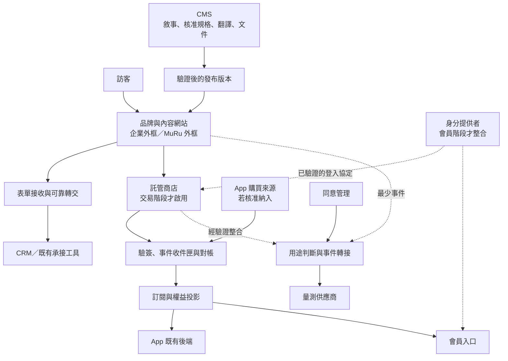

# D-Link Robotics 網站規劃 v2 架構與體驗審查

審查日期：2026-11-07。評審對象：v2 草案。結論：**方向可保留，但需重大修訂後，才適合作為估價、工程交付與驗收基準。**

v2 補上多產品、CMS、售後、量測及搜尋治理，具有價值。主要問題是把尚未確認的商業決策寫成平台承諾，並混合品牌體驗、語言、市場、內容發布、交易及裝置權益的責任。建議以「可擴充的品牌與內容網站」為第一階段；商店、會員及訂閱依整合證據逐步接入。

## 1. 證據範圍與判讀方式

以下代號及行號均指本次讀取的檔案版本：

| 代號 | 文件 | 本次使用方式 |
| --- | --- | --- |
| C | [企業原稿](<./D-Link Robotics 企業官網架構v0_20260917/D-Link Robotics 企業官網架構v0_20260917.md>) | 完整閱讀 101 行，包含教育／長照情境批註 |
| M | [MuRu 原稿](<./MuRu網站架構v1_20260915/MuRu網站架構v1_20260915.md>) | 完整閱讀 1151 行；另檢視 image1、2、3、4、19 的導覽、主視覺與頁尾示意 |
| V | [待評審 v2](<./D-Link Robotics 網站整體規劃建議_v2_20261107.md>) | 完整閱讀 771 行 |

這是需求與規劃審查；未將示意文案當成產品已實現的證據。原稿引用的《Gen1 定版功能設定》未在指定輸入中提供，功能、資安認證、雲端保存政策需另取產品證據。本文未重做原始 DOCX 排版審查。

為檢查「現有 React 元件可沿用」的前提，另靜態讀取 `package.json`、`src/main.tsx`、`src/App.tsx`、`src/sites/muru/i18n.tsx`、`src/sites/robotics/ContactForm.tsx`。工作區為 `main@8498113d40e4cb60dad8a8fd1191e1f43d5e69d0`，原有未提交變更已保留。本次不修改原始規劃或程式碼。

證據狀態：文件及上述程式片段為 **VERIFIED_STATIC**；引用的外部規則為本次查詢的官方文件；部署、CMS、金流、會員、裝置與跨站同意同步皆為 **NOT_RUN**，不表示產品驗收通過。本環境未提供 Context7 的 resolve/query 工具，因此技術查證採官方網站。

## 2. 需求閉環與 Gap

| 客戶基準需求／偏好 | v2 對應 | 判定與修訂 |
| --- | --- | --- |
| C 25–35：自然光、溫暖居家、科技退居背景 | §7 首頁、§13 主題 | **部分覆蓋**。應列成攝影、文字、動態與版型的設計原則，不能只留下主題色 |
| C 9–17：品牌精神、技術、產品、新聞、支援 | §5.2 有 about、technology 等頁 | **頁面保留、入口弱化**。§5.3 主導覽沒有品牌精神／關於；企業站應有清楚的一級入口 |
| C 43–53：D-Link 背書、連網、Edge AI、情感科技 | §5、§7 trust | **覆蓋但未完成證據治理**。不可將 MuRu 的能力推廣為所有產品共同能力 |
| C 57 與批註：MuRu、靈犀、大／小機器狗，教育／長照情境照片 | §2 有列出，§5.2 其他產品列 P1 | **首發範圍落差**。原稿已要求同步呈現；至少應確認是否首發放置情境摘要、產品卡及詢價入口。完整子站可晚於摘要 |
| C 65、M 13–21、949–1005：企業導流 MuRu，MuRu 有自己的 Logo、導覽、回企業站連結 | §2.1、§5.3 全站同頁首／頁尾加次導覽 | **品牌體驗偏移**。原稿支持具獨立體驗的產品站，未強制要求獨立網域；共用基礎元件仍可保留 MuRu 外框 |
| M 153–827、1047–1151：成長、五項陪伴特色、智慧設計、App／Basic／Plus | §5.2 子頁、§7「不重複列出」 | **結構大致覆蓋，驗收缺追溯**。逐項建立區塊 ID、產品核准狀態、三語狀態、CTA 去向；不可認定已完整驗證 |
| M 13–21 等：MuRu 繁中／英／日 | §1、§5、§13 三語 | **方向正確，發布規則不足**。企業站日文屬我方增補，應列待確認範圍，不應假裝是原始需求 |
| C 85–91、M 963–997：Care guide、FAQ、保固、商務／經銷／媒體聯絡 | §5、§9 有支援與會員 | **部分延期、局部弱化**。照護指南應有明確路徑；媒體洽詢應保留首發表單分流；保固自動化可延期，但若產品已售，不能沒有人工服務入口 |
| M 877–895：隱私控制、鏡頭狀態；C 49：本機處理 | §7 trust、§10、§14 | **有補強但未消解矛盾**。需與雲端記憶、遠端影像、LINE 推播逐功能對照 |
| C 97–101、M 939–1045：母品牌、LINE／X／YouTube、法務、無障礙 | §5.3 頁尾、§14 | **基本覆蓋**。頁尾資料可共用，呈現與產品支援連結應依站點情境不同 |
| 原稿的預約／帶回家 CTA、Basic／Plus 說明 | §4、§8、§9 全套商店／會員／訂閱 | **擴充提案，並非客戶已確認規格**。原稿沒有確認官網售訂閱、全產品共用帳號、CRM、BigQuery 或完整自營商店 |

### 2.1 必須先處理的原始輸入矛盾

1. **成長積分不自洽**：M 1061 寫 150 分約 1–3 天，1067 寫 1200 分約 4–30 天，1079 又寫每日最多 30 分。若從零起算且沒有其他加分來源，至少分別需 5 天及 40 天。應請產品團隊提供正式規則；在確認前保留階段故事，暫不發布數字承諾。
2. **本機處理與雲端功能需要資料分類**：C 49 的環境感知／語音情緒本機處理，與 M 659、679、717、737 的雲端記憶、M 415 的 LINE 照片、M 445 的異常影片並非必然互斥，但必須交代哪些原始資料、衍生結果或使用者選擇上傳的內容會離開裝置。v2 不能直接宣告全部一致。
3. **「1 年或永久」尚不是可販售規格**：需定義保存期間起算、取消後資料處理、容量、公平使用、匯出／刪除與服務終止情況；Basic／Plus 文案必須對應核准方案版本。
4. **多語內容尚有不一致**：M 723 英文為「Plus selected」，中文 743 為「選擇 Plus 方案」；成長階段中年／成年等譯名也不一致。「MuRu／小咪」是否為品牌名、預設暱稱或例子需定義詞彙表。
5. **功能宣稱不可由網站方認證**：軍規級資安、情緒辨識、異常寵物警報、4G／5G、續航兩小時等，需產品版本、適用地區、測試條件及核准人。v2 §1 的「文案完整」宜改為「已有文案草稿，待產品及在地化審核」。

## 3. 按嚴重度逐項診斷

高：會改變預算／交付邊界，或可能造成權限、付款、個資、功能宣稱錯誤，需在承諾實作前修正。中：會造成體驗、維運或量測偏差，需在相關功能設計完成前修正。低：表述、分類或可延後的成熟度問題。以下共 22 項：高 8、中 11、低 3。

### 高嚴重度

**H01｜尚未確認的商業需求被寫成架構前提**  
位置：V §0、§4、§8、§9、§15（12–18、215–227、428、477、732–748）。

§16 明明仍待決定販售方式、帳號系統與訂閱管道，前文卻已寫「電商需要」「A＋C 並行」「App 立即開通」。這使網站上線依賴 App、財務、金流、客服等多個團隊。修訂為「首發必要能力／可選商業方案／決策後才啟動的整合」三欄；第二產品 2–3 週只能作為模板、素材、翻譯和整合均已就緒時的驗證目標。

**H02｜未建立產品事實與宣稱的審核關卡**  
位置：V §1、§6、§11–13（26–27、404、644、667、709），對照 §2.1 所列原稿矛盾。

同一份資料只能降低重複輸入，不能保證資料正確、發布同步、搜尋快取更新或 AI 回答一致。新增「宣稱登錄」：`claim_id`、適用產品／型號／韌體、證據來源、限制、核准人、有效期間、翻譯審核版本。產品負責人先核准，再由行銷轉成故事；未核准規格不得進公開頁面、JSON-LD、客服答案與搜尋索引。

**H03｜語言、市場、交易價格與狀態混在 CMS**  
位置：V §2.3–2.4、§6、§11.1（71–99、374–387、398–401、604）。

「英語市場」不構成可定價、收稅與出貨的市場；英文也可能給台灣買家閱讀。CMS 和電商同時持有價格與狀態會形成兩個真實來源。拆開 `locale`、`market_id`、`currency`、`sales_channel`、內容發布狀態及市場可售狀態。CMS 管敘事與核准規格；商務系統管 SKU、成交價、庫存與訂單；公開 Offer 由同一份商務投影生成，避免網頁與結帳不同價。

**H04｜統一登入的供應商能力與成本未驗證**  
位置：V §0、§4.2–4.3、§9（15、216、225、494）。

「同一個人」「帳號可連結」「一次登入跨系統」是三種需求。Auth0 或 Cognito 本身不會讓任意商店、App、客服自動共用登入。本次官方文件指出，Shopify 客戶帳號接入自有 OIDC 身分提供者需要 Shopify Plus。先查既有 IdP、App 帳號遷移能力、商店方案及客服登入模式，再比較真正 SSO 與帳號連結兩種路線；禁止僅憑相同 Email 自動合併。來源：[Shopify Customer authentication](https://shopify.dev/docs/api/customer-authentication)。

**H05｜訂單付款、裝置擁有權與訂閱權益被直接等同**  
位置：V §4.3、§8.1、§9（229–263、449–454、496–499）。

付款者可能是贈禮者、經銷商或家庭其他成員；掃到 QR 序號也不足以證明有權綁定。§4.3 的單向成功流程缺取消、退款、拒付、續訂失敗、恢復購買、重複通知及延遲補償。應分開 Person／Order／DeviceOwnership／Warranty／Subscription／Entitlement；訂單通知驗簽、持久化及冪等處理後才更新權益，並定期向來源對帳。官方也明示 webhook 可能重送，不能假設只送一次。來源：[Shopify webhook verification](https://shopify.dev/docs/apps/build/webhooks/verify-deliveries)。

**H06｜Consent Mode 模式與個資敘述不精確**  
位置：V §0、§5.1、§10.1（14、286、513–534）。

「未同意前不載入行銷追蹤」與「GA4 未同意時送匿名訊號」未說清楚採 Basic 還是 Advanced。兩者不一定邏輯矛盾，但工程、法務與使用者將得到不同解讀。Basic 阻擋 Google tags 至同意；Advanced 在拒絕狀態仍可能送出無 Cookie 的訊號。**無 Cookie 不代表沒有資料處理，也不能概括稱匿名**。建議首發採 Basic／預設拒絕非必要追蹤，另以獨立決策評估 Advanced。來源：[Google Consent Mode](https://developers.google.com/tag-platform/security/concepts/consent-mode)。

同一母網域不會自動完成主站、Shopify 結帳與第三方 SDK 的同意同步；需驗證各宿主、用途及撤回路徑。訂單與 CRM 改用會員代碼仍可能重新連結到個人，應視為假名化資料管理。來源：[Shopify Customer Privacy API](https://shopify.dev/docs/api/customer-privacy)、[ICO Pseudonymisation](https://ico.org.uk/for-organisations/uk-gdpr-guidance-and-resources/data-sharing/anonymisation/pseudonymisation/)。

**H07｜商務選型把多市場、訂閱與付款能力綁成一包**  
位置：V §4.2、§8.3–8.4（215、473–486）。

能收一次性付款不代表能做定期扣款；支援日本消費者也不代表台灣公司可直接啟用日本 Shopify Payments。官方支援國家清單以商家所在地與資格為前提，本次清單列日本、未列台灣；訂閱另限可用 gateway／付款方式，Shopify Subscriptions 與 bundle 也有相容限制。先完成「商家實體 × 販售市場 × 幣別 × 付款方式 × 訂閱 × 發票／退款」矩陣與測試訂單，再決定 A＋C。來源：[Payments 支援國家](https://help.shopify.com/en/manual/payments/shopify-payments/supported-countries)、[訂閱限制](https://help.shopify.com/en/manual/products/purchase-options/subscriptions/considerations)。

§8.4「網站付款沒有平台抽成」應改成可比較的總費用：支付、電商、訂閱服務，以及適用時的 App 平台費用。實體主機與 App 數位權益需分開確認規範，並按 storefront／國家、商品性質和參與方案判斷外部購買連結；不以固定 15–30% 推導決策。來源：[Apple 審查規範](https://developer.apple.com/app-store/review/guidelines/)、[Google Play Payments](https://support.google.com/googleplay/android-developer/answer/9858738?hl=en)。

**H08｜首發表單缺少真正完成交易線索的資料契約**  
位置：V §5.2、§8.1、§10.3、§15（323、336、434、563、733）。

免費候補、預約體驗、收訂金預購不是同一流程；§16 尚未決定訂金，§2 卻用同一「預購／預約」狀態。應首發先選定一種主要轉換。表單需有伺服器驗證、速率限制／防濫用、重送處理、持久化或可靠轉交、成功回執、客服承接及保留／刪除政策；寄信失敗與表單入庫失敗需區分。產品通知與電子報行銷選擇分開，不因保固或洽詢自動加入行銷名單。

### 中嚴重度

**M01｜品牌共用被簡化為同頁首、同頁尾換色**  
位置：V §2.1、§5.3、§13.1（42、345–356、661）。

企業導覽加產品次導覽會同時顯示產品、應用、技術、新聞、支援、搜尋、語言、帳號、購物車及 CTA，削弱 MuRu 的安靜敘事。建議共用 primitives、token、內容型別及無障礙行為，保留 `CorporateShell` 與 `ProductShell`。產品頁 CTA 依目前產品／市場決定，不能永遠導到當期主打 MuRu；尚未提供購物功能時隱藏購物車與帳號入口。

**M02｜多產品首發範圍與服務入口未閉環**  
位置：V §5.2、§15（324–337、735），對照 C 57、87–91。

其他產品與媒體資源延期可以討論，但不能默默推翻客戶要求。把「產品摘要公開」「完整產品頁」「自營交易」分開排期。首發保留產品／情境摘要、Care guide、客服、商務／經銷／媒體分流；若已有消費者，提供可運作的保固與維修承接方式。

**M03｜多語 URL 已有方向，缺內容關聯與失敗行為**  
位置：V §5.1、§6、§11.1（283–287、391–404、596–598）。

新增穩定 `content_id`、各語言 slug、翻譯群組、審核版本與發布狀態。切語言應盡量留在同一內容；缺譯時明示並提供選項，不把英文內容藏在繁中 URL。獨立完成翻譯的頁面原則上使用自己的 canonical，不把三語全部指向英文。`hreflang` 只列已發布對等頁，包含自身與 reciprocal links；`x-default` 指向真正預設入口，不能只列標籤名稱。來源：[Google 多語頁面](https://developers.google.com/search/docs/specialty/international/localized-versions)。

**M04｜資訊架構存在重複頁面及保留路由衝突**  
位置：V §5.2、§6、§11.2（322、326、331–334、399、618）。

`products/muru/faq/` 與 `support/muru/` 應分清購前 FAQ 和售後操作內容；FAQ 資料可共用，但完整文章保留單一權威 URL。§11.2 提產品線 SEO 頁，站點地圖卻只有篩選式總覽；需補內容型類別頁或撤回首發承諾。`compare`、`warranty`、`repair`、`contact` 等必須列保留 slug。企業 technology 講經核准的平台原則，產品 technology 講該型號實際能力。

**M05｜內容模型不足以支援無程式上架承諾**  
位置：V §6、§13.2（365–404、681–696）。

缺穩定 ID、翻譯、審核、素材授權／alt／焦點、文件版本、重新導向、schema 版本和區塊限制。市場應為獨立實體，透過 ProductMarket 關聯；主題可被多產品共用，不必強制一對一。「旗艦／標準／方案」混合敘事層級及交易方式，宜拆成展示模板、交易模式、產品來源。CMS 只允許核准區塊組合，新增互動型別仍走工程變更；設計與無障礙審核不能只限旗艦產品。

**M06｜渲染、CDN 與部署邊界尚未形成可執行方案**  
位置：V §4.1、§13.1（155、210、659–679）。

Next.js 是合理候選，但「伺服器產生頁面」沒有回答靜態預產生、重新驗證、私人頁面、預覽及 CDN cache key 如何分工。Vercel 與 Cloudflare 也不能當成完全等價替代：本次 Cloudflare 指引已以 vinext 為建議路徑、保留 OpenNext 等選項，須鎖定部署方式／版本並驗證。Next.js 官方另提醒多執行個體與 CDN 的快取協調。來源：[Next.js 自行部署](https://nextjs.org/docs/app/guides/self-hosting)、[Cloudflare Next.js](https://developers.cloudflare.com/workers/framework-guides/web-apps/nextjs/)。

建議公開內容預產生並可受控更新，會員／結帳相關內容不進共享快取；CMS 發布失敗應保留上一個可用版本。全球節點不等於全球資料合規、動態 API 低延遲或中國大陸可用性；市場尚未確定時不做這些保證。

**M07｜狀態管理與服務降級完全缺少明確責任表**  
位置：V §4、§6、§13。

不是一定要補 Redux 或其他套件，而是要定義誰擁有狀態：URL 擁有語言／可分享篩選，元件擁有展開／選單，CMP 擁有同意，IdP／後端擁有身分與權限，商務系統擁有價格／庫存，權益服務擁有可稽核的投影。網站不以 localStorage 的 Plus 狀態授權；CMS、CRM、商店故障時分別降級，不使品牌內容整站不可用。

**M08｜埋點格式與指標語意會污染資料**  
位置：V §10.2–10.4（538–586）。

企業首頁未必有 `product_id`，比較頁及購物車可有多產品；事件應支援 optional product 與 `items[]`。會員註冊與電子報訂閱分開；客服詢問不與銷售 lead 混算；通路點擊是微轉換，不能算成交。`purchase` 需 transaction ID、商品明細、幣別、金額口徑、去重責任及 refund 流程，並用訂單系統核對營收。來源：[GA4 電商事件](https://developers.google.com/analytics/devguides/collection/ga4/ecommerce)。

原文的搜尋關鍵字、目的網址可能夾帶 Email、序號或表單資訊。事件參數採允許清單與去識別處理，不送完整自由文字或含識別資料的 query string。避免自動 page_view 與 SPA 手動事件重送；GTM 發布須審核及可回滾。來源：[Google Analytics PII 指引](https://support.google.com/analytics/answer/6366371?hl=en)。

**M09｜SEO／GEO 有過時項目與因果過度承諾**  
位置：V §11–12（594–649）。

`Product + Offer` 應依頁面是否真的有可公開的有效 offer 輸出；未定價、B2B 詢價、預告不可填假價格。停產有支援價值時保留；只有內容相應的替代頁才永久轉址，不能統一導回泛用類別頁。Google 官方更新指出，自 2026-05-07 不再顯示 FAQ rich results；可為使用者保留 FAQ 與有需要的語意標記，但不可將其列為搜尋展示收益。來源：[Google Search 更新紀錄](https://developers.google.com/search/updates)。

GEO 要把搜尋可見性、模型訓練授權與使用者觸發抓取分開。OpenAI 的 OAI-SearchBot 用於搜尋，GPTBot 用於可能的模型訓練，兩者可獨立設定；Google-Extended 不決定 Google Search 索引或排名，且涵蓋 Gemini 等用途。來源：[OpenAI crawlers](https://developers.openai.com/api/docs/bots)、[Google crawlers](https://developers.google.com/crawling/docs/crawlers-fetchers/google-common-crawlers)。

允許爬蟲、SSR 或結構化資料都不保證 AI 推薦。Google 的 AI 搜尋功能沿用 SEO 基本原則，沒有額外特殊最佳化必要條件。AI referral 只代表可觀測到的點擊，不能當成全部引用或曝光。來源：[Google AI features](https://developers.google.com/search/docs/appearance/ai-features)。

**M10｜合規被縮成頁面清單，適用條件過度概括**  
位置：V §8.3、§14（479、717–724）。

「有歐洲用戶就含 GDPR」不精確：應評估設立、向境內人士提供商品／服務、監測行為等適用條件；Cookie／類似技術規範另須按司法管轄區分析。全市場採相同、較嚴格的同意體驗可作品牌政策，但不要寫成所有市場法律相同。來源：[European Commission GDPR 適用說明](https://commission.europa.eu/law/law-topic/data-protection/information-business-and-organisations/application-gdpr_en)。

台灣通訊交易七日解除權存在法定合理例外，不能把主機與所有數位訂閱一概而論，也不能自行認定訂閱必然例外。法務應交付市場／商品／處理目的矩陣；工程負責版本化告知、撤回、資料保留與刪除傳遞、存取控制及稽核，不能只等待法務提供頁面文字。來源：[消保法第 18–19 條](https://law.moj.gov.tw/LawClass/LawAll.aspx?pcode=J0170001)、[合理例外準則](https://law.moj.gov.tw/LawClass/LawAll.aspx?pcode=J0170012)。

**M11｜缺可驗收的品質、發布與復原標準**  
位置：V §11.1、§13、§15（612、664–667、694、709、730–748）。

CWV 數字方向正確，但應寫真實使用者資料的第 75 百分位及裝置／市場分群；新站無足量樣本時分開報實驗室結果與尚未取得的現場資料。來源：[web.dev CWV 門檻](https://web.dev/articles/defining-core-web-vitals-thresholds)。

WCAG 2.2 AA 要有鍵盤、焦點、對比、縮放、語言切換、表單錯誤、字幕及 Cookie Banner 檢查；雙層 sticky nav 尤其需驗證焦點不被完全遮住。觸控目標可訂更寬鬆的產品目標，但不得把 44px 宣稱為 AA 一律要求。來源：[W3C 焦點遮蔽](https://www.w3.org/WAI/WCAG22/Understanding/focus-not-obscured-minimum)、[W3C 目標尺寸](https://www.w3.org/WAI/WCAG22/Understanding/target-size-minimum)。

另補預覽存取保護與素材權限、schema 驗證、跨語發布檢查、敏感頁不快取、監控告警、回滾及還原演練。原文已提出預覽環境與權限，這裡是補足驗收條件，並非宣稱目前已有洩漏；`noindex` 和 robots 規則不能代替授權。

### 低嚴重度

**L01｜固定三款才做比較缺少使用者任務依據**（V §5.2、§7：326、418）。兩款相似產品就可能需要比較，三款用途完全不同反而不適合。按可比較屬性與使用者決策困難決定，異類產品優先做需求導購。

**L02｜過早承諾全部工具與多包 monorepo**（V §4.2、§10.1、§13.1）。若首發只有一個部署應用，先用清楚模組即可；只有實際跨應用共用、不同發布週期或獨立測試需求才拆 package。站內搜尋、熱圖、倉儲與 CRM 自動化需有業務問題、內容量與預算依據。

**L03｜「自動」「一定一致」「只需新增資料」用詞過滿**（V §0、§4.1、§6、§11、§13）。改成受支援模板／資料契約內的自動化，並列例外升級流程。新增產品若帶來新互動、型號、法規、交易或 App 能力，就可能需要工程與設計。

## 4. 建議的品牌、路由與系統邊界

### 4.1 品牌與網域選項

| 選項 | 適用前提 | 主要代價 | 本案建議 |
| --- | --- | --- | --- |
| 主網域產品子目錄＋獨立產品外框 | 同一企業營運、共用內容流程與支援 | 需隔離路由、主題及產品導覽 | **首選基線**；保留 `/products/muru/`，不強制企業導覽覆蓋產品故事 |
| `muru.<domain>` 子網域 | 產品團隊或發布節奏確有獨立需求 | 跨宿主同意、分析、登入與 SEO 治理增加 | 有明確隔離收益才採用 |
| MuRu 獨立網域 | 品牌營運、授權或商業主體需獨立 | 多網域內容、同意及維運成本 | 原稿未要求，暫不預設；可保留為品牌資產／導流網址 |

選子目錄是營運及治理判斷，不承諾天然 SEO 加分。同網域、同程式庫、同部署單位、同品牌外框是四個可獨立決策的維度。

企業外框保留品牌精神、技術、產品與商務支援入口；MuRu 外框採品牌 Logo／母品牌背書、四個故事入口與一個依市場狀態變化的主要 CTA。母品牌回連放在精簡 utility 區或頁尾，首頁可自然互相導流。保留自然光、生活攝影、柔和材質與留白；動態用於解釋動作、成長或使用情境，重要訊息不要只放在動畫內。

### 4.2 路由基線

以下路徑是建議，不代表網域已確認或已有部署：

```text
/{locale}/                             企業首頁
/{locale}/about/                       品牌精神與企業關係
/{locale}/technology/                  經核准的企業技術原則
/{locale}/products/                    產品總覽
/{locale}/product-lines/{line}/        有獨立內容需求時的產品線頁
/{locale}/products/{product}/          依產品套用獨立體驗外框
/{locale}/products/muru/life-with-muru/
/{locale}/products/muru/growing-together/
/{locale}/products/muru/technology/
/{locale}/products/muru/the-app/
/{locale}/products/muru/faq/            購前問答與售後文章連結
/{locale}/products/{product}/buy/       按市場呈現候補、預約或購買
/{locale}/support/{product}/           售後支援入口
/{locale}/support/{product}/care-guide/
/{locale}/support/{product}/articles/{slug}/
/{locale}/business/                    B2B／經銷／媒體分流
/{locale}/news/{slug}/
/{locale}/trust/                       網站資料與產品資料分區說明
/{locale}/legal/{document}/
```

`locale` 可先維持 v2 的 `zh-tw`、`en`、`ja` 路徑；內部語言標籤採一致標準，避免 URL 字串直接充當所有資料鍵。首發語言網站可保持全球產品介紹，購買頁另外明示「購買地區／配送目的地」。只有同語言在不同市場的公開內容／價格確實不同且需索引時，才增加穩定市場 URL，例如 `en-TW` 對應的內容版本；不要一次產生所有市場乘語言的空頁。

切換語言不默認改變配送國家；IP 或瀏覽器設定只給建議。索引頁面上的價格、可售狀態、canonical 與 JSON-LD 必須對應可重現的公開版本，不能只靠訪客 Cookie 隱性切換。所有市場／語言維度都要進入相應的快取鍵或明確的非快取邊界。

商城可先維持獨立託管 storefront，透過清楚的購買入口跳轉；主站不必同步自建完整 cart／checkout。品牌站與商店商品頁應有不同任務與內容，按實際重複程度決定 canonical，不把所有商店頁一律 canonical 回品牌站。

### 4.3 系統結構



這是責任圖，不要求每一格都部署成微服務。首發可為一個網站應用與輕量表單端點；共享模組透過型別與明確介面解耦。設計系統是建置依賴，量測是側向能力，不必把兩者硬塞成所有請求必經的「平台服務層」。

### 4.4 資料與狀態所有權

| 資料／狀態 | 權威來源 | 網站使用方式 |
| --- | --- | --- |
| 品牌故事、翻譯、公開產品規格 | 經核准的 CMS／產品資料來源 | 版本化發布與快取 |
| SKU、售價、可售庫存、訂單／退款 | 商務／付款系統 | 唯讀投影展示；結帳重新驗價 |
| 訂閱原始交易與收據 | 各付款來源 | 驗證後轉成標準事件，保留來源識別 |
| App 可用權益 | 權益服務的可稽核投影 | 由後端授權，不信任客戶端標記 |
| 帳號身分 | IdP 與核准的帳號連結紀錄 | 各應用依協定建立自己的安全 session |
| 裝置擁有權／家庭共享 | 裝置或產品後端 | 經所有權驗證後顯示，與付款者分開 |
| 保固 | 核准的保固規則與證明紀錄 | 支援人工審核及權利移轉；序號不放分析事件 |
| 語言與可分享篩選 | URL | server 與 client 使用同一解析結果 |
| 選單、FAQ、暫存選項 | 元件區域狀態 | 不升級成全域商業真實來源 |
| 同意、用途、政策版本 | CMP／同意紀錄 | 追蹤與嵌入內容經 policy adapter 決定是否啟用 |
| 行為分析 | 經允許的事件資料 | 作行銷觀測，不回寫產品授權或作財務帳本 |

內容契約至少包含穩定 `product_id`、`content_id`、`locale`、`market_id`、`schema_version`、`publication_status`、`reviewed_at` 與來源。展示等級、銷售模式、生命週期、庫存及翻譯狀態分開。金額另定幣別、精度、含稅口徑與有效期間，避免只用沒有契約的 `price: string`。原始裝置影像、聲紋與家庭活動不進網站分析資料管線。

個資清冊應逐類記錄控制者／處理者、目的、法律依據、接收者、處理地區、保留期限與權利請求責任人。撤回行銷同意與刪除帳號是不同操作；依法需保留的交易紀錄採限制用途與到期刪除，不能在收到刪除申請時未經判斷一併抹除。

### 4.5 技術選型的取捨

**Next.js 可作預設候選，但尚不足以定案。** 已有 React 素材，可降低部分視覺元件重做成本；若會員與互動會逐步增加，同一技術棧亦有價值。先做一個企業頁、一個三語 MuRu 頁、一個真實表單與一次 CMS 發布／回滾的垂直驗證，再定 hosting 和版本。

若首年實際只有內容、表單及外連商店，Astro 也是合理候選：官方提供預產生及按需渲染能力。評估理由是互動量、團隊能力與維運成本，不以「新」或「SEO 框架」作決策。來源：[Astro rendering](https://docs.astro.build/en/guides/on-demand-rendering/)。不建議首發同時引入兩套框架。

CMS 選型先拿真實 MuRu 內容測試三語審核、預覽權限、草稿隔離、排程、文件版本、資產權利、備份匯出、webhook 重試及實際方案費用。SaaS CMS 降低日常維運負擔；自架 CMS 需明列升級、備份、告警與值班責任。搜尋與 BigQuery 可依需求延後；若啟用，需有用途、費用上限及資料管理人。

### 4.6 現有示意站的可重用邊界

- `src/main.tsx:7` 使用 `createRoot`，`src/App.tsx:23` 使用客戶端 Routes；v2 判定現況為 Vite SPA 有程式證據。
- `src/sites/muru/i18n.tsx:11` 從 localStorage 讀語言，25 行在 effect 更新 title／html lang。遷移時須改成 URL／伺服器提供一致的 locale 與 metadata；雖有 try/catch，仍需避免伺服器與瀏覽器首屏語言不同。
- `src/sites/robotics/ContactForm.tsx:24` 僅驗證後切換 `sent`，35 行明示不傳資料。外觀可參考，不能作為 CRM 整合已完成的證據。
- `src/App.tsx:51` 將未知路徑導首頁；正式站應有真實 404 與必要的歷史路由映射，不能照搬。
- 可優先重用視覺素材、無瀏覽器耦合的呈現元件與經核准文案；router、i18n、metadata、表單、session 與資料載入逐項遷移驗證。「可沿用」不等於直接搬移即可上線。

## 5. 可直接替換 v2 的文字

### 替換 §0 平台摘要與 §2.1 品牌架構

> 第一階段建立可擴充的企業與產品內容網站。D-Link Robotics 與 MuRu 共用內容契約、基礎元件與發布流程，分別保有企業導覽及產品敘事外框。MuRu 以「MuRu by D-Link Robotics」呈現母品牌背書。新增產品可在既有模板及已驗證能力範圍內以資料配置上架；需要新互動、交易或外部系統能力時，另行評估設計與工程工作。商店、會員及訂閱為依業務決策啟動的後續能力，不作為品牌網站首發的必要依賴。

### 替換 §2.4 市場矩陣及 §6 價格模型

> 語言與販售市場分開管理。語言控制文案與格式；市場控制可售商品、交易幣別、含稅顯示、配送及適用條款。使用者切換語言時保留已選購買地區。CMS 管理故事、核准規格與市場說明；實際價格、庫存及訂單由商務系統提供。公開網頁及結構化資料取用相同的有效商品投影，結帳再次驗證價格與可售狀態。缺少已核准價格時，不輸出虛構 Offer。

### 替換 §4.3 會員與權益流程

> 帳號整合先確認既有 IdP、商店方案及 App 協定，再決定使用 SSO 或經驗證的帳號連結。購買紀錄、裝置擁有權、保固與訂閱權益分開建模。經驗證的付款或訂閱事件先持久化，再以冪等流程更新權益；退款、取消、到期及付款失敗以相同機制處理。App 由後端讀取權益。啟用時間以雙方約定且實測的服務目標表達，使用者可看到處理中、成功或需協助狀態，不以「立即」作未驗證保證。

### 替換 §10.1 同意與量測

> 首發採預設拒絕非必要分析及廣告追蹤的策略，Cookie Banner 提供易理解的接受、拒絕與分類設定，並持續提供撤回入口。Google 採 Basic Consent Mode；Advanced 模式若有業務需求，另行審核其資料處理及市場適用性。同意管理與追蹤供應商透過獨立 adapter 整合，業務元件只發出經核准的事件。網站、商店及結帳各自驗證同意套用與撤回結果；不以共同母網域或跨網域歸因設定視為同步完成。表單服務、產品通知與行銷訂閱分別告知與管理。

Google 的四個同意訊號 `analytics_storage`、`ad_storage`、`ad_user_data`、`ad_personalization` 需明確映射；非 Google SDK 仍須各自阻擋與驗證，不假設自動遵守。來源：[Google Consent Mode 設定](https://developers.google.com/tag-platform/security/guides/consent)。這是建議工程政策，實際法律適用依市場矩陣核定。

### 替換 §11–12 SEO 與 GEO 承諾

> 平台依已發布的內容版本產生 metadata、canonical、有效的語言對應與 sitemap；只有通過內容及商務驗證的頁面才輸出適用的結構化資料。搜尋可見性與模型訓練政策分別決定。GEO 的交付項目為可讀取、可追溯、更新清楚的官方內容、爬蟲政策及定期觀測報告，不保證搜尋排名、AI 推薦或引用。llms.txt 僅為選用實驗，不列為上線必要條件。

### 替換 §13 技術與發布

> 公開品牌、產品故事與新聞以預產生及受控更新為主；會員、私人資料與交易狀態採獨立授權與非共享快取策略。發布前驗證語言、連結、內容契約、規格宣稱及公開狀態，發布失敗可回復上一個完整版本。部署平台、執行環境、框架版本及 CMS 組合須經垂直驗證後定案。以模組邊界建立可維護性，跨應用共用需求成立時再拆成獨立套件或部署。

### 替換 §15 時程與上架目標

> 時程自需求、素材、翻譯及外部介面達成約定就緒條件後估算，並標示人力、依賴、包含／不包含範圍與緩衝。第二個產品 2–3 週上線為待驗證的流程目標，前提是使用既有模板、內容與各語言已核准，且不新增交易、會員或產品後端能力；須分別量測工程投入與從提案到上線的總週期。

## 6. Architecture Roadmap 與退出條件

v2 的 8–10 週及後續 2–3 個月缺人力、外部接口與素材條件，本文不另給假精確日期。建議以以下交付與門檻重新估算；每階段均能產出獨立可用結果。

| 階段 | 交付內容 | 進入下一階段的條件 | 主要責任人 |
| --- | --- | --- | --- |
| R0 需求與證據收斂 | 需求追溯表、品牌外框、首發市場／語言、CTA 定義、產品宣稱清單、商務選項與成本 | 每個首發項目有 owner／來源／接受條件；積分、隱私與 Plus 保存政策的公開文案已定案或暫緩 | 產品、品牌、Web 負責人、法務 |
| R1 垂直驗證 | 一個企業頁、一個三語 MuRu 頁、真實表單、CMS 發布／預覽／回滾、同意管理、候選部署 | 可重現的 HTML／語言／metadata；拒絕追蹤有效；CRM 失敗可恢復；選型與成本有實測依據 | Web 工程、內容營運 |
| R2 品牌與預約首發 | 企業與 MuRu 敘事、已核准的其他產品摘要、Care guide／FAQ／客服、三語依約定發布、SEO 與必要量測 | 首發品質驗收矩陣通過；不依賴尚未完成的購物車／會員；可監控與回滾 | Web、品牌、各語言編輯、客服 |
| R3 交易上線 | 已選商店／通路、在地支付、發票、配送／退貨、同意與歸因串接 | 真實或供應商認可環境驗證成功、失敗、退款、重試；價格與 SKU 正確；財務及客服可承接 | 電商、財務、法務、Web |
| R4 會員與訂閱 | 已驗證登入、帳號連結、裝置歸屬、保固、權益通知與對帳 | 贈禮／共享／轉移不越權；重送不重複開通；退款、取消、到期、恢復購買一致；App 共同驗收 | 身分／App 團隊、後端、客服 |
| R5 第二產品與擴充 | 新產品套模板、必要新區塊；視證據啟用比較、搜尋、倉儲與跨產品行銷 | 測得素材等待、翻譯、工程及發布時間；無既有產品回歸；再修正 2–3 週目標 | 產品行銷、設計、工程 |

R3 和 R4 可以依實際商業方案調整先後或局部並行；若首賣必須含 Plus，兩者共同成為販售門檻，但不應阻止 R2 的非交易品牌網站發布。R5 的第二產品內容上線也可直接接在 R2 後，不必等待商店、會員或訂閱完成。

### 6.1 首發及後續驗收矩陣

| 面向 | 必須看到的證據 |
| --- | --- |
| 需求閉環 | 每個客戶需求對應頁面／區塊、語言、owner、發布階段與批准紀錄 |
| 品牌與體驗 | 企業／MuRu 可辨識且可互相返回；行動版一個清楚主 CTA；無無效帳號／購物車入口 |
| i18n | 各已發布 URL 直接開啟即得正確內容；切語言保留內容；缺譯、404、搜尋與表單回覆已定義 |
| 公開內容 | metadata、canonical、hreflang、sitemap 互相一致；未核准宣稱及草稿資產不公開 |
| 表單 | 持久化／可靠轉交、驗證、重試、成功回執、通知失敗及刪除流程均可重現 |
| 同意管理 | 未選／拒絕／接受分析／撤回／跨站／回訪情境，有 network 與 storage 證據；沒有不應載入的第三方 |
| 無障礙 | 鍵盤與螢幕閱讀器人工檢查搭配自動掃描；焦點、錯誤提示、縮放、字幕與降低動態可用 |
| 效能 | 先記錄測試裝置／網路／路由的實驗室結果；上線後足量現場資料驗證 p75 LCP ≤ 2.5s、INP ≤ 200ms、CLS ≤ 0.1，未足量則標未驗證 |
| 營運 | 負責人、告警、回滾、CMS 備份及還原演練；各 SaaS 權限與月／年費盤點 |
| 交易／訂閱 | 僅在啟用階段驗收：在地付款、退款、稅費／發票、去重、補償、權益撤銷與對帳 |

所有品質門檻目前都是 **建議的驗收條件，尚未執行**。網站 Cookie 及量測測試須與其選定模式一致，不以「完全沒有任何請求」當作所有必要服務的通則。

## 7. v3 建議編排與優先修訂順序

v3 宜以需求與責任為主軸重新編排：客戶原始需求與差異 → 首發目標與非目標 → 品牌外框與 IA → 語言／市場／內容治理 → 技術、渲染與資料責任 → 表單與量測／隱私 → 可選商務與會員整合 → 品質驗收／營運 → 決策紀錄／分期成本。

優先順序為 H01、H02、H03、H06、H08，先修正首發範圍、公開內容、資料及同意責任；M01–M07 同步形成可實作的網站骨架。H04、H05、H07 必須在交易與會員報價前取得供應商與 App 團隊的證據。其餘量測、SEO、品質與營運項目在對應功能開發前納入驗收。

需補入決策表的事項包括：主網域控制權與既有 URL、MuRu 品牌獨立程度、首發其他產品摘要、三語先後、免費候補或付費預購、販售商家實體、IdP 與 App 介面、訂閱綁定個人／家庭／裝置、產品雲端資料邊界、內容營運人力、工具預算與服務責任。每項記錄選項、owner、決策期限、依據及未決時可採的低依賴方案。
