# D-Link Robotics 解決方案與架構說明

版本：v1（2026-11-07）
對應：《數位平台建置計劃書 v6》
用途：提案與啟動會議的講解稿；每一節是一段講解，附「講解重點」與圖
配套文件：《網站功能規格 v1》（做哪些功能）、《工程實施指南 v1》（工程師怎麼做）

---

## 0. 講解順序建議

| 段落 | 主題 | 時間 | 對象 |
| --- | --- | --- | --- |
| 1 | 一張圖看懂方案 | 3 分鐘 | 全體 |
| 2 | 計劃書目標如何落地 | 5 分鐘 | 決策者 |
| 3 | 網站功能地圖與使用者旅程 | 8 分鐘 | 品牌、產品、客服 |
| 4 | 系統架構 | 10 分鐘 | IT、資安 |
| 5 | 關鍵流程 | 12 分鐘 | IT、客服、法務 |
| 6 | 多產品擴充 | 3 分鐘 | 產品 |
| 7 | 分期與時程 | 4 分鐘 | 決策者 |
| 8 | 品質、安全與隱私 | 5 分鐘 | IT、法務 |
| 9 | 常見問題 | 視情況 | 全體 |

---

## 1. 一張圖看懂方案

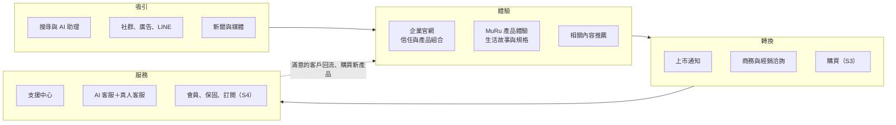

**講解重點**

- 網站的工作是四件事：讓人找到、讓人相信、讓人行動、讓人買了之後被照顧好。
- 首發先完成前三段與服務入口；購買、會員、訂閱依商業決策分期接上。
- 所有環節共用同一套內容、同一套追蹤、同一個客服入口，新產品上架時一起受惠。

---

## 2. 計劃書目標如何落地

| 計劃書目標 | 解決方案 | 對應模組 | 階段 |
| --- | --- | --- | --- |
| 傳達品牌精神與 D-Link 背書 | 企業官網外框、技術原則頁、信任中心 | 企業官網 | S2 |
| 用生活情境說明 MuRu | MuRu 專屬外框、四個故事頁、規格與方案說明 | 產品體驗 | S2 |
| 把興趣轉成名單與洽詢 | 免費上市通知（Email 雙重確認）、商務／經銷／媒體表單自動轉交 | 表單與名單 | S2 |
| 售後不必繞路 | 支援中心依產品分流；線上使用手冊、照護指南、FAQ、資源中心（手冊與 App 下載、韌體說明）、客服、保固協助；手冊頁內可問 AI 助理（A1） | 支援中心 | S2（手冊 AI 助理 A1） |
| 新產品 2–3 週上線 | 產品即資料：內容模型＋三種模板＋狀態規則 | CMS、產品模板 | S2 起 |
| 看完一頁總有下一步 | 相關內容推薦（不使用個人資料） | 推薦 R0 | S2 |
| 常見問題 24 小時三語回答 | 只用已核准內容回答的 AI 客服，可轉真人 | 智慧客服 A0–A3 | S2 起 |
| 搜尋引擎與 AI 能正確引用 | 預渲染靜態頁、結構化資料、多語標記、規格單一來源 | SEO／GEO | S2 |
| 隱私與品牌一致 | 同意後才追蹤；營運數字以業務資料為準 | 同意與追蹤 | S2 |
| 開賣 | Saleor 電商（或沿用既有商店）、台灣金流與電子發票 | 電商 | S3 |
| 官網買 Plus、App 立即可用 | 訂閱權益服務統一管理所有購買來源 | 會員與權益 | S4 |

**講解重點**：每個目標都有明確的模組與階段；沒有一項是「之後再說」。

---

## 3. 網站功能地圖與使用者旅程

### 3.1 功能地圖

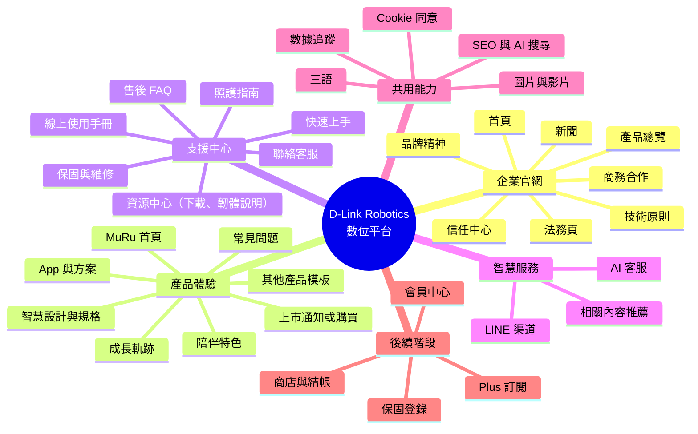

### 3.2 消費者旅程

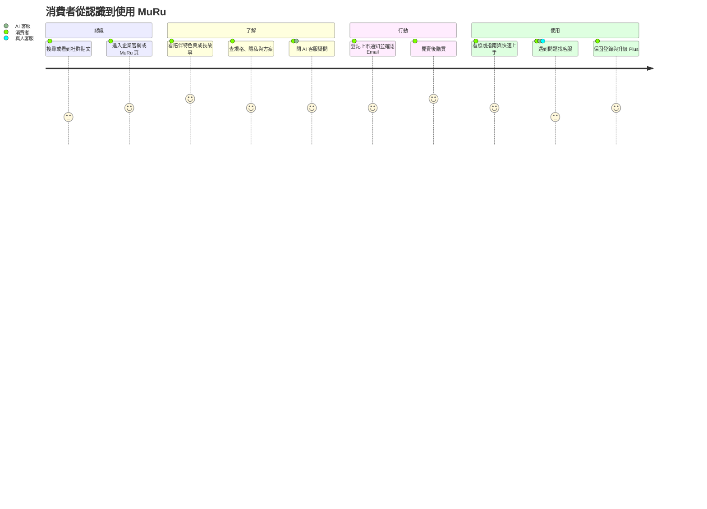

### 3.3 各受眾的主要路徑

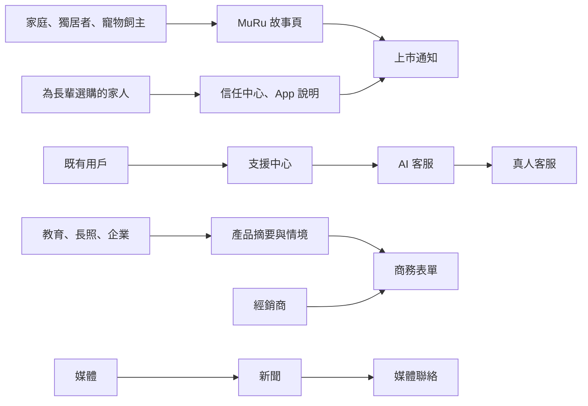

**講解重點**

- 每一種受眾都有一條三步以內的主要路徑。
- 為長輩選購的家人最在意隱私與操作，因此信任中心與 App 說明是首發必備。
- AI 客服在每條路徑都可以接手，但只回答已核准內容，需要承諾的事交給真人。

---

## 4. 系統架構

### 4.1 系統全景

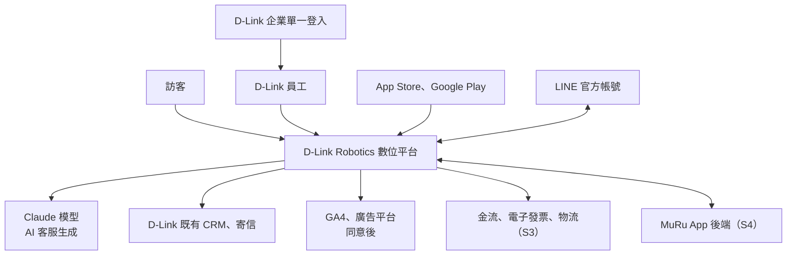

**講解重點**：平台以外的系統只有七類，每一類都透過固定介面連接，任何一個暫時故障都不影響網站瀏覽。

### 4.2 邏輯分層

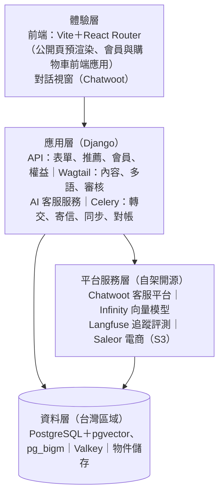

| 層 | 為什麼這樣分 |
| --- | --- |
| 體驗層 | 公開頁是靜態檔案，後端故障時網站照常瀏覽；搜尋引擎直接讀到完整內容 |
| 應用層 | 所有業務邏輯集中在一個 Django 專案，一種語言、一套部署、一套權限 |
| 平台服務層 | 成熟的開源產品直接採用，不重複造輪子 |
| 資料層 | 個資與業務資料只在台灣區域；公開內容才經全球 CDN |

### 4.3 部署架構

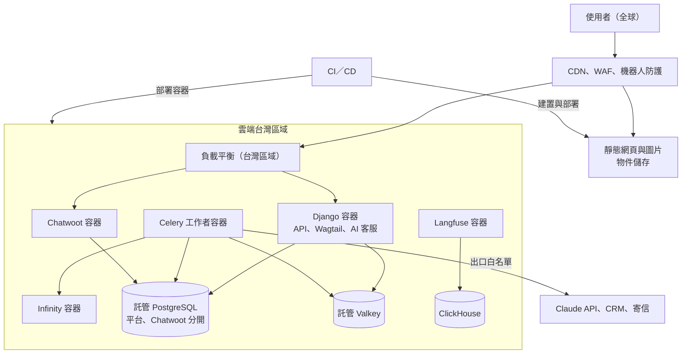

**講解重點**

- 三套環境：預覽、staging、正式；正式資料不複製到其他環境。
- 資料庫、快取使用雲端託管服務，減少維運；應用以容器部署，可水平擴充。
- 只有背景工作可以對外連線，而且限定白名單。

### 4.4 資料放在哪裡

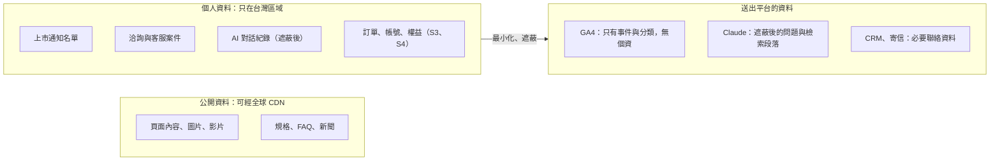

**講解重點**：裝置的影像、聲音、居家活動資料完全不進入網站平台；送出平台的資料都經過遮蔽或最小化。

---

## 5. 關鍵流程

### 5.1 內容從編輯到上線

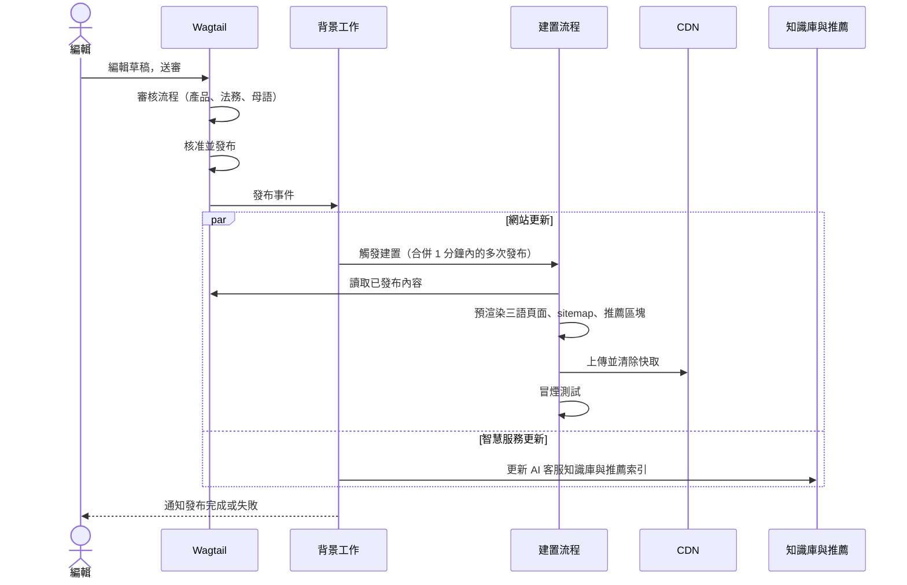

**講解重點**：編輯按下發布後約 10 分鐘內全站更新；失敗時保留上一版並通知編輯，網站不會壞掉。

### 5.2 上市通知登記

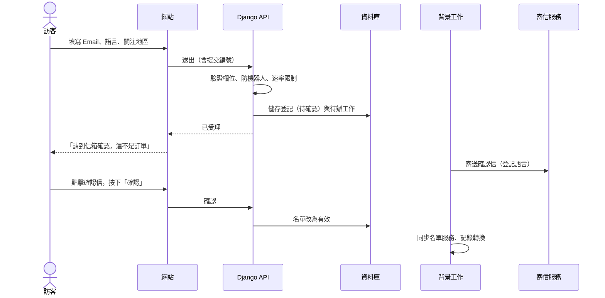

**講解重點**：重複送出不會重複建檔；只有點過確認信的才算有效名單；退訂隨時有效。

### 5.3 多語系網址

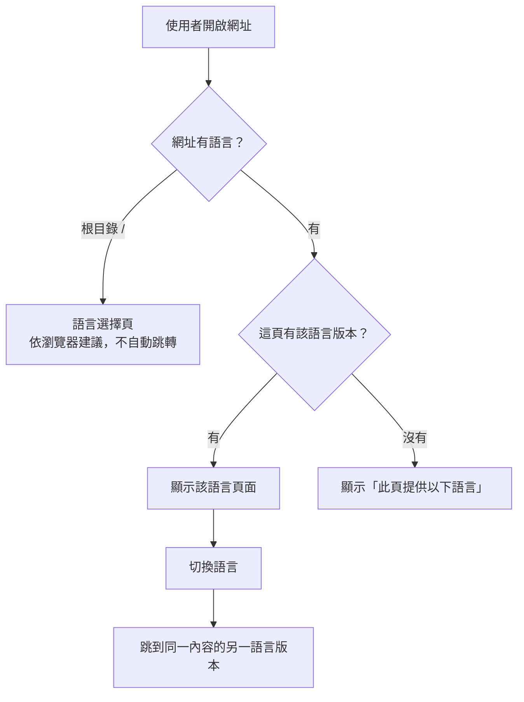

### 5.4 Cookie 同意與追蹤

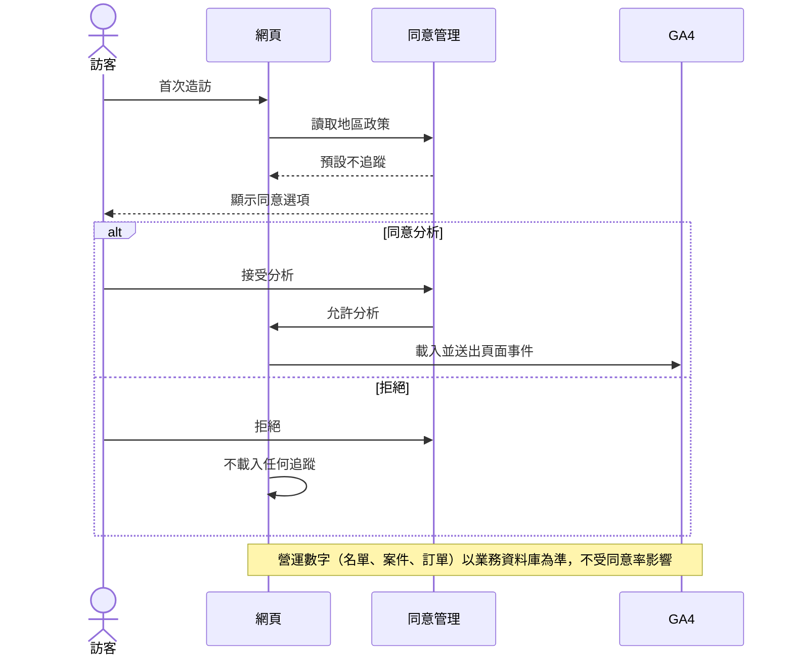

### 5.5 AI 客服與轉真人

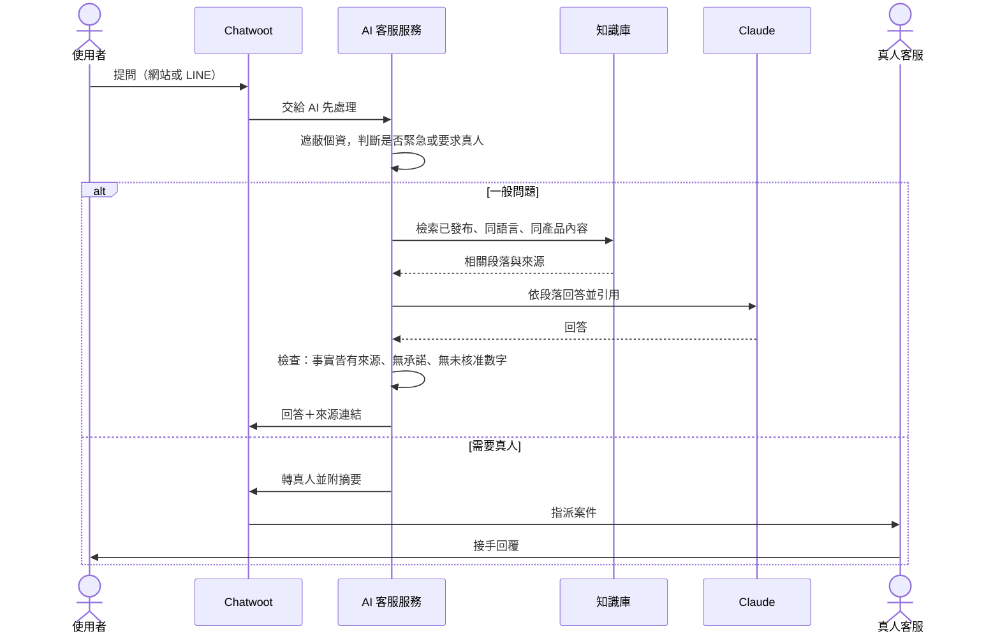

**講解重點**

- AI 只能查資料與建立工單，不能退款、補償或改訂單。
- 沒把握就轉真人，客服接手時已看到摘要與 AI 查到的資料。
- 上線前每種語言約 200 題評測，正確率、轉接率、攻擊攔截都要達標。

### 5.6 結帳（S3）

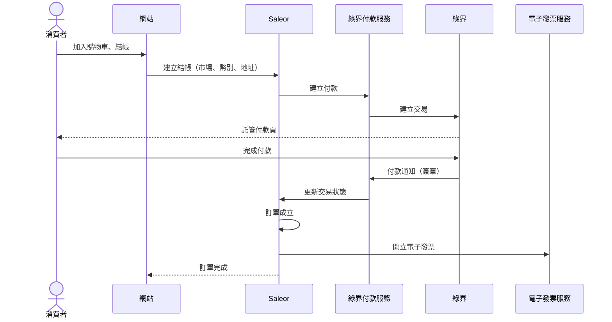

### 5.7 Plus 訂閱開通（S4）

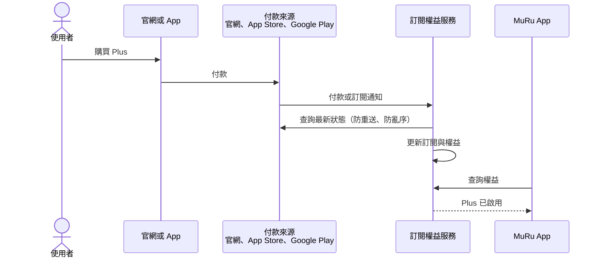

---

## 6. 多產品擴充

### 6.1 產品狀態

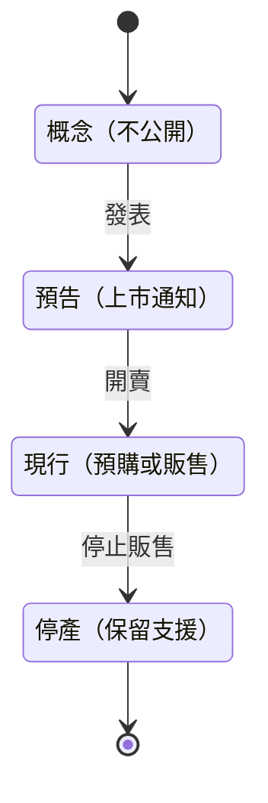

各市場另有可售狀態（未開放、上市通知、預購、販售、缺貨、暫停、停售），頁面按鈕依產品狀態＋市場狀態＋功能開關自動決定。

### 6.2 新產品上架

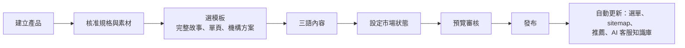

**講解重點**：使用既有模板時不需要工程師；需要新互動時才排工程時程。

---

## 7. 分期與時程

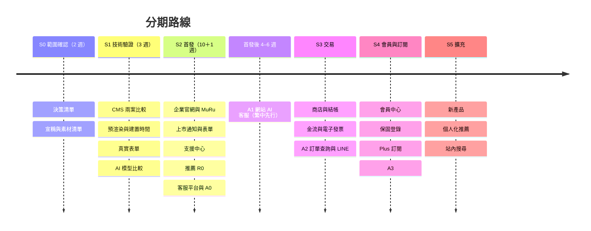

| 里程碑 | 時間（以啟動為第 1 週） |
| --- | --- |
| 技術組合定案 | 第 5 週 |
| 內容凍結 | 約第 12 週 |
| 首發上線 | 約第 16 週 |
| AI 客服公開（繁中） | 約第 21 週 |

---

## 8. 品質、安全與隱私

### 8.1 安全分層

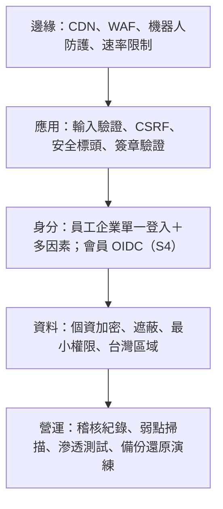

### 8.2 服務水準（建議值）

| 項目 | 目標 |
| --- | --- |
| 公開頁可用性 | 每月 99.9% |
| 表單受理 | 99.9%；95% 在 1.5 秒內回應 |
| 內容發布生效 | 95% 在 10 分鐘內 |
| AI 客服 | 99.5%；95% 回覆在 8 秒內；故障時全數轉真人 |
| 故障復原 | 公開站 1 小時；資料庫 4 小時、資料損失 ≤ 15 分鐘 |

### 8.3 隱私承諾

- 未同意前不載入任何分析或廣告追蹤。
- 追蹤事件不含 Email、姓名、電話、序號或表單內容。
- AI 客服對話先遮蔽個資，遮蔽後保存 90 天，不用於模型訓練。
- 推薦不使用裝置資料，不推論健康、兒童等敏感特徵；個人化需同意且可關閉。

---

## 9. 常見問題（講解準備）

| 問題 | 回答要點 |
| --- | --- |
| 為什麼不用 Next.js？ | 團隊後端以 Python 為主；Vite＋React Router 可預渲染出完整網頁，滿足 SEO 需求，正式環境只需靜態檔案與 Django，維運更單純 |
| 為什麼後端只用 Django？ | 一種框架、一套權限與部署；內建管理後台與安全防護；AI、推薦也在 Python 生態最成熟 |
| 為什麼選開源？ | 無授權費、可自架於台灣、不被單一供應商綁住；每個元件都有替代方案 |
| 開源會不會不安全？ | 選用的都是長期維護的主流專案；鎖定版本、每季檢視安全公告、上線前滲透測試 |
| 為什麼 AI 模型用 Claude 而不是全部自架？ | 三語品質與引用能力最好，初期對話量下成本較低；架構保留切換為自架模型的能力，S1 以題庫實測比較 |
| 客戶資料會送到國外嗎？ | 個資存放在台灣；AI 生成時只送出遮蔽後的問題與公開知識段落；若要求亞洲處理，可評估雲平台區域或自架模型 |
| AI 講錯怎麼辦？ | 只用已核准內容、必附來源、輸出檢查、沒把握轉真人、可一鍵關閉；每週人工抽審 |
| 新產品要多久上線？ | 使用既有模板、內容已核准時 2–3 週 |
| 為什麼首發不開賣？ | 金流、發票、App 整合需要額外決策與驗收；品牌網站先上線，不被拖延 |
| 為什麼選 Saleor 而不是 Medusa？ | Saleor 是 Python／Django，與本案後端一致；金流與發票可用 Python 服務擴充 |
| 費用主要在哪裡？ | 一次性建置、內容製作、每月主機與維運、AI 用量；開源元件無授權費但需維運人力 |
| 內容更新要找工程師嗎？ | 不用。文字、圖片、FAQ、新聞、產品狀態都由編輯在 Wagtail 完成 |
