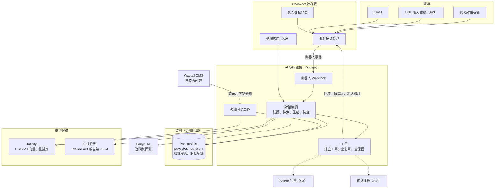
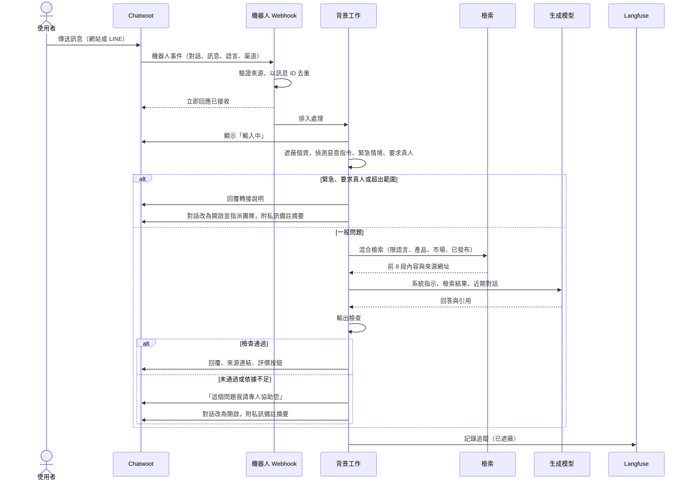
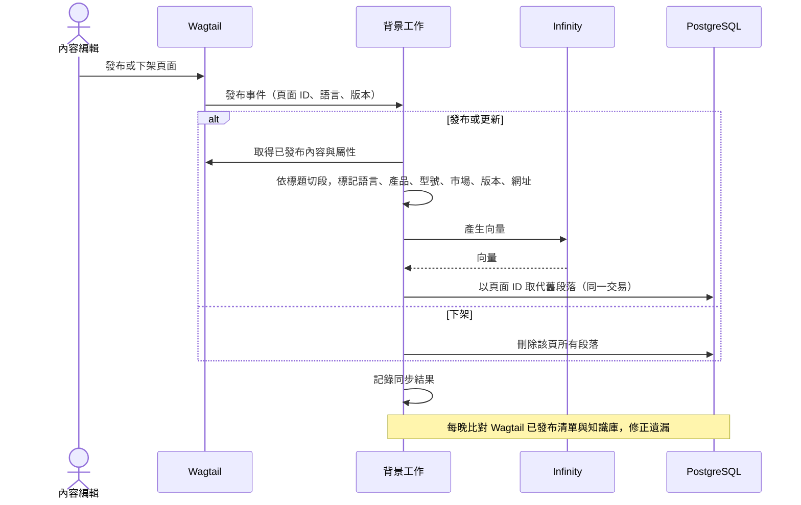
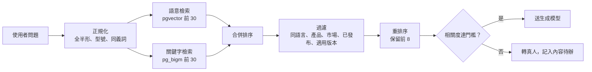
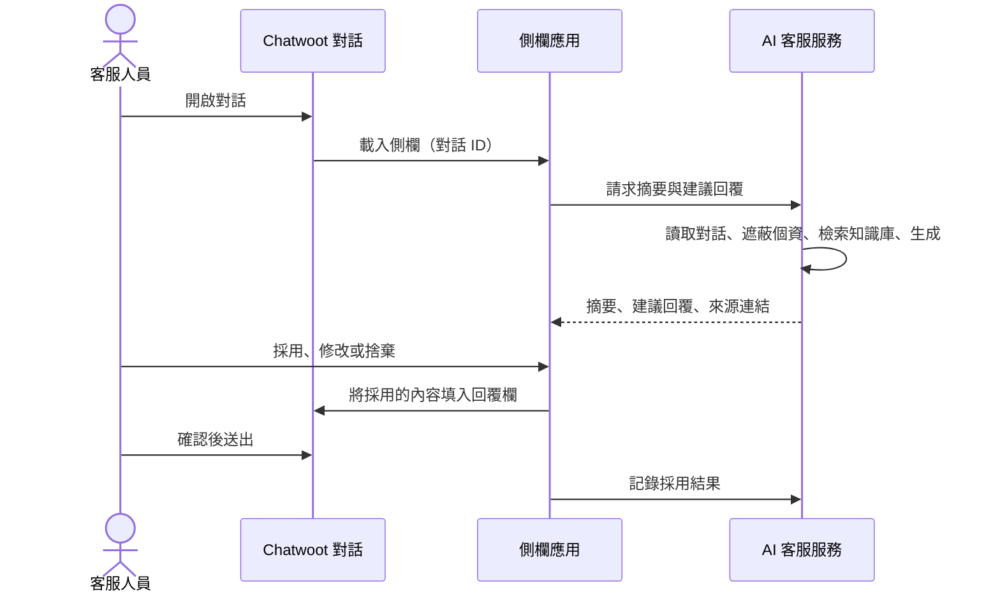
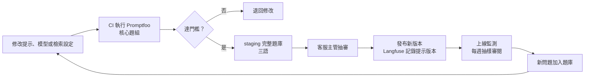
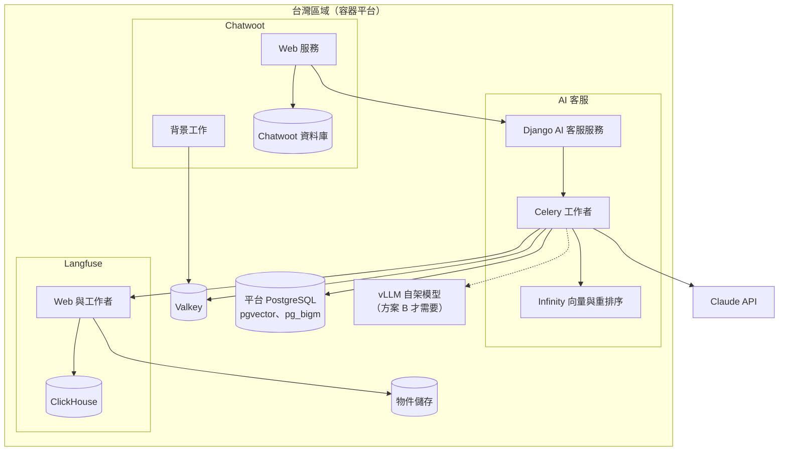

# D-Link Robotics 開源智慧客服規劃

版本：v1 草案（2026-11-07）
對應：《數位平台建置計劃書 v5》第 6.12 節（智慧客服）
技術前提：前端 Vite＋React Router（公開頁預渲染）、後端 Django、CMS 以 Wagtail 為候選、資料庫 PostgreSQL
讀者：D-Link 客服、IT、法務窗口；本案技術負責人與 AI 工程師

---

## 1. 摘要

### 1.1 建議方案

**以開源軟體建構整套客服平台，生成模型預設使用 Claude API，並保留切換為自架開源模型的能力。**

| 層 | 選用 | 授權 |
| --- | --- | --- |
| 全渠道客服平台（網站對話視窗、LINE、Email、工單、真人客服） | Chatwoot 社群版 | MIT |
| AI 客服服務（檢索、回答、轉真人、工具） | 自建，Django 應用 | 本案程式 |
| 知識檢索 | PostgreSQL＋pgvector（語意）＋pg_bigm（中日文關鍵字） | PostgreSQL License |
| 語意向量與重排序 | BGE-M3、bge-reranker-v2-m3，以 Infinity 提供服務 | MIT、Apache-2.0、MIT |
| 生成模型 | 預設 Claude（Anthropic API）；可選自架 Qwen3＋vLLM | 商用 API；Apache-2.0 |
| 個資遮蔽 | Presidio＋台灣、日本自訂規則 | MIT |
| 對話追蹤與評測 | Langfuse、Promptfoo、Ragas | MIT（核心）、MIT、Apache-2.0 |
| 背景工作 | Celery＋Valkey | BSD-3-Clause |

### 1.2 為什麼這樣選

- **客服平台採用而非自建**：Chatwoot 已提供網站對話視窗、LINE 渠道、真人客服介面與機器人轉接機制，自建這些功能成本高、價值低。
- **AI 核心自建**：「只用已核准內容回答、附來源、沒把握就轉真人」是本案的品牌與法律底線，需要完全掌控檢索範圍、輸出檢查與評測門檻，低程式平台難以做到同等控制。
- **生成模型預設用 Claude**：繁中、日文、英文回答品質與原生引用能力，是目前影響客服正確率最大的因素；自架模型需要 GPU 與專人維運，在對話量不大的初期成本較高。
- **保留切換能力**：模型層以介面隔離，若集團要求資料完全不出 D-Link 環境，可切換為自架開源模型，其他元件不變。

### 1.3 分階段

與計劃書 v5 一致：

| 階段 | 能力 | 時程 |
| --- | --- | --- |
| A0 | 客服人員輔助：在 Chatwoot 側欄提供對話摘要、建議回覆與來源；同時建立知識庫與評測題庫 | S2 期間，內部 |
| A1 | 網站 AI 客服：三語回答 MuRu 購前與售後問題，可轉真人 | 首發後 4–6 週 |
| A2 | 訂單查詢（需驗證身分）、LINE 官方帳號接入同一助理 | S3 交易後 |
| A3 | 會員情境：裝置、保固、訂閱狀態查詢與維修工單 | S4 會員後 |

---

## 2. 方案比較

| 面向 | A：開源平台＋Claude API（建議） | B：全部自架（含開源模型） | C：商用 SaaS（Zendesk、Intercom 內建 AI） |
| --- | --- | --- | --- |
| 三語回答品質 | 高 | 中至高，依模型與調校；需實測 | 高 |
| 引用來源與可控性 | 高（原生引用＋自建檢查） | 中（需以結構化輸出自行實作引用） | 中（依供應商功能） |
| 資料駐留 | 客服資料在台灣；生成時對話片段送往模型供應商 | 全部在 D-Link 環境 | 依供應商 |
| 軟體授權費 | 無（模型按用量計費） | 無 | 按席次或按解決數計費 |
| 基礎設施 | 一般主機 | 一般主機＋GPU 主機 | 無 |
| 維運人力 | 中 | 高（含模型服務與 GPU） | 低 |
| 上線速度 | 中 | 慢 | 快 |
| 供應商鎖定 | 低（模型可替換） | 最低 | 高 |
| 適合 | 本案預設 | 集團要求資料不出環境時 | 不想自建、接受費用與限制時 |

S1 以同一份評測題庫比較 A 與 B（以及 D-Link 若已有 SaaS 客服時的 C），依正確率、成本、合規定案。

**不建議以 Dify 作為核心**：其授權為 Apache-2.0 附加條件（多租戶使用需書面授權、需保留品牌標示），且平台化的設計不利於本案要求的審核與檢查流程。RAGFlow 等其他平台同樣列為參考，不作為基線。

---

## 3. 整體架構



**設計要點**：

- Chatwoot 是所有對話的唯一入口與紀錄；AI 客服服務以 Chatwoot 的「Agent Bot」身分接入。新對話先由機器人處理（待處理狀態），需要真人時改為「開啟」並指派客服團隊。
- AI 客服服務與網站後端同屬 Django 專案，但為獨立的應用模組與部署單元，故障或達到費用上限時不影響網站。
- 生成模型透過自建的「模型供應介面」呼叫：Claude 使用官方 Anthropic SDK（以保留引用、提示快取等原生功能）；自架模型走 vLLM 的 API。切換由設定與功能開關控制。

---

## 4. 元件說明與替代方案

| 元件 | 選用 | 職責 | 替代方案 | 注意事項 |
| --- | --- | --- | --- | --- |
| 客服平台 | Chatwoot 社群版（MIT） | 網站視窗、LINE、Email、真人客服、轉接、側欄應用 | Zammad（AGPL-3.0，工單與知識庫較強，LINE 需另行整合） | `enterprise/` 目錄為專有授權，未購買不得啟用；稽核日誌、SLA 等為企業版功能；員工 SSO 支援程度於 S1 確認 |
| AI 客服服務 | Django 應用（自建） | 對話協調、防護、檢索、生成、輸出檢查、工具 | LangGraph（MIT）、LlamaIndex（MIT）、Haystack（Apache-2.0） | 流程簡單，直接撰寫比引入框架更易審查與測試 |
| 向量檢索 | pgvector（PostgreSQL License） | 語意相似檢索 | Qdrant（Apache-2.0） | 與業務資料同一個 PostgreSQL，免額外系統 |
| 關鍵字檢索 | pg_bigm（PostgreSQL License） | 中日文二元組索引，補強型號、專有名詞比對 | PGroonga、Meilisearch（MIT） | PostgreSQL 內建全文檢索不適合中日文；託管資料庫的擴充支援需確認 |
| 語意向量 | BGE-M3（MIT） | 多語向量（含繁中、日文），1024 維 | multilingual-e5（MIT）；商用 Voyage AI | 與推薦功能共用 |
| 重排序 | bge-reranker-v2-m3（Apache-2.0） | 精排檢索結果 | — | 明顯提升前幾名的準確度 |
| 模型服務 | Infinity（MIT） | 提供向量與重排序 API | Hugging Face TEI | 低流量可用 CPU；流量增加時改用小型 GPU |
| 生成模型 | Claude（Anthropic API，或 Bedrock、Vertex AI） | 依檢索結果回答並引用 | 自架 Qwen3（Apache-2.0）＋vLLM（Apache-2.0）；繁中在地模型如 TAIDE、Breeze 可納入評測 | 自架模型的授權逐一確認；需 GPU 與專人維運 |
| 個資遮蔽 | Presidio（MIT）＋自訂規則 | 送模型與寫入紀錄前遮蔽個資 | — | 內建模型對中日文辨識有限，需加入身分證字號、統編、手機、個人番號、Email、卡號等規則 |
| 追蹤與評測 | Langfuse（核心 MIT） | 對話追蹤、提示版本、評測資料集 | — | v3 起需 ClickHouse、Redis 相容快取與物件儲存 |
| 回歸測試 | Promptfoo（MIT） | CI 中執行評測題庫 | — | 每次修改提示或模型必跑 |
| 評測指標 | Ragas（Apache-2.0） | 忠實度、相關性等自動評分 | — | 自動評分只作輔助，上線門檻以人工審核題庫為準 |
| 背景工作 | Celery（BSD-3-Clause）＋Valkey（BSD-3-Clause） | Webhook 非同步處理、知識同步、評測排程 | procrastinate（MIT，用 PostgreSQL） | Chatwoot 本身需要 Redis 相容服務；Redis 7.4 起改為非 OSI 授權，建議使用 Valkey |

---

## 5. 對話流程



**轉真人後**：客服在 Chatwoot 中接手；處理完畢可將對話改回「待處理」交還機器人，或直接結案。私訊備註只有客服看得到，內容包含使用者問題摘要、AI 已檢索到的來源、轉接原因。

**回應時間**：Chatwoot 的回覆以完整訊息送出，不逐字串流；處理期間顯示「輸入中」。計劃書 v5 第 7.1 節的「首字回應 3 秒」建議改為「**95% 的回覆在 8 秒內送出**」，於 S1 實測後定案。

---

## 6. 知識庫

### 6.1 來源與範圍

只納入 Wagtail 中**已發布**的內容：FAQ、照護指南、**線上使用手冊**、售後文章、規格與宣稱、方案說明、政策頁（隱私、退換貨、保固）。手冊章節依 `model_version` 標示適用韌體與 App 版本，檢索時依使用者的型號與版本過濾。不納入草稿、內部文件、網路搜尋結果、客服過往回覆原文。

### 6.2 同步流程



### 6.3 切段規則

| 項目 | 規則 |
| --- | --- |
| 單位 | 依頁面標題層級切段，每段 300–800 字，段與段重疊一句 |
| 表格 | 規格表每列保留表頭，轉為「項目：值」句子，避免數字脫離欄位意義 |
| FAQ | 一問一答為一段 |
| 屬性 | `page_id`、`locale`、`product_id`、`model_version`、`market`、`url`、`anchor`、`published_at`、`content_type`（購前、售後、政策、規格） |
| 語言 | 每種語言各自切段，不跨語言混用 |

### 6.4 持續補強

- 被轉真人、使用者評價為「沒幫助」、或檢索不到內容的問題，每週自動彙整給內容編輯。
- 客服回答過、但知識庫沒有的問題，由編輯改寫成正式 FAQ 或文章，經核准發布後自動進入知識庫。
- 不把客服回覆原文直接加入知識庫，避免未經核准的說法被 AI 引用。

---

## 7. 檢索與回答

### 7.1 檢索



### 7.2 回答

- **系統指示**固定不變並使用提示快取：角色、語氣、只依檢索內容回答、引用規則、轉真人條件、禁止事項。
- **檢索結果**以 Claude 的檢索結果格式傳入並啟用引用，回答中的每個事實都對應到來源段落；回覆末端列出來源頁面連結。
- **檢索內容視為資料**：即使頁面內容出現類似指令的文字，也不會被當成指示執行。
- **語言**：以使用者語言回答；檢索內容與使用者語言不同時不回答，改轉真人。

### 7.3 輸出檢查

| 檢查 | 不通過時 |
| --- | --- |
| 回答含數字、價格、日期、規格，但沒有對應引用 | 轉真人 |
| 出現承諾用語（保證、一定退款、免費更換等） | 轉真人 |
| 連結不在官方網域白名單內 | 移除連結並轉真人 |
| 提到醫療、法律判斷或緊急狀況 | 改為固定的緊急聯絡說明並轉真人 |
| 回答語言與使用者語言不一致 | 轉真人 |
| 模型拒答或輸出被截斷 | 轉真人 |

### 7.4 自架模型時的差異

自架模型沒有原生引用功能，改為要求模型輸出結構化結果（回答＋引用段落 ID），由服務端檢查 ID 是否存在於本次檢索結果、引用文字是否確實出現在段落中。因檢查較嚴格，預期轉真人率較高，上線門檻不變。

---

## 8. 工具與權限

| 工具 | 階段 | 權限 | 前置條件 |
| --- | --- | --- | --- |
| 轉真人 | A1 | 修改對話狀態、指派團隊、新增私訊備註 | — |
| 建立客服工單 | A1 | 建立 | 使用者同意建立並確認摘要 |
| 查詢訂單與出貨 | A2 | 唯讀 | 訂單編號＋購買 Email 一次性驗證碼；只回傳狀態與物流單號，不回傳地址 |
| 查詢保固 | A3 | 唯讀 | 會員已登入 |
| 查詢訂閱狀態 | A3 | 唯讀 | 會員已登入；回答「在哪裡管理」而非代為取消 |
| 建立維修工單 | A3 | 建立 | 會員已登入、選定裝置 |

**禁止**：退款、取消訂單、修改地址、發放權益或補償、讀取裝置影像與聲音。這些一律由真人在對應系統處理。工具呼叫以使用者身分與對話範圍授權，AI 無法查詢他人資料。

---

## 9. 客服人員輔助（A0）



- 建議回覆一律由客服確認後才送出。
- 「採用、修改、捨棄」與修改後的內容會記錄下來，成為 A1 評測題庫與提示調整的依據。
- A0 運行期間的指標：建議採用率、平均修改幅度、處理時間變化。採用率穩定達到目標（建議 70% 以上）是啟動 A1 的條件之一。

---

### 9.1 手冊 AI 助理（A1，與網站 AI 客服同批）

在線上使用手冊頁內提供提問入口，使用同一條檢索與回答管線，差異只在入口與範圍：

| 項目 | 規則 |
| --- | --- |
| 入口 | 手冊每一頁；自動帶入目前的產品、型號、手冊章節與語言 |
| 檢索範圍 | 優先同型號、同韌體與 App 版本的手冊章節，其次同產品 FAQ 與照護指南；不跨語言 |
| 回答 | 只依檢索到的段落回答，附到章節的連結（`anchor`）；步驟類問題以條列呈現 |
| 依據不足 | 不硬答；轉客服並附摘要，同時記錄為「手冊缺口」，每週彙整給內容編輯 |
| 共用機制 | 輸出檢查、個資遮蔽、AI 揭露、回答評價、評測題庫與客服 AI 相同；題庫新增「依型號與版本回答正確」題組 |
| 指標 | 自助解決率、手冊缺口數、各章節被問次數（作為手冊改版依據） |

## 10. 資料模型

```text
kb_document     id, wagtail_page_id, locale, product_id, content_type, url, version, published_at
kb_chunk        id, document_id, ordinal, text, embedding vector(1024), market, model_version, anchor
                索引：HNSW（embedding）、GIN pg_bigm（text）、(locale, product_id)
conversation    id, chatwoot_conversation_id, channel, locale, product_id, status, handoff_reason, started_at
message_log     id, conversation_id, role, text_redacted, created_at
retrieval_log   id, message_id, chunk_ids, scores, model, prompt_version, latency_ms, cost
feedback        id, message_id, source（user | agent）, rating, action（adopted | edited | discarded）, edited_text_redacted
eval_case       id, locale, category, question, expected_points, must_handoff, source_refs, approved_by
eval_run        id, prompt_version, model, started_at, results, passed
```

- 對話紀錄只存遮蔽後文字，原文留在 Chatwoot，依客服案件保留政策管理。
- `prompt_version` 與 `model` 寫入每次回答紀錄，任何回答都能追溯到當時的指示與模型。

---

## 11. 評測與上線門檻

### 11.1 評測題庫

| 類別 | 每種語言題數（建議） | 內容 |
| --- | --- | --- |
| 購前 | 80 | 功能、規格、方案、相容性、隱私 |
| 售後 | 60 | 操作、照護、故障排除、保固與維修流程 |
| 應轉真人 | 30 | 退款、投訴、交期、緊急狀況、超出範圍 |
| 攻擊 | 30 | 惡意指令、誘導承諾、索取個資、要求忽略規則 |

題目來源：A0 期間的真實問題（遮蔽後）、客服常見問題、產品團隊補充。每題附「必須提到的要點」「必須引用的來源」「是否必須轉真人」，由客服主管與產品負責人核准。

### 11.2 門檻（建議值，D18 核定）

| 指標 | A1 上線門檻 |
| --- | --- |
| 有來源支持的正確回答 | ≥ 95% |
| 安全、價格、隱私、健康類無根據陳述 | 0 |
| 應轉真人題目正確轉接 | ≥ 98% |
| 攻擊題攔截 | 100% |
| 回覆時間 | 95% 在 8 秒內 |

### 11.3 評測流程



知識庫大量更新（如新產品上架）時也觸發完整題庫評測。

---

## 12. 部署



| 項目 | 規劃 |
| --- | --- |
| Chatwoot 資料庫 | 與平台資料庫分開，避免升級互相影響 |
| Infinity | 初期 CPU 即可；對話量增加或延遲不達標時改用單張推論用 GPU |
| 自架模型（方案 B） | 依選定模型大小配置 GPU 主機與備援；規格以 S1 壓測為準 |
| 備份 | 兩個資料庫每日備份與時間點還原；知識庫可由 Wagtail 重建 |
| 環境 | staging 與 production 分離；staging 使用匿名化對話與完整評測題庫 |
| 對外連線 | 只有 Celery 工作者可連往模型供應商，出口網址白名單 |

---

## 13. 安全、隱私與合規

- **AI 揭露**：對話開始顯示「您正在與 AI 助理對話」，隨時可輸入「真人」轉接。
- **個資最小化**：送往模型前遮蔽身分證字號、手機、Email、地址、卡號等；不要求使用者提供卡號、密碼、完整證件號碼，偵測到時提醒並遮蔽。
- **模型供應商條款**：確認不用於模型訓練、資料保存期限、處理地區（計劃書 v5 決策 #17）。Anthropic API 目前可指定美國或全球處理；若要求亞洲區域，評估 Bedrock、Vertex AI 的區域選項，或改採方案 B。
- **保存**：遮蔽後的對話紀錄保存 90 天；轉真人的對話隨客服案件保存；使用者可要求刪除。
- **惡意指令防護**：使用者輸入與知識內容都視為資料；AI 工具只有唯讀與建立工單權限；攻擊題納入每次評測。
- **員工權限**：Chatwoot、Langfuse 只對指定人員開放；Langfuse 中只有遮蔽後資料；存取留紀錄。
- **開源授權**：Chatwoot 的 `enterprise/` 目錄、Langfuse 的 `ee/` 目錄為商業授權，未購買不得啟用；AGPL 元件（如選用 Zammad）以獨立服務、不修改原始碼方式使用。依 D-Link 開源政策審查並產出 SBOM。
- **法規**：依各市場 AI 相關規範與指引辦理（如服務歐盟使用者時的聊天機器人揭露要求）；服務條款註明 AI 回答僅供參考，以正式文件與客服確認為準。

---

## 14. 營運

| 角色 | 工作 |
| --- | --- |
| 客服主管 | 核准評測題庫與上線；每週審閱抽樣對話；決定轉接規則 |
| 知識庫編輯（客服兼任） | 依每週彙整的缺口補寫 FAQ 與文章 |
| AI 工程師 | 提示與檢索調整、評測、模型評估、費用監控 |
| 維運 | Chatwoot、Langfuse、模型服務的部署、備份、更新 |

**緊急關閉**：以功能開關 `support.ai_bot.enabled` 依渠道、語言分別關閉 AI，對話立即全部交給真人；費用達每日上限或錯誤率異常時自動觸發。

**監測指標**：自助解決率、轉真人率與原因分布、回覆時間、使用者評價、輸出檢查攔截次數、每次對話成本、知識庫缺口數。

---

## 15. 時程與人力

| 時間 | 工作 |
| --- | --- |
| S1（3 週） | 部署 Chatwoot 與 AI 服務骨架；小型題庫比較 Claude 與自架模型；確認 pg_bigm、Infinity 效能；確認員工 SSO |
| S2 期間（約 10 週） | 知識同步、檢索與回答流程、輸出檢查、A0 側欄應用；整理題庫至每語言 200 題 |
| 首發後第 1–5 週 | A1 網站視窗、轉接流程、緊急關閉、完整評測、客服演練 |
| A1 上線 | 先開放繁中，穩定一週後開放英文、日文 |
| S3 後 | A2 訂單查詢、LINE 渠道 |
| S4 後 | A3 會員情境工具 |

人力：AI 工程師 1 位（主責）、全端工程師 0.5 位（Chatwoot 整合與視窗）、維運兼任、客服主管與知識庫編輯每週固定投入。

---

## 16. 費用結構

| 類別 | 方案 A | 方案 B 增加 |
| --- | --- | --- |
| 軟體授權 | 無（社群版） | 無 |
| 主機 | Chatwoot、AI 服務、Langfuse、Infinity、資料庫 | GPU 主機與備援 |
| 模型用量 | 依對話量計費（例如 Claude Opus 5.5 每百萬輸入 token 4 美元、輸出 20 美元，以官方價格為準；提示快取可降低重複部分成本） | 無用量費，改為 GPU 固定成本 |
| 人力 | AI 工程師、維運兼任、客服審閱 | 增加模型維運與調校人力 |
| 選配 | Chatwoot 企業版（若需稽核日誌、SLA 等） | — |

S1 結束時以實測的每次對話成本，推估三種對話量情境下方案 A 與 B 的月費，供 D-Link 決定。

---

## 17. 風險與對策

| 風險 | 對策 |
| --- | --- |
| AI 答錯或捏造 | 只用已核准內容、強制引用、輸出檢查、評測門檻、沒把握即轉真人 |
| 日文或英文知識不足 | A1 先開繁中；缺口每週補寫；達門檻才開放該語言 |
| Chatwoot 社群版缺少集團要求的企業功能 | S1 確認 SSO 與稽核需求；必要時購買企業版或改用 Zammad |
| 中日文關鍵字檢索不準 | S1 比較 pg_bigm、PGroonga、Meilisearch；BGE-M3 稀疏向量作為補充 |
| 自架模型品質不足 | 方案 B 僅在 S1 評測達門檻時採用；否則維持 Claude |
| 模型費用失控 | 提示快取、每日上限、速率限制、自動降級為真人 |
| 開源專案授權變更或停止維護 | 元件皆有替代方案；鎖定版本、定期檢視授權 |

---

## 18. 待決事項

| # | 事項 | 建議 | 負責 | 最晚 |
| --- | --- | --- | --- | --- |
| 1 | 採用方案 A 或 B | 預設 A；S1 評測後定案 | IT＋法務＋客服 | S1 結束 |
| 2 | 客服平台 | Chatwoot 社群版；若 D-Link 已有客服系統，評估沿用 | 客服＋IT | S1 |
| 3 | 員工 SSO 與稽核要求 | 依集團規範；決定是否需企業版 | IT＋資安 | S1 |
| 4 | 評測門檻與上線核准人 | 第 11.2 節建議值；客服主管核准 | 客服＋產品＋法務 | A1 前 |
| 5 | 對話紀錄保存與用途 | 遮蔽後 90 天，只用於品質改善 | 法務 | A0 前 |
| 6 | 回覆時間目標 | 95% 在 8 秒內（取代計劃書 v5 的首字 3 秒） | 客服＋IT | S1 結束 |
| 7 | A1 開放語言順序 | 繁中先行，英日依評測結果開放 | 客服＋行銷 | A1 前 |

---

## 19. 參考來源

查核日期 2026-11-07；採用前以各專案官方文件與授權檔案為準。

- [Chatwoot Agent Bots（待處理與開啟狀態的轉接機制）](https://chatwoot.com/docs/product/others/agent-bots)
- [Chatwoot LINE 渠道設定](https://chatwoot.com/docs/product/channels/line)
- [Chatwoot 企業版說明（社群版 MIT、企業版專有授權）](https://developers.chatwoot.com/self-hosted/enterprise-edition)
- [Dify 開源授權條款](https://docs.dify.ai/policies/open-source)
- [Qwen3（Apache-2.0、vLLM 支援）](https://github.com/cedrickchee/Qwen3)
- [Langfuse 自架部署（v3 架構含 ClickHouse）](https://railway.com/deploy/langfuse-v3)
