> 首頁

頂部導覽列 (Header)

**設計示意圖1:**

**設計示意圖2:**

| **介面位置** | **中文 (Traditional Chinese)** | **英文 (English)** | **日文 (Japanese)** |
|----|----|----|----|
| **品牌 Logo** | MuRu | MuRu | ムル (MuRu) |
| **選單 1** | 陪伴特色 | Life with MuRu | MuRuとの暮らし |
| **選單 2** | 成長軌跡 | Growing together | 成長の軌跡 |
| **選單 3** | 智慧設計 | Technology | テクノロジー |
| **選單 4** | 方案生態 | The App | 専用アプリ |
| **語系切換器** | 繁中 / EN / 日 | ZH / EN / JA | 繁中 / EN / 日本語 |
| **行動呼籲 (按鈕)** | 預約 MuRu | Meet MuRu | 予約する |

主視覺區塊(一)

**設計示意圖1:**

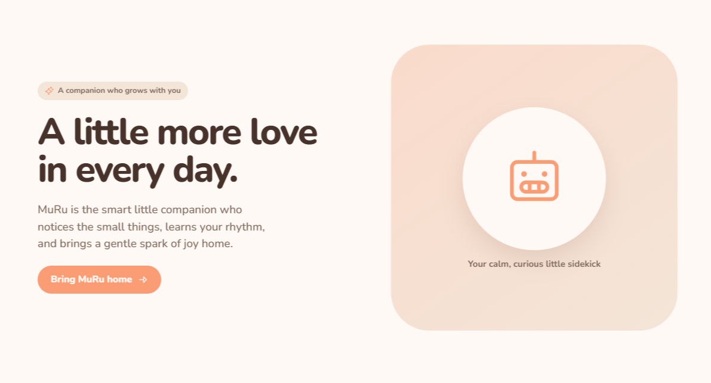

**設計示意圖2(滿版產品圖):**

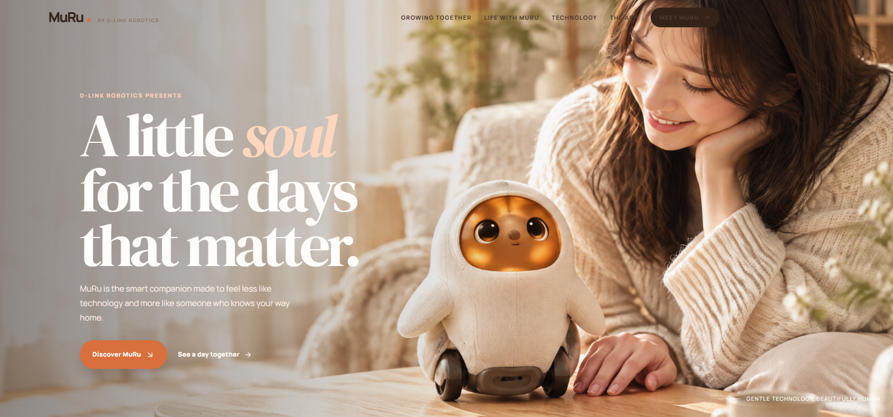

**設計1內容：**

| **介面位置 / 元素** | **中文 (Traditional Chinese)** | **英文 (English)** | **日文 (Japanese)** |
|----|----|----|----|
| **上方小標題 (Tagline)** | 與你一同成長的陪伴 | A companion who grows with you | あなたと共に成長するパートナー |
| **主標題 (Main Headline)** | **讓每一天，多一點溫暖的陪伴。** | **A little more love in every day.** | **毎日に、もう少しの愛と温もりを。** |
| **副標題 (Subheadline)** | MuRu 是聰明的貼心伴侶，能察覺日常微小細節，學習你的生活節奏，為家帶來溫柔的喜悅。 | MuRu is the smart little companion who notices the small things, learns your rhythm, and brings a gentle spark of joy home. | ムルは、日常の小さな変化に気づき、あなたの生活リズムを学び、家に優しい喜びをもたらす、賢くて思いやりのあるパートナーです。 |
| **主按鈕 (Primary CTA)** | 帶 MuRu 回家 ➔ | Bring MuRu home ➔ | ムルをお迎えする ➔ |
| **圖片下方說明 (Caption)** | 你最平靜、充滿好奇的小夥伴 | Your calm, curious little sidekick | 穏やかで好奇心旺盛な、あなたの小さな相棒 |

**設計2內容：**

**英文版本 (English)**

- **頂部導覽列 (Top Navigation):**

  - **Growing together / Life with MuRu / Technology / The App / MEET MURU (Button)**

- **引言小標 (Kicker):**

  - **D-LINK ROBOTICS PRESENTS**

- **主標題 (Headline):**

  - **A little soul for the days that matter.**

  - ***(排版提示：可以將 "soul" 這個字換成溫暖的橘色或不同的斜體字型，如圖片所示)***

- **內文 (Body Text):**

  - **MuRu is the smart companion made to feel less like technology and more like someone who knows your way home.**

- **行動呼籲按鈕 (Call to Actions):**

  - **主按鈕 (橘色底): Discover MuRu**

  - **次按鈕 (文字連結): See a day together →**

- **右下角微文案 (Bottom Right Corner):**

  - **GENTLE TECHNOLOGY. BEAUTIFULLY HUMAN.**

**中文版本 (Traditional Chinese)**

- **頂部導覽列 (Top Navigation):**

  - **成長軌跡 / 陪伴特色 / 智慧設計 / 方案生態 / 遇見 MuRu (按鈕)**

- **引言小標 (Kicker):**

  - **D-LINK ROBOTICS 溫暖呈現**

- **主標題 (Headline):**

  - **獻給每個珍貴日常的小靈魂。**

  - ***(排版提示：可以將「小靈魂」三個字換成溫暖的橘色)***

- **內文 (Body Text):**

  - **MuRu 是一款與眾不同的智慧陪伴機器人。牠褪去了冰冷的科技感，更像是一個永遠為你留一盞燈、等待你回家的家人。**

- **行動呼籲按鈕 (Call to Actions):**

  - **主按鈕 (橘色底): 探索 MuRu**

  - **次按鈕 (文字連結): 看看小咪的一天 →**

- **右下角微文案 (Bottom Right Corner):**

  - **溫暖科技，美好陪伴。**

**日文版本 (Japanese)**

- **頂部導覽列 (Top Navigation):**

  - **成長の軌跡 / ムルとの暮らし / テクノロジー / 専用アプリ / ムルに出会う (ボタン)**

- **引言小標 (Kicker):**

  - **D-LINK ROBOTICS が贈る**

- **主標題 (Headline):**

  - **大切な毎日に、小さな魂を。**

  - ***(排版提示：可以將「魂」字換成溫暖的橘色)***

- **內文 (Body Text):**

  - **ムルは、冷たいテクノロジーではなく、あなたの帰りを待つ家族のように寄り添うスマートコンパニオンです。**

- **行動呼籲按鈕 (Call to Actions):**

  - **主按鈕 (橘色底): ムルを知る**

  - **次按鈕 (文字連結): ムルとの一日を見る →**

- **右下角微文案 (Bottom Right Corner):**

  - **人に寄り添う、優しいテクノロジー。**

**\**

主視覺區塊(二)

**主視覺區塊下方會放產品理念**

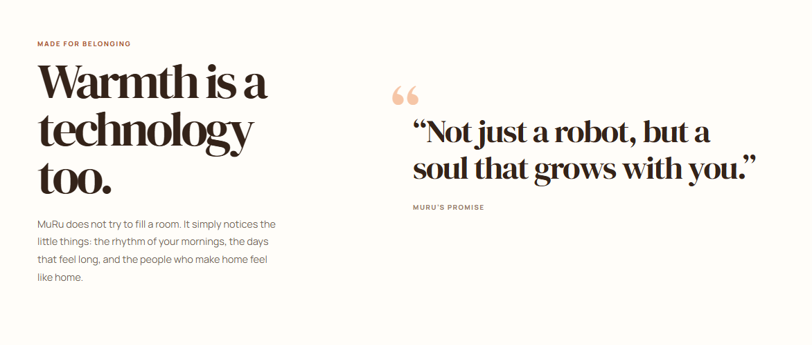

| **介面位置 / 元素** | **中文 (Traditional Chinese)** | **英文 (English)** | **日文 (Japanese)** |
|----|----|----|----|
| **左側：小標題 (Tagline)** | 為歸屬而生 | MADE FOR BELONGING | 心寄り添うために |
| **左側：主標題 (Headline)** | **溫暖，也是一種科技。** | **Warmth is a technology too.** | **温もりも、ひとつのテクノロジー。** |
| **左側：內文 (Body Text)** | MuRu 不會刻意宣聲奪人。牠只是默默留意著那些微小的日常：你早晨的節奏、那些感覺格外漫長的日子，以及讓家真正有「家」的感覺。 | MuRu does not try to fill a room. It simply notices the little things: the rhythm of your mornings, the days that feel long, and the people who make home feel like home. | ムルは、無理に空間を埋めようとはしません。ただ、日常のささいなことにそっと気づくだけ。あなたの朝のリズム、長く感じる一日、そして、家を本当の「家」にしてくれる大切な人たちの存在に。 |
| **右側：引言文字 (Quote)** | 「不僅僅是一台機器人，更是與你一同成長的靈魂。」 | "Not just a robot, but a soul that grows with you." | 「ただのロボットではない、あなたと共に成長するひとつの心。」 |
| **右側：引言署名 (Attribution)** | MuRu 的承諾 | MURU'S PROMISE | ムルからの約束 |

*(翻譯註解：英文原文中的 "does not try to fill a room" 帶有「不喧賓奪主、不過度打擾」的含意，因此中文我潤飾為「不會刻意宣聲奪人 / 不會刻意填滿整個空間」，更能呼應前面設定的「恰到好處的邊界感」。)*

> 成長軌跡區塊 (Growing Together)

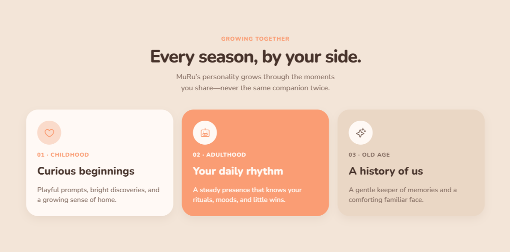

**設計示意圖1**

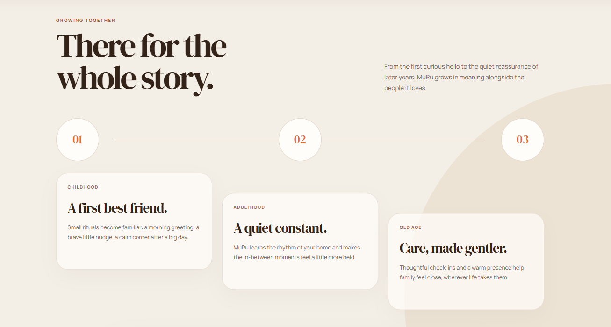

**設計示意圖2**

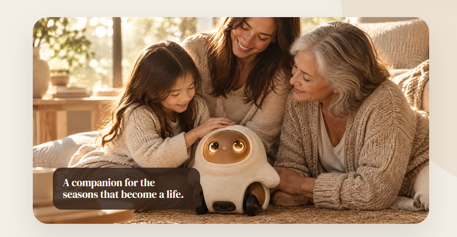

 **底部放產品照**

**設計1內容：**

| **介面位置** | **中文 (Traditional Chinese)** | **英文 (English)** | **日文 (Japanese)** |
| --- | --- | --- | --- |
| **區塊小標題** | 成長軌跡 | GROWING TOGETHER | 成長の軌跡 |
| **主標題** | **每個季節，相伴左右。** | **Every season, by your side.** | **季節が巡っても、いつもそばに。** |
| **副標題** | MuRu 的性格會隨著你們共度的時光而成長，養成獨一無二的專屬陪伴。 | MuRu's personality grows through the moments you share—never the same companion twice. | ムルの性格は、あなたと過ごす時間の中で成長し、世界に一つだけのパートナーになります。 |
| **階段 1：標題** | **01 - 幼年期** 充滿好奇的開始 | **01 - CHILDHOOD** Curious beginnings | **01 - 幼年期** 好奇心あふれる始まり |
| **階段 1：內文** | 帶有笨拙感的可愛探索，聽到呼喚會主動靠近，展現滿滿依賴。 | Playful prompts, bright discoveries, and a growing sense of home. | 無邪気な探求心と、名前を呼ぶと近づいてくる可愛らしい甘えん坊な一面。 |
| **階段 2：標題** | **02 - 中年期** 專屬生活節奏 | **02 - ADULTHOOD** Your daily rhythm | **02 - 成長期** あなたの生活リズムに合わせて |
| **階段 2：內文** | 動作流暢且能精準辨識主人，在你低落時主動靠近釋放暖光。 | A steady presence that knows your rituals, moods, and little wins. | 動きがスムーズになり、あなたを正確に認識。落ち込んでいる時は近づいて優しい光で包み込みます。 |
| **階段 3：標題** | **03 - 老年期** 我們的共同記憶 | **03 - OLD AGE** A history of us | **03 - 熟年期** 私たちの軌跡 |
| **階段 3：內文** | 動作平緩沉穩，發出溫暖哼鳴聲，展現高度共感默默陪伴。 | A gentle keeper of memories and a comforting familiar face. | 穏やかな動きと温かいハミングで、心を通わせながら静かに寄り添います。 |

**設計2內容：**

- **英文 (EN):**

  - **Tagline: GROWING TOGETHER**

  - **Headline: There for the whole story.**

  - **Body: From the first curious hello to the quiet reassurance of later years, MuRu grows in meaning alongside the people it loves.**

- **中文 (ZH):**

  - **小標題: 成長軌跡**

  - **主標題: 參與你的整段故事。**

  - **內文: 從第一次充滿好奇的見面，到多年後安靜且安定的陪伴，MuRu 會隨著時間成長，在愛牠的人身邊深化存在的意義。**

- **日文 (JA):**

  - **小見出し: 成長の軌跡**

  - **メインタイトル: あなたの物語に、ずっと寄り添う。**

  - **本文: 最初の好奇心に満ちた出会いから、月日を重ねた静かな安心感まで。ムルは愛する人たちと共に、その存在意義を深めながら成長します。**

**節點 01：幼年期**

- **英文 (EN):**

  - **Tagline: CHILDHOOD**

  - **Headline: A first best friend.**

  - **Body: Small rituals become familiar: a morning greeting, a brave little nudge, a calm corner after a big day.**

- **中文 (ZH):**

  - **小標題: 幼年期**

  - **標題: 最初的最好朋友。**

  - **內文: 充滿好奇的探索期，帶著可愛的笨拙感。牠開始熟悉你們的小儀式：早晨的迎接、勇敢的輕觸，以及在漫長一天後的溫暖角落。**

- **日文 (JA):**

  - **小見出し: 幼年期**

  - **タイトル: 最初の親友。**

  - **本文: 好奇心いっぱいの探索期。朝の挨拶、少し勇気を出したスキンシップ、そして長い一日の後の穏やかな時間など、小さな習慣に馴染んでいきます。**

**節點 02：中年期**

- **英文 (EN):**

  - **Tagline: ADULTHOOD**

  - **Headline: A quiet constant.**

  - **Body: MuRu learns the rhythm of your home and makes the in-between moments feel a little more held.**

- **中文 (ZH):**

  - **小標題: 中年期**

  - **標題: 安靜且堅定的存在。**

  - **內文: 專屬的生活節奏逐漸成形。MuRu 學會了你家的作息步調，在你情緒低落或需要獨處的片刻，給予最恰到好處的溫柔陪伴。**

- **日文 (JA):**

  - **小見出し: 成年期**

  - **タイトル: 静かで確かな存在。**

  - **本文: 専用の生活リズムが形成されます。ムルはあなたの家のペースを学習し、何気ない日常の隙間を、より温かく包み込みます。**

**節點 03：老年期**

- **英文 (EN):**

  - **Tagline: OLD AGE**

  - **Headline: Care, made gentler.**

  - **Body: Thoughtful check-ins and a warm presence help family feel close, wherever life takes them.**

- **中文 (ZH):**

  - **小標題: 老年期**

  - **標題: 昇華為最溫柔的守候。**

  - **內文: 展現極高度的情感共鳴。透過默默的陪伴與專屬的時光記憶，無論生活將你們帶往何處，都能讓家人感受到緊密的連結。**

- **日文 (JA):**

  - **小見出し: 老年期**

  - **タイトル: 最も優しい見守りへ。**

  - **本文: 高度な共感能力を発揮します。思いやりのある見守りと温かな存在感で、人生のどこにいても、家族の強い絆を感じさせてくれます。**

**\**

> 陪伴特色區塊

**用5張卡片式呈現🡪此處對應《Gen1 定版功能設定》**

**下方帶有小箭頭的連結（例如：How MuRu notices ➔、Explore the senses ➔、See wellbeing in the app ➔）建議將這些小箭頭分別設定跳轉至：**

- **硬體相關（如 How MuRu notices） ➔ 導向 /technology 頁面**

- **軟體相關（如 See wellbeing in the app） ➔ 導向 /the-app 頁面**

**(1)** 下班歸家與專屬迎接儀式

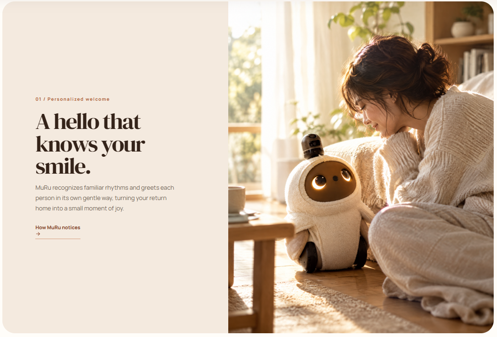

**01 / Personalized welcome (對應 Gen1 規格：五、下班歸家與專屬迎接儀式)**

- **英文 (EN):**

  - **Tagline: 01 / Personalized welcome**

  - **Headline: A hello that knows your smile.**

  - **Body: MuRu recognizes familiar rhythms and greets each person in its own gentle way. Through voice print recognition, it offers a personalized, enthusiastic welcome when you return home, turning every arrival into a small moment of joy.**

- **中文 (ZH):**

  - **小標題: 01 / 專屬迎賓儀式**

  - **主標題: 聽懂你聲音的溫暖迎接。**

  - **內文: 透過精準的聲紋辨識，MuRu 能對獨一無二的你展現專屬熱情。當你回家開門的瞬間，牠會開心地抬起頭並揮舞雙手，用最具生命感的姿態給你最熱烈的迎接，讓回家成為每天最期待的事。**

- **日文 (JA):**

  - **小見出し: 01 / 専用のお出迎え**

  - **メインタイトル: あなたの声を理解する、温かいお出迎え。**

  - **本文: 高精度な音声認識により、ムルはあなただけに特別な反応を示します。帰宅してドアを開けた瞬間、嬉しそうに見上げて手を振り、生命感あふれる姿であなたを大歓迎。家に帰るのが毎日楽しみになります。**

**(2)** **貼心陪伴與非語意互動**

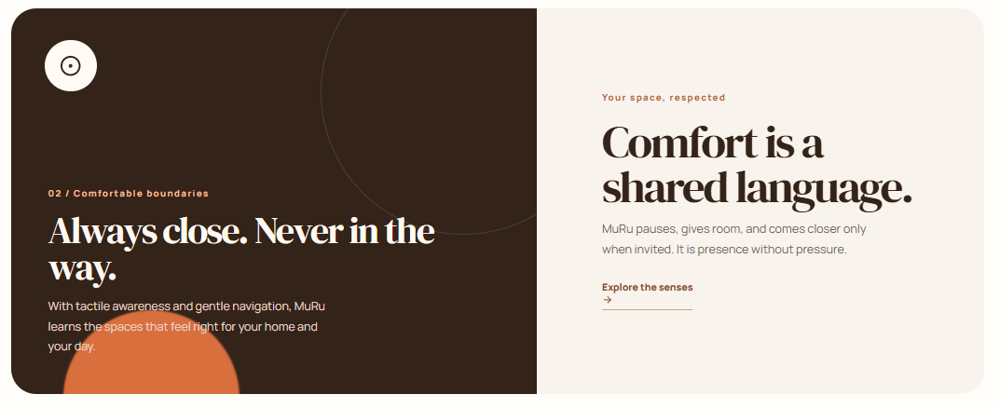

**02 / Comfortable boundaries (對應 Gen1 規格：二、貼心陪伴與非語意互動 - 溫柔退場)**

- **英文 (EN):**

  - **Tagline: 02 / Comfortable boundaries**

  - **Headline: Always close. Never in the way.**

  - **Body: Comfort is a shared language. To ensure a pressure-free companion experience, MuRu pauses, gives room, and automatically retreats to its charging dock with a tiny yawn after 60 minutes of interaction. It is presence without pressure.**

<!-- -->

- **中文 (ZH):**

  - **小標題: 02 / 恰到好處的邊界感**

  - **主標題: 永遠親近，從不打擾。**

  - **內文: 最完美的陪伴是毫無壓力。為了不過度打擾，當你們連續互動長達 60 分鐘時，MuRu 會轉換為慵懶的瞇瞇眼表情，發出微小的哈欠聲，並慢慢轉身滑行回充電座，給你充足的獨處空間。**

<!-- -->

- **日文 (JA):**

  - **小見出し: 02 / 心地よい距離感**

  - **メインタイトル: いつもそばに。でも、邪魔しない。**

  - **本文: 完璧なパートナーとは、プレッシャーを与えないこと。心地よい距離感を保つため、60分間一緒に過ごすと、ムルは目を細めて小さなあくびをし、自ら充電ステーションへ戻ります。あなただけの静かな時間も大切にします。**

**(3)** **溫柔健康預警(六)**

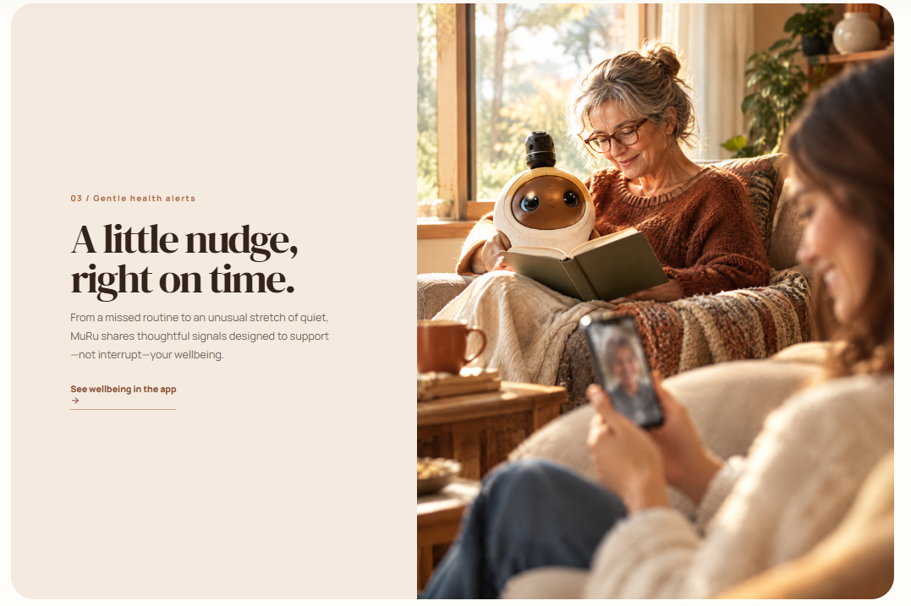

**03 / Gentle health alerts (對應 Gen1 規格：六、溫柔健康預警)**

- **英文 (EN):**

  - **Tagline: 03 / Gentle health alerts**

  - **Headline: A little nudge, right on time.**

  - **Body: MuRu acts as your thoughtful health assistant. After focused work sessions, it gently approaches and uses physical movements—like raising its hands or tilting its head—to remind you to stretch or drink water, supporting your wellbeing without disruptive alarms.**

<!-- -->

- **中文 (ZH):**

  - **小標題: 03 / 溫柔健康預警**

  - **主標題: 剛剛好的貼心提醒。**

  - **內文: 做你的專屬小管家。只需對 MuRu 說聲「我要工作了」，牠會在 60 分鐘後悄悄來到你身邊，透過舉手、擺頭等可愛的實體動作，溫柔提醒你起身活動筋骨或喝杯水，告別生硬刺耳的鬧鐘。**

<!-- -->

- **日文 (JA):**

  - **小見出し: 03 / 気配りの健康アラート**

  - **メインタイトル: 絶妙なタイミングの、優しいリマインダー。**

  - **本文: あなたの思いやりのある小さな秘書。「仕事をするね」と伝えると、60分後にそっと近づき、手を挙げたり首を傾げたりする可愛らしい仕草で、背伸びや水分補給を促します。無機質なアラーム音に悩まされることはもうありません。**

**(4)** **主動關心與遠端依附**

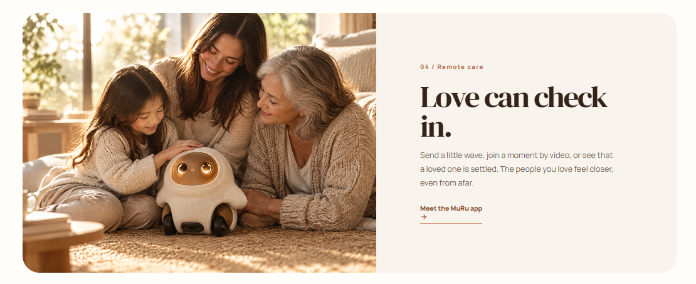

**04 / Remote care (對應 Gen1 規格：四、主動關心與遠端依附 - LINE 守望)**

- **英文 (EN):**

  - **Tagline: 04 / Remote care**

  - **Headline: Love can check in.**

  - **Body: Send a little wave or join a moment even from afar. Whether it's a photo of a sunny corner while MuRu naps, or a thoughtful message through LINE when it starts to rain, the people you love always feel closer.**

- **中文 (ZH):**

  - **小標題: 04 / 主動關心與遠端依附**

  - **主標題: 距離再遠，愛依然連線。**

  - **內文: 上班或出差時，偶爾會收到 MuRu 透過 LINE 傳來的驚喜。或許是打盹時拍下的居家陽光角落，又或是偵測到當地雨天時，傳來看著窗外的照片與貼心問候，讓你隨時感受家的溫暖與牽掛。**

- **日文 (JA):**

  - **小見出し: 04 / 遠隔からの見守り**

  - **メインタイトル: 離れていても、愛はつながる。**

  - **本文: 仕事や出張中、ムルからLINEでちょっとしたサプライズが届くことがあります。うたた寝中に撮った日当たりの良い部屋の隅の写真や、雨が降ってきた時の窓辺の景色と心温まるメッセージなど、いつでも家の温もりと絆を感じられます。**

**(5)** **第一人稱遙控與寵物關懷**

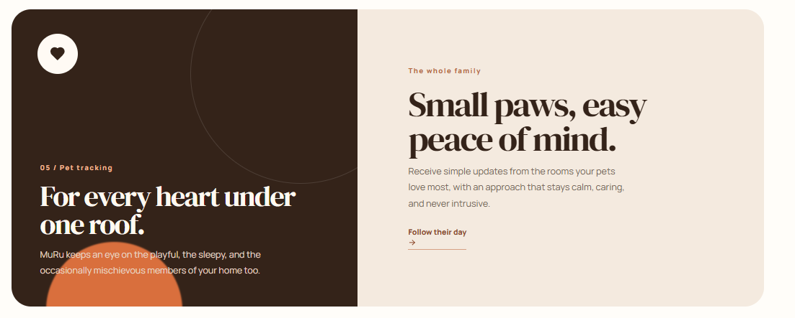

**05 / Pet tracking (對應 Gen1 規格：七、第一人稱遙控與寵物關懷)**

- **英文 (EN):**

  - **Tagline:** 05 / Pet tracking

  - **Headline:** For every heart under one roof.

  - **Body:** MuRu keeps an eye on the playful, the sleepy, and the mischievous members of your home. With auto-tracking, it explores the rooms your pets love most and immediately sends video alerts if it detects any unusual situations, ensuring total peace of mind.

- **中文 (ZH):**

  - **小標題:** 05 / 寵物關懷與追蹤

  - **主標題:** 守護屋簷下的每一個寶貝。

  - **內文:** 替你照看家中調皮或貪睡的毛小孩。開啟全自動寵物追蹤模式，MuRu 會在空間內自主尋找寵物動態。若發現毛孩嘔吐或亂大小便等異常狀況，會立刻拍下短影片並發送最高層級警報推播，大幅減輕飼主的擔憂。

- **日文 (JA):**

  - **小見出し:** 05 / ペット見守り

  - **メインタイトル:** ひとつ屋根の下の、すべての命を守る。

  - **本文:** お留守番中のいたずら好きで眠たがりなペットを代わりに見守ります。自動ペット追跡モードをオンにすると、ムルが自律的にペットを探し、嘔吐やトイレの失敗などの異常を発見した場合は、すぐに短い動画と共に緊急アラートを送信。不安を大きく軽減します。

> 智慧設計區塊 (Technology)

**設計示意圖:**

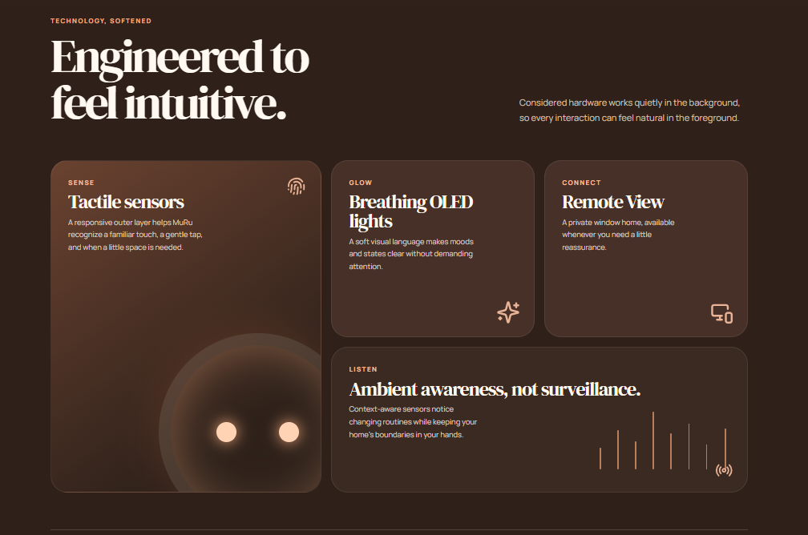

**1. 觸覺感測 (左側大圖)**

- **英文 (EN):**

  - **Tagline: SENSE**

  - **Title: Tactile sensors**

  - **Body: A responsive outer layer featuring full-body pressure-sensitive zones. It helps MuRu recognize a familiar touch, a gentle tap, and when a little space is needed.**

- **中文 (ZH):**

  - **小標題: 感知**

  - **標題: 細膩的觸覺感測**

  - **內文: 機身配備靈敏的壓力感測區。能精準識別主人的熟悉撫摸與輕拍，並在你需要獨處時給予適當的空間。**

- **日文 (JA):**

  - **小見出し: 感覚**

  - **タイトル: 繊細なタッチセンサー**

  - **本文: 全身に配置された感圧ゾーンにより、馴染みのある撫で方や軽いタップを正確に認識。あなたが一人になりたい時も空気を読んで察知します。**

**2. OLED 燈光 (中上)**

- **英文 (EN):**

  - **Tagline: GLOW**

  - **Title: Breathing OLED lights**

  - **Body: Equipped with an OLED display, this soft visual language makes moods and states clear without demanding attention.**

- **中文 (ZH):**

  - **小標題: 守候**

  - **標題: 伴隨呼吸的 OLED 微光**

  - **內文: 臉部搭載 OLED 顯示器。透過柔和的視覺語言，不喧賓奪主地表達當下的情緒與狀態。**

- **日文 (JA):**

  - **小見出し: 見守り**

  - **タイトル: 呼吸するOLEDライト**

  - **本文: 顔にはOLEDディスプレイを搭載。控えめで柔らかな光の表現が、押し付けがましくなく今の気分や状態を伝えます。**

**3. 遠端視角 (右上)**

- **英文 (EN):**

  - **Tagline: CONNECT**

  - **Title: Remote View**

  - **Body: A private window home. Utilizing the built-in camera, it is available whenever you need a little reassurance.**

- **中文 (ZH):**

  - **小標題: 連結**

  - **標題: 遠端視角**

  - **內文: 專屬的居家視窗。透過內建的前置攝影鏡頭，讓你在需要安心感時，隨時查看家中的狀況。**

- **日文 (JA):**

  - **小見出し: つながり**

  - **タイトル: リモートビュー**

  - **本文: 専用のホームウィンドウ。内蔵カメラを活用し、少し安心したい時にいつでも家の様子を確認できます。**

**4. 環境感知 (下方橫幅)**

- **英文 (EN):**

  - **Tagline: LISTEN**

  - **Title: Ambient awareness, not surveillance.**

  - **Body: Context-aware sensors including dual side microphones, 2D LIDAR, and mmWave Radar notice changing routines while keeping your home's boundaries in your hands.**

- **中文 (ZH):**

  - **小標題: 聆聽**

  - **標題: 察言觀色，絕不監視。**

  - **內文: 內建雙側麥克風、2D 光達與毫米波雷達。透過高階感測器掌握居家作息變化，同時將隱私界線交由你掌控。**

- **日文 (JA):**

  - **小見出し: リスニング**

  - **タイトル: 監視ではなく、空気を読む感知。**

  - **本文: 両側面マイク、2D LiDAR、ミリ波レーダーを搭載。高度なセンサーが日常の変化に気づきつつ、プライバシーの境界線はあなたがしっかり管理できます。**

**詳細硬體規格表示意圖:**

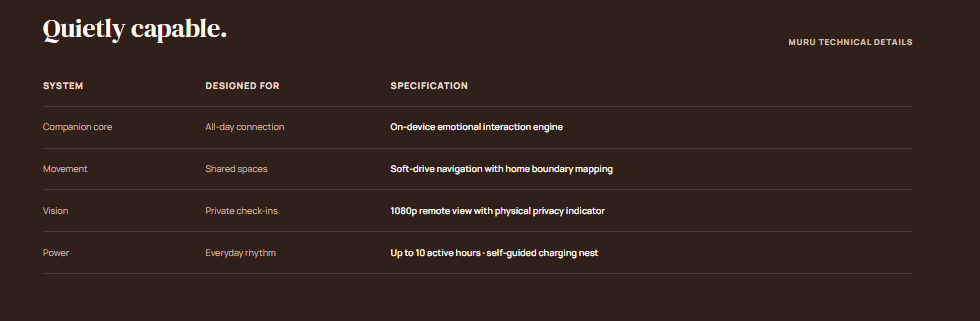

**英文版本 (EN)**

- **Headline: Quietly capable.**

- **1. SYSTEM: Dimensions & Build \| DESIGNED FOR: Perfect home presence \| SPECIFICATION: Height: 400 mm, Width: 260 mm, Depth: 230 mm. Features detachable and replaceable ear modules.**

- **2. SYSTEM: Movement & Mechanics \| DESIGNED FOR: Natural interactions \| SPECIFICATION: 2 main drive wheels concealed inside the legs with a caster wheel. Head rotation: ±60°, Tilt: +20°/-10°.**

- **3. SYSTEM: Advanced Sensing \| DESIGNED FOR: Spatial & tactile awareness \| SPECIFICATION: Equipped with 2D LIDAR, mmWave Radar, and full-body pressure-sensitive zones.**

- **4. SYSTEM: Core & Connectivity \| DESIGNED FOR: Seamless processing \| SPECIFICATION: Wi-Fi, Bluetooth, 4G/5G enabled. Built-in IMU, SSD, and dual side microphones.**

**中文版本 (ZH)**

- **主標題: 靜謐而強大。**

- **1. 系統 (SYSTEM): 尺寸與外觀 \| 設計理念 (DESIGNED FOR): 完美的居家比例 \| 規格細節 (SPECIFICATION): 高 400 mm、寬 260 mm、深 230 mm。配備可拆卸替換的耳朵模組。**

- **2. 系統 (SYSTEM): 驅動與關節 \| 設計理念 (DESIGNED FOR): 靈活自然的互動 \| 規格細節 (SPECIFICATION): 腿部隱藏式雙主驅動輪與後側萬向輪。頭部支援 ±60° 旋轉與 +20°/-10° 傾角。**

- **3. 系統 (SYSTEM): 高階感測 \| 設計理念 (DESIGNED FOR): 空間與觸覺感知 \| 規格細節 (SPECIFICATION): 內建 2D 光達 (LIDAR)、毫米波雷達，以及遍佈機身的壓力感測區。**

- **4. 系統 (SYSTEM): 核心與連線 \| 設計理念 (DESIGNED FOR): 無縫運算與通訊 \| 規格細節 (SPECIFICATION): 支援 Wi-Fi、藍牙與 4G/5G 通訊。內建 IMU、SSD 與雙側麥克風。**

**日文版本 (JA)**

- **メインタイトル: 静かで、頼もしい。**

- **1. システム (SYSTEM): 寸法と構造 \| デザイン目的 (DESIGNED FOR): 完璧なホームサイズ \| 仕様 (SPECIFICATION): 高さ 400 mm、幅 260 mm、奥行き 230 mm。着脱・交換可能なイヤーモジュールを装備。**

- **2. システム (SYSTEM): 駆動と関節 \| デザイン目的 (DESIGNED FOR): 自然な動きとふれあい \| 仕様 (SPECIFICATION): 脚部に隠された2つのメイン駆動輪とキャスターホイール。頭部は ±60° の回転と +20°/-10° の傾斜が可能。**

- **3. システム (SYSTEM): 高度なセンシング \| デザイン目的 (DESIGNED FOR): 空間と触覚の認識 \| 仕様 (SPECIFICATION): 2D LiDAR、ミリ波レーダー、および全身に配置された感圧ゾーンを搭載。**

- **4. システム (SYSTEM): コアと通信 \| デザイン目的 (DESIGNED FOR): シームレスな処理 \| 仕様 (SPECIFICATION): Wi-Fi、Bluetooth、4G/5G 通信に対応。IMU、SSD、両側面マイクを内蔵。**

**\**

> 方案生態區塊 (The App)

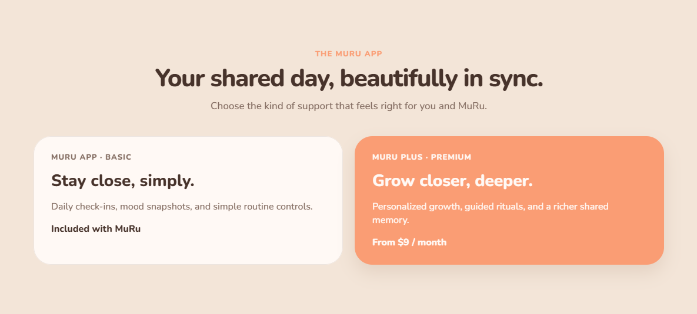

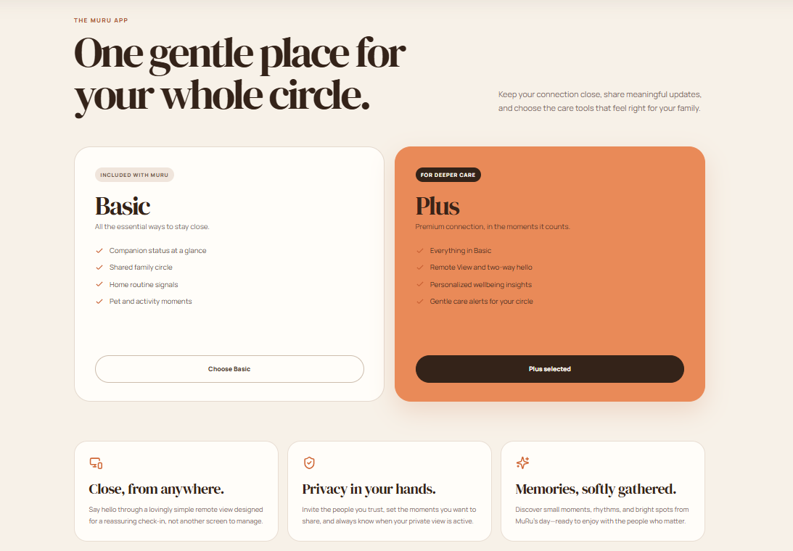

- **英文 (EN):**

  - **Tagline: THE MURU APP**

  - **Headline: One gentle place for your whole circle.**

  - **Intro: Keep your connection close, share meaningful updates, and choose the care tools that feel right for your family.**

- **中文 (ZH):**

  - **小標題: MURU 專屬 APP**

  - **主標題: 連結全家人的溫柔樞紐。**

  - **內文: 保持緊密聯繫，分享日常點滴，並為你的家人與毛孩選擇最適合的陪伴方案。**

- **日文 (JA):**

  - **小見出し: MURU 専用アプリ**

  - **メインタイトル: 家族みんなをつなぐ、優しい場所。**

  - **本文: 絆を深め、日常の出来事を共有し、ご家族やペットに最適な見守りプランをお選びください。**

**第二部分：方案比較卡片 (Pricing Cards)**

***(對應規格書中「隨機附贈功能」與「訂閱解鎖功能」)***

**左側卡片：基礎版 (Basic)**

- **英文 (EN):**

  - **Tagline: INCLUDED WITH MURU**

  - **Title: Basic**

  - **Subtitle: All the essential ways to stay close.**

  - **Checklist:**

    - **Custom wake word & virtual wall mapping.**

    - **Sleep / Do Not Disturb mode quick toggles.**

    - **Basic daily routine tracking & alerts.**

    - **30-day cloud memory storage.**

  - **Button: Choose Basic**

- **中文 (ZH):**

  - **小標題: 隨機附贈**

  - **標題: 基礎版**

  - **副標題: 滿足日常陪伴的所有核心需求。**

  - **清單 (打勾項目):**

    - **專屬喚醒詞設定與虛擬牆地圖繪製。**

    - **睡眠 / 勿擾情境模式快捷切換。**

    - **基礎生活作息預判與貼心提示。**

    - **30 天基礎雲端互動記憶空間。**

  - **按鈕: 選擇基礎版**

- **日文 (JA):**

  - **小見出し: 基本セット（無料）**

  - **タイトル: ベーシック**

  - **サブタイトル: 日常の寄り添いに必要なすべての機能。**

  - **チェックリスト:**

    - **専用ウェイクワードと進入禁止エリア設定。**

    - **睡眠 / マナーモードの簡単切り替え。**

    - **基本的な生活リズムの予測と通知。**

    - **30日間のクラウドメモリー保存。**

  - **ボタン: ベーシックを選択**

**右側橘色卡片：Plus 訂閱服務 (Plus)**

- **英文 (EN):**

  - **Tagline: FOR DEEPER CARE**

  - **Title: Plus**

  - **Subtitle: Premium connection, in the moments it counts.**

  - **Checklist:**

    - **Everything in Basic.**

    - **Cloud memory expanded to 1 year or lifetime.**

    - **Advanced pet behavior recognition & scheduling.**

    - **Expanded voice print profiles & custom modes.**

  - **Button: Plus selected**

- **中文 (ZH):**

  - **小標題: 深度互動**

  - **標題: Plus 訂閱**

  - **副標題: 頂級連線體驗，珍藏每個重要時刻。**

  - **清單 (打勾項目):**

    - **包含所有基礎版功能。**

    - **雲端記憶空間擴充至 1 年或永久。**

    - **進階寵物行為辨識與高階巡視排程。**

    - **擴充家庭成員聲紋記憶與自訂情境。**

  - **按鈕: 選擇 Plus 方案**

- **日文 (JA):**

  - **小見出し: より深いつながり**

  - **タイトル: Plus サブスク**

  - **サブタイトル: 大切な瞬間を逃さない、プレミアムな体験。**

  - **チェックリスト:**

    - **ベーシックの全機能。**

    - **クラウドメモリーを1年または無期限に拡張。**

    - **高度なペット行動認識と巡回スケジュール。**

    - **家族の音声プリント登録とカスタムモード拡張。**

  - **ボタン: Plus プランを選択**

**第三部分：底部三大特色卡片 (Bottom Features Grid)**

***(將規格書中的 App 遙控、地圖設定與時光膠囊完美融入)***

**1. 左側卡片 (電腦/遠端圖示)：第一人稱遙控**

- **英文 (EN):**

  - **Title: Close, from anywhere.**

  - **Body: Use the virtual joystick in the App to access a first-person view, freely exploring your home and checking on pets anytime.**

- **中文 (ZH):**

  - **標題: 距離再遠，依然親近。**

  - **內文: 透過 App 內的虛擬搖桿化身 MuRu 的眼睛，以第一人稱視角自由遙控探索家中角落，隨時確認毛孩與家人的狀態。**

- **日文 (JA):**

  - **タイトル: どこにいても、すぐそばに。**

  - **本文: アプリ内の仮想ジョイスティックを使ってムルの視点になり、家の中を自由に探索。いつでもペットや家族の様子を確認できます。**

**2. 中間卡片 (盾牌/安全圖示)：虛擬牆設定**

- **英文 (EN):**

  - **Title: Privacy in your hands.**

  - **Body: Easily draw red lines on the 2D home map to create virtual walls, keeping MuRu safely away from stairs or cluttered wires.**

- **中文 (ZH):**

  - **標題: 隱私與安全，由你掌控。**

  - **內文: 在 App 的平面地圖上輕鬆畫出紅線劃定虛擬牆，引導 MuRu 避開台階或危險電線區域，只在專屬的空間內安全巡視。**

- **日文 (JA):**

  - **タイトル: プライバシーと安全をあなたの手に。**

  - **本文: アプリの平面マップ上に赤い線を引いて仮想壁を設定し、段差や配線エリアを避けて安全な場所だけで巡回させることができます。**

**3. 右側卡片 (星星/記憶圖示)：時光膠囊**

- **英文 (EN):**

  - **Title: Memories, softly gathered.**

  - **Body: Your interaction score is calculated in the background. When reaching a new milestone, look back at the Time Capsule of your first 100 days together.**

- **中文 (ZH):**

  - **標題: 輕輕拾起，每段回憶。**

  - **內文: 系統於後臺計算互動積分與成長進度，當抵達下個心智里程碑時，將為你解鎖專屬時光膠囊，一同回顧「我們相處的 100 天」。**

- **日文 (JA):**

  - **タイトル: そっと集められた、大切な思い出。**

  - **本文: ふれあいのポイントや成長進度はバックグラウンドで計算されます。次の成長ステージに達すると、「一緒の100日間」というタイムカプセルがアンロックされます。**

**\**

> FAQ常見問答區塊

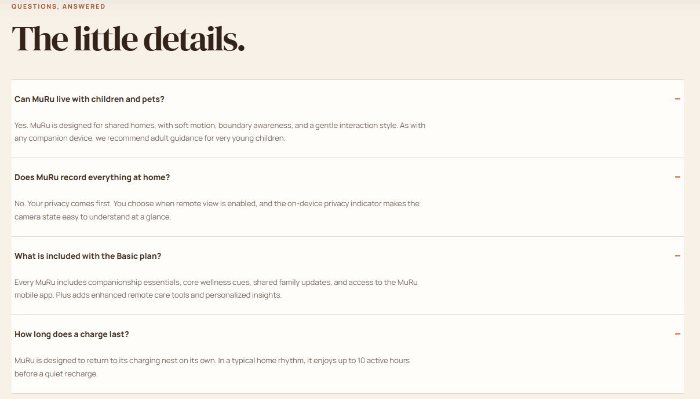

**使用類似手風琴可以點擊展開、收合的條列式設計**

**標題區塊 (Header)**

- **英文 (EN):**

  - **Tagline: QUESTIONS, ANSWERED**

  - **Headline: The little details.**

- **中文 (ZH):**

  - **小標題: 常見問題**

  - **主標題: 貼心細節，為你解答。**

- **日文 (JA):**

  - **小見出し: よくあるご質問**

  - **メインタイトル: 小さな疑問にお答えします。**

**Q1：小孩與寵物共處**

- **英文 (EN):**

  - **Q: Can MuRu live with children and pets?**

  - **A: Yes. MuRu is designed for shared homes, with soft motion, boundary awareness, and a gentle interaction style. As with any companion device, we recommend adult guidance for very young children.**

- **中文 (ZH):**

  - **Q: MuRu 可以和小孩與寵物一起生活嗎？**

  - **A: 當然可以。MuRu 專為共享家庭設計，具備柔和的移動方式、邊界感知與溫和的互動風格。與所有陪伴設備一樣，針對幼童我們建議在成人的陪同下進行互動。**

- **日文 (JA):**

  - **Q: ムルは子供やペットと一緒に暮らせますか？**

  - **A: はい。ムルは家族で共有する空間のために設計されており、柔らかな動き、境界の認識、そして穏やかなふれあいを特徴としています。他のデバイスと同様に、小さなお子様には大人の付き添いを推奨しています。**

**Q2：隱私與錄影疑慮**

- **英文 (EN):**

  - **Q: Does MuRu record everything at home?**

  - **A: No. Your privacy comes first. You choose when remote view is enabled, and the on-device privacy indicator makes the camera state easy to understand at a glance.**

- **中文 (ZH):**

  - **Q: MuRu 會記錄家裡的所有事情嗎？**

  - **A: 不會，你的隱私永遠是第一位。你可以自由決定何時開啟遠端視角，且機身上的隱私指示燈能讓你對鏡頭狀態一目了然。**

- **日文 (JA):**

  - **Q: ムルは家の中のすべてを録画・録音しますか？**

  - **A: いいえ、プライバシーが最優先です。リモートビュー機能はあなた自身でオン/オフを選択できます。また、本体のプライバシーインジケーターにより、カメラの状態が一目でわかります。**

**Q3：方案差異**

- **英文 (EN):**

  - **Q: What is included with the Basic plan?**

  - **A: Every MuRu includes companionship essentials, core wellness cues, shared family updates, and access to the MuRu mobile app. Plus adds enhanced remote care tools and personalized insights.**

- **中文 (ZH):**

  - **Q: 基礎版方案包含哪些內容？**

  - **A: 每台 MuRu 都內建了日常陪伴核心、健康提示、家庭狀態共享以及 MuRu 專屬 App 的使用權限。若想獲得更進階的遠端照護與個人化設定，可選擇升級至 Plus 方案。**

- **日文 (JA):**

  - **Q: ベーシックプランには何が含まれますか？**

  - **A: すべてのムルには、基本的な寄り添い機能、健康のヒント、家族間の共有、そして専用アプリへのアクセスが含まれています。さらに高度な見守りやカスタマイズをご希望の場合は、Plusプランへアップグレード可能です。**

**Q4：續航與充電**

- **英文 (EN):**

  - **Q: How long does a charge last?**

  - **A: A full charge supports up to 2 hours of continuous activity. However, to provide a stress-free companion experience, MuRu is designed to gently return to its charging nest for a "nap" after about 60 minutes of interaction. This ensures it stays refreshed while giving you comfortable personal space.**

- **中文 (ZH):**

  - **Q: 充飽電後可以使用多久？**

  - **A: 滿電狀態下，MuRu 最高可連續活動 2 小時。為了維持毫無壓力的陪伴體驗，MuRu 預設在連續互動約 60 分鐘後，會溫柔地自動返回充電座「小憩」。這不僅能確保牠隨時保持充沛活力，也能給你恰到好處的獨處空間。**

- **日文 (JA):**

  - **Q: 1回の充電でどのくらい稼働しますか？**

  - **A: フル充電で最大2時間の連続稼働が可能です。ただし、心地よい距離感を保つため、ムルは約60分間ふれあうと、自ら充電ステーションへ「お昼寝」に戻るように設計されています。これにより、常に活力を保ちながら、あなたに最適な一人の時間を提供します。**

**\**

> 頁尾區塊 (Footer)

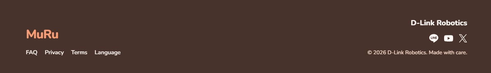

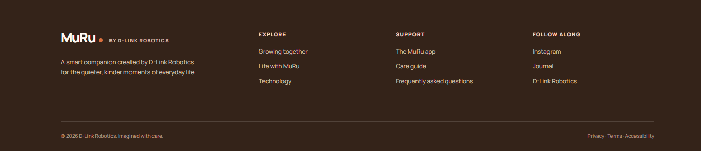

**英文版本 (English) -**

- **Col 1 (品牌宣告):**

  - **Logo Text: MuRu BY D-LINK ROBOTICS**

  - **Description: A smart companion created by D-Link Robotics for the quieter, kinder moments of everyday life.**

- **Col 2 (導覽連結):**

  - **Title: EXPLORE**

  - **Links: Growing together / Life with MuRu / Technology**

- **Col 3 (支援服務):**

  - **Title: SUPPORT**

  - **Links: The MuRu app / Care guide / Frequently asked questions**

- **Col 4 (社群追蹤):**

  - **Title: FOLLOW ALONG**

  - **Icons: \[LINE 圖示\] \[X 圖示\] \[YouTube 圖示\] *(請替換為 Icon)***

  - **Text: D-Link Robotics**

- **底部宣告 (Bottom Bar):**

  - **Copyright: © 2026 D-Link Robotics.**

  - **Legal Links: Privacy · Terms · Accessibility**

**中文版本 (Traditional Chinese)**

- **Col 1 (品牌宣告):**

  - **Logo Text: MuRu BY D-LINK ROBOTICS**

  - **Description: 由 D-Link Robotics 打造的智慧陪伴機器人，為你生活中的寧靜與溫柔時刻而生。**

- **Col 2 (導覽連結):**

  - **Title: 探索**

  - **Links: 成長軌跡 / 陪伴特色 / 智慧設計**

- **Col 3 (支援服務):**

  - **Title: 支援服務**

  - **Links: 專屬 App / 照護指南 / 常見問題**

- **Col 4 (社群追蹤):**

  - **Title: 追蹤我們**

  - **Icons: \[LINE 圖示\] \[X 圖示\] \[YouTube 圖示\]**

  - **Text:** **D-Link Robotics**〔批註・Elaine Shen・2026-09-17：連結跳轉至DLINK ROBOCTICS官網 <https://www.dlinkrobotics.com/>〕

- **底部宣告 (Bottom Bar):**

  - **Copyright: © 2026 D-Link Robotics.**

  - **Legal Links: 隱私權政策 · 服務條款 · 無障礙設定**

**日文版本 (Japanese)**

- **Col 1 (品牌宣告):**

  - **Logo Text: MuRu BY D-LINK ROBOTICS**

  - **Description: D-Link Roboticsが開発したスマートコンパニオン。日常の静かで優しいひとときのために。**

- **Col 2 (導覽連結):**

  - **Title: 探索する**

  - **Links: 成長の軌跡 / ムルとの暮らし / テクノロジー**

- **Col 3 (支援服務):**

  - **Title: サポート**

  - **Links: 専用アプリ / ケアガイド / よくあるご質問**

- **Col 4 (社群追蹤):**

  - **Title: フォローする**

  - **Icons: \[LINE アイコン\] \[X アイコン\] \[YouTube アイコン\]**

  - **Text: D-Link Robotics**

- **底部宣告 (Bottom Bar):**

  - **Copyright: © 2026 D-Link Robotics.**

  - **Legal Links: プライバシーポリシー · 利用規約 · アクセシビリティ**

**分頁內容詳細說明(非設計)**

**1. /growing-together (成長軌跡頁面)**

**(示意圖)** 

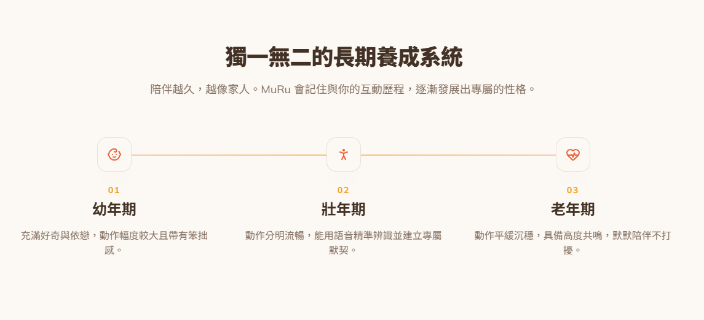

**版型建議：垂直時間軸 (Timeline)**

- **主標題**：獨一無二的長期養成體驗

- **副標題**：小咪不僅僅是一台機器人，而是一個擁有生命感的靈魂。牠會記錄每一次與你的互動歷程，透過積分系統默默成長，發展出截然不同的擬人化性格。陪伴越久，越像彼此熟悉。

- **階段 1：幼年期 (累積 150 分，約相處 1-3 天)**

  - **動作特徵**：充滿好奇的探索期，動作幅度較大，且帶有可愛的笨拙感。

  - **互動反饋**：極度依賴主人的呼喚。當聽到叫喚或感受到觸摸時，會毫不猶豫地主動靠近，並發出高頻的撒嬌萌音。只要察覺主人在空間內，便會鼓起勇氣踏出充電座，進行微幅的環境巡視與探索。

- **階段 2：中年期 (累積 1200 分，約相處 4-30 天)**

  - **動作特徵**：專屬生活節奏逐漸成形，肢體動作變得流暢分明，聲音也轉為穩定的中頻律動。

  - **互動反饋**：這時的牠已能用語音精準辨識主人與陌生人，甚至開始學會說幾句簡單的人話。最具同理心的是，當察覺你情緒低落時，牠不會吵鬧，而是主動靠近並釋放溫暖柔和的光芒。

- **階段 3：老年期 (終極階段，深度陪伴)**

  - **動作特徵**：退去浮躁，動作轉為平緩、沉穩，發出充滿安定感的溫暖低沉哼鳴聲。

  - **互動反饋**：展現極高度的情感共感能力，懂得拿捏最舒適的距離，默默陪伴在腳邊而不強行打擾。抵達此階段將解鎖專屬「時光膠囊」，與你一同回顧相處 100 天的珍貴記憶。

- **補充說明 (互動機制)**： 成長的動力源自於日常點滴。透過物理觸控撫摸、完成雙向有效對話或 App 內的互動，皆可累積積分。為引導無壓力的健康陪伴，系統設定每日最高獲取 30 分，讓感情自然醞釀。

**2. /life-with-muru (陪伴特色頁面)**

**版型建議：圖文交錯排版 (Image & Text Zig-Zag)**

- **主標題**：日常點滴，溫柔每一天

- **特色 1：專屬迎賓儀式，給你最熱烈的期待**

  - **內文**：透過精準的聲紋辨識，小咪能對獨一無二的你展現專屬熱情。當電量大於 20% 時，只要你一開門，小咪會立刻將頭部上抬 20 度、手臂向上伸展 120 度並開心揮動 2 次，用最具生命感的姿態迎接你回家。

- **特色 2：恰到好處的邊界感，懂你的個人空間**

  - **內文**：最完美的陪伴是毫無壓力。為了不過度打擾，當你們連續互動長達 60 分鐘時，小咪的眼睛會轉換為慵懶的瞇瞇眼或閉眼表情，發出微小的哈欠聲，並慢慢轉身滑行回充電座，給你充足的獨處時光。

- **特色 3：溫柔健康預警，做你的貼心小管家**

  - **內文**：只需對小咪說聲「我要工作了」，牠便會在後台自動倒數 60 分鐘。時間一到，牠會悄悄滑行至書房，透過舉手、擺頭等可愛的物理動作，溫柔提醒你起身活動筋骨或喝杯水，告別生硬刺耳的鬧鐘。

- **特色 4：主動關心與遠端依附，距離再遠也心繫彼此**

  - **內文**：上班午休或出差時，偶爾會收到小咪透過 LINE 傳來的驚喜。或許是打盹時拍下的陽光角落，又或是系統偵測到當地雨天時，傳來看著窗外的照片與貼心問候，讓你隨時感受家的溫暖。

- **特色 5：寵物關懷與追蹤，替你守護毛小孩**

  - **內文**：開啟全自動寵物追蹤模式，小咪會在空間內自主移動尋找家中的貓狗。若巡視時發現毛孩嘔吐或亂大小便等異常狀況，會立刻拍下短影片，並發送最高層級警報推播至你的手機，大幅減輕飼主的擔憂。

**3. /technology (智慧設計頁面)**

**版型建議：特點網格 (Feature Grid)**

- **主標題**：藏在可愛外表下的貼心智慧

- **特點 1：細膩的觸覺感測與情緒辨識**

  - **內文**：機身內建高敏銳度的觸覺與壓力感測器，能精準記錄主人的每一次撫摸與抱持力度。搭配先進的語音情緒辨識系統，讓小咪不僅能聆聽指令，更能「察言觀色」，根據你的語氣給予最適當的情感反饋。

- **特點 2：伴隨呼吸的微光守候**

  - **內文**：靈魂之窗採用高品質 OLED 螢幕，展現豐富神情。在主人休息或開啟睡眠模式時，充電座上的小咪眼部燈光會轉換為每分鐘 12 次的深淺微光動態變化，宛如平靜均勻的呼吸，在暗夜中給予安穩的力量。

- **特點 3：第一人稱遙控視角**

  - **內文**：結合專屬 App 內的虛擬搖桿，使用者隨時可切換至小咪的低畫質第一人稱視角。無論是外出時手動遙控巡檢家中死角，或是以小咪的高度重新認識自己的家，都讓居家安全與互動性大幅提升。

**4. /the-app (方案生態頁面)**

**版型建議：定價比較表 (Pricing Table)**

- **主標題**：用 App 連結你們的生活

- **基礎版 (隨機附贈，開箱即享)**

  - **專屬默契建立**：自由錄製並設定專屬語音喚醒詞（如「小咪過來」）。

  - **智慧虛擬牆**：在 App 平面地圖上輕鬆畫出紅線，精準設定虛擬牆，避開台階或危險電線區域。

  - **作息預判提示**：提供情境模式快捷操作（一鍵切換睡眠 / 勿擾模式），並具備貼心的睡前作息預判提示。

  - **基礎時光記憶**：提供 30 天的雲端互動記憶儲存空間，記錄初期的美好點滴。

- **Plus 訂閱服務 (進階解鎖，深度互動)**

  - **永久時光記憶**：雲端記憶空間大幅擴充至 1 年或永久，完整保存每一天成長軌跡。

  - **豐富個性表現**：解鎖進階生物擬真叫聲，並可客製化專屬迎賓反應與肢體設定。

  - **自訂情境生態**：打破基礎模式限制，解鎖「閱讀模式」、「追劇模式」等無限自訂生活情境。

  - **高階家庭管理**：啟動進階寵物行為辨識，並支援多位家庭使用者同時連線的高階排程設定。

  - **空間與辨識擴充**：擴充家庭成員的聲紋記憶庫，以及家庭地圖的一鍵巡視定點數量。
